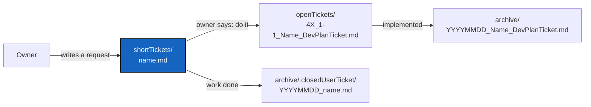

# DevTickets — where CaWaQS's tickets sit, and which branches they name

*Created: 2026-11-22*

*Fills in: ../../../.distant/ticket/TICKETLIFECYCLE.md*

## Abstract — read this first

**The one-line version.** The owner writes a short ticket in
`shortTickets/`; on the owner's word the agent turns it into planning
tickets in `openTickets/`; finished work is stamped and archived. The loop
and every naming rule are
[TICKETLIFECYCLE.md](../../../.distant/ticket/TICKETLIFECYCLE.md) (§6.1 for
the loop). This file says only what is CaWaQS's own.

**What this document is.** The fill-in of the ticket lifecycle: where
`DevTickets/` lives, which branches this project has and the filename prefix
each gives a ticket, and what does not belong here.

**Why it exists.** How CaWaQS is developed is private; the public
repository (`gitlab:cawaqs/cawaqs`) holds no tickets. CaWaQS's planning
started from zero on 2026-11-22, with the `4X` branch: ComplexGitSync's
tickets, which this mount was seeded with, stay on ComplexGitSync's branch
(`ComplexGitSync_CGS-ALPHA`).

**What you will find.** §1 where the tickets sit. §2 the branches and their
prefixes. §3 what does not belong here.

**Who it is for.** The owner, who writes short tickets, and the agent, who
turns them into plans.

**What you need to do with it.** Writing a request: put it in
`shortTickets/`. Acting on one, opening a plan or finishing one: follow
TICKETLIFECYCLE.md, using the branches in §2.

---

## 1. Where the tickets sit

`DevTickets/` is in the `.dev` mount (`.agent/.local/.dev/DevTickets/`),
private and writable.

| Directory | Holds | Written by |
|---|---|---|
| `shortTickets/` | Open requests, in the owner's own words | The owner |
| `openTickets/` | Planning tickets: `<branch>_<priority>-<rank>_<Name>_DevPlanTicket.md` | The agent, on the owner's word |
| `archive/` | Planning tickets whose work has landed, or that were dropped (opening with `> **Dropped — YYYY-MM-DD, owner's decision.** <why>`): `YYYYMMDD_<Name>_DevPlanTicket.md` | The agent, in the commit that finishes the work |
| `archive/.closedUserTicket/` | Short tickets acted on: `YYYYMMDD_<name>.md` | The agent, when the request is satisfied |
| `archive/.deepArchive/` | The immutable copy of each archived ticket, as it was the day it was archived | The agent, in the same change that archives it |
| `dependency/<TOOL>/` | Requests for a tool this project's development depends on (ComplexGitSync is a dependency of the Operating Space only, never of CaWaQS: owner, 2026-11-25), written as generic features of that tool, which its own tickets must carry, written for the owner to assess and transfer. `CGS/` holds ComplexGitSync's, named `<branch>-<YYYYMMDD>_<Name>.md` after the ComplexGitSync line they target (`HT-BETA-20261124_…`), since 2026-11-24 (owner) | The agent, on the owner's word; the owner moves them out |

`DevTickets/` holds nothing else. `dependency/` is this project's addition to
TICKETLIFECYCLE §1: a dependency's tickets live in that dependency's own
planning surface, and a mounted dependency is read-only here, so they wait in
`dependency/` until the owner transfers them. The list of open tickets is the sorted
`openTickets/` directory.

## 2. Branches and ticket prefixes

**`4X` is where CaWaQS's agentic work lands** since 2026-11-22 (owner): the
4.x line, opened from `main` at cawaqs 4.01. `main` stays the published
line: it is reached from `4X` by a merge the owner makes, and no ticket
lands on it directly.

| Workstream | Branch | Ticket filename prefix |
|---|---|---|
| Everything, until the owner opens another workstream | `4X` | `4X_` |

An open ticket is named `<branch>_<priority>-<rank>_<Name>_DevPlanTicket.md`
and carries `*Branch: <branch>*` under its `*Created:*` line
(TICKETLIFECYCLE.md §2.3 and §3). The prefix is always written out.

**The libraries keep the project's name on the branch.** Only the cawaqs root
is on the bare `4X`. The 17 libraries and `scripts` (`src/lib*`,
`src/scripts`) are on `cawaqs_4X` since 2026-11-24, opened at the tip of
their `main` (cgitsync 8.11.1, RootBareBranch), in the development
workspace and in the user install alike.

**The private configuration repositories keep their own branches.** `.dev`,
`.localSpec`, `.claude` and `.omniscience` sit on `cawaqs_4X`, the memory
(`.cgitsync/.memory`) and its `.self-history` on `ComplexGitSync_cawaqs_4X`,
and the shared `DevSpec`, `.ticketing` and `DocSpec` (`.agent/.distant/`) on
`main`. A ticket's branch line names the branch of the project's own
repository, never theirs, nor the libraries'.

## 3. What does not belong here

Specifications and living documents are not tickets (TICKETLIFECYCLE §7).
In this project:

| Belongs in | Not in `DevTickets/` |
|---|---|
| `.agent/.local/.localSpec/AdditionalSpecs.md` | Architecture, libraries, build rules |
| `.agent/.local/.localSpec/audit.md` | Findings and open risks |
| `.agent/.local/.localSpec/AGENT.md` | The agent roles and how they hand off |
| `.agent/.distant/` | The project-agnostic rules |
| `docs/` (public) | The user documentation |
| The public repository | Anything a user of CaWaQS needs |
