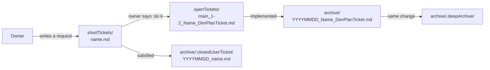

# DevTickets — where GX4G's tickets sit, and which branches they name

*Created: 2026-10-27*

*Fills in: ../../../.distant/ticket/TICKETLIFECYCLE.md*

## Abstract — read this first

**The one-line version.** The owner writes a short ticket in
`shortTickets/`; on the owner's word the agent turns it into a ranked plan
in `openTickets/`; when the work lands, the plan is stamped and moved to
`archive/`, with an immutable copy in `archive/.deepArchive/`. Every rule
is [TICKETLIFECYCLE.md](../../../.distant/ticket/TICKETLIFECYCLE.md). This
file says only what is GX4G's own.

**What you will find.** §1 where the tickets sit. §2 the branches. §3 what
does not belong here.

**Who it is for.** The owner and the agent.

**What you need to do with it.** Writing a request: put it in
`shortTickets/`. Planning, ranking or finishing: follow TICKETLIFECYCLE.md
with the branches in §2.

---

## 1. Where the tickets sit

`DevTickets/` is in the `.dev` mount (`.agent/.local/.dev/DevTickets/`),
branch `gx4g`, private and writable. The public gx4g repository holds no
tickets.

| Directory | Holds | Written by |
|---|---|---|
| `shortTickets/` | Open requests, in the owner's words | The owner |
| `openTickets/` | Planning tickets: `<branch>_<priority>-<rank>_<Name>_DevPlanTicket.md` | The agent, on the owner's word |
| `archive/` | Planning tickets landed or dropped: `YYYYMMDD_<Name>_DevPlanTicket.md` | The agent, in the change that finishes the work |
| `archive/.closedUserTicket/` | Short tickets acted on: `YYYYMMDD_<name>.md` | The agent |
| `archive/.deepArchive/` | The immutable copy of each archived ticket | The agent, in the same change |

GX4G adopted the deep archive from its first archived ticket, 2026-10-27.
The pair rule's record is a section of the ticket itself
([gx4g-dev.md](../gx4g-dev.md), *The pair rule*).

## 2. Branches

`main` is the only branch GX4G's work lands on, so every open ticket is
`main_<priority>-<rank>_<Name>_DevPlanTicket.md` and carries
`*Branch: main*`. A new workstream branch is added here, with its prefix,
in the change that opens its first ticket.

The configuration repositories keep their own branches: `.dev`,
`.localSpec` and `.claude` on `gx4g`; `DevSpec`, `.ticketing` and `DocSpec`
on `main`. A ticket's branch line names the branch of the gx4g repository.

## 3. What does not belong here

| Belongs in | Not in `DevTickets/` |
|---|---|
| `.agent/.local/.localSpec/AdditionalSpecs.md` | Architecture, the gate's rules, the kernel's phases |
| `.agent/.local/.localSpec/audit.md` | Findings and open risks |
| `doc/` and `GX4G.md` in the public repository | The theory and anything a user needs |
| ComplexGitSync's own `.dev`, branch `ComplexGitSync` | Work on ComplexGitSync, even when GX4G asks for it |
