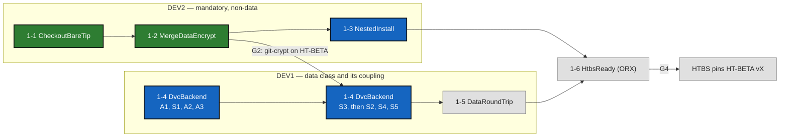

# HTBS Roadmap — how DEV1, DEV2 and ORX bring `HT-BETA` to HydrologicalTwinBetaSeries

*Created: 2026-11-27*

## Abstract — read this first

**What this document is.** The coordination plan between the people working towards one goal: a ComplexGitSync
`HT-BETA` that HydrologicalTwinBetaSeries (HTBS) can pin. It says who holds which ticket, who waits for whom, and
the few working rules that keep two developers on one branch from colliding. It holds no design. Each ticket holds
its own.

**Why it exists.** The owner does not develop the data class and DVC serving. A collaborator does (owner,
2026-11-27). Two developers working in parallel need one place that says where their work meets. The
`data-encrypt` line showed what happens without it: two lines released 8.10.x and 8.11.x for different work, and
the merge has to untangle it.

**What you will find.** §1 the roles. §2 how to read a ticket's name. §3 the tickets, in order, with what each
waits for. §4 the gates where ORX syncs the plan. §5 the files both developers touch. §6 the working rules.
§7 what is still open.

**Who it is for.** DEV1 and DEV2, and ORX, who keeps this file true.

**What you need to do with it.** Find your role's lane in §3. Start the first ticket whose *Waits for* column is
satisfied. Follow §6 at every commit.



**Colors.** Green: archived. Blue: ready, every ticket it waits for is archived, so someone can start it now.
Grey: waiting. Whoever archives a roadmap ticket recolors its node and updates the *Status* column of §3 in the same
change (TICKETLIFECYCLE §8). *As of 2026-11-27: CheckoutBareTip and MergeDataEncrypt are archived, so
NestedInstall (DEV2) and DvcBackend (DEV1) are ready.*

---

## 1. The roles

| Role | Holds | Who |
|---|---|---|
| **ORX** | The sync of the DevPlanTickets towards the goal: ticket reviews, ranks, this roadmap, the gates of §4, archiving, the final check (HtbsReady), and the answers to decisions that change a shared rule (§6) | the owner |
| **DEV1** | The data class and its coupling in ComplexGitSync: everything under DataArchitecture | the collaborator |
| **DEV2** | The other mandatory work for HTBS: branch derivation, the `data-encrypt` merge, nested installs | — |

A role is a lane, not a person. One person can hold two, but each ticket names one.

## 2. How to read a ticket's name

```
openTickets/<branch>_<priority>-<rank>_<ROLE>_<Name>_DevPlanTicket.md
            HT-BETA_1-4_DEV1_DvcBackend_DevPlanTicket.md
```

- `<branch>`, `<priority>` and `<rank>` are TICKETLIFECYCLE §2's: where the work lands, now or stand-by, and the
  position in the pile.
- `<ROLE>` is `ORX`, `DEV1` or `DEV2`. It is TICKETLIFECYCLE §2.4, only for tickets on a roadmap. A ticket without one is on no roadmap.
- **Reading order:** within a role, the rank is the order of work. Between roles, the rank says nothing about
  waiting. The *Waits for* column of §3 does.
- When a ticket is archived, the role goes with the branch and the rank:
  `archive/YYYYMMDD_<Name>_DevPlanTicket.md`.

## 3. The tickets, and who waits for whom

| Ticket | Role | Status | Waits for | Unblocks | Serves HTBS step |
|---|---|---|---|---|---|
| [CheckoutBareTip](../archive/20261127_CheckoutBareTip_DevPlanTicket.md) | DEV2 | done | — (**archived 2026-11-27, cgitsync 8.15.1: gate G1 reached**) | MergeDataEncrypt | every space (stable derived branches) |
| [MergeDataEncrypt](../archive/20261127_MergeDataEncrypt_DevPlanTicket.md) | DEV2 | done | CheckoutBareTip (**archived and committed 2026-11-27, cgitsync 8.16.0: gate G2 reached**) | NestedInstall; DvcBackend S3 and S2's locked hint (G2) | the gate space (encrypted server addresses) |
| [HT-BETA_1-3 NestedInstall](../openTickets/HT-BETA_1-3_DEV2_NestedInstall_DevPlanTicket.md) | DEV2 | ready | MergeDataEncrypt (both edit `orchestre/installer.py`) | HtbsReady | P1, C1, D3 |
| [HT-BETA_1-4 DvcBackend](../openTickets/HT-BETA_1-4_DEV1_DvcBackend_DevPlanTicket.md) | DEV1 | ready | **nothing for A1, S1, A2, A3**: they start now, on 8.14.2's `DataManager`. **G2 for S3**, and for S2's locked-snippet hint (G2 is reached: S3 may start) | DataRoundTrip | G, C1, gate |
| [HT-BETA_1-5 DataRoundTrip](../openTickets/HT-BETA_1-5_DEV1_DataRoundTrip_DevPlanTicket.md) | DEV1 | waiting | DvcBackend archived (G3) | HtbsReady | G, C1, E1 |
| [HT-BETA_1-6 HtbsReady](../openTickets/HT-BETA_1-6_ORX_HtbsReady_DevPlanTicket.md) | ORX | waiting | all five above (G4) | HTBS's pin | all |

**After the goal (pile 2, DEV1, not needed by HTBS):** DataWorkspace, DataPublication, DataAcceptance, under
DataArchitecture. **ORX bookkeeping:** DataSchema and DataBackendContract landed in 8.14.1 and 8.14.2. They wait
only for their records to be archived.

**The two lanes run side by side from day one.** DEV1 has four steps of DvcBackend to do before it needs anything
from DEV2. DEV2's three tickets touch no data file.

## 4. The gates — where ORX syncs the plan

| Gate | When | ORX does |
|---|---|---|
| **G0** | This roadmap is accepted | DEV1 gets access (§6), the §7 points are settled |
| **G1** (reached 2026-11-27) | CheckoutBareTip archived | Confirm a fresh `checkout` of every branch is stable. DEV1 pulls |
| **G2** (reached 2026-11-27, 8.16.0) | MergeDataEncrypt archived | Tell DEV1 that S3 may start. `data-encrypt` is closed (its D4) |
| **G3** | DvcBackend archived | DataRoundTrip may start |
| **G4** | NestedInstall and DataRoundTrip archived | Start HtbsReady |

At each gate ORX re-ranks the piles, updates §3, and commits the change in `.dev` with one message.

## 5. Where the two lanes touch the same files

Most of the work is apart: DEV1 is in `git_repo/data_spec.py`, `tree/data_manager.py` and the new `dvc_backend.py`;
DEV2 in `git_repo/git_branch.py`, `tree/operations/branch.py` and `tree/discovery.py`. Four places are shared, and
whoever lands second adapts:

| File | DEV2 | DEV1 |
|---|---|---|
| `orchestre/installer.py`, end-of-install report | NestedInstall N1 (adopted clone), CheckoutBareTip's report block | DvcBackend S5, DataRoundTrip R3 (data line per repository) |
| `orchestre/reporting.py`, `status` columns | MergeDataEncrypt (`CRYPT`) | DataRoundTrip R1 (`DATA`) |
| `tree/operations/push.py` | MergeDataEncrypt (`EncryptionGuard`) | DataRoundTrip R2 (publish first, beside it) |
| `scripts/ceiling_baseline.json`, `CHANGELOG.md`, the version files | every release | every release |

The last row is the one that collides every time. That is what §6's commit rule is for.

## 6. Working rules on the shared `HT-BETA`

1. **One branch, `HT-BETA`, for both lanes** (owner, 2026-11-27). No developer branch. No later merge to redo.
2. **Pull right before you commit.** `cgitsync pull`, then lint, test and `status`, then commit. A release number
   is taken in commit order, so no number is ever used twice. If `pull` brings the other lane's release, re-run
   `bump-version` on top of it.
3. **Run the tool from `HT-BETA`.** `pixi run cgitsync` runs the root's working tree. Never run it with the root on
   another line (CheckoutBareTip §1).
4. **Each ticket follows the implement orders** of `CLAUDE.md`, in the session of whoever holds it: worker,
   orchestrator, one commit message for every repository the change touches, and no agent ever credited on a
   commit.
5. **Records must reach the shared memory.** After archiving a ticket, `cgitsync push --private` publishes the
   orchestrator's self-history record. Without it, ORX's `check-tickets` cannot see it, and the archive fails the
   gate on ORX's machine.
6. **Decisions.** The *Decisions for the owner* in a ticket are asked of the role that holds it. Any decision that
   changes a rule in `digest.md`, a stored format (`.gts`, State, ledger), the CLI grammar or the branch-naming
   contract is asked of ORX as well.
7. **A new need is a short ticket.** A developer who finds work the roadmap lacks writes it in `shortTickets/`.
   ORX turns it into a plan and updates §3. Only ORX edits this file, except that whoever archives a roadmap ticket
   recolors its node in the graph and sets its *Status* in §3, in the same change.

## 7. Open points for ORX at G0

- **DEV1's access:** write access to `ComplexGitSync` (`HT-BETA`), `DocComplexGitSync`, `.dev`, `.localSpec`
  (`ComplexGitSync_HT-BETA`), `.memory` and `.self-history`, and read access to `.claude` and the `.agent/.distant`
  repositories. All are private except the first two.
- **One memory branch, two workspaces.** Both developers' development trees file their memory on
  `ComplexGitSync_ComplexGitSync_HT-BETA`. Pushes to the memory are fast-forward only, so the second developer to
  push must pull first. ORX decides whether that is enough, or whether DEV1's workspace gets a memory of its own.
- **DEV1's test data:** a DVC remote for tests (a temporary filesystem remote suffices for every ticket) and, for
  HtbsReady only, access to the HTBS VPS by its SSH alias.
