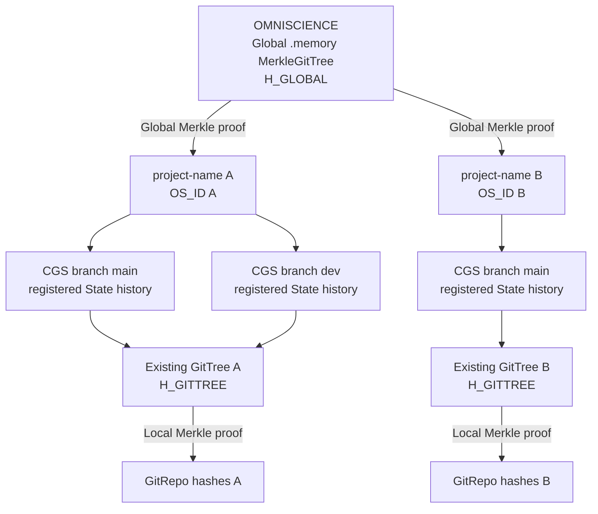
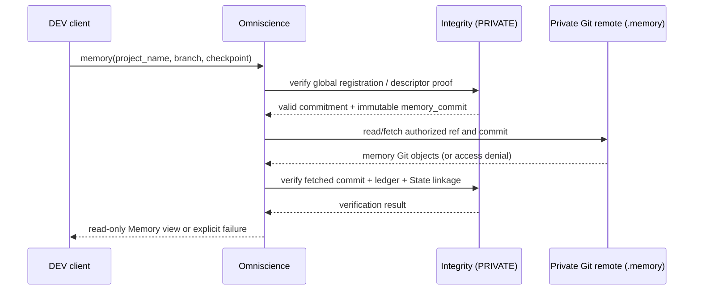

# DevPlanTicket — Omniscience: Global Memory MerkleGitTree

| Field | Value |
|---|---|
| Status | OPEN — owner architectural update, 2026-10-20 |
| Origin | Omniscience ticket created 2026-09-16; branch `memory-dev`; last recorded review 2026-10-08 |
| Priority | Architectural P0 candidate; **do not silently change ticket pile number** (`memory-dev_2-10` at last review). Reconcile through TicketLifecycle. |
| Baseline | ComplexGitSync v6.3.4 (`f609f31`, 2026-10-16); re-verify current HEAD before implementation |
| Scope | ComplexGitSync only — GitTree identity, Merkle proof, global Memory, developer registration |
| Existing contracts | `GitTree`, `GtsIntegrity` schema 1, `.gts`, `.memory`, `MemoryMergeOperation`, `UniversalClock`, `ancestors` |

## 0. Owner update — superseding design

**OMNISCIENCE is the global `.memory` MerkleGitTree of all *registered* ComplexGitSync Operating Spaces, addressable by canonical `project_name`.** It owns the Git-backed global ledger and exposes an authorized, read-only interrogation API. Its logical tree is `project_name / OS_ID → CGS branch → historical State → GitTree → GitRepo`. It records cryptographic commitments **and resolvable CGS GitRepo descriptors for the `.memory` repositories**, not clones or copies of private project repositories and snapshots. Authorized readers must be able to locate and read registered `.memory` GitRepos through the existing Git transport and access controls.

**The existing `GitTree` is the materialized Operating Space.** Do **not** add an `OperatingSpace` lifecycle class or reimplement the GitTree machinery. Add `os_id` as a deterministic primitive derived from the project root's `project_name`.

**`Integrity` and `IntegrityControl` are PRIVATE-ONLY implementation classes.** Their source is **not** split into separate OWNER and DEVELOPER GitRepos; that proposed split is explicitly rejected as unnecessary complexity. `Omniscience` is the public *software API* for authorized read-only queries, not a public Git remote.

Preserve this ticket's earlier owner decisions on content-addressed records, Git-DAG historical integrity, local Memory autonomy, time/causality and the O0 push anchor, subject to the explicit adjustments below. This update **supersedes** the old interpretation of Omniscience as merely a per-project announcement journal.

## 1. Identity and existing CGS mapping

```text
OS_ID := SHA256(UTF8(canonical(project_name)))
OperatingSpace := existing GitTree identified by OS_ID
```

- Compute `GitTree.os_id` from the canonical **root-project** name; do not accidentally hash a child `GitRepo.project_name` or a workstation path. Verify actual project-name resolution paths in `GitTree`, `WorkingGitTree`, `RegistryTranslator`, bootstrap, initialise and release load.
- Define and freeze name canonicalization (UTF-8, Unicode normalization, case, allowed whitespace); never silently normalize two distinct accepted names into one. This is a globally unique identity name within Omniscience; reject an unauthorized conflicting claim. A project rename is a new identity unless a later identity-migration contract explicitly relates the two.
- `os_id` is not a mutable State hash, and **not the Merkle root**. Branch switching, relocation, Memory reboot, bootstrap and release load preserve OS identity when `project_name` is unchanged.
- Preserve schema-1 `.gts` hashes; do not add `os_id` to the existing `H_STATE` preimage. Resolve OS identity from metadata already persisted in `.cgs` / `.gts`; test old releases.
- Reuse existing `MemoryRepository.branch(project_name, project_branch)` mapping, project and `P_branch` conventions, and `ancestors` preservation after branch close/delete. A branch ref is a location, **not** a permanent identity. Keep concurrent heads distinct.

## 2. Repository classification and physical storage

| Object | CGS type | Underlying GitRepo | Access/authority |
|---|---|---|---|
| Local workspace `.cgitsync/.memory` | `PRIVATE LOCAL` | PRIVATE GitRepo, existing shared `.memory` with project branches | Local writer; owner-approved replication |
| Omniscience mounted by an ordinary developer for inspection | `PRIVATE DISTANT` | **PRIVATE** `github:flipoyo/omniscience` at `.omniscience` (existing proposed name/mount) | Authorized read-only |
| Omniscience authorized contributor working copy | `PRIVATE LOCAL` / existing `private=true, writable=true` | **Same PRIVATE GitRepo** | Remote write right expressly granted by provider policy |
| Universal-time reference, if configured | `PRIVATE DISTANT` | PRIVATE, read-only | Independently managed clock reference |

`PRIVATE DISTANT` does not mean publicly accessible. A public `Omniscience` method must not expose an inaccessible private record. Maintain the existing USER/DEV rule: USER trees have no private repos and do not contribute; authorized DEV contexts contribute. No new source repositories or special Git credentials inside CGS.

Keep **one** physical `omniscience` GitRepo shared by projects; preserve its project-specific branches. Add a distinguished global checkpoint/index branch or equivalent authenticated aggregate to derive **one H_GLOBAL across all registered project branches**. The index must reference immutable project-branch State commitments **and authenticated `.memory` GitRepo descriptors**, **not** recursively clone project repos or fold local ledger files. A registry reference must be resolvable to an authorized read-only Git operation; absence of access is reported, not interpreted as corruption. Avoid self-referential hashing of an in-progress global checkpoint.

## 3. MerkleGitTree and Integrity contract

Reuse existing schema-1 `GtsIntegrity` hashes unchanged:

```text
H_REPO → H_GITTREE → H_STATE
```

Add a versioned domain-separated OS commitment and a global authenticated tree:

```text
OS_ID       = SHA256(UTF8(canonical(project_name)))
H_OS_STATE  = hash_v1(OS_ID, branch reference, H_STATE, H_GITTREE,
                    local memory tip, immutable state/commit references)
H_GLOBAL    = MerkleRoot_v1(ordered, unique global registration leaves)
```

The global index key must identify a specific registered branch head / immutable state commitment; grouping by `OS_ID` alone would overwrite branches or histories. Define ordering, duplicate behavior, leaf preimage, domain separation, empty-tree behavior and proof encoding as a **new global schema**; do not reinterpret `integrity_schema = 1`.

Implement **Merkle inclusion proof generation and verification** for the existing `GtsIntegrity` tree decomposition (RFC 6962-style, current CGS domain tags). Schema-1 roots and golden vectors must remain byte-for-byte identical. Proofs bind leaf index, tree size, ordered siblings, schema/domain and a specific trusted root/checkpoint.

An inclusion proof establishes membership in a **particular committed root**, not that the currently checked-out GitRepo matches that commitment. Divergence localization compares trusted and observed authenticated hashes: global → project/branch/State → repo. If private repo evidence is unavailable, report diagnosis unavailable rather than claiming corruption.



## 3a. Readable `.memory` GitRepo resolution — mandatory contract

**A `.memory` is a materialized GitRepo, not an abstract hash.** Every CGS GitRepo is characterized by its existing repository arguments (provider/repository identity, relative mount path, declared and resolved refs, target/fallback branches and relevant repository metadata). Omniscience MUST retain enough of this identity and addressing information to **resolve and read the actual registered `.memory` repository**. A hash alone is insufficient.

For each registered Operating Space branch, store a versioned **MemoryRepoDescriptor**, derived from the existing CGS repository model (do not create a competing GitRepo model):

- `os_id`, `project_name`, `project_branch` — logical lookup key.
- `memory_repository` — canonical CGS repository identifier, e.g. `github:<owner>/.memory`; include provider and repository name, not credentials.
- `memory_mount` — logical mount, normally `.cgitsync/.memory`, for reconstruction context; do not store absolute workstation paths.
- `memory_ref` — full Git ref of the corresponding project Memory branch, per `MemoryRepository.branch()`.
- `memory_commit` — **immutable Git commit SHA** whose tree contains the announced memory snapshot; this, not the mutable branch tip, defines the historical read.
- `local_ledger_tip`, `state_id`, `gittree_root` — verified commitments; link registration to State and local ledger.
- Optional `remote_locator` — provider-resolvable repository address when the canonical identifier alone is insufficient; never embed tokens, private filesystem locations or credentials.

Separate **descriptor/addressing fields** from the **frozen canonical registration preimage**. Mutable remote URL aliases, credentials or access status must not affect the historical Merkle hash. The IT agent must select and freeze a minimal canonical descriptor schema before implementation; reuse already supported CGS repository arguments rather than hash all transient `WorkingRepo` properties.

Required authorized read flow:



The read interface must support resolving a Memory repository, listing its recorded States and reading its ledger at a registered commit **without mutating either the source `.memory` or OMNISCIENCE**. Use existing `git_runner.py`, `MemoryRepository`, `MemoryStates` and `LedgerStore` interfaces; do not parse Git internals in Omniscience. A temporary/cache clone is an implementation detail allowed for authorized reads, not centralized ownership of the local repository.

Outcomes must distinguish `not_registered`, `unauthorized`, `remote_unavailable`, `commit_unreachable`, `invalid_proof`, `ledger_corrupt` and `verified`. Mutable remote ref movement after registration is not evidence that the historical commit is corrupted; check commit reachability separately. Authorization is enforced by the provider; the public interrogation API does not make private `.memory` public.

## 3b. GitRepo disappearance and lifecycle integrity — mandatory P0 contract

**A registered GitRepo may subsequently be closed, deleted, destroyed, made private/inaccessible, or become temporarily unreachable. OMNISCIENCE MUST retain its historical registration and report its current availability and evidenced lifecycle status. A missing GitRepo is material project-integrity information, not a reason to erase its leaf.** This applies to every registered project GitRepo and to `.memory` GitRepos, including those of closed branches.

Keep three independent dimensions; do not conflate them:

1. **Recorded state and proof:** the historical `repo_hash`, expected commit/ref, `H_GITTREE`, State and global checkpoint remain immutable. A valid Merkle proof remains valid for that historical commitment, even if its underlying GitRepo is now unavailable.
2. **Declared lifecycle:** reuse CGS's existing lifecycle/branch-close records and `ancestors` relocations. `CLOSED` is an authenticated explicit transition, **not** inferred from a failed fetch. Branch closure is distinct from repository deletion.
3. **Observed accessibility/existence:** independently probe the canonical GitRepo descriptor and immutable commit. Record `AVAILABLE`, `ACCESS_DENIED`, `UNREACHABLE`, `NOT_FOUND`, `COMMIT_MISSING`, or `UNKNOWN`, with observation time, method and evidence. A 404 from a private forge or network failure does **not** prove deletion; mark **`DELETION_CONFIRMED` only on authoritative authenticated evidence** (e.g., owner/provider deletion event), otherwise report `NOT_FOUND` or `UNREACHABLE`. `DESTROYED` is reserved for separately documented loss of authoritative objects, not a synonym for an inaccessible remote.

**Integrity finding taxonomy (new, typed; names subject to alignment with existing `Finding`):**

```text
REPO_CLOSED             declared closure (informational unless policy requires availability)
REPO_NOT_FOUND          repository could not be resolved (deletion unconfirmed)
REPO_DELETION_CONFIRMED authenticated provider/owner deletion evidence
REPO_UNREACHABLE        remote or network temporarily unavailable
REPO_ACCESS_DENIED      caller lacks permission; no deletion inference
REPO_COMMIT_MISSING     remote readable but registered immutable commit unavailable
MEMORY_REPO_UNAVAILABLE registered .memory repository cannot be read
REPO_CONTENT_MISMATCH   independently observed content contradicts committed state
```

The repository's **historical integrity** (`verified` / `invalid` / `unverified`) and **current availability** are separate fields. A past Merkle proof must never be invalidated merely because a remote vanishes. Conversely, `GLOBAL_PROOF_VERIFIED` must never be reported as `REPO_AVAILABLE`. A missing GitRepo causes a **project completeness/reproducibility warning or failure** according to an explicit policy, even where global Merkle inclusion remains valid.

**Where to implement:** PRIVATE `Integrity` defines pure checks and typed findings; PRIVATE `IntegrityControl` performs or coordinates authorized Git/provider probes via existing `git_runner.py`/operations, compares evidence and records **append-only availability/lifecycle observations** in OMNISCIENCE. `Omniscience` exposes read-only `repository_status(project_name, repo_id, checkpoint=None)` and project-level `integrity_report(project_name)` with per-GitRepo findings. Probe outcomes are time-stamped observations, not mutations of previously committed State hashes. Maintain the last known valid repository descriptor, immutable commit SHA and registration even when the remote disappears; preserve branch/commit relocation references in `ancestors`.

**Acceptance tests:** declared branch/repository closure; deleted remote with authenticated evidence; private remote returning indistinguishable 404; temporary DNS/network outage; revoked credentials; ref deletion while commit remains reachable; immutable commit lost after garbage collection; missing `.memory` GitRepo; recovery/reappearance. In all cases the Merkle registry retains the historical leaf and reports an accurate, distinguishable status; no automatic tombstone, leaf removal, or destructive repair is permitted. A confirmed disappearance is registered as a *new event* linked to the prior registration, not a rewrite.

## 4. PRIVATE classes and PUBLIC API — mandatory boundary

**`Integrity` — PRIVATE ONLY:** pure internal Merkle primitive/proof engine. Extend `gts_integrity.py` or add a thin internal module; **no second hashing implementation**, Git operations, remote access or separately exported public Integrity API. Implement proof generation/verification, typed proof structure and domain-dispatched verification. Keep existing user-facing `verify` behavior intact.

**`IntegrityControl` — PRIVATE ONLY:** validate/register contributions, maintain global checkpoints, check append-only ancestry, compare trusted/observed commitments, diagnose divergence, track GitRepo lifecycle/accessibility findings and rebuild **derived indexes only from verified history**. Do not rewrite bad evidence to look clean. Dispatch Git actions via existing `operations/` and `git_runner.py`; enforce remote authorization independently of Python `_private` naming.

**`Omniscience` — PUBLIC read-only API:** object representing the *global Memory* plus its authorized read-only queries. Minimum surface: `get(project_name)`, `branches(project_name)`, `memory(project_name, branch, checkpoint=None)` (authorized read-only MemoryRepo view), `history(project_name, branch=None)`, `get_state(project_name, state_id)`, `get_proof(project_name, state_id, checkpoint=None)`, `verify(project_name, state_id, checkpoint=None)`, `repository_status(project_name, repo_id, checkpoint=None)`, `integrity_report(project_name)`. Responses must distinguish `verified`, `invalid`, `unavailable`, `unauthorized`, and `not_registered`; a global proof cannot assert local live-state verification. Existing CLI conventions may expose `cgitsync omniscience ...` as a facade; never expose private classes directly.

## 5. Global registration and Git history

Keep the original ticket's **content-addressed** `register/<sha256>.toml` records and Git commit-DAG as the historical append-only backbone, including manual Git append capability. Extend the record minimally rather than replacing it:

```toml
[record]
project = "ComplexGitSync"
recorded_at = "2026-10-20T18:00:00Z"   # example global registration time
contributor = "authorized-developer"    # claim; Git signature authenticates append

[operating_space]
os_id = "<64 hex sha256 canonical project_name>"
project_branch = "main"
state_id = "state(<H_STATE>)"
gittree_root = "<H_GITTREE>"
local_ledger_tip = "sha256:..."
local_memory_git_commit = "<commit SHA>"

[memory_repo]
repository = "github:<owner>/.memory"
mount = ".cgitsync/.memory"
ref = "refs/heads/ComplexGitSync"
commit = "<immutable commit SHA>"

[published_state]
id = "sha256:..."
# Keep existing [[published_state.repo]] repository/ref/commit attestation rows.

[local]
state = "state(<H_STATE>)"
memory_ref = "refs/heads/ComplexGitSync"
ledger_head = "sha256:..."
```

This is an **illustrative delta**, not the final frozen serialization: agents must specify canonical representation and validate it against the original published-state design and current snapshot schema. Preserve `git ls-remote` publication attestation while associating it with immutable local `.gts` and Memory commitments. A remote ref observed now may have advanced since an earlier announcement; distinguish historical publication evidence from present remote-ref equality.

Appending via direct Git is allowed by the old owner decision. Such records become **accepted** only after validation by the internal IntegrityControl/checkpoint-building process; malformed or unauthorized files may remain observable as unaccepted evidence, never silently acquire a valid global Merkle inclusion proof.

Two developers may submit concurrently: never force-push or rebase authoritative history; retry against the newest checkpoint, preserve both valid submissions, handle commit races and crash windows idempotently. Commit signatures and host branch protections are enforcement/attestation layers, **not** substitutes for application-level verification. Hash-linked Git history makes rewriting detectable by clients holding a prior trusted anchor, but cannot make it physically impossible for the host owner.

## 6. Time and causality — retained from original ticket

Preserve two temporal layers: the local machine's `universal_clock.py` and an optional external/shared time reference (`time_reference.py`, proposed distinct module name). Registration time is recorded separately from local event time. If lag is measured, store local measured time, offset, uncertainty and source. **Causal parent edges prevail over timestamp ordering**; concurrent events within timing uncertainty remain unordered. O0 local push witness remains an independently useful milestone and must not depend on Omniscience.

## 7. Updated milestone sequence

| Milestone | Scope | Acceptance |
|---|---|---|
| **O0** | Local push anchor (unchanged; inherited UniversalClock WP7) | A public-only or private-local CGS workspace records an independently verifiable push witness without Omniscience |
| **O1a** | `GitTree.os_id` + naming contract | Same canonical project name produces same id across bootstrap, initialise, release load, OS and machines; schema-1 hashes unchanged |
| **O1b** | PRIVATE `Integrity` Merkle proofs | Proofs for GitRepo → existing H_GITTREE with unchanged golden vectors; negative proof tests |
| **O1c** | Versioned OS registration commitment | OS/branch/State/Memory linkage plus resolvable MemoryRepoDescriptor; canonical signed/content-addressed record; no copied State data |
| **O2** | Omniscience Git mount + global Merkle index | One private repository, project branches, plus authenticated cross-project checkpoint root |
| **O3** | PRIVATE `IntegrityControl` registration and persistence | Idempotent concurrent append, race and interrupted-push recovery, protected history checks |
| **O4** | PUBLIC `Omniscience` interrogation and hierarchical verification | Project-name lookup; branches/history/proofs and read-only `.memory` GitRepo resolution; per-repository lifecycle/availability findings and project completeness report |
| **O5** | Multi-developer end-to-end | Two projects, branches and developers; restore and continue from another workstation; detect rewritten checkpoint; locate divergence when evidence accessible |

Before coding, agent must compare these milestones with the existing backlog, UniversalClock, UserDevProfile and current release; do not reopen completed tickets or silently change archived decisions. Prior O1–O5 ticket labels may be remapped but preserve their traceability.

## 8. Definition of Done

1. Existing GitTree is the Operating Space; `os_id` is deterministically computed from its root `project_name` and survives unchanged across supported materialization workflows.
2. Current `.memory`, branch naming, ledger and GitTree integrity contracts continue to work; all schema-1 golden vectors pass.
3. Existing private `omniscience` GitRepo stores append-only, content-addressed registrations and a verifiable single global Merkle checkpoint spanning multiple project branches.
4. Only authorized DEV contributors register; private GitRepo data remains inaccessible to unauthorized readers.
5. Read-only Omniscience APIs locate registered projects, branches and historical States, return proof plus verified checkpoint identity, **and resolve/read their actual private `.memory` GitRepos at an immutable registered commit when authorized**.
6. PRIVATE Integrity verifies Merkle membership locally and globally; PRIVATE IntegrityControl can locate an inconsistent Operating Space then GitRepo when sufficient observed evidence is available.
7. Two machines restore the same named Operating Space and continue its registered history; concurrent branch heads are preserved without destructive ledger merge.
8. Non-fast-forward retries, crash recovery, content-address collisions, unauthorized append, missing memory and forced remote-history rewrite are covered by tests and precise outcomes.
11. Closed, inaccessible, unreachable, missing and confirmed-deleted GitRepos produce separate evidence-backed findings; project completeness is flagged without erasing historical registrations or incorrectly invalidating Merkle proofs.
9. Direct Git appends remain possible as proposed records, but only valid/authorized records enter the authenticated global index.
10. No new separate OWNER/DEV Integrity source repositories, no parallel OperatingSpace class, no change to existing hash preimages, and no app-specific dependencies.

## 9. Non-goals and decisions carried forward

- No merging local hash chains file-by-file; preserve `MemoryMergeOperation` and Git ancestry.
- No authoritative central copy of local `.gts`, private project GitRepos, diffs or credentials; authorized ephemeral fetch/cache of a registered `.memory` GitRepo for read-only interrogation is permitted.
- No claim that Git alone enforces owner-proof append-only immutability; report presence/absence of branch protections, trusted anchors and signed commits.
- No automatic networking or announcement in USER-only mode; registration stays an explicit authorized network operation.
- Do not resolve contradictory remote observations by replacing evidence; report them.
- Do not split `Integrity` sources into two physical private repositories. The class access distinction is logical/API-level only.

**Canonical:** *Historical inclusion does not imply present availability. An inaccessible, closed or lost GitRepo remains recorded and must be visibly flagged.*

**Canonical:** *GitTree materializes an Operating Space. `OS_ID = SHA256(project_name)` identifies it. Local Memory preserves its history. OMNISCIENCE is the global `.memory` MerkleGitTree of registered histories. Integrity proves privately; IntegrityControl maintains privately; Omniscience answers through an authorized public API.*
