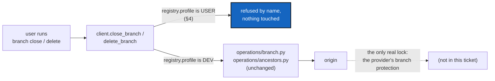

# DevOnlyClosure — `branch close` and `branch delete` are refused in a tree that holds no private repository

*Created: 2026-10-13*

*Branch: main*

> **From the owner's short ticket `deletion4devOnly` (2026-10-13), in full:**
> i was able to delete a branch as a random user with a simple install.cgs.
> This is not secured. Only Dev can be granted deletion rights for branch or
> other strategic assets. It is already a large privilege. It would be good to
> be able to lock a branch from deletion. The problem becomes who can lock and
> how recognising the person who locked for granting the deletion privilege.
> Generally closing should be dev privilege. deleting should be maintainer
> privilege. But those tier are absent from cgitsync. First write a
> DevPlanTicket for cutting closing and deletion rights for any artefacts for
> simple users ie without any private repo
>
> **What this ticket takes, and what it leaves.** It takes only the last
> sentence: cut closing and deletion for a tree without a private repository.
> The lock, who may lock, how to recognise them, and the dev and maintainer
> tiers cannot be built from what `cgitsync` knows today. They stay in the
> short ticket as a note, with the ideas to investigate before the next
> ticket.

> **Implemented — 2026-10-13 (`cgitsync-6.2.0`), by a worker and a launched
> orchestrator, its decisions asked first.** D1–D3 as recommended: the USER
> profile, no override, `branch close` and `branch delete` only. The owner
> approved the LOC raises (`git_tree.py` +14, `cli/expert.py` +2,
> `orchestre/tree_commands.py` +2); no import or public-symbol change, checked
> by hand. The orchestrator found no blocking defect and quoted 94/100.
> **Left, recorded:** the §6 memory item is covered by
> `test_default_memory.py`, not the new test file; the AST test sees a new
> caller file but not a new call inside an existing one; the CLI prints its
> `git_command=` line before the refusal, as every branch command does.
> **The short ticket `deletion4devOnly` stays open:** its note carries the lock,
> the tiers and the provider roles still to investigate.

| | |
|---|---|
| Predecessors | [BranchClosing](../archive/20260918_BranchClosing_DevPlanTicket.md): `branch close`, the `closed/` name; [BranchAncestors](../archive/20261002_BranchAncestors_DevPlanTicket.md) did the `ancestors` keeping that `branch delete` relies on |
| Touches | Tutorial 7 §7 teaches `branch close` and `branch delete` in a tree that has private repositories, so it stays valid and gains one sentence |

## Abstract — read this first

**The one-line version.** In a tree whose profile is USER (no repository is
effectively private), `branch close` and `branch delete` are refused, by name
and before any repository is touched. In a DEV tree nothing changes. The
refusal lives in the client methods, so the Python API and the CLI agree.

**What this document is.** The plan for that one refusal: what is wrong today,
what the refusal is and is not worth (§2), the decisions (§3), the behaviour
(§4), where the code goes (§5) and acceptance (§6).

**Why it exists.** A user with a plain `install.cgs` can run `branch close` and
`branch delete` on a project branch. Both act on the remote: `close` pushes the
`closed/` name and deletes the old name on `origin`
(`operations/branch.py`, `delete_remote_branch`); `delete` deletes the closed
branch on `origin` and locally (`operations/ancestors.py`). Nothing in
`cgitsync` asks who is running them. The owner did exactly this as a random
user.

**Who it is for.** The worker and the orchestrator who implement it, and the
owner, for §3.

**What you need to do with it.** Owner: answer §3. Worker: re-check §1 against
`HEAD`, then build §4 against §6.



---

## 1. What is wrong today

Checked on 2026-10-13 in `orchestre/tree_commands.py`, `operations/branch.py`,
`operations/ancestors.py`, `orchestre/memory_commands.py`, `git_tree.py` and
`git_repo.py`.

1. **Two commands remove or rename a branch on the remote, and neither asks who
   runs it.**
   - `ComplexGitSyncClient.close_branch` → `TreeCommands.close_branch` →
     `operations.close_branch`: pushes `closed/<name>`, deletes `<name>` on
     `origin`, then renames locally.
   - `ComplexGitSyncClient.delete_branch` → `TreeCommands.delete_branch` →
     `operations/ancestors.py`: deletes the closed branch on `origin`, then
     locally.
   - The only checks are about losing work (`ancestors`, `safe` / `recorded`),
     never about the person. The guards before them are about the project's
     default branch and the branch being checked out.
2. **The profile exists and is not used for this.** `WorkingGitTree.profile`
   is DEV when any repository is effectively private, USER otherwise. It is
   read by `status` and by `MemorySetup`. No destructive command reads it.
3. **The other deletions are already out of a user's reach.** The sweep found
   three calls to `delete_remote_branch`: the two above and `memory reboot`
   (`orchestre/memory_commands.py`, the memory's remote branch). A USER tree's
   memory never leaves the disk (`AdditionalSpecs.md`, *The tree profile*), so
   `memory reboot` has no remote branch to delete there. `pull --force`
   resets local branches only and refuses while a commit exists nowhere else.
   `rm` stages a deletion of a tracked file locally. `tag` and `release freeze`
   create tags and never delete one. No command deletes a tag.
4. **The scope rail says what it is not.** `RepoScope`'s docstring: "a safety
   rail, not a permission system … not a substitute for branch protection on
   the remote."

## 2. What this refusal is worth

**It is an accident guard, not a lock.** The profile comes from the `.cgs` the
user holds. Anyone who adds `private = true` to one repository of their own
`.cgs` has a DEV tree. Anyone can also run `git push origin --delete` by hand.
So the refusal keeps a user who follows the documentation from closing or
deleting a shared branch by mistake. It does not stop a determined or
malicious one. The only thing that does is the provider refusing the push, by
branch protection, and `cgitsync` cannot set that today.

This ticket is still worth doing for the first case, which is the owner's: a
random user running a documented command. The user guide, the refusal text and
the note in the short ticket all say the limit out loud, so nobody later
believes the tool secured something it did not.

## 3. Decisions for the owner

The worker asks each with `AskUserQuestion` before the first edit.

**D1 — What makes a tree "simple".**
- **(a) Recommended: `registry.profile is USER`**, the one rule that already
  exists (`WorkingGitTree.profile`, no effective private repository). It
  matches the owner's words ("without any private repo") and adds no second
  definition.
- (b) A DEV tree that also declares a *writable* private repository. Stricter:
  the user at least has a configuration repository they may write. It still
  rests on the same self-declared `.cgs`, so it blocks nobody more, and it
  would turn a DEV tree with only read-only private repositories into a
  refused one.

**D2 — The refusal's exit.**
- **(a) Recommended: no flag, no override.** A user who must close a branch
  uses the provider's page or plain `git`, or declares a private repository
  and becomes DEV, which the text names plainly as the way a project gives
  someone the right. A `--force` would turn the guard into a formality.
- (b) A `--i-am-a-maintainer` style option. Easier for a tired maintainer, and
  it teaches every user the way round on their first refusal.

**D3 — The refusal's reach.**
- **(a) Recommended: `branch close` and `branch delete` only.** §1.3 shows
  they are the only commands that remove or rename a branch on a remote from a
  USER tree. `branch check` stays: it is read-only and tells a user whether a
  branch is safe, which they can pass to a maintainer.
- (b) Also refuse `branch create` and `push` in a USER tree. This is a
  different rule, "users may not publish", and breaks the plain
  clone-edit-push use case the README sells. Not recommended.

The version level is the orchestrator's call under `pixi run bump-version`.
Making an existing command refuse is a behaviour change: `minor` at least.

## 4. The behaviour

1. **Where.** In `TreeCommands.close_branch` and `TreeCommands.delete_branch`,
   first, before the default-branch check, before any repository is read, and
   before the `last_ancestry` bookkeeping. Therefore the Python API and the
   CLI refuse the same way, and nothing is left half done.
2. **The rule is one method.** `WorkingGitTree` (or `GitProbes`, which already
   holds scope rules) gets one method, `require_dev(command)`, that raises
   `GitSyncError` when `profile` is USER. Neither `TreeCommands` method
   repeats the test. `profile` stays the only place that decides DEV or USER.
3. **The text** names the command, the reason and the way out, in plain
   English, in one message:

   ```text
   branch close was refused: this tree holds no private repository, so it is a
   user's tree, and closing or deleting a branch removes it on the remote for
   everyone. A developer's tree (one that declares a private repository) can.
   Ask a maintainer, or close it on the provider's page. Nothing was changed.
   ```

   The exit code is `EXIT_REFUSED`, as for every refusal.
4. **`branch check`, `branch list`, `branch create`, `merge`, `push` and every
   other command are unchanged.** `--private` on a USER tree is already
   refused ("no repository qualifies"); it keeps its own message.
5. **The profile is read from the registry the command loaded**, as `status`
   does. A DEV tree whose private repository is not cloned yet is still DEV,
   because `effective_private` reads the declaration.

## 5. Where the code goes

No new module.

| Module | Change |
|---|---|
| `git_tree.py` (`WorkingGitTree`) | `require_dev(command: str) -> None`, next to `profile`. Pure, offline. |
| `orchestre/tree_commands.py` | `close_branch` and `delete_branch` call it first. |
| `cli/help_text.py` or the `branch` parser help in `cli/expert.py` | One sentence in the `close` and `delete` help: "Developer trees only." |

**Docs, in the same change:**
- `docs/Text/user_guide.tex`: `branch close` and `branch delete`. Say that both
  are refused in a tree with no private repository, why, the exit, and the
  limit of §2 in one sentence. The section on the tree profile gets the same
  line.
- `docs/Text/api_python.tex`: `close_branch` and `delete_branch` raise
  `GitSyncError` in a USER tree.
- `tutorials/07_merge.md` §7: one sentence, that `branch close` and `branch
  delete` need a developer tree, which this tutorial's tree is.
- `AdditionalSpecs.md`: one sentence in the *The tree profile* section stating
  the rule and that it is an accident guard, not a permission; and the
  *Responsibility boundaries* line for `require_dev`.
- `digest.md`: one line for the rule, in the same change
  (`SpecTree.md` §3–§5).
- The PDFs are rebuilt by the orchestrator after `bump-version`.

**Ceilings.** `git_tree.py` and `orchestre/tree_commands.py` gain a few lines
each. If `pixi run check-ceilings` asks for a raise, ask the owner for it by
name, **including any import-count rise** (the check does not ratchet imports,
so count them yourself: `git diff` of the `import` lines), and record it.

## 6. Acceptance

- **USER tree, close.** On a fixture tree declared with no private repository,
  `branch close <b>` exits `EXIT_REFUSED`, prints the §4 text naming
  `branch close`, and every repository's refs, `HEAD` and the remote's branches
  are exactly as before. The run writes no State.
- **USER tree, delete.** The same for `branch delete`, including on a branch
  already named `closed/<b>`.
- **Python API.** `client.close_branch` and `client.delete_branch` raise
  `GitSyncError` with that text, so a script is held to the same rule.
- **DEV tree.** The existing `tests/integration/test_close_branch.py` and
  `tests/integration/test_branch_ancestors.py` pass unchanged. If one of them
  builds a USER tree to close or delete in, it is changed to declare a
  private repository, and the ticket's closing note says which.
- **Read-only stays.** `branch check` and `branch list` work in a USER tree.
- **No other way.** A test enumerates every caller of
  `GitRunner.delete_remote_branch` (a grep or an AST walk over `src/`) and
  fails when a new one appears that is neither behind `require_dev` nor in the
  memory path. This is what keeps §1.3 true after the next change.
- **Memory.** In a USER tree, `memory reboot` has no remote branch to delete
  (a test asserts the mount has no `origin`).
- **Docs.** The user guide, API docs, Tutorial 7, `AdditionalSpecs.md` and
  `digest.md` say what §5 lists.
- `pixi run lint` and `pixi run test` pass, `pixi run bump-build` has run, and
  `cgitsync status` shows `errors=0`.
