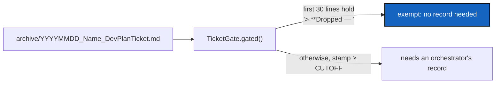

# DroppedTicketGate — a ticket the owner dropped needs no orchestrator's record

*Created: 2026-10-13*

*Branch: main*

> **From the owner, 2026-10-13.** The owner dropped `PackageHygiene` instead of
> ranking it. Archiving it is the only honest end for a ticket that is not
> built, but the pair-rule gate refuses a ticket archived on or after
> 2026-10-09 with no orchestrator's record, and a dropped ticket has no work
> for an orchestrator to quote. Asked which route to take, the owner chose to
> teach the gate to exempt dropped tickets.

> **Implemented — 2026-10-13 (`cgitsync-6.3.1`), by a worker and a launched
> orchestrator.** No decisions were open; the owner had chosen the route. A
> ticket opening with `> **Dropped — ` within its first thirty lines needs no
> orchestrator's record. The owner approved the +17 LOC raise in
> `ticket_gate.py` (no import or public-symbol change, checked by hand). The
> orchestrator found no blocking defect and quoted 97/100. **Left, recorded:** the
> exemption can be added to a built ticket (the gate cannot prove otherwise, as
> it cannot prove the orchestrator was a separate agent); an unreadable ticket
> stays gated and has no test.

| | |
|---|---|
| Predecessor | [PairRuleGate](../archive/20261009_PairRuleGate_DevPlanTicket.md): `TicketGate`, `pixi run check-tickets` and the `cgitsync commit` refusal |
| First user | `PackageHygiene`, archived by this ticket's follow-up once the exemption lands |

## Abstract — read this first

**The one-line version.** A ticket archived with a banner that begins
`> **Dropped — ` in its first thirty lines needs no orchestrator's record.
Every other ticket archived on or after 2026-10-09 still does.

**What this document is.** The plan for that exemption: the marker, where it
is read, what it does not prove, and how we know it is done.

**Why it exists.** `TicketGate` (`ticket_gate.py`) counts every
`YYYYMMDD_<Name>_DevPlanTicket.md` stamped on or after `CUTOFF`. Nothing says
"this ticket was never built". The only ways out today are to back-date the
stamp, which falsifies the date work stopped being live (TICKETLIFECYCLE §4),
or to write a record quoting work that does not exist. Both are worse than a
named exemption.

**Who it is for.** The worker and the orchestrator.

**What you need to do with it.** Build §1 against §3. There are no decisions
for the owner: the owner chose this route on 2026-10-13, and the marker below
is the smallest one that reads from the ticket itself.

---

## 1. What to build

- `TicketGate.gated` leaves out a ticket whose first thirty lines contain a
  line starting `> **Dropped — `. The check is on the file the gate already
  reads (the history ticket, never the deep copy), through one private method,
  so `unrecorded`, `require` and the `cgitsync commit` path all agree.
- A ticket with the marker **and** a record naming it is not an error: the
  record still counts, the marker only removes the demand.
- `DevTickets/README.md` (the project's fill-in) states the convention: a
  dropped ticket carries `> **Dropped — YYYY-MM-DD, owner's decision.** <why>`
  as its first banner, is stamped with the date it was dropped, and is
  archived and deep-archived like any other.

## 2. What it does not prove

The gate cannot tell a dropped ticket from an implemented one whose author
added the marker to skip the pair rule, exactly as it cannot prove the
orchestrator was a separate agent. It turns "forgot" into "named", and the
banner stays in the history and deep copies for the owner to read. The user's
guide for the tool is untouched: this is a development-process gate, not a
`cgitsync` feature.

## 3. Acceptance

- A test archives a ticket carrying the marker, stamped after the cut-off, and
  `unrecorded` returns nothing for it; the same ticket without the marker is
  returned.
- The marker is read only in the first thirty lines: a ticket that quotes
  `> **Dropped — ` further down is not exempt.
- `cgitsync commit` adding such a ticket is not refused; adding the same
  ticket without the marker still is.
- `AdditionalSpecs.md`'s pair-rule sentence and `digest.md`'s line state the
  exemption.
- `pixi run lint`, `pixi run test`, `pixi run check-ceilings`,
  `pixi run check-spectree` and `pixi run check-tickets` pass, and
  `cgitsync status` shows `errors=0`; `bump-version patch` at least.
