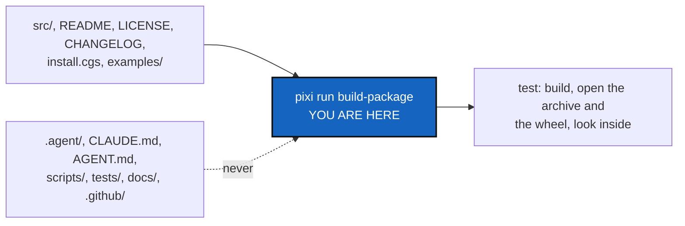

# PackageHygiene — what this repository builds carries only what a user needs

*Created: 2026-10-02*

*Branch: main*

> **Dropped — 2026-10-13, owner's decision.** The owner dropped this ticket
> instead of ranking it, after the rewrite below showed what is missing: the
> package cannot be built through Pixi (`hatchling` is not in the environment),
> its source archive would carry the developer files (`CLAUDE.md`, `AGENT.md`,
> `scripts/`, `tests/`), and no test looks inside a build. Nothing was built.
> The goal does not depend on the install route; a new ticket can take §1 and §4
> back whole if a package is ever published.

> **Rewritten — 2026-10-13, owner's request.** The first version was a pointer:
> "take the pieces from `tmpPyPi`'s commit `e8d8749`". That branch is closed and
> the commit survives only locally, so the plan now holds the pieces itself and
> was checked against `HEAD` (§1). The goal is unchanged and does not depend on
> the install route, which is still the owner's open question (short ticket
> `pixi-global-install.md`).

> **Ticket review — 2026-10-08, owner's decision.** Renumbered `main_2-6` → `main_2-2`: each priority is one pile counted across branches (TICKETLIFECYCLE §2), which this backlog had numbered per branch. Pile 2 order: AutofixBlindSpot, PackageHygiene, the seven data-repo tickets, Omniscience, WorkingAreaRename, StateLocking; order unchanged within its workstream.

> **From TmpBranchClosure**, the CorrTicket closing the `tmp` branches. It
> takes back the part of `tmpPyPi` that conforms to the core rules. The
> rest of that branch (`pipx`, PyPI publishing) is not taken back.

## Abstract — read this first

**The one-line version.** Whatever route users end up installing by, the
package built from this repository must hold the tool and what a user reads
about it, and never the developer mounts. Today the repository cannot build the
package through Pixi at all, and nothing checks what a build would contain.

**What this document is.** The plan for a Pixi-only package build, an
allow-list of what the source archive holds, the package page's metadata, and
a test that builds the package and looks inside.

**Why it exists.** Checked on 2026-10-13 against `HEAD`:

- `pyproject.toml` names `hatchling` as the build backend, but `hatchling` is
  not in the Pixi environment (`pixi run python -m hatchling` fails), and no
  Pixi task builds anything. The package can be built only by a tool the
  project's own rule forbids (`pipx run build`, `pip`).
- `pyproject.toml` has no source-archive rule. Hatch's default for a source
  archive is every file Git tracks, and Git tracks `CLAUDE.md` and `AGENT.md`
  (two symbolic links into `.agent/`), `scripts/`, `tests/`, `docs/` and the
  `.agent` mounts. A user who receives that archive receives the workshop.
- `pyproject.toml` has no project URLs or classifiers. `CHANGELOG.md` exists.
- There is no `tests/unit/test_packaging.py`.

**Who it is for.** The worker and the orchestrator, and the owner for §2.

**What you need to do with it.** Owner: answer §2. Worker: re-check the list
above against `HEAD`, then build §3 against §4.



---

## 1. What to build

1. **`hatchling` becomes a Pixi dependency** and a task builds with it:
   `build-package = "python -m hatchling build -d dist"`. Pixi stays the only
   tool (`digest.md`, Python work): no `pipx`, `pip install` or `build`. `dist/`
   is already in `.gitignore`.
2. **An allow-list for the source archive**, in `pyproject.toml`:

   ```toml
   [tool.hatch.build.targets.sdist]
   include = ["/src", "/README.md", "/LICENSE", "/CHANGELOG.md", "/install.cgs", "/examples"]
   ```

   An allow-list, never an exclude-list: the next developer file added to the
   repository is left out by default. `docs/` is left out too: the user guide
   is the PDF in the documentation repository, linked from the README.
3. **The package page's metadata**: `[project.urls]` (Repository, Issues,
   Documentation, Changelog) and classifiers for what is validated: Python
   3.11 and 3.12, `Operating System :: POSIX :: Linux` only (the platform CI
   checks), the licence, the console environment. No `Development Status`
   classifier: how stable the tool is, is the owner's statement to make.
4. **`tests/unit/test_packaging.py`** (§4).
5. **`CHANGELOG.md` stays a person's file.** It exists; `bump-version` never
   touches it. Nothing to build.

## 2. Decisions for the owner

The worker asks each with `AskUserQuestion` before the first edit.

**D1 — How Pixi builds the package.**

- **(a) Recommended: `hatchling` as an ordinary Pixi dependency and the
  `build-package` task above.** Stable, small, and the build backend
  `pyproject.toml` already names.
- (b) Pixi's own `pixi build` / `pixi-build-python`. It is a preview feature of
  a pre-1.0 Pixi, the risk the `pixi-global-install` short ticket already
  weighs. It also belongs to the install-route decision, not to this ticket.

**D2 — What the test does.**

- **(a) Recommended: really build the source archive and the wheel into a
  temporary directory, then open them.** It checks the thing a user receives,
  not the configuration that is meant to produce it. A few seconds.
- (b) Read `pyproject.toml` only, as the first version did. Faster, but a
  hatch change or a mistyped path passes.

## 3. What it must not bring

- No `pipx`, `pip install` or other installer, in code, docs or CI. Pixi only.
- No user install instructions. The route is the owner's open question
  (short ticket `pixi-global-install.md`).
- No publishing workflow and no PyPI release. Publishing is the owner's
  decision.
- No `[package]` section or `preview` feature in `pixi.toml`.
- No change to the editable `pypi-dependencies` entry the contributor workflow
  relies on, or to any contributor command.

## 4. Acceptance

- `pixi run build-package` builds a source archive and a wheel into `dist/`
  from a clean checkout, using only Pixi.
- The test builds both into a temporary directory (D2 a) and asserts:
  - the archive holds `src/ComplexGitSync/`, `README.md`, `LICENSE`,
    `CHANGELOG.md`, `install.cgs` and `examples/`;
  - the archive holds no path starting with `.agent`, `scripts`, `tests`,
    `docs` or `.github`, and neither `CLAUDE.md` nor `AGENT.md`;
  - the wheel holds `ComplexGitSync/` and its metadata, and no `.agent`;
  - the wheel's metadata carries the URLs, the Python floor and the
    `cgitsync` console script, and only the Linux operating-system classifier.
- The test fails when a developer file is added to the `include` list, shown
  once in the test by a deliberate temporary change.
- `pixi run lint`, `pixi run test`, `pixi run check-ceilings` pass, and
  `cgitsync status` shows `errors=0`; `bump-version patch` at least.
