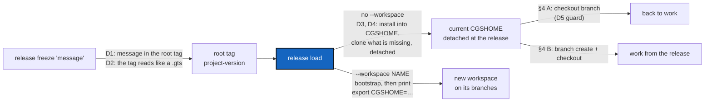

# ReleaseErgonomy — a release tag a person can read, a `release load` that installs like `bootstrap`, and a way back from a loaded release

*Created: 2026-10-13*

*Branch: main*

> **From the owner's short ticket `release-ergonomy` (2026-10-13), in full:**
> While working on cawaqs release i found a few ergonomy bugs for cmd
> release. 1 the argument 'message' of release freeze is not writen in the
> TAGS message. 2. The TAGS mesage displayed on the GitProvider page is not
> fully readable - it should be a toml format. 3. The ergonomy of release
> load is not good. release load should behave as a bootstrap. If no
> --workspace NAME argument is given, it should keep the CGSHOME that is in
> memory to bootstrap and overwrite what is there. If --workspace NAME is
> defined, it should specify export CGSHOME="NAME" as it does in the stderr
> bootstrap message.
>
> Tuto 3 should integrate how to load cawaqs-C363 release. Once loaded the
> user should go in $CGSHOME/src and launch
> `./make_Cawaqs_from_branches.sh -b C363 .`
> which installs cawaqs3.63
>
> **Owner, 2026-10-13, on the first draft of this plan:** the cawaqs
> tutorial is removed from this ticket. D1–D4 are decided as recommended
> (§2). Add the protocol that re-attaches a tree left detached by a
> release (§4).

> **Implemented — 2026-10-13 (`cgitsync-6.1.0`), by a worker and a launched
> orchestrator, its decisions asked first.** D1–D4 as recommended; D5 taken as
> (a), `checkout` refuses to leave a detached commit no name holds; the
> owner approved the LOC and public-symbol raises, and, after the orchestrator
> found them, the import raises (`cli/release_command.py` 8 → 11,
> `cli/minimalist.py` 15 → 16, `orchestre/client.py` 62 → 63). The orchestrator
> found one blocking defect (a false "no import increase" approval), then
> quoted 92/100 at 6.1.0. **Premise corrected:** `cgitsync commit` already
> refuses on a detached tree, so a commit made while detached is made with
> plain `git`. **Left open, recorded:** `Installer.clone_recorded` does not name
> already-cloned repositories when a later clone fails, and has no test for a
> nested missing parent or a repository absent from the live registry; an empty
> `CGSHOME` falls through to the default workspace (shared resolution, not
> changed); the manual run against the real `cawaqs-C363` tag was not done.

| | |
|---|---|
| Predecessor | [ReleaseCommand](../archive/20261009_ReleaseCommand_DevPlanTicket.md): `release freeze \| list \| load`, the root's annotated tag carrying the State (6.0.1) |
| Touches | DataAcceptance runs `release load R1 --workspace fresh`; that form keeps its meaning, so the ticket needs no edit |

## Abstract — read this first

**The one-line version.** `release freeze "message"` writes the message
into the release tag. The tag's message is TOML that reads like a `.gts`
file, not a single 13,000-character line. `release load` installs the
release into the current workspace the way `bootstrap` would, cloning what
is missing instead of refusing. With `--workspace`, it prints the
`export CGSHOME=…` line `bootstrap` prints. A documented, tested protocol
takes a detached tree back onto a branch without losing any commit.

**What this document is.** The plan for the owner's three release requests
and the re-attach protocol. It covers what is wrong today, checked against
`cgitsync-6.0.1` and the real `cawaqs-C363` tag (§1), the decisions (§2),
the release behaviour to build (§3), the re-attach protocol (§4), where the
code goes (§5) and acceptance (§6).

**Why it exists.** The first real release made with 6.0.1, cawaqs 3.63,
showed that the release can be made but is hard to use. Its tag on GitLab
does not say what the release is. Its State is unreadable there. A
colleague who loads it in place is refused as soon as their tree lacks one
repository. After a `--workspace` load, they have to find the new
workspace's path themselves. After an in-place load, the only way back is
one sentence ("`checkout <branch>` goes back to work") that no test covers.
It does not say how to start work *from* the release, and it does not say
what happens to a commit made while detached.

**Who it is for.** The worker and the orchestrator who implement it, and
the owner, for D5.

**What you need to do with it.** Owner: answer D5. Worker: re-check §1
against `HEAD`, then build §3 and §4 against §6.



---

## 1. What is wrong today

Checked on 2026-10-13 in `release_commands.py`, `operations/push.py`,
`operations/branch.py`, `cli/release_command.py` and
`orchestre/installer.py`, and on the `cawaqs-C363` tag in
`~/.cgs/cawaqs-20261013134107`. That tag is on `gitlab.com/cawaqs/cawaqs`,
next to `cawaqs-1`.

1. **The message never reaches a tag.** `freeze_release` passes the
   message to `_freeze_tag` as the *commit* message only. The root's tag
   message comes from `ReleaseCommands._annotation`, which writes
   `<tag>: release of <project>` and the table, nothing else. Every other
   repository gets a lightweight tag, which has no message at all. On
   `cawaqs-C363` the commit says `cawaqs version 3.63` and the tag does not.
   When `release freeze` adds nothing new, no commit is made, and the
   message is lost entirely.
2. **The State is one escaped string.** `_annotation` stores the State as
   `state = tomli_w.dumps(document)`. `tomli_w` writes a multi-line string
   as one basic string with `\n` escapes. The `cawaqs-C363` tag message is
   12 lines, one of them 12,955 characters long. GitLab's tag page shows
   that line as it is.
3. **An in-place load refuses a tree that is not already complete.**
   `_load_in_place` raises `records repositories this tree does not hold`
   and tells the user to use `--workspace`. It never clones.
4. **`--workspace` prints no path.** `load_release` calls
   `client.bootstrap`, which names the workspace `$HOME/.cgs/<NAME>-<timestamp>`
   (or `<CGSPATH>/<NAME>` with `--cgs-path`). The `bootstrap` command then
   prints `To use this workspace, run: export CGSHOME=<path>`
   (`cli/minimalist.py`, about line 509, on **stdout**, not stderr as the
   short ticket says). `release load` prints only the tree-state line, so
   the owner had to find `~/.cgs/C363-20261013142844` by hand.
5. **The two forms of load leave the tree differently.** In place, every
   repository is *detached* at its recorded commit. With `--workspace`,
   `Installer._apply_pin` puts each fresh clone *on its branch*, pointed at
   the recorded commit (`checkout -B`). `~/.cgs/C363-20261013142844` shows
   `## C363...origin/C363`. D4 keeps that difference on purpose.
6. **The way out of a detached tree is untested.** `release load` prints
   "`cgitsync checkout <branch>` goes back to work", but no test runs any
   command after an in-place load
   (`tests/integration/test_release_command.py`). `branch create` runs
   `Preflight.assert_ready` (`operations/branch.py`, `branch_tree`), and the
   branch-topology report counts a detached repository without a tag
   reference as blocking (`detached_head`). A repository the load leaves
   detached at a commit that carries no release tag can be in that state:
   a read-only repository, or one this load clones (§3.2). Whether
   `branch create` or `checkout` then refuses has not been tried. Nothing
   protects a commit made while detached either. `checkout <branch>` moves
   away from it, as plain Git does, and it is reachable only through the
   reflog.

**What the tag cannot fix.** `cawaqs-C363` and `cawaqs-1` are pushed. They
keep their old message, because moving a pushed tag is a rewrite
(`AdditionalSpecs.md`, *The hard prohibitions*). Their State still has to
load, so `parse_annotation` keeps reading the old `state = "…"` string as
well as the new layout.

## 2. Decisions

**Taken by the owner, 2026-10-13, each as recommended:**

- **D1 — the freeze message goes into the root's tag only.** The tag's
  subject line becomes `<tag>: <message>` (GitLab and GitHub show it as the
  title), and the table gains `message = "<message>"`. The rule "only the
  root's tag is annotated" stays as it is. *Not taken:* annotating every
  writable repository's tag with the message.
- **D2 — the tag message is a `.gts` with one extra table.** After the
  subject line, the body is one TOML document: first `[cgitsync_release]`
  (project, tag, version, message, made_with), then the State's own tables
  exactly as a `.gts` file writes them: `[document]`, `[project]`,
  `[tree_state]`, `[tree]`, `[[repo_state]]`. To load, remove
  `cgitsync_release` and pass the rest to `GtsDocument.from_dict`. *Not
  taken:* nesting the State under `[cgitsync_release.state]`.
- **D3 — in place, uncommitted changes are still refused**, by name and
  before anything moves. "Overwrite what is there" means that repositories
  are moved, and missing ones cloned, without asking for a new workspace.
  It does not mean throwing away uncommitted work. *Not taken:* a
  `--force` that discards it.
- **D4 — in place, every repository the load moves is left detached at its
  recorded commit, freshly cloned ones included.** No local branch moves.
  `--workspace` keeps `bootstrap`'s behaviour (on the branch, at the
  commit), because its clones are fresh and have nothing to lose. The user
  guide states the difference in one sentence. *Not taken:* matching
  `bootstrap` in place, which would move a local branch backwards.

**Open — the worker asks it with `AskUserQuestion` before the first edit:**

- **D5 — `checkout <branch>` from a tree where a commit was made while
  detached** (§4, path A).
  - **(a) Recommended: refused by name before anything moves.** The
    refusal names each repository and its commits that no branch holds, and
    gives path B's two commands, which keep them. The tool never makes work
    unreachable on its own; this is the same guard `branch delete` applies.
  - (b) Warn, name the commits, and move anyway, as plain Git does. They
    stay in the reflog for a while.

The version level, at least `minor` since `release load` and the tag
change behaviour, is the orchestrator's call under `pixi run bump-version`.

## 3. The release behaviour to build

### 3.1 `release freeze`

- The root tag's message is
  `<tag>: <message>` + blank line + the TOML body (D2). Its table carries
  `message`.
- `--dry-run` shows the subject line it would write.
- `release list --json` gives every row a `message` (empty for a ledger-only
  row or an old tag). The text table does not change.

### 3.2 `release load <name>` with no `--workspace`

The release goes into the workspace `cgitsync` already resolves, the
`CGSHOME` that `cgshome=` names, and nowhere else.

1. The State is found as today: on this disk, in a memory chapter, or on
   the root's tag.
2. **Refusals happen before anything moves, each naming its
   repositories**: a `tag only` release, and uncommitted changes (D3). A
   recorded commit that no remote holds any more is refused too, as
   `initialise_gts` refuses it today.
3. **A repository the release records but the tree lacks is cloned**
   through the installer's own pinned clone path (`Installer._clone_pending`
   and `_apply_pin`). It is not a new clone routine.
4. Every recorded repository, freshly cloned ones included, is then
   detached at its commit (D4). The memory under `.cgitsync/` stays on its
   branch, as today.
5. A repository the tree holds but the release does not record is left
   alone and is named in the output. It is never deleted.
6. If any step fails, every repository already moved goes back where it
   was, as today. A repository this load cloned is left in place and named
   (a clone holds nothing to lose).
7. A State is written, as today. The output ends with §4's two ways out,
   naming the branch the tree was on before the load.

A `CGSHOME` with no tree at all is refused by name. Without a `.cgs`,
`cgitsync` knows neither the project nor its root remote, and the refusal
says to `bootstrap` the project's `.cgs` first. Loading a release from
nothing, given a `.cgs`, is a separate ticket if the owner wants it.

### 3.3 `release load <name> --workspace NAME`

Unchanged apart from its output. After the tree line, it prints the same
block as `bootstrap`:

```text
To use this workspace, run:
  export CGSHOME=/home/you/.cgs/C363-20261013142844

Or for the current command:
  CGSHOME=/home/you/.cgs/C363-20261013142844 pixi run cgitsync <command>
```

The path is the one `bootstrap` actually built, with its `-<timestamp>`
suffix, not the bare `NAME` the short ticket wrote. That suffix is
`bootstrap`'s naming rule, and `release load --workspace` follows it.

## 4. Re-attaching a tree a release left detached

After an in-place `release load` (D4), or a `checkout <tag>`, the project
is detached: `status` prints `cgitsync_branch=detached`. There are exactly
two ways back onto a branch. Both are existing commands. This ticket makes
them work from a detached tree, tests them, and documents them as the
protocol.

**A — back to work, leaving the release behind:**

```bash
pixi run cgitsync checkout <branch>
```

`<branch>` is the branch the tree was on before the load. `release load`
names it in its closing lines (§3.2, step 7). Every repository goes back to
its branch under the privacy rule (`<project>_<branch>` for a private/local
one). That includes a repository that load cloned, from its remote branch.
What the release shows is not lost: the tag still names it, and `release
load` reaches it again. A repository holding a commit made while detached
is handled as D5 decides.

**B — work from the release** (a fix to a released version, or a commit
made while detached that must be kept):

```bash
pixi run cgitsync branch create <name>
pixi run cgitsync checkout <name>
```

`branch create` starts each repository's new branch at its `HEAD`, which is
the release commit, or a later commit made while detached, so nothing is
left unreachable. A private/local repository gets `<project>_<name>`. The
memory stays on its own branch throughout. `push` then publishes the new
branch, which follows the release, not `main`.

**What must hold, and what to fix if it does not:**

- After an in-place load, the tree is READY, or `branch create` and
  `checkout` accept the release-detached state as `checkout <tag>`'s state
  is accepted. The worker first writes the two tests (§6), then fixes what
  refuses. It does that by recognising a repository detached at a commit
  the release recorded, in `Preflight` / the branch-topology report. It
  does not relax the `detached_head` refusal for any other detached
  repository.
- D5's guard sits in the `checkout` path. It finds a repository's commits
  that no local or remote-tracking branch holds
  (`git rev-list HEAD --not --branches --remotes`), through `git_runner.py`.
- **`--workspace` loads need no re-attaching**: their repositories are on
  their branches already (D4). `pull` brings a branch from the release
  commit to its tip, and says how many commits it moved.

## 5. Where the code goes

No new module. Each change goes to the module that already owns the rule.

| Module | Change |
|---|---|
| `orchestre/release_commands.py` | `_annotation(tag, plan, message)` writes the subject line and the D2 layout. `parse_annotation` / `_state_file` read both the D2 layout and the old `state = "…"` string. `freeze_release` passes the message on. `list_releases` adds `message`. `_load_in_place` loses the "does not hold" refusal, has the installer clone the missing repositories (§3.2), and returns the branch the tree was on before. |
| `orchestre/installer.py` | One entry point that clones a given set of registry entries, pinned, into an existing root. It is built from `_clone_pending` and `_apply_pin`, and is the only clone path the in-place load uses. The load then detaches what it cloned (D4). |
| `operations/preflight.py`, `operations/branch.py` | Only if §4's tests show a refusal: a repository detached at a commit its release recorded is not `detached_head`. Plus D5's guard on `checkout`. |
| `git_runner.py` | If D5's guard needs it, one read-only question: the commits of `HEAD` that no branch holds. |
| `cli/_shared.py`, `cli/minimalist.py` | `bootstrap`'s "To use this workspace" block moves into one helper in `_shared.py`. `bootstrap` and `release load --workspace` both call it. |
| `cli/release_command.py` | `freeze --dry-run` prints the subject line. `load` prints the export block with `--workspace` (§3.3), names the repositories it cloned or left alone, and ends with §4's two ways out, naming the previous branch. |

**Docs, in the same change:**

- `docs/Text/user_guide.tex`:
  - the `release freeze` paragraph: the message is the tag's title;
  - `release load`: it clones what is missing, and is refused only for
    uncommitted changes and a `tag only` release; plus the D4 sentence. The
    line "when the release records a repository this tree does not hold"
    goes;
  - a new paragraph, *Leaving a loaded release*, with §4's protocol, which
    `checkout <tag>` also points to.
- `docs/Text/api_python.tex`: `load_release`.
- Tutorial 2, Step 8:
  - remove "the release records a repository" from the refusals;
  - show the export line after `--workspace`;
  - beside `checkout main`, add path B in two lines.
- `AdditionalSpecs.md`: the `ReleaseCommands` sentence in the `orchestre/`
  row (it clones what is missing; the tag message carries the freeze
  message), and a sentence under *Responsibility boundaries* stating §4's
  two paths and the D5 guard.
- `digest.md`: one line for the D5 guard, in the same change
  (`SpecTree.md` §3–§5).
- The PDFs are rebuilt by the orchestrator after `bump-version`.

**Ceilings.** `release_commands.py` is 313 lines and `installer.py` is a
single-class file. If `pixi run check-ceilings` asks for a raise, ask the
owner for it by name, before the first edit when it can be foreseen, and
record it.

## 6. Acceptance

- **Freeze.** In an integration test, `release freeze "first release"`
  gives a root tag whose subject is `<tag>: first release` and whose table
  holds `message = "first release"`. A freeze that commits nothing still
  writes the message into the tag.
- **TOML.** The tag body is valid TOML with no line longer than the longest
  line of the `.gts` it holds. The State read back from it has the same
  `snapshot_hash` as the State the ledger recorded. A tag in the 6.0.1
  layout (`state = "…"`), built in the test fixture, still loads.
- **Load in place.** From a tree missing one recorded repository, `release
  load` clones it and leaves every recorded repository detached at its
  commit. It names the repository it cloned and any repository it left
  alone, and writes a State. Uncommitted changes refuse with nothing moved.
  A `CGSHOME` with no tree refuses by name.
- **Re-attach, path A.** After an in-place load, `checkout main` puts every
  repository, the one load cloned included, back on `main` (or
  `<project>_main`) at its tip. `status` shows `cgitsync_branch=main` and
  `errors=0`.
- **Re-attach, path B.** After an in-place load, `branch create fix` and
  `checkout fix` put every repository on `fix` (or `<project>_fix`) at the
  release commit. A commit made while detached before `branch create` is on
  `fix`. `push` publishes `fix`, and `main` is unchanged.
- **D5.** After a commit made while detached, `checkout main` is refused by
  name with nothing moved (a), or warns, names the commit and moves (b).
- **Workspace.** `release load 1 --workspace X` prints `export
  CGSHOME=<the path it built>`, the same text `bootstrap` prints, from the
  one shared helper.
- **Real tag.** Run by hand once: in a bootstrapped `examples/cawaqs.cgs`
  tree, `release load C363` reads the 6.0.1-layout `cawaqs-C363` tag, and
  `checkout C363` re-attaches.
- The user guide, API docs, Tutorial 2, `AdditionalSpecs.md` and
  `digest.md` say what §5 lists.
- `pixi run lint` and `pixi run test` pass, `pixi run bump-build` has run,
  and `cgitsync status` shows `errors=0`.
