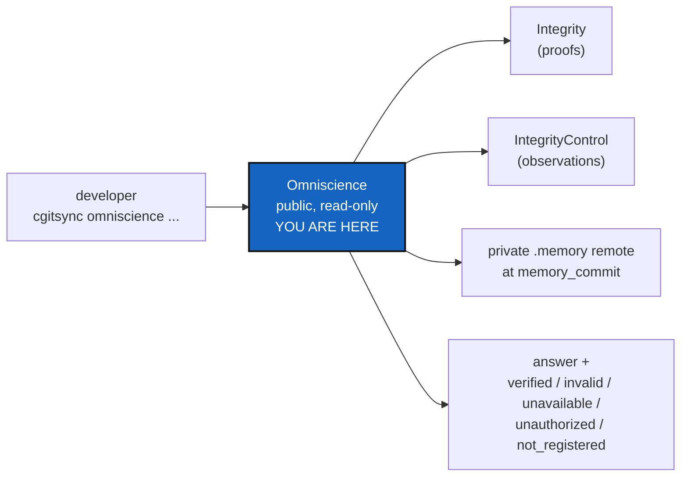

# OmniscienceQuery — ask the global memory, and get a proof or an honest "cannot tell"

*Created: 2026-10-20*

*Branch: main*

> **Implemented — 2026-10-21 (`cgitsync-6.10.0`), by a worker and a launched
> orchestrator, its decisions asked first (D1 to D3, and a ceiling raise).**
> Nine subcommands, one per API method; a registered memory is read in a
> temporary clone that is removed; anyone the provider allows may ask. The
> eighth tutorial, `tutorials/08_omniscience.md`, was added at the owner's
> request and is replayed by `test_tuto_omniscience.py`. `Omniscience` itself
> (1-1) stays open until its closing note checks off its section 10.

> **Split from [Omniscience](main_1-1_Omniscience_DevPlanTicket.md) on
> 2026-10-20 (owner's short ticket `update-omniscience`), as milestones O4
> and O5.** It builds the public, read-only `Omniscience` API and ends the
> workstream with the two-developer, two-project test. When it lands,
> Omniscience is archived.

| | |
|---|---|
| Part of | [Omniscience](main_1-1_Omniscience_DevPlanTicket.md) §1, §5, §8, §10 — milestones O4, O5 |
| Needs | [OmniscienceAppend](../archive/20261021_OmniscienceAppend_DevPlanTicket.md) |
| Expected release | minor (a public API and commands) |

## Abstract — read this first

**The one-line version.** A read-only `Omniscience` object, mirrored by
`cgitsync omniscience ...`, that finds a project by name, lists its branches
and history, returns a State with its proof, reads the registered `.memory`
at its immutable commit, and reports each repository's status. Every answer
says whether it is verified, invalid, unavailable, unauthorized or not
registered.

**What this document is.** The plan for O4 (the API) and O5 (the end-to-end
acceptance of the whole workstream).

**Why it exists.** A register is worth what a reader can check. This is the
part a developer on another machine uses to restore a project's history and
trust it.

**Who it is for.** The worker, the orchestrator, and the owner, for §3.

**What you need to do with it.** Owner: answer §3. Worker: build §2, then
run §5's end-to-end test.

---

## 1. What is true today

Nothing of Omniscience is built (Omniscience §8). The read path reuses
`MemoryRepository`, `MemoryStates`, `LedgerStore` and `git_runner.py`;
`memory explore` and `release load`'s State retrieval already read States
from a memory without changing it.

## 2. What it delivers

1. **The API.** `Omniscience.get(project_name)`, `branches(project_name)`,
   `memory(project_name, branch, checkpoint=None)`, `history(project_name,
   branch=None)`, `get_state(project_name, state_id)`,
   `get_proof(project_name, state_id, checkpoint=None)`,
   `verify(project_name, state_id, checkpoint=None)`,
   `repository_status(project_name, repo_id, checkpoint=None)`,
   `integrity_report(project_name)`. The private classes are never exposed.
2. **Typed outcomes.** Every answer carries one of `verified`, `invalid`,
   `unavailable`, `unauthorized`, `not_registered`. Reading a memory also
   distinguishes `remote_unavailable`, `commit_unreachable`,
   `invalid_proof` and `ledger_corrupt`. A global proof never claims that a
   repository is available or that a live checkout matches.
3. **The memory read** follows the sequence in Omniscience §5: verify the
   registration, fetch the authorized ref and the immutable commit, verify
   the commit, ledger and State link, and answer. It writes nothing to the
   source `.memory` or to Omniscience. Its cache location is D2.
4. **`omniscience verify`** says, for the register itself: `intact`,
   `rewritten`, `attested` or `contradicted` (the 2026-09-16 §6 answers), and
   which protections exist (branch protection read if BranchProtection has
   landed, otherwise "not checked"; signed commits).
5. **The CLI facade:** `cgitsync omniscience get|branches|history|state|proof|verify|status|report|memory`,
   each with `--json` (names are D1).
6. **Restore from another machine.** `release load` or `bootstrap` from a
   registered State found through Omniscience, so that a second machine
   continues the same `os_id`'s history.
7. **The eighth tutorial, `tutorials/08_omniscience.md`** (owner,
   2026-10-21). It follows the seven that exist: a reader registers a State,
   finds the project by name from a second workspace, lists its branches and
   history, gets a State with its proof, reads the `.memory` at its
   immutable commit, sees what each answer (`verified`, `invalid`,
   `unavailable`, `unauthorized`, `not_registered`) means, and restores the
   project on another machine. Every command in it is run by an integration
   test, as `test_tuto_merge.py` does for tutorial 07. The README's use-case
   table and tutorial count, and `getting_started.tex`'s, move from seven to
   eight in the same change.

## 3. Decisions for the owner

- **D1 — The command names.** (a) Recommended: the nine subcommands above,
  one per API method. (b) Fewer: `show` (get, branches, history), `proof`,
  `verify`, `report`, `memory`.
- **D2 — The cache for authorized memory reads.** (a) Recommended: a
  temporary clone under the tree's `.cgitsync/`, removed after the answer.
  (b) A persistent cache, refreshed by fetch.
- **D3 — Who may query.** (a) Recommended: anyone the provider lets read the
  `omniscience` repository; `cgitsync` adds no check of its own. (b) DEV
  trees only.

## 4. Where the code goes

| Module | Change |
|---|---|
| `orchestre/omniscience.py` (public API) | The nine methods, delegating to the private classes |
| `cli/` | The facade, `--json` on each |
| `client.py` | The mirror of the API, per *the CLI mirrors the Python API* |

Docs: the user guide (every subcommand), `api_python.tex` (the API),
`AdditionalSpecs.md` (*Responsibility boundaries*), and the eighth tutorial
(§2 item 7), with its test in `tests/integration/`.

## 5. Acceptance — the workstream's end-to-end (O5)

- Two projects, two branches each, two developers on two workspaces, one
  bare `omniscience` remote and one bare `.memory` remote.
- Each developer registers; both projects resolve by name; `H_GLOBAL`
  covers all four branches; every proof verifies.
- A third workspace restores one project from a registered State and
  continues its history; its `os_id` is the same, and the earlier
  registrations keep verifying.
- A forced rewrite of the register is reported `rewritten`; a tampered
  `.memory` commit is located down to the repository when the evidence is
  readable, and reported "diagnosis unavailable" when it is not.
- A reader without access to a private `.memory` gets `unauthorized`, never
  its content.
- A repository deleted after registration: its proof still verifies, and
  `repository_status` reports the observation, not "verified".
- `tutorials/08_omniscience.md` exists, follows DOCSTYLE, is linked from the
  README table and `getting_started.tex` (both now say eight), and an
  integration test runs each of its commands.
- Every item of Omniscience §10 is checked off in the closing note.
- `pixi run lint` and `pixi run test` pass, `bump-build` has run, and
  `cgitsync status` shows `errors=0`.
