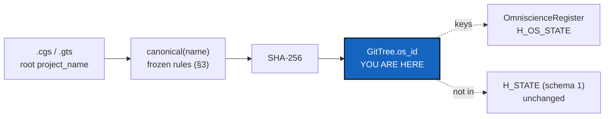

# OperatingSpaceId — one id per project name, the same on every machine

*Created: 2026-10-20*

*Branch: main*

> **Implemented — 2026-10-21 (`cgitsync-6.6.0`), by a worker and a launched
> orchestrator, its decisions asked first.** D1 (a) NFC with case kept, D2 (a)
> warn and refuse registration only, D3 (a) plain SHA-256 hex. The owner
> reversed the Omniscience refusal of an `OperatingSpace` class and had the
> pure functions merged into it; no ceiling was raised.

> **Split from [Omniscience](main_1-1_Omniscience_DevPlanTicket.md) on
> 2026-10-20 (owner's short ticket `update-omniscience`), as milestone O1a.**
> The owner: *"Add `os_id` as a deterministic primitive derived from the
> project root's `project_name`"*, and *"do not add an `OperatingSpace`
> lifecycle class or reimplement the GitTree machinery."*

> **Owner's decisions while building, 2026-10-21.** The Omniscience refusal
> of an `OperatingSpace` class was reversed, and the owner ordered the pure
> functions and the class merged. So §2 and §4 read as follows: the
> functions are static methods of one class, `OperatingSpace`
> (`operating_space.py`, ring 1), which wraps a loaded `WorkingGitTree`;
> there is no `WorkingGitTree.os_id` property and no ring-0 module. Its
> status/show/validate plumbing lives in that class, so no module's ceiling
> was raised.

| | |
|---|---|
| Part of | [Omniscience](main_1-1_Omniscience_DevPlanTicket.md) §2, §8 — milestone O1a |
| Expected release | minor (a new property and a new `--json` field) |

## Abstract — read this first

**The one-line version.** `GitTree.os_id = SHA256(UTF8(canonical(project_name)))`,
taken from the root's project name, frozen with its naming rules, and the
same across `bootstrap`, `initialise`, `release load`, branches and
machines.

**What this document is.** The plan for O1a: the identity every later
Omniscience record is keyed by.

**Why it exists.** Omniscience is addressed by project name. Two machines
holding the same project must compute the same id, and two different
projects must never share one. Any later change to how the name is
canonicalised would change every id, so the rules are fixed once, here.

**Who it is for.** The worker, the orchestrator, and the owner, for §3.

**What you need to do with it.** Owner: answer §3. Worker: re-check §1,
then build §2 against §5.

---

## 1. What is true today

Read on 2026-10-20 (6.4.0).

1. **The project's name is read in one place.** `tree_project_name(tree)`
   (`git_tree_branch.py`) reads the root entry's `project_name`, falling back
   to its `name`. Private branches (`P_branch`) and `MemoryRepository.branch()`
   are named from it. The worker lists every other path that resolves a
   project name (`RegistryTranslator`, `bootstrap`, `initialise`, `release
   load`, `.gts` loading) and checks that they all reach the root's.
2. **No canonicalisation exists.** The name is used as written.
3. **The State hash does not include the name's id**, and must not
   (`gts_integrity.py`, schema 1, immutable).

## 2. What it delivers

1. `canonical_project_name(name) -> str` and `os_id(name) -> str`, pure
   functions in one ring-0 module, with no second spelling anywhere.
2. `WorkingGitTree.os_id`, computed from `tree_project_name`. No new class.
3. The id is shown where a script reads the tree: `status --json` gains an
   `os_id` field (additive), and `memory show` prints it.
4. A name that canonicalisation would reject is reported by `validate`
   with the rule it broke. An existing `.cgs` that the rules would reject is
   not refused retroactively: it gets a warning, and Omniscience refuses to
   register it (D2).
5. Golden vectors: a fixed table of names and ids in the tests, as for
   schema 1.

## 3. Decisions for the owner

- **D1 — The canonical form.** (a) Recommended: Unicode NFC, then the
  bytes as they are: case kept, no trimming. Leading or trailing whitespace,
  control characters and an empty name are rejected rather than repaired, so
  two distinct accepted names never fold into one (owner's rule). (b) NFC
  plus case folding, so `CaWaQS` and `cawaqs` are one project; that changes
  what the existing private branch names mean. (c) ASCII only.
- **D2 — A name the rules reject in an existing tree.** (a) Recommended:
  warn, keep working, refuse only registration in Omniscience. (b) Refuse
  the tree at load (a breaking change, so a MAJOR).
- **D3 — The hash's form.** (a) Recommended: 64 lowercase hex characters
  of SHA-256 over the UTF-8 bytes, no domain prefix. That is the owner's
  formula as written; domain separation happens one level up, in
  `H_OS_STATE`. (b) A domain-tagged hash (`cgs-os-id-v1` prefix).

## 4. Where the code goes

| Module | Change |
|---|---|
| A ring-0 home for the two functions (next to `gts_integrity.py`, or in it) | `canonical_project_name`, `os_id` |
| `git_tree.py` (`WorkingGitTree`) | `os_id` property |
| `status_render.py` / `json_render.py` | The `os_id` field |
| `cgs_format.py` validation | The D2 warning |

Docs: user guide (`status` fields, `.cgs` project name rules),
`api_python.tex`, `AdditionalSpecs.md` (*Responsibility boundaries*: where the
id is computed).

## 5. Acceptance

- The golden vectors pass on Linux and Windows.
- The same `.cgs` bootstrapped, initialised, and loaded from a release
  gives one `os_id`; a branch switch, `memory reboot` and a relocation keep
  it.
- A child repository's own `project_name` never changes the tree's id.
- `H_STATE` and every schema-1 golden vector are unchanged; an old release
  loads and shows the id.
- Two names that differ only in a way D1 rejects are not folded together.
- `pixi run lint` and `pixi run test` pass, `bump-build` has run, and
  `cgitsync status` shows `errors=0`.
