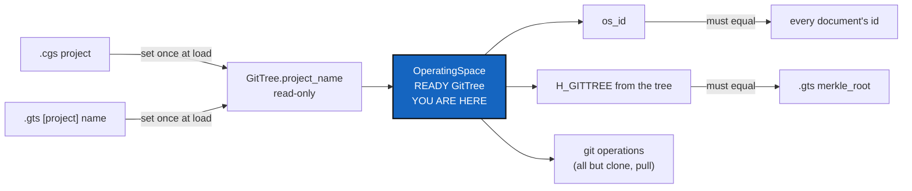

# OperatingSpace — a READY GitTree that owns its git operations, its name and its Merkle root

*Created: 2026-10-21*

*Branch: main*

> **Implemented — 2026-10-21 (`cgitsync-6.7.1`), by a worker and a launched
> orchestrator, its decisions asked first (D1–D4), and D5–D6 asked after
> the first quote returned three blocking defects, all fixed. No ceiling was
> raised; docstrings were shortened to pay for the growth.**

> **From the owner, 2026-10-21, in conversation, after
> [OperatingSpaceId](../archive/20261021_OperatingSpaceId_DevPlanTicket.md)
> landed as 6.6.0:** *"the Merkle root must be calculated directly from the
> tree. The only reference is GitTree, no documents. Operating space is a
> READY GitTree. Therefore git operations belongs to Operating Space not
> GitTree. Write a test that evaluate the integrity of the id accros GitTree
> (ref) and the documents produced by various methods. It may be wise to
> protect project-name from rewriting. Only an explicite change-project-name
> method should be applied. There must be only one source of project-name,
> which is the GitTree name."* The decisions in §3 were asked and answered
> the same day, before this ticket was written.

| | |
|---|---|
| Part of | [Omniscience](main_1-1_Omniscience_DevPlanTicket.md) §1, §2, §4 — between O1a and O1b |
| Predecessors | [OperatingSpaceId](../archive/20261021_OperatingSpaceId_DevPlanTicket.md) (the class and `os_id`) |
| Expected release | minor (the public client API is unchanged; internal ownership moves) |

## Abstract — read this first

**The one-line version.** `OperatingSpace` becomes the READY `GitTree` in
action: it runs every git operation but clone, computes `H_GITTREE` from the
tree itself, and reads the project's one name from `GitTree.project_name`,
which nothing but an explicit internal rename can change.

**What this document is.** The plan for the change, with the owner's
answers in §3.

**Why it exists.** After 6.6.0 a project's name still had four sources and
the Merkle root existed only inside a `.gts` document. An id that two
sources can disagree about, and a root that only a file can produce, are
not the reference Omniscience needs. The tree is.

**Who it is for.** The worker, the orchestrator, and the owner.

**What you need to do with it.** Worker: re-check §1, build §2 against §5.

---

## 1. What is true today

Read on 2026-10-21 (6.6.0).

1. **Four sources of a project's name.** The `.cgs` `project` key becomes
   the root entry's `name`; the root repository's own `project_name` (its
   provider repository name, hashed in the schema-1 leaf); the `.gts`
   `[project] name`, written from the root entry's `name`; and a
   `GitTree.project_name` field that nothing sets. `tree_project_name`
   reads the root repository's `project_name`, falling back to `name`.
   `memory show` derives `os_id` from the `.gts` `[project] name`, so it and
   `status --json` can disagree.
2. **The Merkle root is computed only from a document.**
   `GtsDocument.compute_gittree_root` and `ensure_snapshot_hash` build each
   repository's leaf from the document's own dictionaries.
   `RegistryTranslator.to_gts_document` writes those dictionaries from the
   tree.
3. **Git operations sit on `GitTree.git`** (`GitTreeGitCommands`): checkout,
   branch, list_branches, close_branch, pull, pull_force, refresh_private,
   add, rm, commit, merge, merge_into, merge_one_at_a_time, push, tag,
   freeze, clone. Each delegates to `operations/`. The facade is bound to
   the loaded tree by `bind_tree`. `pull` and `pull_force` (`restart_tree`)
   run on a DECLARED tree and produce READY.

## 2. What it delivers

1. **One name.** `GitTree.project_name` is the only source. It is set once,
   when a tree is built from a `.cgs` (its `project`) or a `.gts` (its
   `[project] name`), and is read-only afterwards. A private
   `GitTree._rename_project(name)` is the only way to change it (D4).
   `tree_project_name`, the `.gts` `[project] name`, `os_id`, the private
   branch names, the memory branch and the release tag all read it. The root
   repository's provider `project_name` stays that repository's identity
   and is no longer read as the project's name. When the two differ at
   load, a warning says so (D3).
2. **The Merkle root from the tree.** `OperatingSpace.gittree_root` is
   `H_GITTREE` computed from the tree: each repository's state dictionary
   is built by the code `to_gts_document` writes with, each leaf by the code
   `GtsDocument` hashes with, and the root by `GtsIntegrity`. There is one
   implementation of each step, and schema 1 is unchanged byte for byte.
   `to_gts_document` refuses to write a document whose root differs from
   the tree's.
3. **Git operations on `OperatingSpace`** (D2): every operation of
   `GitTreeGitCommands` except `clone`, `pull` and `pull_force`, which make a
   tree READY and stay with the tree. Each operation refuses a tree that is
   not READY, through the existing `Preflight.assert_ready`. The id and the
   root still answer for any tree, because `status` and `validate` show them
   before a tree is READY (worker's reading, 2026-10-21). The client calls
   `OperatingSpace(tree).<operation>(git_runner, ...)`. No CLI or client API
   changes.
4. **`memory show`** derives `os_id` from the State's tree, like `status`.
5. **The integrity test** (owner's request): for one tree as the reference,
   `os_id` and `H_GITTREE` are the same from the tree, from its `.gts`
   (written and read back), from its `.cgs` (`to_cgs`, reloaded), from a
   `.gts` reloaded into a tree, from `memory show`, and from `status --json`.

## 3. Decisions for the owner — answered 2026-10-21

- **D1 — How the work is carried.** A new planning ticket, built by a worker
  and an orchestrator, its own release after 6.6.0.
- **D2 — Which git operations move.** All but clone; `pull` and
  `pull_force` stay with clone, because they are what make a tree READY.
- **D3 — The one source.** `GitTree.project_name`, set once at load from the
  `.cgs` or `.gts` project name; documents only serialise it; the root
  repository's provider name stays its repository identity; a difference
  is warned about.
- **D4 — The rename.** An internal method only: no public API and no CLI.
- **D5 — Trees whose root repository has another name on its provider**
  (asked after the orchestrator's first quote, 2026-10-21). Accept, document
  and warn: their private branches, memory branch, release tags and `os_id`
  now follow the `.cgs` `project` (molonari: MOLONARI1D to MOLONARI;
  cawaqsviz: cawaqsviz to CaWaQS-Viz). The user guide says to set `project`
  to the old name to keep existing branches.
- **D6 — The READY guard on read-only operations** (same day). `branch list`
  (`list_branches`) is not guarded, because it is read-only and reports an
  uncloned repository; `pull --private` stays guarded.

## 4. Where the code goes

| Module | Change |
|---|---|
| `git_tree.py` | `project_name` read-only, `_rename_project`; `GitTreeGitCommands` keeps `bind_tree`, `clone`, `pull`, `pull_force` only |
| `git_tree_branch.py` | `tree_project_name` reads `tree.project_name` |
| `registry.py` | Sets the name once from `.cgs` / `.gts`; `[project] name` from the tree's name; repository state dictionaries shared with `OperatingSpace`; the root check at write |
| `gts_document.py` | Leaf building callable on a repository dictionary |
| `operating_space.py` | READY guard, `gittree_root`, the moved operations; ring 2, since it acts through `operations/` |
| `orchestre/` | Call sites move from `git_tree.git.<op>` to `OperatingSpace` |

Docs: `api_python.tex` if anything public moves (nothing planned),
`AdditionalSpecs.md` (module table rows for `operating_space.py`,
`git_tree.py`, `git_tree_branch.py`; *Responsibility boundaries*).

## 5. Acceptance

- The integrity test of §2.5 passes, on trees with a private repository and
  without, and with a root whose provider name differs from the project's.
- Every schema-1 golden vector and every existing `.gts` verifies unchanged.
- Assigning `GitTree.project_name` raises; `_rename_project` changes it, and
  `os_id` follows.
- An operation on a tree that is not READY is refused by name; clone and
  pull still turn a DECLARED tree into a READY one.
- `pixi run lint` and `pixi run test` pass, `bump-build` has run,
  `cgitsync status` shows `errors=0`, and no ceiling is raised without the
  owner's word.
