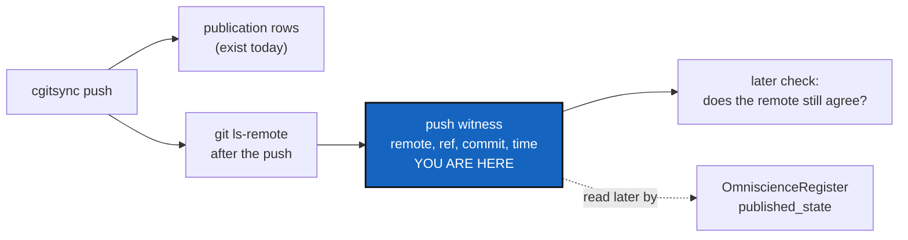

# PushAnchor — the remote's own word that a push carried a State

*Created: 2026-10-20*

*Branch: main*

> **Implemented — 2026-10-21 (`cgitsync-6.5.1`), by a worker and a launched
> orchestrator, its decisions asked first.** D1 (a) fields on the publication
> row, D2 (a) `cgitsync memory verify --published`, D3 (a) always. The owner
> approved raising the ceilings of `cli/expert.py`, `cli/help_text.py`,
> `git_runner.py`, `memory/commit_log.py`, `orchestre/client.py` and
> `orchestre/memory_commands.py`. `memory verify` without `--published` runs
> the existing chain check; `--state` is refused without `--published`.

> **Split from [Omniscience](main_1-1_Omniscience_DevPlanTicket.md) on
> 2026-10-20 (owner's short ticket `update-omniscience`), as milestone O0.**
> It is UniversalClock's WP7, moved into Omniscience on 2026-09-20 and kept
> independent of it (Omniscience D10): *"A public-only or private-local CGS
> workspace records an independently verifiable push witness without
> Omniscience."*

| | |
|---|---|
| Part of | [Omniscience](main_1-1_Omniscience_DevPlanTicket.md) §6.3, §8 — milestone O0 |
| Predecessors | [UniversalClock](../archive/20260920_UniversalClock_DevPlanTicket.md) WP7 and §4.3; the publication rows `push` already writes |
| Expected release | minor (a ledger/commit-log field and a check are added) |

## Abstract — read this first

**The one-line version.** After `push`, ask the remote what it now holds
(`git ls-remote`), record that answer beside the publication row the push
already writes, and let a later check say whether the remote still agrees.

**What this document is.** The plan for O0, the first and ungated milestone
of the Omniscience workstream.

**Why it exists.** A State's time is the machine's own word. A push is the
one moment a third party, the remote, receives the work, and its answer can
be checked by anyone who can read the remote. That is the witness a project
has when it has nothing else, and it must not wait for Omniscience.

**Who it is for.** The worker and orchestrator who build it, and the owner,
for §3.

**What you need to do with it.** Owner: answer §3. Worker: re-check §1 at
`HEAD`, then build §2 against §5.

---

## 1. What is true today

Read on 2026-10-20 (6.4.0).

1. **`push` already records what it published.** `TreeCommands.push` passes
   `MemoryCommands._collect_publication_records` to `write_gts_snapshot`.
   Each `PublicationRecord` carries the repository, the commit, the remote's
   `.cgs` identifier, the ref and the local time. It is filed under the
   State that holds the commit and written to the commit log
   (`memory/commit_log.py`, `append_publications`). `AdditionalSpecs.md`
   describes it (*Publication is a row of its own*).
2. **Nothing asks the remote afterwards.** The row says what this machine
   pushed, not what the remote then held. A push the remote rejected after
   accepting it (a server hook), or a remote rewritten later, is not seen.
3. **`git_runner.py` already speaks `ls-remote`** (`remote_branch_exists`
   and the ref lookups around line 519), so the probe needs no new Git
   plumbing.

## 2. What it delivers

1. **The witness.** Right after each repository's push, one `ls-remote` of
   the pushed ref. Its answer is recorded with the publication row:
   `remote_commit` (what the remote said) and `observed_at` (the local
   time, from `universal_clock.py`). When the remote's answer is not the
   pushed commit, the row says so. The push itself is not undone.
2. **Additive only.** The new fields are absent on every row written
   before. Every existing ledger and commit log verifies byte for byte, and
   no State hash changes.
3. **The check.** A read-only command (D2) re-asks the remote for every
   witnessed row of a State, or of the whole memory, and answers per row:
   `attested` (the remote still has that commit on that ref, or has moved on
   from it fast-forward), `moved` (the ref no longer contains it), or
   `unreachable` (no answer). `moved` is a finding, never repaired.
4. **USER trees too.** A USER tree's memory never leaves the disk, but its
   project repositories are pushed: the witness is recorded there as well
   (Omniscience §3 keeps USER trees out of *Omniscience*, not out of O0).

## 3. Decisions for the owner

The worker asks each with `AskUserQuestion` before the first edit.

- **D1 — Where the witness is stored.** (a) Recommended: new fields on the
  existing publication row in the commit log, so one row says what was
  pushed and what the remote answered. (b) A separate `witness/` record per
  push in the memory. (c) A ledger-entry field.
- **D2 — The check's command.** (a) Recommended: `cgitsync memory verify
  --published`, next to the existing chain verification. (b) A new
  `cgitsync push --verify`. (c) Part of `status`, which would make `status`
  reach the network.
- **D3 — The cost.** One `ls-remote` per pushed repository adds a round
  trip per repository to every push. (a) Recommended: always. (b) Only with
  a flag.

## 4. Where the code goes

| Module | Change |
|---|---|
| `memory/commit_log.py` (`PublicationRecord`) | Two optional fields, serialised only when present |
| `orchestre/memory_commands.py` | `_collect_publication_records` fills them from the probe |
| `git_runner.py` | Nothing new expected; a ref lookup that returns the commit exists |
| The D2 command | One read-only method on the client, mirrored in the CLI |

Docs: the user guide (`push`, and the D2 command), `api_python.tex`, and
`AdditionalSpecs.md` (the publication row's new fields).

## 5. Acceptance

- A push to a local bare remote records `remote_commit` equal to the
  pushed commit, and the D2 check says `attested`.
- After a forced rewrite of the bare remote, the check says `moved` for that
  row and changes nothing.
- With the remote unreachable, the check says `unreachable`, not `moved`.
- Every ledger and commit log written before this verifies unchanged; the
  schema-1 golden vectors pass.
- A USER tree records the witness for its project repositories.
- `pixi run lint` and `pixi run test` pass, `bump-build` has run, and
  `cgitsync status` shows `errors=0`.
