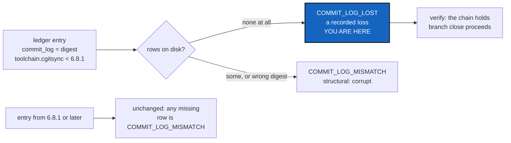

# CommitLogLoss — the commit messages a pre-6.8.1 fold deleted are a recorded loss, not corruption

*Created: 2026-10-27*

*Branch: main*

> **Ticket review — 2026-10-27, owner's decision.** BeforeBeta's D4, answered
> (b): *"b option ticket de code verify"*. Filed at `main_1-2`, right after
> BeforeBeta. It is BeforeBeta's step S0, because S1 (`branch close
> memory-dev`) cannot run until it lands.

## Abstract — read this first

**The one-line version.** Before 6.8.1, the memory push fold deleted the
pending commit logs it was supposed to fold, and 6.8.1 said the lost rows are
not recovered. `verify` still calls every such entry `COMMIT_LOG_MISMATCH`, a
structural finding, so a memory that lived through that bug says `corrupt`
for ever. `branch close` and `branch delete` then refuse for ever. This ticket
recognises that loss by a signature the ledger itself vouches for, and
reports it as a loss, not as corruption.

**What this document is.** The defect, measured on the developer tree (§1);
the signature (§2); the change (§3); the decisions (§4); acceptance (§5).

**Why it exists.** It is defect 3 of BeforeBeta, and it blocks BeforeBeta's
S1. It would block every developer whose memory was folded by 6.8.0 or
earlier, which in a beta is every early developer.

**What you need to do with it.** Owner: answer §4. Worker: §3, with §5 as the
tests.

---

## 1. The defect, measured

On the developer tree, 2026-10-27, `cgitsync verify check` at 7.0.0 gives:

- `status=corrupt`, with 27 findings, every one
  `COMMIT_LOG_MISMATCH: entry records a commit log whose rows are gone`;
- seq 3 to 55, the odd entries: every `commit`, whose `push` partner records
  no commit log;
- every one of them written by `toolchain.cgitsync` between 5.0.0 and 6.7.3;
- seq 57 (6.8.1) onward, every commit log verifies.

`cgitsync branch close memory-dev` is then refused:

> the ledger does not verify (seq=3 COMMIT_LOG_MISMATCH; …), so nothing was
> renamed or deleted

The refusal comes from `TreeCommands._assert_history_holds`. `verify repair`
heals only a stale HEAD. The 6.8.1 release said: *"it read the pending commit
logs from the wrong directory and deleted them, so every one was lost at the
first fold. Rows already lost are not recovered."*

## 2. The signature, and why it can be trusted

An entry is a **recorded loss** when all three hold:

1. It records a `commit_log` digest.
2. **No** row at all names it, neither committed nor published, folded nor
   pending. That is the `not committed and not published` branch of
   `MemoryFacts.verify_commit_logs`.
3. Its `toolchain.cgitsync` is a version **older than 6.8.1**, the release
   that fixed the fold.

Condition 3 cannot be forged. `toolchain` is inside the hashed payload of the
entry (`ledger_entry.py`), so editing the version string makes the entry fail
`BAD_ENTRY_HASH`, which stays structural. Condition 2 keeps every partial
case structural: rows edited, added, removed one by one, or unreadable. The
bug deleted whole logs, never single rows.

What this gives up: a pre-6.8.1 log that someone deleted on purpose now reads
as a loss, not as corruption. It is still reported, by entry, every time.

## 3. The change

- **`memory/integrity.py`.** A new finding, `COMMIT_LOG_LOST`, which is **not**
  in `_STRUCTURAL_FINDINGS`. D1 decides which `HistoryState` a chain with only
  such findings gets.
- **`MemoryFacts.verify_commit_logs`.** The "rows are gone" branch reports
  `COMMIT_LOG_LOST` when §2 holds, and `COMMIT_LOG_MISMATCH` otherwise. Its
  detail names the build that wrote the entry: "commit messages deleted by
  the fold of cgitsync <version>, fixed in 6.8.1".
- **The 6.8.1 boundary.** It is one constant, beside the finding, with one
  pure comparison of a recorded version's leading numbers
  (`ChainVerifier.written_before_fold_fix`). `project_version.py` is not
  used: it reads a manifest and says it never interprets a version.
- **`verify check` output.** It says, in one line, how many entries lost
  their messages and why, then lists them. A `CORRUPT` verdict is never
  softened by anything else on the chain.
- **`_assert_history_holds`, unchanged in code.** It refuses on `CORRUPT`, and
  a chain holding only recorded losses is not `CORRUPT`, so `branch close` and
  `branch delete` proceed.
- **Docs, in the same change.**
  - The user guide: `verify`'s states and the new finding.
  - `AdditionalSpecs.md`: *The hash-chained ledger*, where the finding
    taxonomy is listed. The `Finding` docstring says "fourteen members"; that
    becomes fifteen.
  - `digest.md`, one line: a commit log lost to the pre-6.8.1 fold is a
    recorded loss, never corruption, and never repaired.

Nothing is repaired, rewritten or recreated: the rows are gone, and this only
stops calling their absence corruption.

## 4. Decisions for the owner

| D | Question | Answer |
|---|---|---|
| **D1** | Which state does `verify` report when the only findings are `COMMIT_LOG_LOST`? | **Answered, owner 2026-10-27: a new `HistoryState.INCOMPLETE`**, printed `incomplete`, **exit code 0**. It was asked first as "exit 0, like `TIME_INCONSISTENT`", which was wrong: `time-inconsistent` exits 1. Asked again with that corrected, the owner kept 0. The loss is permanent and recorded, so exit 1 would fail every gate on that tree for ever. |
| **D2** | Do Omniscience registration and queries treat `INCOMPLETE` as `verified`? | **Answered, owner 2026-10-27: yes, and it holds trivially.** Omniscience's memory read checks the hash chain only and never reads commit logs, so a recorded loss never reaches its answers. "The loss carried in the answer" was asked first and cannot happen as the code stands; asked again, the owner accepted this. |
| — | Ceilings | **Raised, owner 2026-10-27**, for `memory/integrity.py`, `orchestre/memory_facts.py` and `cli/expert.py` only. |

`verify check` prints `lost_commit_logs=<n>` next to `findings=<n>`, so the
count of recorded losses is its own line (§3).

## 5. Acceptance

- On a copy of the developer tree's memory, `verify check` reports 27
  `COMMIT_LOG_LOST`, no `COMMIT_LOG_MISMATCH`, and the D1 state.
  `branch close memory-dev` then proceeds, and `branch check` stays as it was.
- Unit tests, each on a built ledger:
  - a pre-6.8.1 entry with all rows absent is `COMMIT_LOG_LOST`;
  - the same entry with one row left, or a wrong digest, is
    `COMMIT_LOG_MISMATCH`;
  - a 6.8.1-or-later entry with all rows absent is `COMMIT_LOG_MISMATCH`;
  - an entry whose `toolchain` was edited down to an old version is
    `BAD_ENTRY_HASH`, so still corrupt.
- `CORRUPT` still wins over `INCOMPLETE` when both kinds of finding are
  present.
- `pixi run lint`, `pixi run test`, and `cgitsync status` with `errors=0`.
