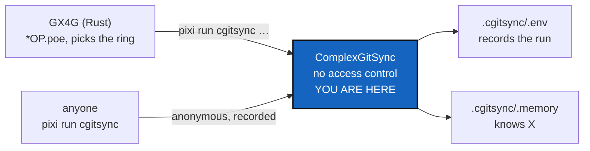

# EnvConnect — what GX4G needs from ComplexGitSync, and no access control inside it

*Created: 2026-10-26*

*Branch: main*

> **Owner direction — 2026-10-26 (GX4G session), current:** *"i think we
> can forget the decorator idea. GX4G is in Rust API {NAME,NODE,EDGE,OP}
> simply defines OP\* via \*OP.poe{OP.poe,NAME.poe,NODE.poe,0}, 0
> indicates anonymous execution but recorded .env. In fine X access
> Public Artefact .cgs (static report), USER -> .gts (.state), DEV ->
> .local (.memory), ORX -> distant (.cgitsync)."*
>
> Earlier the same day: *"initialise API .cgs. bootstrap inherits
> initialise (.cgs) and add 'release load' API-method for .gts."*
> *"bootstrap is tag based (MerkleRoot) while initialise is branch based
> (GitRepo)."* *"ComplexGitSync is SemVer, the cgitsync build version is
> accessible to DEV not USER not PUBLIC."*

## Abstract — read this first

**The one-line version.** GX4G decides access in its own Rust process and
calls `pixi run cgitsync` like anyone else. ComplexGitSync gets **no
access-control code**. What it owes GX4G is four capabilities: a DEV
`release load`, one frontier answer, a public SemVer, and a real
MerkleRoot.

**What this replaces.** The first draft of this ticket put a ring
decorator on all 87 public methods of `ComplexGitSyncClient`. The owner
dropped that idea on 2026-10-26. Gone with it: `GateRing`,
`@requires_gate_ring`, the per-method assignment, the credential file,
and the naming collision with the import Rings.

**The other half.** GX4G's own ticket:
`gx4g/.localSpec/DevTickets/openTickets/main_1-1_EnvConnect_DevPlanTicket.md`.
Refer to both as `EnvConnect`.

**Why stand-by (`2-`).** Nothing here blocks ComplexGitSync's own work,
and C3 rides on Versioning.

**What you will find.** §1 what GX4G expects from this side. §2 what
"anonymous but recorded" asks of `.env`. §3 decisions. §4 milestones. §5
refusals.

> **Re-checked against ComplexGitSync 6.10.0, 2026-10-26.** This ticket was
> first written against a stale workspace (`0002.88`). Against the current
> release, most of it is already done:
>
> | Milestone | In 6.10.0 | Left |
> |---|---|---|
> | C1 frontier answer | `omniscience memory` / `state` verify the memory against a record | one DEV call giving `hash(X.root)` too, which depends on GX4G's D12 |
> | C2 `release load` | **built**: `release load <version\|tag> [--workspace]`. `bootstrap` takes a `.gts`. | optional: `release load <State hash>` |
> | C3 SemVer split | **built**: `__version__ 6.10.0`, `__build__ 0004.01` | none |
> | C4 MerkleRoot | **built**: `repo_hash` → `merkle_root` (RFC 9162) → `snapshot_hash`, inclusion proofs | none |
> | C5 run record (D3) | not built | as before: `status`-like reads leave nothing on disk |
>
> Also decided the same day: **one register**. cgitsync's `omniscience`
> commands stay its mechanism, and in a GX4G Operating Space only gx4g
> invokes them, holding the mount on the DEV tree. Tutorial 8 gained §10,
> "Behind a gate: GX4G". The gate mounts the register itself, beside
> `.cgitsync`, as a private/local entry of its own DEV spec, so
> `omniscience register` writes to it with no change on this side.
>
> **Filed** as `.dev/DevTickets/openTickets/main_2-11_EnvConnect_DevPlanTicket.md`
> (`github:flipoyo/.dev`, branch `ComplexGitSync`), after `main_2-10`. It
> was first drafted in a stale workspace (`0002.88`). Every fact below
> was re-checked against 6.10.0. The rules it settles are written into
> `AdditionalSpecs.md`, *The install frontier*, in the same change.

---

## 1. What GX4G expects from this side

### 1.1 The access table, as ComplexGitSync sees it

| GX4G ring | `Σ *OP.poe` | X accesses | ComplexGitSync provides |
|---|---|---|---|
| PUBLIC | 3 | the Public Artefact, `.cgs` (static report) | a `.cgs` from a released Tree. `GitTree.to_cgs()` and `create-cgs` exist. |
| USER | 2 | `.gts`, the `.state` | `initialise gx4g/install.cgs` (branch-based, ComplexGitSync mounted as a leaf with `nested_config = "disabled"`). The `.gts` it writes. |
| DEV | 1 | `.local`, the `.memory` | `bootstrap gx4g/examples/gx4g4dev.cgs`, which mounts `examples/complexgitsync4dev.cgs` through `nested_config`, + **`release load`** (tag-based, C2). The frontier answer (C1). |
| ORX | 0 | distant, the whole `.cgitsync` | every command, run by GX4G |

Seen from X, `.distant` is `.cgitsync` and `.local` is `.memory`. Seen
from the gx4g tree, `.distant` is `.omniscience` and `.local` is
`.cgitsync`. It is the same nesting, one level in.

### 1.2 Branch-based and tag-based

| | `initialise` | `bootstrap` + `release load` |
|---|---|---|
| Reads | `.cgs`: a GitTree at a branch, no commits | `.gts`: the Tree, GitTree.trunk, every commit |
| Addresses by | GitRepo + branch, which moves | the MerkleRoot of `NAME.state`, which does not |
| Today | exists | `bootstrap <.cgs>` exists. `release load` does not. |

### 1.3 The frontier

X is the root of the tree a LEFT client gets through GX4G, and only
`.memory` knows it. Every value this side hands GX4G is public or a hash:

| Value | Form |
|---|---|
| `.env.root` | the State's name |
| `.memory.root` | the memory ledger head, as a hash |
| `hash(X.root)` | a hash only. **`X.root` never leaves unhashed.** |
| memory intact? | yes / no, from the ledger `verify` already checks |

## 2. "Anonymous but recorded `.env`"

The owner's `0` means *anonymous execution, recorded in `.env`*, and
**`PoE == 0` is true**. A coordinate holds once `.env` records it. So
what `.env` records is exactly what GX4G can count as true. Without a
decorator, any direct `pixi run cgitsync` is an anonymous run, and `.env`
is the only witness it has. This is what `.cgitsync/` records today:

| A run that… | Durable record today |
|---|---|
| calls `write_gts_snapshot`: `commit`, `branch`, `checkout`, `pull`, `merge-into`, `clone`, `load`, `expand`, **and `validate`** | `state/<hash>.gts`, a hash-chained entry in `lgr/`, and the run log in `logs/` (`bind_log_file` is called only from there) |
| does not (`status` and `view-tree` were not found among them) | **none.** `CommandRunLogger` buffers the run and prints it to the console. |

So the line falls between snapshot and no snapshot, not between read and
write: `validate` of GX4G's `install.cgs` wrote a State, a ledger entry
and a log beside the spec. Every mutation is recorded. Whether the
remaining reads must be recorded too is D3.

## 3. Decisions, your call

### D1. Is `initialise <.gts>` withdrawn?

*"initialise API .cgs"* makes `release load` the `.gts` path.
`initialise` accepts a `.gts` today (restore mode), and that is part of
the documented CLI. Under Versioning's rules, removing it is a MAJOR
change. **Recommendation:** deprecate it in the MINOR that adds `release
load`, with a warning that names `release load`. Remove it at the next
MAJOR.

### D2. What `release load` takes

**Recommendation:** a `.gts` path, a MerkleRoot, or a release tag.

- A MerkleRoot resolves to `.cgitsync/state/<hash>.gts`, else to
  wherever D4 says.
- A release tag resolves through the ledger's release row (`git_tag` ↔
  `state_id`, Versioning §3). It is refused if no row exists. It must
  never fall back to checking the tag out, because a Git tag can be moved
  and a MerkleRoot cannot.

In every case it restores through today's `load_gts` path, so there is no
second restore code. It **refuses** if the rebuilt tree's root differs
from the one it was given.

### D3. Must a read be recorded in `.env`?

"Anonymous but recorded" is fully true today only for runs that write a
State. **Recommendation:** yes. Append one line per run to
`.cgitsync/logs/runs.jsonl`: command, time, State before and after, exit
code. Bind it for every command in `_run_with_logging`. It is not a
ledger entry, because a read changes no State. It is not hash-chained
either, because this is a record of activity, not of state. **Owner's
call:** without it, an anonymous read leaves no trace.

### D4. Where `release load` finds a `.gts` it does not have

A fresh DEV machine has an empty `.cgitsync/state/`. The candidates are
`.cgitsync/.memory`, which a DEV holds, or a location GX4G publishes to.
**Owner's call.**

### D5. Versioning by ring. Answered

Public SemVer (`3.1.0`, `3.1.0-rc.1`) for PUBLIC, USER and the gx4g id.
The build counter (`0002.88`) for DEV only, through the ledger. Today
`__version__` *is* the build counter, and it reaches further than DEV:

| Leak | Fix |
|---|---|
| `cgitsync --version` | prints SemVer |
| `.gts` `document.CGS_VERSION` | carries SemVer. It is already outside the State hash since format 3, so no State is renamed. |
| the install-upgrade notice in `orchestre.py` | compares SemVer |
| ledger `toolchain.cgitsync` | keeps the build counter. It is DEV, which is correct. |

This answers Versioning's own D1 ("where each number lives"). SemVer
`+build` metadata is not an escape hatch: it would put the counter back
into public strings.

### D6. A real MerkleRoot

The State's name is one sha256 over the whole canonical payload
(`compute_snapshot_hash`), not a Merkle root. **Recommendation:** a new
`hash_canonicalisation` version with one leaf per repository,
`(repository, relative_path, ref, commit)`, in path order. Each `.gts`
declares its canonicalisation and is never re-measured, so **old States
keep their names**. It gives per-repository inclusion proofs, which is
what GX4G's "each part its own proof" needs. **Owner's call**, because it
changes the name of every future State.

### D7. The twin's separator (C8). Answered: keep `_`

**Answered by the owner, 2026-10-26:** *"the branch-name is controlled at
its creation. Cannot be replicated for now, we'll see during
industrialisation for improvement branch-name++."*

So the twin's branch is `ComplexGitSync_<Project>`, with the existing `_`.
The ambiguity is real in the *string*: `ComplexGitSync_memory-dev` could
be ComplexGitSync's memory for branch `memory-dev`, or the twin of a
project named `memory-dev`. It is prevented at *creation*: a branch whose
name already exists is not created, so the second meaning can never come
into being. **C8 must make that check explicit**, and refuse by name when
creating a twin or project memory branch whose name already exists. That
is where "controlled at its creation" lives in code.

**And `_` prevails over `-`.** Owner, 2026-10-26: *"_ prevails -"*,
confirmed as: `_` is the **only** structural separator in a branch name,
and `-` belongs inside names. A project or branch name may contain `-`
(`memory-dev`, `CaWaQS-Viz`) and never `_`. Then `ComplexGitSync_P_X`
reads one way only: twin of `P`, branch `X`. The one reading left
ambiguous, `ComplexGitSync_<name>` (ComplexGitSync's branch `<name>`, or
the twin of project `<name>`), is the one the creation check prevents.

**C8 refuses, by name, at creation:** a project name or project branch
name containing `_`, and a memory branch whose name already exists.
Existing names are never renamed. As of 2026-10-26 these already break
the rule, and stay as they are:

| Name | Where |
|---|---|
| `MOLONARI1D_data_import`, and its `.archived-20261012` | `github:flipoyo/.memory` (branch `data_import`) |
| `175-onboarding_devplanticket-adopting-cawaqsviz-into-complexgitsync` | ComplexGitSync's branches |
| `tmp-main-1-2_DiscoverRoundTrip` | ComplexGitSync's branches |

The project names in ComplexGitSync's examples, gx4g's branches
(`main`, `alpha-rust`, `poc`) and the project `gx4g` all conform.
`_global`, Omniscience's index branch, is a reserved system name, outside
the rule.

**Deferred: "branch-name++"**, a scheme that cannot collide even as a
string (for example a dedicated separator such as `+`), at
industrialisation. Not now.

### D8. Twin scope (C8)

`.memory` only, or every private/local repository of a standalone tree
(`.claude`, `.localSpec`, `.dev`)? The owner's sentence names `.memory`.
**Recommendation:** `.memory` only. It is the one that records *what
happened*, which is where a twin and its Project must not mix. The
configuration repositories describe *how to work*, which is the same for
both. **Owner's call.**

## 4. Milestones

| # | Milestone | Done when |
|---|---|---|
| **C1** | The frontier answer: one DEV command printing §1.3's four values | No output of it, in any test, contains an unhashed `X.root`. The yes/no matches `verify` on the memory ledger. |
| **C2** | `cgitsync release load` per D2, and D1's deprecation | On a fresh machine, `bootstrap <.cgs>` then `release load <root>` rebuilds a tree with that root. A wrong root, or a tag with no ledger row, is refused by name. `initialise <.gts>` warns. |
| **C3** | D5, once Versioning lands | `cgitsync --version` prints SemVer with no `+`. A test searches every non-DEV output, `.gts` included, for the build counter and finds none. |
| **C4** | D6's Merkle canonicalisation | Every existing `.gts` still verifies. A new State verifies from one repository's leaf plus its path. Changing one commit changes that leaf and the root only. |
| **C5** | D3's run record, if accepted | `cgitsync status` run directly leaves one line in `.cgitsync/logs/runs.jsonl`. |
| **C8** | Whose `.memory`: the Project's or ComplexGitSync's twin | Owner, 2026-10-26, *"very important frontier"*: *"Initialise --> nested .memory belongs to Project. The branch follows cgitsync standards. bootstrap --> standalone .memory belongs to ComplexGitSync ie Branch is ComplexGitSync_Project. It would make sense for distinguishing twin from their Project."* **Rule:** `UseCase.NESTED` (`initialise`) keeps `private_local_branch(project, branch)`: `<Project>`, `<Project>_<branch>`. `UseCase.STANDALONE` (`bootstrap`, `release load --workspace`) files the memory under ComplexGitSync: `ComplexGitSync_<Project>`. The twin and its Project then never share a memory branch. `settings.py` already computes the use case, and `private_local_branch` stays the one place the rule lives. **Separator (D7, answered):** `_`, as written, and **`_` prevails over `-`**: `_` is the only structural separator, so project and branch names use `-` and never `_`. Names that could still be read two ways are prevented at creation: an existing branch name is never created again. A collision-proof scheme ("branch-name++") is deferred to industrialisation. **Scope, open (D8):** `.memory` only, or every private/local repository (`.claude`, `.localSpec`, `.dev`)? **Done when:** a nested and a standalone tree of the same project write to two different memory branches, creating a memory branch whose name already exists, or a project or branch name containing `_`, is refused by name, and an existing `<Project>` memory is never renamed. |
| **C7** | A DEV bootstrap whose memory branch does not exist offers to set it up, instead of failing. The branch it offers is C8's: `ComplexGitSync_<Project>` for a standalone bootstrap. | Owner, 2026-10-26, after the first `bootstrap gx4g4dev.cgs`: *"At worst cgitsync should offer to mount .memory as I am DEV."* Observed: nested under gx4g, `.memory` targets branch `gx4g` (`private_local_branch`), falls back to `main`, and `nested_config = "config-memory.cgs"` is then `MISSING`. A missing private/local branch is itself expected (*The install frontier*: it "is created lazily by a private commit, so on a first install it is usually absent"). What breaks is only that `.memory` also names a `nested_config`, and that file exists on no fallback branch. `_assert_nested_discovery_complete` (`orchestre/client.py`) raises, although the tree is `READY`. **Done when:** for a DEV tree, a private/local entry that fell back because the project's branch is missing, and whose nested config is missing *for that reason*, is reported by name, not raised. bootstrap ends `READY` and prints the one command that creates the branch (`memory setup`, or a `memory branch` creating `<project>` with its `config-memory.cgs` and `.self-history`), and offers to run it. A genuinely missing nested config on an existing branch is still refused. The same report warns that writable repositories left on a fallback `main` must not be committed to. |
| **C6** | `H_project`, computed and provided by cgitsync | Owner, 2026-10-26: *"H_project.root is provided by cgitsync, never calculated by GX4G."* `H_project = node(node(L_PROJECT, L_NAME), node(L_NODE, L_EDGE))`, with `L_x = sha256("GX4G:ROOT:v1\0" ‖ x.root)` and `node(a,b) = sha256("GX4G:NODE:v1\0" ‖ a ‖ b)`: the RFC 9162 four-leaf tree `GtsIntegrity._subtree` already builds, domain-separated. It is stored as a field of a `GLOBAL_SCHEMA = 2` record, and schema 1 still verifies. Each root has a two-sibling proof output. Golden vectors fix it, swapping two roots changes it, and a leaf's bytes are refused as a node. Leaves: PROJECT ↔ `os_id`, NAME ↔ `gittree_root` at the branch, NODE ↔ ledger tip / memory commit, EDGE ↔ `state_id`, still to confirm. |

GX4G's E5 needs C1 and C2. C3 and C4 can land in any order, and until C4
the flat hash serves as Trunk.

## 5. What this refuses

- **To control access.** No decorator, no ring, no credential file. GX4G
  decides. ComplexGitSync runs what it is asked to run, as it does for
  everyone.
- **To manage GitRepo rights on a host.** GX4G does that, through the
  providers' APIs. This is `provider.py`'s existing rule, unchanged:
  *"This project stores no credential and implements no provider's API."*
- **To compute or read `*OP.poe`.** That stays inside GX4G.
- **To know `.omniscience`.** That is GX4G's public register, not this
  project's Omniscience (`memory-dev_2-1`).
- **To let `X.root` out unhashed.** C1 tests it.
- **To import anything from GX4G.** It adds no Rust and no dependency.
