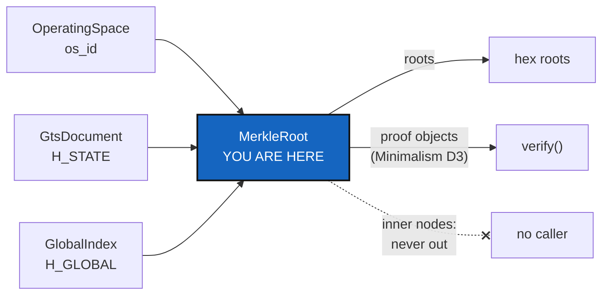

# MerkleRoot — one class computes every State hash, and never hands its tree out

*Created: 2026-10-27*

*Branch: main*

> **Implemented — 2026-10-27 (`cgitsync-8.0.1`, a major: a `--json` field of `omniscience proof` is removed).**
> Decisions asked through `AskUserQuestion` before the first edit: **D1** the folder is
> `merkle/` in lowercase (this also answers SrcLayout's D1 for this folder, and the
> other three follow the same rule); **D3** `GtsIntegrity` and `GlobalIntegrity` are
> removed, with every caller moved, no alias; **hashes that are not recorded** (a
> tie-break in `git_tree`, a cache key in `runtime_state_store`) are exempt and named
> by a test; **the interim output** of `omniscience proof` and `state`: the `siblings`
> are gone now, not at ProviderMigration. What landed:
> - `merkle/merkle_root.py`: `MerkleRoot`, `InclusionProof`, `GlobalInclusionProof`,
>   `MerkleError`. It replaces `gts_integrity.py`, `global_integrity.py` and
>   `inclusion_proof.py`, and imports nothing of the package (a test holds it).
> - Every content hash goes through it: the ledger entry, the commit log, the
>   Environment, the agent contract, the self-history, a manifest's digest, a snapshot
>   file's digest, `os_id`, and the ledger chain's `GENESIS_PREV`, which
>   `autofix/repair_divergent_user.py` no longer copies.
> - **Bit for bit.** Every golden vector passes unchanged (115 tests, moved onto the
>   class), and this tree's real chain, 92 entries written by 5.0.0 to 7.3.x, still
>   verifies with the same answer as before (`incomplete`, 27 `COMMIT_LOG_LOST`, no bad
>   entry hash).
> - **The proof path is private.** `InclusionProof` has `verify` and `summary()` (schema,
>   leaf index, tree size, root), no `siblings`, `to_dict` or `from_dict`. `omniscience
>   proof` and `state` print `leaf n of m, root …` and no path (tutorial 8, user guide and
>   API guide updated). This changes a documented output.
> - **Deviations from §2 and §4, for the owner to see.** (1) `global_index.py` stays
>   outside `merkle/`: it imports `OmniscienceRecord`, and `merkle/` imports nothing; it
>   is the adapter that turns records into leaf digests, and it goes with the
>   Omniscience modules (`omniscience/`, SrcLayout). (2) The class does **not** yet take
>   the integrity schema as an argument: `SCHEMA = 1` and `GLOBAL_SCHEMA = 1` are
>   constants. NestedAgentMaster's N1 (schema 2, keyed by `tree_path`) adds the argument,
>   additively. (3) `GtsDocument.checked` translates `MerkleError` into
>   `ConfigValidationError`, in one place, because `merkle/` cannot import `errors`.
>   (4) Tests: `test_merkle_state.py`, `test_merkle_global.py`, `test_merkle_proofs.py`
>   (the old integrity tests, moved) and `test_merkle_root.py` (imports, public surface,
>   the leaf's field set, LEFT = RIGHT for a ledger entry, an Environment, an agent
>   contract and a commit log). The State's own LEFT = RIGHT (tree, `.gts` in memory, on
>   disk, reloaded) is held by `test_operating_space_integrity.py`, unchanged.
> - **Two edges the orchestrator found, left as follow-ups.** The path is private by
>   convention: `dataclasses.asdict(proof)` and `proof._path` still reach it (`__slots__`
>   does not hide it). Nothing does, and `repr` and `summary()` are clean; a test that
>   forbids `asdict` on a proof, or a wrapper that holds the path, would close it. And
>   `autofix/repair_divergent_user.py` has two stray blank lines where `_GENESIS_PREV` was.
> - **The version is 8.0.1, not 7.4.0:** removing `siblings` from `omniscience proof
>   --json` removes a documented `--json` field, which `.dev/Versioning.md` calls major.
> - **Ceilings:** none raised. `gts_document.py` was kept at its baseline by joining
>   three calls and two strings.

> **Owner's answers, 2026-10-27 (Minimalism D3, D4, D5).** Asked through
> `AskUserQuestion` once the map existed.
> - **Every hash is MerkleRoot's** (D4). The owner's model: the system converges on a
>   tree, where hashes and Merkle trees are immaterial frontiers, *never exposed,
>   always held to the test LEFT = RIGHT bit for bit*: the hash computed from the
>   structure in memory equals the one recomputed from its materialised form
>   (`.gts`, disk, remote). MerkleRoot owns the State hashes (`H_GITTREE`, `H_STATE`,
>   `H_GLOBAL`, `os_id`), the ledger chain (its head is its root) and the content hashes
>   of the commit log, the Environment and the records: the nine modules that import
>   `hashlib` without being hashing modules, plus the eight that name a node (Minimalism
>   §7.5). §2 and §6 below are read with that scope, and §6's acceptance gains the
>   LEFT = RIGHT test for every hashed object, not only the State.
> - **An audit path is a node** (D3). `InclusionProof.siblings` is private to
>   `MerkleRoot`: no CLI, answer or file shows, returns or stores it. A caller learns
>   *verified* or *invalid* and the root. `omniscience proof` and `state` leave with the
>   register (D7), so nothing prints one.
> - **Every byte as before.** The ledger entry hash contains the toolchain, so each
>   moved computation must give the same bytes as the code it replaces, on every chain
>   already written (§4 holds the golden vectors; this widens them to each moved hash).

> **Ticket review — 2026-10-27, seventh pass (short ticket `gitRepo`).**
> Rank unchanged. Two changes. First, `MerkleRoot` is the first resident of
> SrcLayout's `Merkle/` folder, the *"never revealed interface"*, so it is
> created there and not as a top-level module. Second, Omniscience
> *"synthesises with hash256(MerkleRoot)"* and gx4g holds the register. The
> roots and record names this class computes are therefore exactly what gx4g
> writes (ProviderMigration §1a), and they must stay byte for byte (§4).
> **Answered 2026-10-27 (owner, A): `Merkle/` imports nothing, not even
> `GitRepo/`.** It receives raw data and gives back a root, a name or a verdict.
> What the owner asked: *does the hash of a `GitRepo` move into Merkle, or does
> `GitRepo` hold an object shared with Merkle?* Neither. The hash was never in
> `git_repo.py`; what moves is the **computation**. The list of fields that make a
> repository's identity (`GtsDocument.repo_leaf`: name, relative path, state, refs,
> `commit_sha`, owner, provider… and not `access_protocol`) **stays with the adapter**,
> `GtsDocument` in `Tree/`, which builds each leaf from a `GitRepo` and hands plain values
> to `MerkleRoot`. So `GitRepo/` and `Merkle/` are two independent folders that import
> nothing from each other or from the rest of the package, and `Tree/` is the one place
> that knows both. Consequence, accepted: the choice of fields is outside `Merkle/`, so
> the LEFT = RIGHT test cannot see it. A **field-set test** in `Tree/` pins the exact
> leaf keys and fails loudly when one is added or dropped, since either changes every
> State's name.

> **From the owner's short ticket `minimalism` (2026-10-27).** Filed at
> `main_1-4` by the ticket review of the same day, as BeforeBeta's step S6,
> after Minimalism draws the map. The owner's words: *"The Merkle Tree of
> MerkleRoot must never be accessible by cgitsync nor gx4g. It is the
> interface never materialised. […] Reorganise Class around this MerkleTree.
> […] MerkleRoot doit ainsi devenir une classe à part entière et les méthodes
> de calcul des hash d'état doivent lui être déléguées. À terme cette classe
> deviendra certainement un repo à part entière."* Before beta (owner, the
> same review).

## Abstract — read this first

**The one-line version.** The State hashes are computed today in five
modules. This ticket moves them behind one class, `MerkleRoot`, which takes
leaves and gives back roots and proofs, and from which no code can read an
inner node. Every hash stays byte for byte what it is.

**What this document is.** What exists (§1), what the class is (§2), how the
roles the owner named are checked (§3), what must not change (§4), the
decisions (§5), the work (§6) and acceptance (§7).

**Why it exists.** A State's name and the Omniscience register's `H_GLOBAL`
are the two facts the whole project rests on, and gx4g will move a host's
repositories by them (ProviderMigration). One class, with one door, is the
part that can later become a repository of its own. Five modules that each
know a little of the tree cannot.

**Who it is for.** The worker, the orchestrator, and the owner for §5.

**What you need to do with it.** Wait for Minimalism's §7 (the Merkle surface
table) and its D3 and D4, which fix this ticket's scope. Then follow §6.

---

## 1. What exists, as of 2026-10-27 (`cgitsync-7.3.0`)

| Module (ring) | Computes |
|---|---|
| `gts_integrity.py` (0) | `GtsIntegrity`: the leaf of one repository, `node_hash`, `merkle_root` (`H_GITTREE`), `integrity_schema = 1`'s golden vectors |
| `global_integrity.py` (0) | `GlobalIntegrity(GtsIntegrity)`: `leaf_digest`, `global_root` (`H_GLOBAL`), an observation's and a checkpoint's name |
| `gts_document.py` (0) | `compute_gittree_root`, `_state_payload`: `H_STATE`, a State's name |
| `operating_space.py` (2) | `os_id`; by rule the *only* place `H_GITTREE` is computed from the tree (`AdditionalSpecs.md`, *Architecture rules*) |
| `inclusion_proof.py` (0) | `InclusionProof`, `GlobalInclusionProof`: audit paths, which carry inner nodes, and their `verify` |
| `global_index.py` (0) | `GlobalIndex.root`: `H_GLOBAL` over the accepted records |

## 2. The class

- **`MerkleRoot`** owns the hashes Minimalism D4 names, the State hashes at
  least (`H_GITTREE`, `H_STATE`, `H_GLOBAL`), and `os_id` if D4 says so. It
  owns them under each schema (`integrity_schema = 1`, `GLOBAL_SCHEMA = 1`).
- **Its door.**
  - In: leaves, canonical payloads.
  - Out: hex roots, names, and proof objects with a `verify`.
  - No method returns a node list, a level, or a sibling by index.
- **One module.** It is ring 0: pure, no I/O, and importing only the
  canonical-JSON helpers it already uses. That is the shape that can later
  leave for its own repository (§5, D2).
- **The callers keep their names.**
  - `OperatingSpace`, `GtsDocument`, `GlobalIndex` and the proofs delegate to
    it; their public methods stay, so nothing outside changes.
  - The rule "`OperatingSpace` is the only place `H_GITTREE` is computed from
    the tree" becomes "`OperatingSpace` is the only place it is asked for;
    `MerkleRoot` computes it".

## 3. The roles the owner named, checked in the code

Minimalism's §4 checks the ring interfaces. This ticket writes the outcome
into the class docstrings and into `AdditionalSpecs.md`, in the owner's
words:

- `ComplexGitSyncClient` is the gate of GitTree;
- `WorkingGitTree` is the Operating Space;
- `.cgs` is the API of USER;
- `.gts` is the API of DEV;
- `OperatingSpace` is the API of OPX;
- gx4g is the universal API gate.

A role the map found violated is either fixed here, when the fix is a
delegation, or filed as a defect in BeforeBeta §3.

## 4. What must not change

- Every golden vector in `tests/` (`integrity_schema = 1`, `GLOBAL_SCHEMA = 1`,
  the RFC 6962 vectors) passes unchanged.
- Every State on disk keeps its name.
- Every `os_id`, every `H_GLOBAL` and every proof in a register is
  byte-identical.
- No schema number moves here. A change to anything hashed is a new schema,
  never an edit (digest). Integrity schema 2, which keys a leaf by its
  `tree_path`, is NestedAgentMaster's N1 (BeforeBeta S10). It lands after
  this ticket, inside `MerkleRoot`, beside schema 1, which keeps verifying
  under its own rule. So the class takes the schema as an argument from the
  start, with schema 1 its only value for now.

## 5. Decisions for the owner

Asked through `AskUserQuestion` before the first edit.

| D | Question | Recommendation |
|---|---|---|
| **D1** | The class name and module: `MerkleRoot` in the `Merkle/` folder (spelled as SrcLayout D1 decides), or another name. | `MerkleRoot`, in `Merkle/merkle_root.py`, ring 0, as the owner wrote it. |
| **D2** | "Later its own repository": prepare now (no import from the rest of the package, a test that asserts it), or only keep the door small? | **Answered 2026-10-27 (owner, A): prepare now, and strictly.** A test that `Merkle/` imports nothing from `ComplexGitSync`, `GitRepo/` included. It costs one test and keeps the move possible. |
| **D3** | `GtsIntegrity` and `GlobalIntegrity`: kept as thin aliases for one release, or removed in this change? | **Removed,** with every caller moved. They are not public API in `api_python.tex`; Minimalism's map confirms it. |

## 6. The work

1. Minimalism's §7 Merkle table is the starting list.
2. `merkle_root.py`, with the existing tests moved onto it first, so that each
   golden vector is green before any caller moves.
3. Each caller moves to `MerkleRoot`, one per commit-sized step, with the full
   suite after each.
4. Every inner node that §7 found leaving the hashing modules goes behind the
   door, or is reported if Minimalism D3 kept it.
5. Docs: `AdditionalSpecs.md` (*What a State's name is computed from*, the
   module table, *Architecture rules*), `digest.md` (the `OperatingSpace`
   line), `api_python.tex` where a public name moves. The ceilings are
   expected to fall. A raise is asked by name.

## 7. Acceptance

- One module computes every hash D4 names. A test walks `src/` and finds no
  `hashlib` call building a Merkle node or root outside it.
- No public method of `MerkleRoot` returns an inner node, and a test lists
  its public surface.
- §4 holds: golden vectors, State names, `os_id`, `H_GLOBAL` and the proofs.
- A **field-set test** in `Tree/` pins the exact keys of a repository's leaf
  (`GtsDocument.repo_leaf`), because under answer A the choice of fields is the adapter's,
  not `Merkle/`'s, and adding or dropping a key renames every State.
- A test that `Merkle/` imports nothing from `ComplexGitSync`, `GitRepo/` included.
- `pixi run lint`, `pixi run test`, `bump-build`, and `cgitsync status` with
  `errors=0`.
