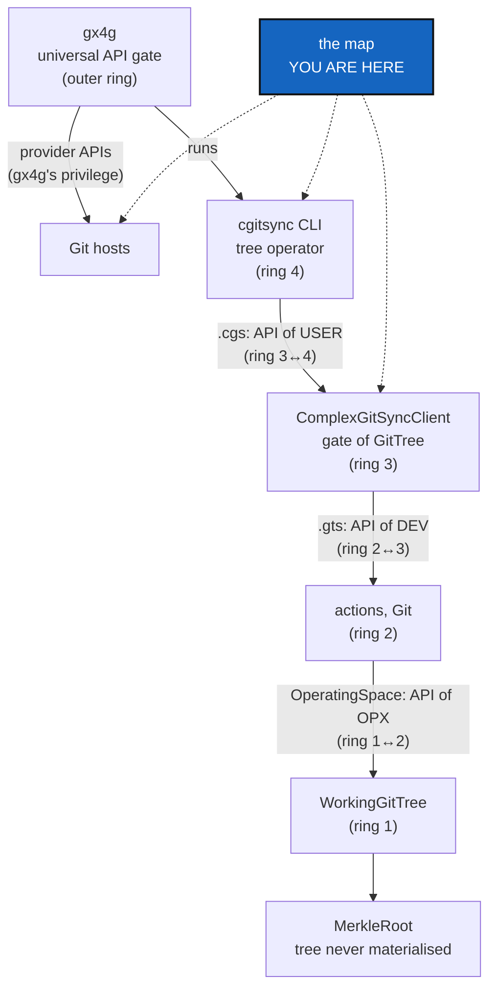

# Minimalism — map every class and method by ring, and what the CLI exposes, before the CLI is cut down

*Created: 2026-10-27*

*Branch: main*

> **Implemented — 2026-10-27 (the map; `src/` unchanged).** The map is §7, drawn
> by `scripts/map_surface.py` (`pixi run python scripts/map_surface.py`, one
> `--section` of `modules`, `unused`, `client`, `cli`, `provider`, `merkle`,
> `rings`, `gitrepo`, `folders`; `--full` for every module), and held by
> `tests/unit/test_map_surface.py`. D1–D7 (§5) are **asked of the owner after
> this map**, as the ticket said. **They were answered by the owner on
> 2026-10-27, through `AskUserQuestion`, and are recorded in §5.** §7.3's
> verdict column is D1 under the owner's *autonomous rule*.

> **Ticket review — 2026-10-27, seventh pass (short ticket `gitRepo`).**
> Rank unchanged. The map gains three things. A **folder column** (D6):
> SrcLayout moves every module into `GitRepo/`, `Merkle/`, `Tree/` or
> `OperatingSpace/`, and the owner decides the moves from this column. The
> **`GitRepo` boundary**: GitRepo is the dependency gx4g will share, and it
> imports nothing back. And **Omniscience's split**: gx4g holds the register
> and writes to it, and `cgitsync` produces what is written
> (ProviderMigration §1a). BranchProtection is now `main_1-7`.

> **From the owner's short ticket `minimalism` (2026-10-27).** Filed at
> `main_1-3` by the ticket review of the same day, as BeforeBeta's step S5.
> The owner's words: *"The CLI is very rich. It would be wise to reduce it to
> the minimal. Security comes from there because it reduces the attack
> surface. […] map class and methods by ring and see which ones are exposed
> through the CLI, with the objective that the CLI lands mostly at ring
> interfaces. This is a mapping ticket for further decisions."* The short
> ticket's other parts went to MerkleRoot (`main_1-4`), CliReduction
> (`main_1-5`), BranchProtection and ProviderMigration (`main_2-10`). The owner's answers in that review, asked through
> `AskUserQuestion`:
> - **Provider APIs.** Every call to a provider's API migrates to gx4g, the
>   reads as well as the writes. Before beta, `cgitsync` gains no new call,
>   and the existing ones are listed here for ProviderMigration.
> - **BranchProtection is split.** `cgitsync` keeps its USER-tree guard and
>   the dead-branch report. Protection and roles on the provider become a
>   requirement for gx4g.
> - **Everything in the short ticket is before beta,** except the migration
>   itself, which waits for gx4g.
> - **"Disclosed" means withdrawn from the CLI.** A command is kept,
>   reinforced, adapted, or withdrawn.

## Abstract — read this first

**The one-line version.** Before anything is cut, draw the map. Every class
and public method, by ring. Every CLI command, with the method it reaches and
the ring boundary it crosses. Every call to a provider's API. Then every
command gets one verdict: keep, reinforce, adapt or withdraw.

**What this document is.** The owner's model (§1), what the code holds today
(§2), what the map must contain (§3), the checks it runs (§4), the decisions
it raises (§5), and when it is done (§6). It changes no line of `src/`.

**Why it exists.** The CLI has 27 commands and 66 leaf commands, over 115
public client methods and about 1 480 functions. Each one is attack surface,
and some of it may be unused or deprecated. The owner wants the CLI to sit at
the interfaces between rings, the Merkle tree to stay behind one class that
never hands its inner nodes out, and every write on a Git host to become
gx4g's. Nobody can cut that surface safely without a map.

**Who it is for.** The worker who draws the map and the orchestrator who
checks it. The owner reads its verdicts (§5) before CliReduction cuts
anything.

**What you need to do with it.** Draw §3 as a new §7 of this ticket, run §4,
then ask §5. MerkleRoot and CliReduction start from that table.

---

## 1. The owner's model, as the short ticket states it

| Name | Role in the owner's words | Ring interface it is |
|---|---|---|
| gx4g | "the UNIVERSAL API-GATE"; the only one that writes to a Git host through its API | the outer ring |
| `cgitsync` | "the Tree Operator of the infrastructure", "only an executor" | — |
| `ComplexGitSync` (the client) | "the Gate of GitTree" | — |
| `.cgs` | "the API of USER" | ring 3 ↔ 4 |
| `.gts` | "the API of DEV" | ring 2 ↔ 3 |
| `OperatingSpace` | "the API of OPX" | ring 1 ↔ 2 |
| `WorkingGitTree` | "the Operating Space" | — |
| `MerkleRoot` | its own class, computing the State hashes; later its own repository. "The Merkle Tree of MerkleRoot must never be accessible by cgitsync nor gx4g. It is the interface never materialised." | — |
| `GitRepo` | *(short ticket `gitRepo`)* "a specific Graph for GX4G"; the dependency that provides Graph and GitRepo, and that `cgitsync` mounts as GitTree | below everything; imports nothing back |
| Omniscience | *(`gitRepo`)* synthesises the GitTree "with hash256(MerkleRoot)"; held by gx4g, which "manages access privileges to GitRepo" | gx4g's |

"OPX" is the owner's term and is not defined anywhere in the spec tree (D5).

## 2. What the code holds today

Checked on 2026-10-27 against `HEAD` (`cgitsync-7.3.0`).

- **The CLI** has 27 top-level commands and 66 leaf commands:
  - `initialise`, `bootstrap`, `release` (3), `status`, `view-tree`,
    `validate`, `pull`, `fetch`, `autofix`, `checkout`;
  - `branch` (5), `add`, `rm`, `commit`, `merge`, `push`, `tag`;
  - `submodules` (3), `verify` (2), `memory` (16), `self-history` (3),
    `omniscience` (13);
  - `discover`, `repo` (1), `env` (2), `unlock`, `help`.

  `ComplexGitSyncClient` has 115 public methods.
- **The ring table** (`AdditionalSpecs.md`, *The ring table*) places modules,
  not documents. `cgs_format.py` and `gts_document.py` are ring 0,
  `git_tree.py` (`WorkingGitTree`) is ring 1, `operating_space.py` is ring 2,
  `orchestre/` is ring 3 and `cli/` is ring 4. The owner's model (§1) places
  each *document* on the boundary it crosses, so the two are not in conflict
  yet. §4 checks whether each document really crosses only that boundary.
- **Provider API calls.** Each one runs the provider's own CLI through
  `GitRunner.run_tool`, and `provider.py` builds every argv:

  | Call | Kind | Who reaches it |
  |---|---|---|
  | `gh`/`glab`/`tea` `repo create` (`provider.creation_plan`, `DiscoveryCommands.repo_create`) | write | `cgitsync repo create`; `cgitsync memory setup` through `MemorySetup`, and the terminal offer that runs it |
  | `gh auth status` and its peers (`TreeObserver._provider_auth`, `tree_env.py`) | read | `cgitsync env show` and `env check`, and every command that writes a State, through its Environment record |
  | `memory init` and `memory setup`'s proposal | none (they print the command) | — |

  BranchProtection's M0–M4 planned three more (`gh api` for the role, the
  protection and the login). They now go to gx4g instead (BranchProtection).
- **State hashes** are computed in five modules:
  - `gts_integrity.py` (`GtsIntegrity`: leaf, node, `H_GITTREE`);
  - `global_integrity.py` (`GlobalIntegrity`: `H_GLOBAL`, observation names);
  - `gts_document.py` (`compute_gittree_root`, `_state_payload`: `H_STATE`);
  - `operating_space.py` (`os_id`; the only place `H_GITTREE` is computed
    from the tree);
  - `inclusion_proof.py` (audit paths, which carry inner nodes) and
    `global_index.py` (`H_GLOBAL` over the index).

  `omniscience proof` prints an audit path. Ledger, commit-log, Environment,
  self-history and register-record hashes are content hashes over one record,
  not over a tree.
- **One mirror break.** `cgitsync unlock` (StateLocking, 7.3.0) calls
  `WorkspaceLock` directly. It has no client method, against
  `AdditionalSpecs.md`'s rule *The CLI mirrors the Python API*.

## 3. The map: what §7 must contain

One table per layer, generated where it can be (an AST walk, a parser walk),
and written by hand only where a judgement is needed.

1. **Classes and public methods by ring.** Module, ring, class, public method,
   its callers in `src/`, and whether any CLI path reaches it. A method that
   nothing in `src/`, the tests excepted, calls is marked *unused*; one
   documented as kept only for compatibility is marked *deprecated*.
2. **The CLI, command by command.** Leaf command, the client method it calls
   (or "none", as for `unlock`), the ring that method sits in, the document it
   reads or writes (`.cgs`, `.gts`, an Operating Space, none), the ring
   interface it therefore lands on (§1), whether it writes, and whether it
   reaches a provider's API or the network.
3. **Provider API calls.** Every `run_tool` call site and every planned one,
   read or write, the command that reaches it, and what gx4g must offer
   instead (ProviderMigration).
4. **The Merkle surface.** Every function that computes a State hash or walks a
   Merkle tree, and every API, CLI or file that hands out an inner node. An
   audit path counts, and so does a leaf list.
5. **The folder column** (short ticket `gitRepo`). For each module, the
   SrcLayout folder it moves to: `GitRepo/`, `Merkle/`, `Tree/` or
   `OperatingSpace/`, or a place of its own with a reason. `cli/`,
   `orchestre/`, `memory/`, `operations/` and `autofix/` are proposed here,
   and the owner decides (D6).
6. **The verdict column.** Each leaf command is marked keep, reinforce, adapt
   or withdraw, with one line of reason. A withdrawn command names what
   replaces it, or "nothing; the method is removed" (D1).

## 4. The checks the map runs

- **The ring interfaces (the owner's model).** Each check confirms one
  boundary, or lists what crosses it from elsewhere:
  - `.cgs` is produced and consumed only across ring 3 ↔ 4;
  - `.gts` only across ring 2 ↔ 3;
  - `OperatingSpace` only across ring 1 ↔ 2;
  - nothing in `cgitsync` stands where gx4g should: no provider call, and no
    register write beyond those ProviderMigration §1a lists;
  - the modules proposed for `GitRepo/` import nothing else from
    `ComplexGitSync`, or the map lists each import that would have to go.
- **The CLI lands at ring interfaces.** It lists every command that reaches
  deeper than the interface it should land on, or that has logic of its own.
- **Unused and deprecated methods.** Each one is listed with its callers and
  its test-only callers. Nothing is removed here.
- **Provider calls.** Each call is listed and none is added. A check, kept in
  `tests/` once CliReduction lands, fails when a new `run_tool` call site
  appears.
- **The Merkle tree is never materialised.** It lists every place an inner
  node leaves the hashing modules.

## 5. Decisions for the owner

Each is asked through `AskUserQuestion` once §7 exists, because each answer
needs the map's numbers.

| D | Question | Recommendation |
|---|---|---|
| **D1** | The verdict per command, from §7's column, as a list the owner edits: keep, reinforce, adapt or withdraw. | **Answered 2026-10-27: the autonomous rule.** A command stays if `cgitsync` needs it to run with no gx4g (*"la CLI `memory` ne doit pas disparaître, ni `branch create`… pour que cgitsync fonctionne en standalone"*). Only what gx4g owns leaves: `repo create` and the 12 `omniscience *` commands, 13 withdrawals, executed by ProviderMigration when gx4g offers them. `memory migrate`, `memory init` and `memory mount` stay. Totals: 44 keep, 4 adapt, 5 reinforce, 13 withdraw (§7.3). |
| **D2** | *The CLI mirrors the Python API* says every capability exists in both layers. Does a minimal CLI keep that rule, or keep it only one way (every CLI command has a client method, but not every method has a command)? | **Answered 2026-10-27: one way.** A client method may exist for gx4g and Python callers with no command. Every command has its method, so `unlock` gains one (CliReduction). `AdditionalSpecs.md` is rewritten accordingly. |
| **D3** | Does an audit path (`omniscience proof`, `InclusionProof`) count as "the Merkle tree accessible"? | **Answered 2026-10-27: yes, a path is a node.** `InclusionProof.siblings` is never printed, returned or stored outside `MerkleRoot`. The proof is verified inside it, and a caller learns only *verified* or *invalid* and the root. `omniscience proof` and `state` stop showing it, and both leave with the register (D7). |
| **D4** | Which hashes MerkleRoot owns: the State hashes only (`H_GITTREE`, `H_STATE`, `H_GLOBAL`, `os_id`), or every content hash too (ledger, commit log, Environment, record)? | **Answered 2026-10-27: every hash.** The owner's model: *the system converges on a tree*, where hashes and Merkle trees are immaterial frontiers, never exposed, always held to the test **LEFT = RIGHT bit for bit** (the hash computed from the structure in memory equals the one recomputed from its materialised form: `.gts`, disk, remote). The ledger is a chain, a degenerate tree whose head is its root. MerkleRoot owns the State hashes, the ledger chain and the content hashes of the commit log, the Environment and the records. |
| **D5** | What "OPX" names, so that the map can say what the `OperatingSpace` interface serves. | **Answered 2026-10-27: the operating system.** `OperatingSpace` is the interface between the file tree (ring 1) and the Git actions (ring 2). The code consumes it from ring 3 (§7.6), which is a deviation SrcLayout and CliReduction correct, not a model to adjust. |
| **D6** | The folder per module and package, from §3's folder column, as a list the owner edits. SrcLayout carries it out. | **Answered 2026-10-27: the map's column, with Omniscience apart.** The 14 Omniscience modules go to their own `omniscience/` folder, which leaves `cgitsync` at migration. `cli/` and `orchestre/` stay above the four folders; `memory/`, `operations/` and `autofix/` go under `Tree/`. |
| **D7** | Omniscience's reads (`get`, `branches`, `history`, `state`, `proof`, `verify`, `status`, `report`, `memory`): kept in `cgitsync`, or gx4g's with the register? Its writes are gx4g's already (ProviderMigration §1a). | **Answered 2026-10-27: gx4g's, all of them.** *"La gate ne possède que Omniscience. Les autres registres restent dans le projet protégé. cgitsync doit pouvoir tourner en local. Il garde ainsi ses registres."* All 12 `omniscience *` commands except `record` leave with the register. `cgitsync` keeps its own registers: the ledger, the memory and the self-history, and runs with no gx4g. |

## 6. Done when

- §7 holds the six tables of §3, generated by a script kept under
  `scripts/` so that it can be run again after CliReduction.
- Every check in §4 has its result in §7.
- D1–D7 are answered (2026-10-27) and written into MerkleRoot, CliReduction,
  SrcLayout and ProviderMigration, and the rules they set are in
  `AdditionalSpecs.md` and `digest.md`.
- `src/` is unchanged. `pixi run lint` and `pixi run test` pass. The script is
  the only new code, and it has a test.
- The orchestrator's record is written. Its version level is `patch`, for a
  script and no behaviour change.

---

## 7. The map (2026-10-27, `cgitsync-7.3.1`)

Generated by `scripts/map_surface.py` from the syntax tree and the real argparse
tree. The analysis is by name: a method is *unused* when no attribute, name or
identifier-shaped string in `src/` equals it, which over-counts use and never
under-counts it. A list below is a set of candidates, not of verdicts. Rerun the
script after CliReduction, ProviderMigration and MerkleRoot to see what is left.

### 7.1 Classes and public methods, by ring

122 modules, 183 public classes, 935 public methods and 87 public functions.

| ring | modules | classes | public methods | public functions |
|---|---|---|---|---|
| 0 | 23 | 58 | 130 | 23 |
| 1 | 23 | 44 | 184 | 30 |
| 2 | 25 | 43 | 303 | 2 |
| 3 | 31 | 37 | 318 | 1 |
| 4 | 17 | 1 | 0 | 31 |
| none declared | 3 | 0 | 0 | 0 |

Rings 2 and 3 hold 621 of the 935 public methods. The ring 4 package holds no
class of its own except one and 31 functions, which is what the CLI should be.
The three modules with no `Ring:` line are the three `__init__.py` and
`__main__.py` (`__init__`, `__main__`, `autofix/__init__`).

**Public names nothing in `src/` refers to: 25**, of which **2 are used by no
test either** and are the first candidates for removal:
`CommitLog.find_state_for_commit` (`memory/commit_log`) and
`MemoryFacts.release_snapshot_slug` (`orchestre/memory_facts`). The other 23
are used by a test only: `CgsDocument.from_project_definition` and `to_git_tree`,
the four `to_json`, `from_json`, `to_yaml`, `from_yaml` of
`ConfigDocumentIOMixin`, `BranchResolution.is_default`, `GitRepo.resolved_group_name`,
`RepoAddress.from_repo`, `GitTree.force_repo_keys`, `force_repo_sha`,
`propagate_tag`, `WorkingGitTree.to_gts`, `GitTreeBranches.refresh`,
`LedgerStore.append_entry`, `MemoryStates.resolve_directory` and
`snapshot_candidates_for_id`, `SyncLedger.record_event`,
`OperatingSpace.inclusion_proof`, `Orchestre.register_repo`,
`PathResolver.resolve_clone_root`, `Toolchain.reset_cache` and
`TreeObserver.reset_cache`. No docstring says *deprecated*.

### 7.2 The client: 115 public methods, 86 reached by a command

The 29 no command reaches (a Python caller, gx4g, or another module only):
`build_installed_from`, `clone_cgs`, `describe_cgs`, `discover_nested_configs`,
`expand`, `fix_circularities`, `format_project_tree`, `freeze`, `freeze_state`,
`get_ledger_history`, `git`, `initialise`, `is_loaded`, `launch_state`, `load`,
`load_cgs`, `load_source`, `next_release_tag`, `preserved_branches`, `print`,
`project_branches`, `replay_ledger`, `restart`, `tree_branch_label`,
`validate_branch_topology`, `validate_topology`, `verify_json`, `view_operation`,
`write_gts_snapshot`. Most are the library surface `api_python.tex` documents. The
full per-method table is `--section client`.

### 7.3 The CLI: 66 leaf commands

35 write, 29 only read, 2 touch no client method (`unlock`, `help`). One client method can serve a reading and a writing leaf, so two leaves are marked by hand (`LEAF_WRITES`): `verify repair` writes (it rewrites the `HEAD` cache, `verify check` does not) and `submodules report` only reads (the dry run of `import`). `memory mount` writes (it appends an entry to a `.cgs`) and `discover` writes only with `--write`. The client
method of a leaf is read from its handler, following dispatch tables and sibling
modules: 21 *exact*, 37 *matched* by name to the group's methods, 8 *hand*-checked
(`NAMED` in the script). Every command reaches `CgsDocument`, `Settings`,
`SnapshotResolution` and `CgshomeResolution` through `_shared`, which is
plumbing for finding a workspace.

What a leaf reaches **below the client** beyond that plumbing, which the owner's
model says should not happen from ring 4:
- `release *`: `ReleaseCommands`, `ReleaseLoad` (ring 3 classes, named directly);
- `pull` and `merge`: `MemoryMergeOperation` (ring 2);
- `self-history *`: `AgentInfo`, `ConformityScore`, `ConformityScale` (ring 1 records);
- `unlock`: `WorkspaceLock` (ring 1), no client method at all;
- `discover`: `DiscoverReport`, `DiscoveredRepo`; `env *`: `Drift`, `TreeEnvironment`;
- most commands name `ProjectTreeState`, `RepoScope`, `RefKind` or `HistoryState`, the
  value types they print.

| leaf command | client method | writes | verdict (D1) | why |
|---|---|---|---|---|
| `initialise` | `configure`, `format_repo_tree`, `initialise_cgs`, `initialise_cgs_document`, `resolve_cgshome`, `resolve_initialise_cgshome` | writes | **keep** | the nested install; the user's front door |
| `bootstrap` | `bootstrap`, `resolve_bootstrap_root` | writes | **keep** | the standalone install |
| `release freeze` | `freeze_release` | writes | **keep** | a release anyone can load; resumable since 7.3.1 |
| `release list` | `list_releases` | reads | **keep** |  |
| `release load` | `load_release` | writes | **keep** |  |
| `status` | `status`, `status_json` | reads | **keep** |  |
| `view-tree` | `load_runtime_or_cgs` | reads | **keep** |  |
| `validate` | `validate` | reads | **keep** | judges a `.cgs`: the API of USER |
| `pull` | `pull`, `pull_force`, `refresh_private` | writes | **reinforce** | `--force` is destructive; reaches `MemoryMergeOperation` below the client |
| `fetch` | `fetch` | reads | **keep** | read-only |
| `autofix` | `autofix` | writes | **reinforce** | repairs; takes the lock |
| `checkout` | `checkout` | writes | **keep** |  |
| `branch create` | `branch` | writes | **keep** |  |
| `branch list` | `list_branches` | reads | **keep** | read-only |
| `branch close` | `close_branch` | writes | **keep** | a developer's right; refused in a USER tree |
| `branch check` | `branch_ancestry` | reads | **keep** | read-only |
| `branch delete` | `delete_branch` | writes | **reinforce** | the one that cannot be undone: BranchProtection |
| `add` | `add` | writes | **keep** |  |
| `rm` | `removals_outside_scope`, `remove` | writes | **keep** |  |
| `commit` | `commit` | writes | **keep** |  |
| `merge` | `merge`, `merge_into`, `merge_into_plan`, `merge_plan`, `merge_resolve`, `merge_resolve_all`, `open_merge_tool` | writes | **keep** | reaches `MemoryMergeOperation` below the client |
| `push` | `memory_declared`, `push` | writes | **keep** |  |
| `tag` | `tag` | writes | **keep** |  |
| `submodules report` | `import_submodules` | reads | **adapt** | the dry run of `import`: one command with `--apply` |
| `submodules import` | `import_submodules` | writes | **adapt** | one command with `--apply`, with `report` |
| `submodules init` | `init_from_submodules` | writes | **keep** | a one-off migration; withdraw once nobody migrates (D1) |
| `verify check` | `verify` | reads | **keep** |  |
| `verify repair` | `verify` | writes | **reinforce** | rewrites only the recomputable `HEAD` cache |
| `memory status` | `memory_status` | reads | **keep** |  |
| `memory list` | `memory_list` | reads | **keep** |  |
| `memory show` | `memory_show`, `memory_show_environment` | reads | **keep** |  |
| `memory init` | `memory_init` | reads | **keep** | the standalone way to see the three steps; stays (D1, autonomous rule) |
| `memory clone` | `memory_clone` | writes | **keep** | restores a memory on another machine |
| `memory mount` | `add_memory_repo_cgs` | writes | **keep** | stays (D1, autonomous rule) |
| `memory adopt` | `memory_adopt` | writes | **keep** |  |
| `memory setup` | `memory_setup`, `memory_setup_decline`, `memory_setup_proposal` | writes | **adapt** | its create step is a provider call: gx4g's (ProviderMigration) |
| `memory as-of` | `memory_as_of` | reads | **keep** |  |
| `memory migrate` | `memory_migrate` | writes | **keep** | stays: a standalone `cgitsync` migrates an old workspace itself (D1) |
| `memory branch` | `memory_branch` | writes | **keep** |  |
| `memory push` | `memory_push` | writes | **keep** |  |
| `memory explore` | `memory_explore` | reads | **keep** |  |
| `memory verify` | `memory_verify_published`, `verify` | reads | **keep** |  |
| `memory reboot` | `memory_reboot` | writes | **reinforce** | an interrupted reboot has no resume (RobustnessCrash D7) |
| `memory merge` | `memory_merge` | writes | **keep** |  |
| `self-history add` | `self_history_add` | writes | **keep** | reaches the conformity records below the client |
| `self-history adopt` | `self_history_adopt` | writes | **keep** |  |
| `self-history list` | `memory_self_history` | reads | **keep** |  |
| `omniscience mount` | `omniscience_mount` | writes | **withdraw** | a register write: gx4g's (ProviderMigration §1a) |
| `omniscience record` | `omniscience_record` | reads | **keep** | cgitsync produces the record gx4g writes |
| `omniscience register` | `omniscience_register` | writes | **withdraw** | a register write: gx4g's (ProviderMigration §1a) |
| `omniscience observe` | `omniscience_observe` | writes | **withdraw** | a register write: gx4g's (ProviderMigration §1a) |
| `omniscience get` | `omniscience_get` | reads | **withdraw** | a read of the register gx4g holds (D7) |
| `omniscience branches` | `omniscience_branches` | reads | **withdraw** | a read of the register gx4g holds (D7) |
| `omniscience history` | `omniscience_history` | reads | **withdraw** | a read of the register gx4g holds (D7) |
| `omniscience state` | `omniscience_state` | reads | **withdraw** | a read of the register gx4g holds, and it shows an audit path (D3, D7) |
| `omniscience proof` | `omniscience_proof` | reads | **withdraw** | shows the audit path, which is a node (D3); a read of the gx4g register (D7) |
| `omniscience verify` | `omniscience_verify` | reads | **withdraw** | a read of the register gx4g holds (D7); the proof is verified inside MerkleRoot |
| `omniscience status` | `omniscience_status` | reads | **withdraw** | a read of the register gx4g holds (D7) |
| `omniscience report` | `omniscience_report` | reads | **withdraw** | a read of the register gx4g holds (D7) |
| `omniscience memory` | `omniscience_memory` | reads | **withdraw** | a read of the register gx4g holds (D7) |
| `discover` | `discover_repos` | writes | **keep** |  |
| `repo create` | `repo_create` | writes | **withdraw** | a provider write: gx4g's (ProviderMigration) |
| `env show` | `environment` | reads | **keep** | the sign-in probe is a provider read: gx4g's (ProviderMigration) |
| `env check` | `check_environment` | reads | **keep** | same probe |
| `unlock` | - | none | **adapt** | has no client method: the CLI calls `WorkspaceLock` directly (D2) |
| `help` | - | none | **keep** |  |

**Verdicts, under the owner's autonomous rule (D1): 44 keep, 4 adapt, 5 reinforce, 13
withdraw.** The table first proposed 42, 8, 5 and 11 (the worker's proposal); the owner's
answers moved it. The 13 withdrawals are `repo create` and the 12 `omniscience *` commands
(`mount`, `register`, `observe`, and the nine reads `get`, `branches`, `history`, `state`,
`proof`, `verify`, `status`, `report`, `memory`), all gx4g's, executed by ProviderMigration
when gx4g offers each one. The four adaptations are `submodules report` and `import` (one
command), `memory setup` (its create step is a provider call) and `unlock` (gains a client
method, D2). `omniscience record` stays: `cgitsync` produces the record gx4g writes.

### 7.4 Provider API calls

Five call sites in three modules (`--section provider`), counted per module and call, so a second `run_tool` in a module that has one is caught:

| call site | call | reached by |
|---|---|---|
| `orchestre/discovery_commands:767`, `:791` | `creation_plan`, `run_tool` | `repo create` (write) |
| `orchestre/memory_setup:130` | `creation_plan` | `memory setup`, and the DEV offer after a recording command (write) |
| `tree_env:158` | `run_tool` | the sign-in probe: `env show`, `env check`, and every Environment record, so every State write (read) |
| `tree_env:278` | `run_tool("ssh", "-V")` | the same observation; `ssh` is not a provider API, only a tool probe |

`tests/unit/test_map_surface.py` holds this count (`tree_env` has two). It fails when a call site is added,
and it shrinks when ProviderMigration lands.

### 7.5 The Merkle surface

The hashing modules (`gts_integrity`, `global_integrity`, `inclusion_proof`,
`global_index`, plus `gts_document` and `operating_space`) hold 19 public functions
that compute or name a root, a leaf or a proof (`--section merkle`). Findings:

- **The tree is handed out, not only its roots.** `InclusionProof.siblings` is the audit
  path: subtree roots, which are inner nodes. `cli/omniscience_command` prints them for
  `omniscience proof`, `state` and `report`, and `OperatingSpace.inclusion_proof` builds
  them. The owner answered D3: **a path is a node**, so it is never shown. `omniscience
  proof` and `state` leave with the register (D7), and `InclusionProof.siblings` becomes
  private to `MerkleRoot`.
- **Eight modules outside the hashing set name a Merkle node, root or leaf:**
  `cli/omniscience_command` (`global_root`, `siblings`), `omniscience_record`
  (`leaf_digest`), `orchestre/memory_facts` (`merkle_root`), `orchestre/omniscience`,
  `omniscience_checkpoints`, `omniscience_commands`, `omniscience_memory` and
  `omniscience_view`. The test holds this set, and MerkleRoot empties it.
- **Nine modules import `hashlib` and are not hashing modules** (`environment_spec`,
  `git_tree`, `memory/agent_contract`, `commit_log`, `ledger_entry`, `self_history`,
  `store`, `orchestre/runtime_state_store`, `tree_env`). None builds a Merkle node: they
  hash one record, one file, or break a tie, which is Minimalism D4's recommendation
  (the State hashes only).

### 7.6 The ring interfaces of the owner's model, checked

| Interface | Owner's ring | What the code does |
|---|---|---|
| `.cgs`, the API of USER | 3 ↔ 4 | `cgs_format` is imported by 20 modules: 3 in ring 4 and 10 in ring 3, as expected, the package `__init__`, **and 6 in rings 0–2** (`environment_spec`, `discovery`, `paths`, `git_tree`, `registry`, `tree_env`) |
| `.gts`, the API of DEV | 2 ↔ 3 | `gts_document` is imported by 16 modules: 10 in ring 3, the package `__init__` and 2 in ring 2 (`operating_space`, `registry`), as expected, **and 3 in ring 1** (`memory/store`, `paths`, `settings`) |
| `OperatingSpace`, the API of OPX | 1 ↔ 2 | the module is ring 2 and is imported by 9 modules of ring 3 and by `registry` (ring 2): the interface it serves in the code is **2 ↔ 3**, not 1 ↔ 2 |
| nothing stands where gx4g should | outer ring | provider calls: 5 sites (§7.4); register writes: `mount`, `register`, `observe` (ProviderMigration §1a) |

The interface is not where the model puts it: `.cgs` is read by the tree and the
registry (the in-memory tree is built from it), and `OperatingSpace` is consumed one
ring higher than the model says. The owner's D5 settles which side moves: OPX is the
operating system, `OperatingSpace` is the interface between the file tree (ring 1) and
the Git actions (ring 2), and the ring 3 consumption is a deviation SrcLayout and
CliReduction correct, not a model to adjust.

### 7.7 The `GitRepo` boundary and the folders

- The proposed `GitRepo/` set is `clone_guard`, `git_branch`, `git_repo`, `git_runner`,
  `provider`. It imports **two** things from the rest of the package: `git_runner` imports
  `errors` and `universal_clock`. A test holds that.
- Add the graph of repositories (`git_tree`, `git_tree_branch`) and it also imports
  `cgs_format`, `errors`, `memory/repository` and two package `__init__`s (`operations`,
  `orchestre`), so the graph does not move into `GitRepo/` without cutting those.
- **The folder column** (the owner edits it, D6): `GitRepo` 5; `Merkle` 4 (`global_index`,
  `global_integrity`, `gts_integrity`, `inclusion_proof`); `OperatingSpace` 1;
  `Tree` 53 (`operations/`, `memory/`, `autofix/`, the documents, `registry`, `git_tree`,
  `paths`, `settings`, `tree_env`…); **gx4g's register** 14 (`omniscience_*` and
  `orchestre/omniscience*`); **above `OperatingSpace`** 45 (`cli/`, `orchestre/`, `errors`,
  `json_render`, `status_render`, `universal_clock`, the package `__init__`s). The full list
  is `--section folders --full`.

### 7.8 §4's checks, as run

| §4 check | Result |
|---|---|
| The ring interfaces | §7.6: `.cgs` and `.gts` are consumed below their ring; `OperatingSpace` one ring above |
| The CLI lands at ring interfaces | §7.3: 6 groups reach a class below the client; `unlock` has no client method |
| Unused and deprecated methods | §7.1: 25 candidates, 2 used by nothing; none marked deprecated |
| Provider calls | §7.4: 5 sites, none added, held by a test |
| The Merkle tree is never materialised | §7.5: audit paths are handed out through the CLI, and 8 modules outside the hashing set touch a node |

