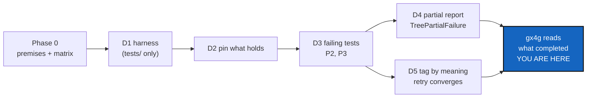

# Robustness — a failed tree-wide write says what it did, and its retry converges

*Created: 2026-10-27*

*Branch: main*

> **Implemented — 2026-10-27, `cgitsync-7.x` (the orchestrator sets the level).**
> Decisions asked through `AskUserQuestion` before the first edit, all on the
> recommendation:
> - **`release freeze`** resumes by its root tag: the annotated root tag is made
>   last, so it says a release is complete. A finished release is refused and
>   recorded once; an interrupted one resumes; a tag on another commit, or on a
>   repository that still has work to commit, is refused before anything moves.
> - **D4 covers `push`, `tag` and `freeze-release`.** The matrix classes the
>   others `PARTIAL_REPORT_REQUIRED` and leaves them as follow-up. This amends
>   §4's *"and only those"*.
> - **The Phase 0 matrix** is a section of `AdditionalSpecs.md`, *How a
>   tree-wide write fails*, not a new file.
>
> **Phase 0, re-checked against `HEAD` (7.3.0).** P1, P4–P7, P9, P10, P12 and
> P14, P15 hold. Deviations, none blocking:
> - **P2 and P3** are defects at `HEAD`, as written, and are fixed here (D4, D5).
> - **P8:** a refused ledger append is no longer only logged: StateLocking (7.3.0)
>   also emits a `UserWarning`. The State still exists, the command still exits 0,
>   and `verify` still finds the orphan.
> - **P11:** `memory reboot`'s calls moved to `memory_commands.py:1364-1368`. It is
>   RobustnessCrash's.
> - **P13:** still true in `src/`; `tests/support/faults.py` now has the one
>   `os._exit(137)`, in kill mode.
> - **§5's `test_no_command_deletes_unpushed_work`** does not exist at `HEAD`.
>   `test_clone_guard.py` holds the nearest guarantee and is kept green.
>
> **What differs from §4.**
> - D1's harness lives in `tests/support/` (`faults.py`, `failpoints.py`, and
>   `trees.py` for the real three-repository tree).
> - D5's *"INFO already tagged"* is the outcome's own `detail` (`already tagged`),
>   not a new preflight severity: `PreflightSeverity` has only two values and the
>   sweep is where the fact is known.
> - **Two edges the orchestrator found, left as follow-ups** (the first is the
>   limit of the owner's root-tag rule). If the root's annotated tag is made
>   locally but its push fails, a retry is refused as "already exists" while the
>   release is not published; the way out is to push the tag by hand, and a
>   follow-up could judge the root by "tag exists and is on the remote". And the
>   report's retry sentence says `cgitsync release freeze` without the original
>   message or `--force-tag`; without `--force-tag` a retry may compute another
>   tag name.
> - The three xfail tests of D3 were never written as xfail: D4 and D5 landed in
>   the same change, so they are plain tests.

> **Ticket review — 2026-10-27, sixth pass (short ticket `minimalism`).**
> Renumbered `main_1-6` → `main_1-2`: pile 1 is compacted, with CommitLogLoss,
> WorkingAreaRename and StateLocking archived. BeforeBeta still runs it as
> S4. Minimalism adds one constraint: the honest report and the retry change
> what `push`, `tag` and `freeze` print and return, and add no command. This
> ticket already ruled out new commands (§6), so nothing else changes.

> **Ticket review — 2026-10-27, fourth pass.** Renumbered `main_1-5` → `main_1-6`: CommitLogLoss is filed at `main_1-2`. BeforeBeta runs this ticket as step S4.

> **From the owner's short ticket `robustness` (closed 2026-10-27 as
> [archive/.closedUserTicket/20261027_robustness.md](../archive/.closedUserTicket/20261027_robustness.md)).**
> Ticket review of 2026-10-27, owner's decision: the plan is split. Phase 0
> and D1–D5 are this ticket, and are mandatory before beta: gx4g runs `push`
> and `tag` as a subprocess, so it must know what a failed run completed (P2)
> and be able to retry it (P3). BeforeBeta runs this ticket as step S5, and
> its Phase 0 is also part of BeforeBeta's defect hunt. D6–D9 (crash windows,
> resuming `memory reboot`, remote races, the real-tree run) are
> RobustnessCrash, in pile 2. The owner's text is carried below with only the
> split applied. P1–P15 were checked at `e042a92`; Phase 0 re-checks them
> against `HEAD`.

## Abstract — read this first

**The one-line version.** When a tree-wide write fails part-way, the command
says which repositories completed, which one failed and which were never
tried. A retry after the cause is fixed converges, and never makes a second
tag or release.

**What this document is.** Phase 0 (premise check and operation matrix), the
failure-report contract (§3), and steps D1–D5: the fault harness, the tests
that pin what already holds, the failing tests, the partial-failure report,
and tag conflicts judged by meaning instead of existence.

**Why it exists.** CGS cannot roll back a push a remote has accepted. So the
guarantee is an honest report and a convergent retry. For gx4g, which reads
`cgitsync`'s output from another process, that report is the frontier.

**What you need to do with it.** Run Phase 0, then D1–D5, one commit each.
§2's decisions are settled.



| Predecessor | `GtsHashRepoPrecision` — must be at its Definition of Done |
| Scope | Behaviour of tree-wide and memory commands under failure: fault harness, partial-failure reporting, retry convergence, crash windows, `memory reboot` interruption |
| State contract | Consumed, never modified. `integrity_schema = 1` and its golden vectors are untouched |
| Split out | Architecture CI gates, cross-platform user-lifecycle CI, module isolation, warning/backlog/docs hygiene → separate tickets (§8) |

---

## 0. Why

`GtsHashRepoPrecision` defines what a valid State is. This ticket checks that
a failure — a Git error, a refused push, a killed process — never makes the
result **silently false, irrecoverably ambiguous, or destructive of the only
copy of work**.

CGS cannot roll back a push a remote has accepted. The guarantee is therefore
not atomicity across remotes but:

| Moment | Guarantee |
|---|---|
| before mutation | everything detectable without mutating is checked for the whole tree |
| during mutation | the only copy of work is never destroyed |
| after partial mutation | the command fails, and says exactly what completed, what failed, and what was not attempted |
| on retry | it converges, is a no-op, or refuses explicitly |
| after a crash | a persistent Memory inconsistency is named by an existing `Finding`; live Git divergence, or an operation interrupted before anything was persisted, is diagnosed from the live tree (`status`, Git probes, the next command) and never manufactures an integrity finding |

---

## 1. Phase 0 — premise verification (mandatory, before D1)

Checked at `e042a92`. Re-check each against `HEAD` once the predecessor has
landed; amend the ticket if one no longer holds.

| # | Premise | Where |
|---|---|---|
| P1 | Git is reached only through an injected runner; `GitRunnerProtocol` is a `Protocol` and `GitRunner` its one concrete class | `git_runner.py:232`, `:494`; `client.git_runner` |
| P2 | **Defect.** `push_tree` stops at the first `GitSyncError` and lets it propagate: the `RepoOutcome`s of repositories already pushed are lost, and no State is written. The user sees one error, not *A done, B failed, C not attempted* | `operations/push.py:36-119`, `orchestre/tree_commands.py:1152-1165` |
| P3 | **Defect.** A retry of `tag` / `freeze-release` after a failure on repository N can never converge: preflight treats *any* existing tag as `BLOCKING_ERROR` ("tag already taken") — including the tags this same operation created on repositories 1…N-1 — so the whole retry is refused before any mutation | `operations/preflight.py:131`, `:172-189`; `operations/push.py:151-240` |
| P4 | `fetch_tree` already reports per-repository failure with `RepoOutcome(failed=True)` — the model the write sweeps should follow | `operations/fetch.py:54`, `operations/outcome.py` |
| P5 | Preflight decides every repository's branch before any push: a refusal leaves the whole tree unpushed | `operations/push.py:67-73` |
| P6 | A State is written atomically (temp file + `replace`, no `fsync`); `state_files()` globs `*.gts`, so a stray `.…gts.tmp` is invisible | `memory/states.py:194-223`, `memory/pending.py:90` |
| P7 | A ledger entry is written `tmp` + `fsync` + `os.link` (`O_EXCL` semantics), **then** `HEAD` is updated | `memory/ledger_store.py:312-345` |
| P8 | A failed ledger append is logged, never raised ("recording must never cost the command its work"); the next `verify` reports `ORPHAN_STATE` | `orchestre/memory_commands.py:1799-1850` |
| P9 | Every ledger entry is written with `outcome="ok"`: the ledger records observed States, never attempts | same, `:1840` |
| P10 | Memory is folded and pushed **before** the project push, and its own failure only warns — so memory can never claim the current push | `memory_commands.py:943` (`_fold_memory_before_push`) |
| P11 | `memory reboot` mutates in this order: `push_ref_as(archived)` → `delete_remote_branch(current)` → `rename_branch` → `create_orphan_branch` → clear → write State → fold → commit → push. A retry is **refused** as soon as the archived branch exists locally or remotely, with no resume path | `memory_commands.py:1264-1330` |
| P12 | Findings already cover the crash windows: `MISSING_STATE`, `ORPHAN_STATE`, `HEAD_STALE`, plus the predecessor's `REPO_HASH_MISMATCH` / `GITTREE_ROOT_MISMATCH` / `STATE_DIGEST_MISMATCH` | `memory/integrity.py:61-83` |
| P13 | No test kills a process mid-command | `grep -rn "os._exit\|SIGKILL" tests` → empty |
| P14 | Repository names are not unique within a tree; records that must identify one repository key on `repo_id` | `memory_commands.py:115`, `:154`; `git_tree.py:488-496` |
| P15 | `check-ceilings` / `check-oo` / `check-spectree` already run inside `pixi run test` | `tests/unit/test_module_ceilings.py`, `test_oo_conformance.py`, `test_spec_tree.py` |

**Phase 0 deliverable:** `RobustnessOperationMatrix.md` — for `push`, `tag`,
`freeze-release`, `pull --force`, `checkout`, `merge`, `branch close|delete`,
`memory push`, `memory reboot`: the ordered list of mutating calls (Git
runner method, State write, ledger write, fold), as read from the source. Each
row is a failpoint candidate for D1.

Each operation is also given exactly one class:

| Class | Meaning | Handled by |
|---|---|---|
| `PARTIAL_REPORT_REQUIRED` | mutates repository after repository; can stop half-way | D4 |
| `PREMUTATION_REFUSAL_SUFFICIENT` | decides everything in preflight; a later failure cannot leave some repositories done | D2 pins it |
| `SINGLE_MUTATION` | one mutating call; nothing partial to report | D2 pins it |
| `CRASH_ONLY` | its only partial outcome is a killed process | D6 / D7 |

The set of `PARTIAL_REPORT_REQUIRED` operations is fixed in the matrix before
D1 and is not widened afterwards without amending this ticket. Deviations from
P1–P15 go at the top of the matrix, or the single line `PREMISES VERIFIED`.

---

## 2. Decisions (settled)

| # | Question | Decision |
|---|---|---|
| Q1 | Distributed rollback across remotes? | **No.** Preflight, never-destroy, explicit partial report, convergent retry. |
| Q2 | Fault injection in `src/`? | **No.** Failpoints live entirely in `tests/support/`: the harness patches named targets (a `GitRunner` method, `MemoryStates.write_atomically`, `LedgerStore.write_head`, …). No `FaultInjector`, no env var, no CLI flag, no production cost. A test asserts every named target still exists, so a rename breaks loudly. |
| Q3 | How is a crash simulated? | **Two modes.** `raise` (error path: `GitSyncError` / `OSError` at call *N*) runs in-process. `kill` runs the command in a child Python process that calls `os._exit(137)` at call *N* — no `finally`, no context-manager exit — then the test reads the disk. A `raise` test never claims to cover a crash window. |
| Q4 | Power loss / `fsync` durability? | **Out of scope.** `kill` models process death; the OS page cache survives it. P6's missing `fsync` is noted, not fixed here. |
| Q5 | Partial failure: record a State? | **No.** On a failed sweep no State and no ledger entry are written (keeps P9: the ledger never records attempts). The tree Git now holds is real and is recorded by the next successful command. |
| Q6 | What counts as duplicated history on retry? | A second tag, release, project commit, or memory genesis for the same intent. A new ledger entry observing the same content-addressed State is **not** duplication — it is a new observation. |
| Q7 | Implicit force-push or deletion during recovery? | **Never.** Preserve or refuse. |

---

## 3. Failure-report contract

A failed tree-wide write raises one `TreePartialFailure(GitSyncError)`
carrying, in visit order and keyed by `repo_id` (P14 — a name is not an
identity):

```
completed      (repo_id, RepoOutcome)                 — Git accepted it
failed         (repo_id, RepoOutcome(failed=True))    — exactly one: where the sweep stopped
not_attempted  [repo_id, …]                           — never touched by this run
```

`RepoOutcome` itself is not widened; the identity travels beside it. The
human rendering shows `name` and `relative_path`. The CLI prints the three groups and exits `EXIT_REFUSED`. Every fault test
asserts the five answers: what was attempted, what failed, what completed,
what definitely did not happen, and the safe next command.

---

## 4. Steps

One step, one commit. `ADD`, `CHANGE`, `MOVE`, `DELETE` never mixed. Each
commit body carries its verification command and output.

**D1 — ADD the fault harness** (`tests/support/faults.py`, `tests/support/failpoints.py`).
- `FaultingGitRunner(inner, method, nth, mode)` wrapping the real runner (P1).
- `run_cgitsync_killed(argv, target, nth)`: launches `python -c` that patches *target* to `os._exit(137)` on call *nth*, then calls `ComplexGitSync.cli.main(argv)`.
- `failpoints.py`: the named table built from the Phase 0 matrix (`push.repo[n]`, `state.after_write`, `ledger.after_link_before_head`, `reboot.after_push_ref_as`, …) mapped to patch targets; `test_failpoints_targets_exist`.
- Deterministic only: no sleep, no randomness, no network.
Verify: `grep -rn "faults\|failpoint" src` → empty.

**D2 — ADD characterisation tests that pin what already holds.**
- P5: push preflight refusal on repository 3 of 3 → zero repositories pushed (bare remotes unchanged).
- P9: no ledger entry with `outcome != "ok"` after any failed command.
- P10, local vs remote memory:
  - memory push failing before the project push → project push still succeeds (warning only);
  - memory push succeeding before the project push → **remote** memory holds only evidence preceding this project push;
  - project push succeeding afterwards → its `PublicationRecord`s exist only in **pending local** memory until the next fold/push.
- P8: `LedgerStore.write_entry` raising → State present, command exit 0, next `verify` → `ORPHAN_STATE`.
- `test_no_command_deletes_unpushed_work` re-run under `raise` faults on `pull --force` and `checkout` preflight.

**D3 — ADD failing tests for P2 and P3** (marked `xfail(strict=True)`, removed in D4/D5).
- push fails on repository B of A, B, C → expects §3 report: A completed, B failed, C not attempted; A's bare remote advanced, C's unchanged; no new State.
- tag fails on B; fix the cause; retry → converges: A unchanged, B and C tagged, no error.

**D4 — CHANGE write sweeps to report partial failure (§3).**
Every operation classified `PARTIAL_REPORT_REQUIRED` in the Phase 0 matrix —
and only those — catches `GitSyncError` per repository, stops, and raises
`TreePartialFailure`. At `e042a92` that set is expected to include
`push_tree`, `tag_tree` and `freeze_release_tree`. `tree_commands.push/tag` and
the CLI render it; the auth hint (`AuthFailureHints`) is kept on the failed
repository's detail. Leaf-first order and stop-at-first-failure are unchanged.
Verify: D3's push test passes without `xfail`.

**D5 — CHANGE tag conflicts from *existence* to *meaning* (P3).**
The rule moves into preflight, so it is decided for the whole tree before any
mutation:

| Local tag | Preflight | Sweep |
|---|---|---|
| absent | — | create, push |
| exists, points at `HEAD` | `INFO` "already tagged" | skip creation (`acted=False`); push (an identical tag is a Git no-op) |
| exists, points elsewhere | `BLOCKING_ERROR` naming both commits | never reached |

`_collect_tag_conflict_diagnostics` changes accordingly; `tag_tree` and
`freeze_release_tree` skip creation for the "already tagged" repositories.
A tag that exists only on the remote, pointing elsewhere, is rejected by the
push and becomes the `failed` outcome — never forced. In `freeze_release_tree`
a commit is skipped when nothing is staged (already true, pinned by a test).
Verify: D3's tag test passes without `xfail`; a `freeze-release` killed after
the tag on repository 2 and retried produces exactly one release entry.

## 5. Regression families kept green

`test_state_identity`, `test_integrity`, `test_gts_document`,
`test_branch_ancestors`, `test_no_command_deletes_unpushed_work`,
`test_memory_reboot`, `test_push_folds_memory`, `test_golden_release_gaps`,
`test_golden_lifecycle_gaps`, `test_cli_contract`, `test_cli_grammar`,
and the predecessor's golden vectors (byte-identical).

---

## 6. Non-goals

A new State hash or schema; Merkle proofs; distributed transactions or
rollback; implicit force-push; power-loss durability (`fsync`); any public
fault-injection surface; new commands.

---

## 7. Definition of Done

1. Every failpoint in `failpoints.py` targets an existing callable; none lives in `src/`.
2. A failed `PARTIAL_REPORT_REQUIRED` operation never reports success and always yields §3's three groups, keyed by `repo_id`.
3. A retried `push`, `tag` or `freeze-release` after a fixed failure converges with no second tag, release or commit.
4. D3's `xfail` markers are gone; the full suite and the predecessor's golden vectors pass unchanged.

## 8. Split into other tickets

| Ticket | Content | Note |
|---|---|---|
| RobustnessCrash | D6–D9: crash windows in `kill` mode, resuming `memory reboot`, remote races, the real-tree run | filed, pile 2 |
| `PlatformCI` | macOS ARM + Windows user-lifecycle smoke (bootstrap a public fixture, `status`, `verify`) | extends the predecessor's golden-vector matrix |
| `ArchGates` | only if P15's pytest wrappers turn out weaker than the scripts (e.g. `--check-digest`) | otherwise nothing to do |
| `ModuleIsolation` | `cli/expert.py` (2 385 LOC), `orchestre/memory_commands.py` (1 931 LOC) | after this ticket, behaviour-neutral, baselines only go down |
| `Hygiene` | warnings classification, backlog triage (petgraph, old memory POCs), user docs | not P0 |