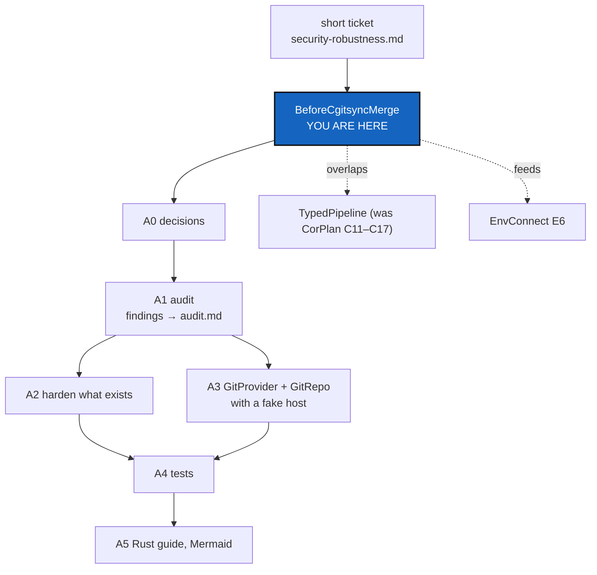
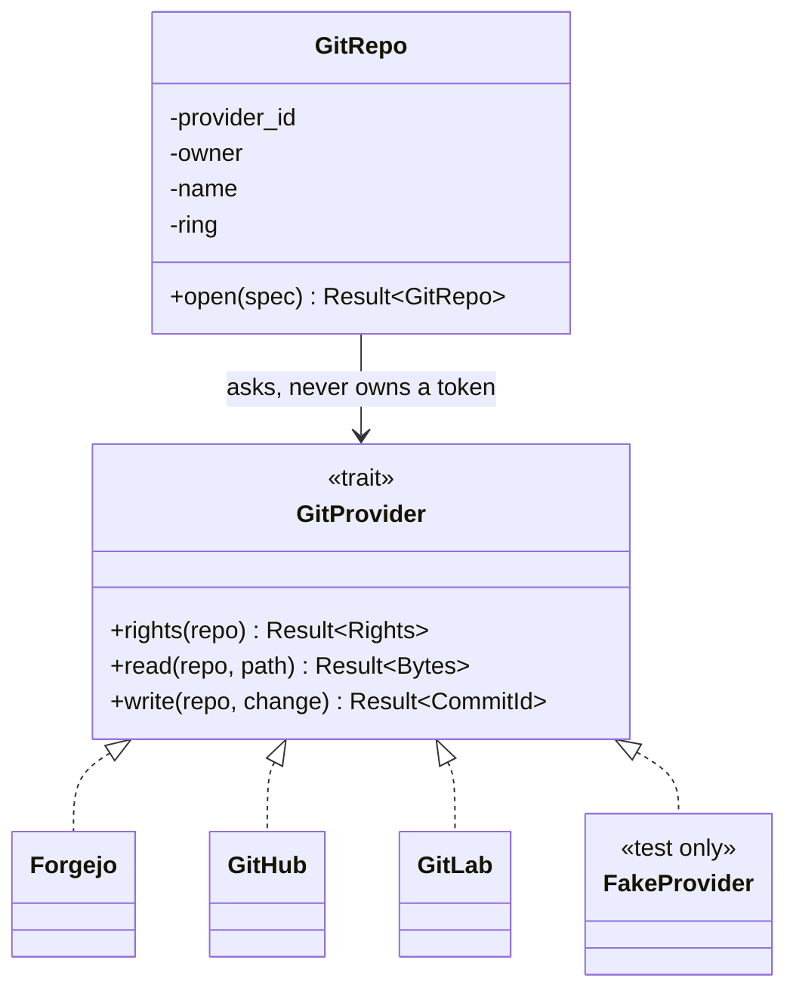

# BeforeCgitsyncMerge — security and robustness audit, tests, and a Rust guide, before GX4G takes the host APIs

*Created: 2026-10-27*

*Branch: main*

> **Owner request — 2026-10-27, short ticket `security-robustness.md`,
> verbatim.** *"audit the rust implementation for security and robustness.
> Propose unit test and integration tests. The only API is over G-Class.
> GX4G connects directly to GitRepo and allows read-write on them with
> gitProviderAPI. GitProvider and GitRepo must be the equivalent of Class.
> As I do not know Rust. I need clear Mermaid Graphs to understand the
> architecture and the underlying Rust concepts. Those docs must for a part
> of it lands in the devDoc"*
>
> **Reading of the title (to confirm, D1).** "Before cgitsync merge" is read
> as: before GX4G takes over host-API calls and register writes from
> ComplexGitSync (its ProviderMigration, upstream 7.3.0, and EnvConnect §4.4
> and E6), the existing kernel is audited and tested, and the shape of
> `GitProvider` and `GitRepo` is fixed. Nothing here changes ComplexGitSync.

## Abstract — read this first

**The one-line version.** Audit the six kernel modules for security and
robustness, write the unit and integration tests that pin the findings,
design `GitProvider` and `GitRepo` as the Rust counterpart of classes, and
write the Mermaid guide that explains the architecture and the Rust ideas
to an owner who does not write Rust.

**What this document is.** A plan in six phases (A0–A5) with a decision
gate first. It plans; it changes nothing in `src/` by itself.

**Why it exists.** Today the kernel is 1,330 lines, pure and offline: it
holds no secret, opens no socket, and reads no file. EnvConnect E6 and the
ProviderMigration change that: GX4G will hold a host token, call three REST
APIs, and write to repositories. The cheapest moment to harden the types
and fix the test strategy is before the first network call exists.

**What you will find.** §1 what the audit already sees in the code. §2 the
owner's "class" wish, translated into Rust. §3 the decisions to ask. §4 the
phases. §5 the test plan. §6 the Mermaid guide and where it lands. §7 how
this meets CorPlan and EnvConnect. §8 acceptance.

**Who it is for.** The Dev and Orchestration roles; the owner, for §2 and
§6, which are written to be read without Rust.

**What you need to do with it.** Answer §3 with `AskUserQuestion` before
the first edit, then implement phase by phase.

---

## 1. What the audit already sees

Read from `src/` at 0.1.1, before any phase runs. These are *candidate*
findings: A1 confirms each with a test that fails, and only then writes it
into `audit.md`.

| ID | Where | Finding | Kind |
|---|---|---|---|
| F01 | `lib.rs` re-exports | `compute_operands`, `persist` and `write` are public and accept any caller-supplied value. Anyone can build a `FileSystem` from arbitrary bytes and `write` it into a genuine `ExecutionHash`, then `emit` it. HASH(@) therefore proves "these bytes were hashed", not "the gate ran". The type system stops a *wrong type* crossing `emit`, not a *forged proof*. | Security (integrity) |
| F02 | `fs.rs` `CanonicalBytes` | The blanket `impl for AsRef<[u8]>` gives `String`, `Vec<u8>` and `&[u8]` the same bytes, so `"a"` and `b"a"` hash alike: no type tag in the preimage. Fine for a toy, ambiguous for a record. | Robustness |
| F03 | `fs.rs` `write` | Named `write` but writes nothing: it hashes. A reader, and a future caller, will trust it to be durable. CorPlan C12/C13 say the same. | Robustness (naming, honesty) |
| F04 | `fs.rs` `ExecutionHash` | Derives `PartialEq`, `Ord`, `Hash`: the comparison is not constant time. Harmless while hashes are public proofs; wrong the day one is compared to a secret or a capability. | Security (latent) |
| F05 | `fs.rs` `update_field` | `len() as u64` is lossless on every supported target, but is an unchecked cast the lints do not forbid. | Robustness (hygiene) |
| F06 | `gateway.rs` | `ClientGraph::edge` returns `Option`, so "invalid graph" means whatever the implementer decides. Any type can claim to be a CLIENT. There is no validation of what a CLIENT or SERVER is. | Security (trust boundary) |
| F07 | `Cargo.toml`, `lib.rs` | No `#![forbid(unsafe_code)]`, no `#![deny(missing_docs)]`, no `cargo audit` or `cargo deny`, one dependency (`sha2 0.10`) with a caret range, no `Cargo.lock` policy stated. | Supply chain |
| F08 | `tests/` | Only fixed examples. No property tests of the framing (the one thing the hash is for), no compile-fail test from an *external* crate (the doctests are inside the crate), no test that fails if a `pub` item is added by accident. | Test gap |
| F09 | Future, not code | Once host APIs arrive: a token in `Debug` or `Display` output, a host URL taken from a `.cgs` entry (SSRF, path injection through a repository name), no timeout or response-size bound, retries on a non-idempotent push, a rights check followed by a push (check-then-act race), a rate-limit that looks like a permission error. None exists yet; §4 A3 designs against each. | Security (design) |

What the audit does **not** find, and says so: no `unsafe`, no `unwrap` or
`expect` in `src/`, no panic path from input, no I/O, no secret. The kernel
is small and clean; the risk is the surface around to be added.

## 2. "GitProvider and GitRepo must be the equivalent of Class"

The owner does not write Rust, so this is the translation the guide (A5)
must make first. Rust has no `class`. It has four parts that together do
what a class does:

| In a class language | In Rust | What it gives |
|---|---|---|
| `class GitRepo { private fields }` | `struct GitRepo { fields without pub }` in its own module | The data, hidden. Outside code cannot build or alter one except through the module's functions. |
| methods | `impl GitRepo { pub fn … }` | Behaviour, attached to the data. |
| `interface GitProvider` / abstract class | `trait GitProvider { fn … }` | A promise: "anything that can do these things". Codeberg, GitHub and GitLab each *implement* it. |
| subclass | `struct Forgejo; impl GitProvider for Forgejo` | One concrete host. There is **no inheritance**: sharing is done by composition and by default methods on the trait. |
| constructor that checks | `fn new(…) -> Result<Self, Error>` | A value that exists is a value that was checked. |

**"The only API is over G-Class."** Read as: the single public entry to
GX4G is a method set on the Graph (G) type; `GitRepo` and `GitProvider`
are reached *through* it, never directly by a caller. In Rust this is a
small public facade: `G` is public, `GitRepo` and every provider are
`pub(crate)` or sealed (CorPlan D07 reaches the same rule for the kernel).
Whether `G` is the Graph of CorPlan C01, a new type, or the existing
`Gateway` is D2.

## 3. Decisions to ask the owner (A0)

Ask all of these with `AskUserQuestion` before the first edit. A
recommendation is not an answer.

| ID | Question | Why it changes the work | Recommended |
|---|---|---|---|
| D1 | Is "BeforeCgitsyncMerge" read as in the note under the title: before the ProviderMigration hands host APIs to GX4G? | Fixes what "before" gates, and whether A3 may wait for upstream. | As read |
| D2 | What is "G-Class"? The Graph `G(NAME, NODE, EDGE, OP)` of CorPlan C01, the existing `Gateway`, or a new facade type? | The public API of everything below. | Facade over the existing `Gateway`; the Graph type follows CorPlan |
| D3 | How much of GitProvider is built here? (a) trait, `GitRepo` and a fake host only, real HTTP stays EnvConnect E6; (b) one real provider (Codeberg) as well; (c) all three. | (a) is offline and testable in CI; (b)/(c) add a network client, TLS, a token, and A3's whole threat list. | (a) |
| D4 | What does "read-write on GitRepo" cover? Host *rights* (collaborator, branch protection: EnvConnect §4.4), or also repository *content* (read a file, push a commit)? | Rights are read-mostly and low risk; content write is the largest new attack surface. | Rights first, content write behind its own ring |
| D5 | Where does "devDoc" land? (a) a new chapter in `doc/Text/` (LaTeX book); (b) a Markdown guide in the private `.dev`; (c) both. | The book is public and rendered with TikZ, not Mermaid; `.dev` renders Mermaid but is private. | (c): Mermaid source in `.dev`, the public part redrawn in TikZ for the book |
| D6 | Does the audit supersede CorPlan's C11–C17 (forged proof, public exports, phase order), or do both tickets stay? | Same defects, two tickets, one fix. | This ticket cites them; CorPlan keeps the type work |
| D7 | Which tools may be added? `proptest` (property tests), `trybuild` (external compile-fail), `cargo-deny` / `cargo-audit`, `cargo-fuzz`. | Each is a new dev-dependency or a new command in `gx4g-dev.md`. | `proptest`, `trybuild`, `cargo-deny`; fuzz only if D3 is (b)/(c) |

## 4. Phases

Every phase ends with the checks of `gx4g-dev.md` (format, clippy,
tests). A phase starts after the previous one passes.

### A0 — Decision gate

Ask D1–D7. Record the answers in this ticket under *Owner decisions*.
Nothing else starts.

### A1 — Audit

- Turn each of F01–F08 into a **failing or pinning test** first, so a
  finding is proof and not opinion. F01 is the first: a test in an
  external crate (`tests/` is one, a `trybuild` case is stricter) that
  forges `ExecutionHash` from arbitrary bytes and emits it.
- Run `cargo clippy` with `-W clippy::pedantic -W clippy::unwrap_used
  -W clippy::expect_used -W clippy::cast_possible_truncation` once and
  list what it adds; adopt only what pays.
- Run `cargo deny check` and `cargo audit` once on the single dependency.
- Write confirmed findings into `.localSpec/audit.md` (its rule: a line is
  deleted in the change that fixes it). Findings that are design rather
  than defect (F09) go into §4 A3, not `audit.md`.

Deliverable: `audit.md` with the confirmed findings; a failing-then-fixed
test per finding.

### A2 — Harden what exists

Only what A1 confirmed and D6 leaves to this ticket.

- `#![forbid(unsafe_code)]` and `#![deny(missing_docs)]` in `lib.rs`.
- Narrow the re-exports so a caller cannot build a genuine `ExecutionHash`
  outside the verified path (F01), with the external compile-fail test
  pinning it. Where this needs the typed pipeline, it is TypedPipeline T4
  and is only cross-referenced.
- Tag the canonical bytes with a type label so `String` and `Vec<u8>` do
  not collide (F02); version the domain string (`…\0V1` → `V2`) and say so.
- Rename `fs::write` to what it does, or make it do it (F03), with a
  migration note (alpha API, CorPlan §11).
- Constant-time `PartialEq` for `ExecutionHash` or a documented reason it
  need not be (F04); `u64::try_from` in `update_field` (F05).
- Dependency policy: `Cargo.lock` committed, `cargo deny` config added,
  command added to `gx4g-dev.md` (F07).

Build counter bumps for every change under `src/` (step 2).

### A3 — `GitProvider` and `GitRepo`, offline

Design rule: **no network in this ticket** (D3 a). The trait, the struct
and a `FakeProvider` exist so the contract and the tests exist before any
HTTP does.

Designed *against* the list in F09, one design line each:

| Threat | Design line |
|---|---|
| Token in output | The token is a newtype `Secret` whose `Debug` and `Display` print `<redacted>`; it is not `Clone`; it is never a field of `GitRepo`. |
| Host URL from a `.cgs` entry | `GitRepo::open` parses `codeberg:` / `github:` / `gitlab:` into an enum, not a free URL; the host base URL comes from the provider type, never from the entry. |
| Path injection in `owner/name` | Validated newtypes `Owner` and `RepoName` (allowed characters, length, no `..`, no `/`), constructed only through `Result`. |
| Unbounded response | The trait returns bounded `Bytes`; the provider enforces a maximum size and a timeout. Stated in the trait doc, tested on the fake. |
| Retry on a push | Reads may retry; a write never retries on its own, and returns the commit id so a caller can check. |
| Check then act | `write` re-checks the right inside the same call; a prior `rights` answer is information, never a permit. |
| Rate limit read as "denied" | `Error::RateLimited { retry_after }` is its own variant, not `Denied`. |
| Ring versus host right | The ring comes from the proof vector (EnvConnect §4.1); the provider's answer can only *narrow* it. |

Types: `GitProvider` (trait), `GitRepo` (struct, private fields,
`open(spec) -> Result`), `Rights`, `Error` (an enum, as `CgsError` and
`ContextError` already are), `FakeProvider` (test-only, scripted answers
and failures). Added to `AdditionalSpecs.md` in the same change (step 6).

### A4 — Tests

§5.

### A5 — The Rust guide, in Mermaid

§6.

## 5. Test plan

Rust's `tests/` folder is already the integration layer; `audit.md`
records that GX4G has no inline unit tests. This ticket **adds** both
layers and says which is which.

| Layer | Where | Sees | Used for |
|---|---|---|---|
| Unit | `#[cfg(test)] mod tests` at the foot of each `src/*.rs` | private items | `Owner` / `RepoName` validation, `Secret` redaction, the framing helper, the case a public API cannot reach |
| Integration | `tests/*.rs` | the public API only, as an outside crate | the whole pipeline, the facade, `GitRepo` over `FakeProvider` |
| Compile-fail | `tests/ui/*.rs` with `trybuild` | what must **not** compile | no forged `ExecutionHash`, no `emit(State)`, no `GitRepo` built by struct literal, no `Secret` printed with `{:?}` as plain text |
| Property | `proptest` in `tests/` | random inputs | the hash framing (§5.1) |
| Contract | one generic function run per provider | the trait only | every provider, fake first, passes the same suite (§5.2) |
| Doc | `cargo test --doc` | examples in comments | the four existing compile-fail doctests stay |

### 5.1 The cases to write first

- **Framing.** For any two different `(state, space)` pairs, the hashes
  differ; moving a byte from STATE to SPACE changes the hash; empty STATE
  with non-empty SPACE differs from the reverse. (F02)
- **Determinism.** Same inputs, same hash, across runs; a golden hash for
  one fixed input so an accidental change of the preimage fails the build.
- **Borrow, not copy.** `build_context` returns references to the very
  objects passed in (`std::ptr::eq`), as the Phase 2 tests already do.
- **Error order.** NABLA is checked before DELTA; both missing reports
  NABLA. (existing; kept)
- **Forgery.** From outside the crate, no path yields an `ExecutionHash`
  that the pipeline did not produce. (F01)
- **Validation.** `Owner` / `RepoName` reject `""`, `".."`, `"a/b"`,
  `"a b"`, a 10,000-character name, a NUL byte, and non-ASCII look-alikes;
  they accept the plain cases and one maximal valid name.
- **Secrecy.** `format!("{secret:?}")` and `{secret}` contain no part of
  the secret; the `GitRepo` `Debug` output contains none either.

### 5.2 The provider contract, run on `FakeProvider`

The fake is scripted per test: it can answer, time out, return an oversize
body, return `RateLimited`, return `Denied`, and change its answer between
two calls. The suite proves:

1. a ring never exceeds the host's right (the provider can only narrow);
2. a `Denied` write changes nothing and returns the error unchanged;
3. a `RateLimited` answer is not retried by a write;
4. an oversize or slow answer becomes an error, not a hang or a panic;
5. a right revoked between `rights` and `write` makes `write` fail
   (check-then-act);
6. no error text, `Debug` output or log line contains the token.

When EnvConnect E6 adds a real provider, it must pass the same generic
suite against a local mock HTTP server. No test ever calls a real host.

## 6. The Mermaid guide, and where it lands

Written for the owner, who does not know Rust: every diagram has one
sentence saying what to look at, and every Rust term is introduced from
what the code already does. The existing code is the running example
(`Gateway`, `ExecutionContext`, `CgsError`, `ExecutionHash`), so nothing is
invented for teaching.

| # | Diagram | Rust idea it makes clear | Code it points at |
|---|---|---|---|
| 1 | Module map: who may call whom, `pub` versus private | modules, `pub`, `pub use`, the facade | `lib.rs` |
| 2 | The six phases as a pipeline, with the type that passes between them | values moved or borrowed from phase to phase | `gateway.rs` … `emit.rs` |
| 3 | Ownership and borrowing: `Gateway<'a>` points to the client, does not own it | `&`, lifetimes `'a`, "borrowed, not copied" | `Gateway`, `ExecutionContext` |
| 4 | Generics and traits: `Gateway<Client, Server>` and `ClientGraph` | a trait is a promise; generics are "any type that keeps it" | `gateway.rs` |
| 5 | `Result` and `Option`: why there is no `null` and no exception | `?`, `ok_or`, error enums | `ContextError`, `CgsError` |
| 6 | Struct plus `impl` plus `trait` = class and interface (the §2 class diagram) | no inheritance; private fields as encapsulation | `GitRepo`, `GitProvider` |
| 7 | Who can build an `ExecutionHash`: today versus after A2 | privacy as a security tool; why F01 matters | `fs.rs`, `emit.rs` |
| 8 | Trust boundary: PUBLIC request, gate, host API, with the token on the inside only | where the secret lives; where input is validated | A3 |
| 9 | Test layers (the §5 table as a picture) | unit, integration, compile-fail, property, contract | `tests/` |
| 10 | Sequence: one request to a `GitRepo` write, with the ring check and the host check | check-then-act | A3 |

**Where each lands (D5).**

- The **Mermaid source** is Markdown, so it lives in the private `.dev`
  (a `RustGuide.md`, with an abstract and `*Created:*` as DOCSTYLE asks).
  It renders in the editor and on the forge.
- A **part** lands in the devDoc as the owner asked: a new chapter in
  `doc/Text/` for the diagrams that explain the *public* architecture and
  the Rust ideas (1–6 and 9), redrawn in TikZ because the book is LaTeX and
  has no Mermaid renderer. Diagrams that expose the threat model (7, 8, 10)
  stay in `.dev` until the owner says otherwise.
- `AdditionalSpecs.md` gets the module and visibility rules (step 6); it
  does not get the teaching text.
- The PDFs are rebuilt (step 5) and the README's *What works today* is
  updated only for what is built (step 7); `GitProvider` stays "designed"
  until E6.

## 7. How this meets the other tickets

| Ticket | Relation |
|---|---|
| TypedPipeline (1-3) | Owns the former CorPlan C11–C17 (anchor before MEM, forged `HASH(@)`, public exports, free-function order), the same defects as F01 and F03. A2 does only the *minimum* that makes a finding testable; the typed pipeline is TypedPipeline's (D6). |
| CorPlan (2-1, stand-by) | Keeps C01–C10 and C18–C20. |
| EnvConnect (1-1) | §4.4 and E6 (`gx4g rights check`) are the first consumer of `GitProvider` and `GitRepo`. This ticket gives E6 its trait, its fake and its contract suite, and E6 adds the real providers. E0 (`pixi run gx4g`) owns the future `pixi run test` that A4's commands join. |
| ComplexGitSync | Not edited. Its `provider.py` states it implements no provider API; GX4G reads the provider from the `.cgs` entry and needs nothing from it (EnvConnect D10). |
| `audit.md` | Receives the confirmed findings (A1) and loses each line when fixed. |

## 8. Risks

| Risk | Impact | Mitigation |
|---|---|---|
| A real provider sneaks in, with its token | The threat list of F09 opens before its tests exist | D3 (a): no network in this ticket |
| The facade hides too much and the examples stop compiling | `examples/phase5.rs`, `phase6.rs` and the tutorials break | Update them in the same change (step 7); `cargo test --all-targets` builds them |
| Hardening changes the hash preimage | Old HASH(@) values no longer match | Version the domain string, golden-hash test, migration note |
| The guide is read as the specification | Two sources of truth | The guide explains and links; `AdditionalSpecs.md` states the rules (DOCSTYLE: one authoritative file per purpose) |
| Test tools bloat a one-dependency crate | Slower builds, more supply chain | They are dev-dependencies only; D7 asks first |
| Overlap with CorPlan | The same defect fixed twice, differently | D6; this ticket cites the C-number it touches |

## 9. Acceptance

The ticket is done when:

- D1–D7 are answered and recorded here;
- every confirmed finding has a test that failed before and passes after,
  or is recorded in `audit.md` as accepted with a reason;
- an outside crate cannot obtain an `ExecutionHash` the pipeline did not
  produce (compile-fail test);
- `GitProvider`, `GitRepo`, `Secret`, `Owner`, `RepoName` and
  `FakeProvider` exist, and the provider contract suite passes on the fake
  with no network access;
- the token never appears in any `Debug`, `Display` or error text (tests);
- `forbid(unsafe_code)`, `deny(missing_docs)` and the `cargo deny` check
  pass, and their commands are in `gx4g-dev.md`;
- the ten diagrams of §6 exist, each with its one-sentence caption, and the
  public part is a chapter of the book with the PDFs rebuilt;
- `AdditionalSpecs.md` states the new modules and their visibility;
- the eight steps are quoted by the orchestrator and its record is
  appended below.

## Owner decisions

*Answered 2026-10-27, in conversation.*

| ID | Answer |
|---|---|
| D1 | Yes: "before cgitsync merge" means before GX4G takes the host APIs from ComplexGitSync. |
| D2 | The G-Class is **`G{NAME-G, NODE-S, EDGE-G, OP*-G}`**: the one public API is over the Graph `G`. `GitRepo` and `GitProvider` are reached through it. |
| D3 | (a): the trait, `GitRepo` and a fake host only. No network, no real provider in this ticket. |
| D4 | Rights first (recommended default, chosen). Content write is designed, behind its own ring, and not built here. |
| D5 | (c): Mermaid source in the private `.dev`, the public part redrawn in TikZ as a chapter of the book. |
| D6 | C11–C17 leave CorPlan for a new ticket, TypedPipeline. A2 below does only the minimum that makes F01 and F03 testable. |
| D7 | `proptest`, `trybuild`, `cargo-deny` and `cargo-audit`. No `cargo-fuzz` (D3 is (a)). |

**Note on D2, corrected by the owner, 2026-10-27, at `implement`.**
`NODE-S` was a typo: the G-Class is **`G{NAME-G, NODE-G, EDGE-G, OP*-G}`**,
each constituent a Graph, as PRIME G says. *"EDGE is an 'interface API'
without other declaration."* Read for A3: `NAME`, `NODE` and `OP*` are Graph
types, and `EDGE` is only an interface, a trait, that declares nothing but
the API it offers. `GitProvider` is that interface: the host APIs are what
the Edge of `G` connects to, and every concrete host implements it. This
agrees with EnvConnect §7, where `graph.rs` gives `Edge` and `Node` traits
that absorb `ClientGraph` and `ServerGraph`. **To confirm in the report:**
that `GitProvider` *is* the `Edge` interface, and not a separate trait
beside it.

**Scope, answered 2026-10-27:** all phases A0–A5, in order, one worker pass,
one orchestrator quote for the whole ticket.

## Worker's report

*Worker: Claude (Sonnet 5.5), 2026-10-28. Build counter bumped to `0001.03`.
The release version, the PDFs and the record below are the orchestrator's.*

### What was built, by phase

| Phase | Result |
|---|---|
| A0 | D1 to D7 were answered; the D2 note was corrected at `implement` (`NODE-S` is `NODE-G`), and the scope was set to all phases. |
| A1 | Each of F01 to F08 was confirmed or accepted (table below). F01 and F02 were first shown on 0.1.1 by two pinning tests that passed, then deleted in the fix. `cargo clippy` pedantic, `cargo audit` and `cargo deny` were run once before any change: no advisory, no `unwrap`/`expect`/`unsafe` in `src/`. |
| A2 | Phase functions `pub(crate)`, modules private, `Gateway::execute` is the one path; `CanonicalBytes::TYPE_LABEL`; domain `V2`; `fs::write` renamed `execution_hash`; `forbid(unsafe_code)`, `deny(missing_docs)`; lints in `Cargo.toml`; `deny.toml`. |
| A3 | `ring.rs`, `identity.rs`, `secret.rs`, `provider.rs`, `repo.rs`, `g.rs`, `fake.rs`. Offline, rights only. |
| A4 | Unit tests inside `src/`; `tests/framing_tests.rs` (proptest); `tests/ui/` and `tests/ui_testing/` (trybuild); `tests/provider_contract.rs`; `tests/public_surface_tests.rs`. |
| A5 | `.dev/RustGuide.md` (ten Mermaid diagrams, all parsed by Mermaid's parser); `doc/Text/rust_guide.tex` and `doc/c_rust_guide.tex` (seven diagrams in TikZ, rendered and read page by page). |

### The findings

| ID | Verdict | Evidence |
|---|---|---|
| F01 forged proof | **fixed** | Shown on 0.1.1 (a `GatewayOutput` made from arbitrary bytes). Now five `tests/ui/` cases fail to compile, each for its own reason: phase function, module path, hash literal, `emit(State)`, `emit(String)`. |
| F02 type collision | **fixed** | Shown on 0.1.1 (`String` and `Vec<u8>` hash alike). Now `TYPE_LABEL` is required (a `tests/ui/` case), and a property test checks text never hashes like bytes. It was mutation-checked: giving `Vec<u8>` the text label makes it fail, with a minimal counterexample. |
| F03 `write` | **fixed** | Renamed `execution_hash`, crate-private. |
| F04 non-constant-time `==` | **accepted** | `audit.md`: a HASH(@) is public. Documented on the type. |
| F05 `as u64` | **fixed** | A compile-time `assert!(usize::BITS <= u64::BITS)` makes the cast provably lossless. |
| F06 graph traits trusted | **accepted** | `audit.md`: in-process values; the boundary is where a request becomes `G` (E2, E3). |
| F07 supply chain | **fixed** | `forbid`, `deny`, lints, `deny.toml` (Apache-2.0 and MIT only), `Cargo.lock` committed; `cargo deny` and `cargo audit` pass over 70 crates. |
| F08 test gaps | **fixed** | Property tests, external compile-fail tests, and a surface test mutation-checked with a stray `pub use` and a `pub mod`. |
| F09 host design | **designed in A3** | Each design line has a test (`identity.rs`, `secret.rs`, `g.rs`, `tests/provider_contract.rs`), with two exceptions: content write (point 3 below), and a real provider's size and time bounds, which the fake can only pass through. Those are a promise until E6 and are in `audit.md`. |

### Where the worker interpreted, for the orchestrator to judge

1. **`Gateway::execute` is new public API.** F01 cannot be fixed by hiding
   functions alone: the pipeline would have no public way to produce a proof.
   `execute` is the minimum, and TypedPipeline T4 inherits it. It adds
   `ExecutionError`. The examples (`phase5`, `phase6`), tutorial 02 and the
   getting-started chapter changed with it, and their quoted hash is now
   `81bb2769…`, recomputed independently in Python.
2. **`CanonicalBytes` is a breaking change** (a required `TYPE_LABEL`, no
   blanket impl), and the hash changed (`V1` to `V2`). The old golden
   `307cfec9…` reproduces from the `V1` preimage and the new golden
   `f568c1be…` from the `V2` one, both in Python. The ticket calls for a
   migration note: it is the doc comment on `execution_hash` and the
   `V2` comment in `fs.rs`. The release level is the orchestrator's: this
   is an alpha API (CorPlan §11), and a `0.x` minor is the usual reading.
3. **D4 is followed literally: rights only.** The plan's §5.2 lists write cases
   (a denied write changes nothing, a write is not retried, a right revoked
   between `rights` and `write` fails the write). They have no code to test.
   The contract suite holds the same properties for what exists (a denial is
   returned unchanged and not retried, a rate limit is not a denial and not
   retried, a right revoked between two questions is seen). The write cases
   are listed in `audit.md` as waiting for their milestone.
4. **`GitProvider` is the `Edge` interface** (D2 note). This is the owner's
   word read into code, and `audit.md` lists it for confirmation.
5. **`Ring` and `Access` are new, and small.** The ceilings (`Public` none,
   `User` read, `Dev` write, `Orx` push) are the architecture chapter's table.
   EnvConnect E2 extends `Ring`.
6. **A `testing` Cargo feature** exposes `FakeProvider` to the integration
   tests. It is a new feature and a new dev-dependency pair (`proptest`,
   `trybuild`, both allowed by D7). `cargo test` without `--all-features`
   skips the contract suite and one compile-fail case, which `gx4g-dev.md`
   says.
7. **The three phase test files were moved into `src/`** as unit tests, since
   they test private functions. No case was dropped; three were added to
   `fs.rs`.
8. **Diagrams 7, 8 and 10 stay in `.dev`** (D5), and `gx4g-dev.md`'s build
   command now includes `c_rust_guide.tex`.

### Checks run

`cargo fmt --check`; `cargo clippy --all-targets -- -D warnings` with and
without `--all-features`; `cargo test --all-targets --all-features` (99
tests); without the feature (92); `cargo test --doc` (4); `cargo deny
--all-features check`; `cargo audit`; `cargo build --release`; both
examples. Outside test modules, `src/` has no `unsafe`, `unwrap`, `expect` or
`panic!`. All six PDFs build in a scratch copy: no undefined reference, and one
overfull box of 5pt that was already there (lines 65 to 68 of
`architecture.tex`).

### Not done, on purpose

*(Written before the orchestrator's quote. Everything below was then done by it: see its record.)*

The release version bump, the PDF rebuild in `doc/` (every title page shows the
version), the commit message, and this ticket's record: they are the
orchestrator's (`CLAUDE.md`, *When the owner says `implement <ticket>`*).
No commit and no push.

## Orchestrator's record

*Quoted: 2026-10-28 · worker: Claude (Sonnet 5.5) · orchestrator: Claude (claude-sonnet-5-5)*

| Step | Verdict | Note |
|---|---|---|
| 1 | met | Run independently: `fmt --check` clean; clippy `-D warnings` clean with and without `--all-features`; 99 tests with the feature, 92 without, 4 doctests, all green; `cargo deny --all-features check` and `cargo audit` (70 crates) clean. Worker's numbers reproduced exactly. No `unsafe`, `unwrap`, `expect` or `panic!` outside test modules in `src/`; no network or file I/O in `src/`. |
| 2 | met | `BUILD` is `0001.03` in `src/version.rs`; it appears in no public text. |
| 3 | n.a. | `pixi run gx4g` does not exist yet. |
| 4 | met | 0.1.1 → 0.2.0 by hand in `Cargo.toml`, `Cargo.lock`, the README title and `\gxversion`; `tests/version_tests.rs` passes. |
| 5 | met | All six PDFs rebuilt after the bump; no `??` reference in any of them; `latexmk -c` run. |
| 6 | met | `AdditionalSpecs.md` §2, §2.1 and §6 state the new modules, their visibility, the sealed trait and the rules. |
| 7 | met | README *What works today*, tutorial 02, the getting-started and architecture chapters and the new Rust guide chapter agree with the code; no stale mention of the old public `compute`/`persist`/`write` or of the V1 hash as current. |
| 8 | met | One message below. |

Checks beyond the worker's. F01: from a scratch crate outside the repo, fifteen attempts to obtain or build an `ExecutionHash`, a `GatewayOutput`, a `GitRepo`, an `Owner`, a `RepoName` or a `G` (Default, From, FromStr, literals, `new`, module path, through `G` and `FakeProvider`) all fail to compile. The one way to a hash is `Gateway::execute`. Golden hashes recomputed in Python from the V2 preimage: `f568c1be…` (TEST_EDGE and TEST_NODE) and `81bb2769…` (EXAMPLE_EDGE and EXAMPLE_NODE) both reproduce. All eleven compile-fail snapshots were read and fail for the reason their file says. Three mutations (`min` to `max` in `G::access`, no length in `frame`, the `.git` suffix check removed) each made tests fail, and each file was restored byte for byte.

Non-blocking observations, left to the worker or the next ticket:
- A caller's own `CanonicalBytes` type may choose any `TYPE_LABEL`, including `UTF8` or `BYTES`, and so can reproduce another type's preimage. The label separates the library's types, not a hostile implementer. This is inherent in a caller-supplied operand and worth one sentence in the `CanonicalBytes` docs.
- `ExecutionError::Cgs` cannot occur through `execute`: `compute` is always given two `Some` operands. The variant, and diagram 5 of the guide (`.dev` and the TikZ chapter), show a failure path that has no trigger today.
- Diagram 7 (`.dev`) says "a real CLIENT and SERVER", but any type can be a CLIENT (F06, accepted). "A caller's CLIENT and SERVER" is truer.
- Diagram 8 says "host from the type, never the text". The host's address does come from the type, but the host prefix is read from the text and then checked against the EDGE's host (`G::same_host`). "Address" would be exact.
- The TikZ test-layers figure shows six layers, the Mermaid diagram seven (doctests are left out of the book). Both say true things, but the rule is that a change to a diagram changes both forms.
- `architecture.tex`'s planned-modules table still lists `provider.rs` as to be added although the file exists with the trait; the row reads "REST clients behind the trait", which is the planned part.

Judgement on the worker's interpretations. (1) `Gateway::execute` and `ExecutionError`: justified as the minimum for F01, since hiding the phase functions would leave no way to make a proof; it is one method over the existing phases, not the typed pipeline (no anchor, no L0, no durable MEM), and `audit.md` records the two-entry-points risk. (2) The `CanonicalBytes` break is acceptable for a 0.x alpha API and the V2 domain string makes old hashes visibly different; the migration note in the `execution_hash` and `fs.rs` comments is adequate. (3) Rights only, following D4, is right; the write cases are listed in `audit.md`. (4) `GitProvider` as the `Edge` interface stays flagged for the owner in `audit.md`. (5) to (8) `Ring`/`Access`, the `testing` feature, moving the phase tests into `src/`, and keeping diagrams 7, 8, 10 in `.dev`: accepted.

Release: 0.1.1 → 0.2.0 (minor), because the public API gains `Gateway::execute`, `ExecutionError`, `G` and the host-side types, and `CanonicalBytes` breaks (a required `TYPE_LABEL`, no blanket impl) with a new hash domain. In 0.x a breaking change moves the minor number.
Re-quotes: 0. Blocking defects left: none.

### Worker's follow-up, after the quote

The orchestrator's non-blocking observations were handled as follows. Diagrams
5, 7 and 8 of the guide were corrected, in both forms: the `CgsError` exit is
marked as unreachable through `execute`, "a real CLIENT" became "a CLIENT"
(F06 is accepted), and the host rule now says the prefix is read from the text
and checked against the EDGE, with the address from the type. The TikZ test
figure gained the doctests layer, so it shows seven like the Mermaid one, and
the planned-modules table no longer lists `provider.rs` as to be written. The
six PDFs were rebuilt for those documentation changes, with no version change,
since nothing under `src/` moved. The `CanonicalBytes` label observation is
recorded in `audit.md` instead of as a doc comment, because a doc comment in
`src/` would start a new build and a new release for one sentence; it waits for
the next change under `src/`.
