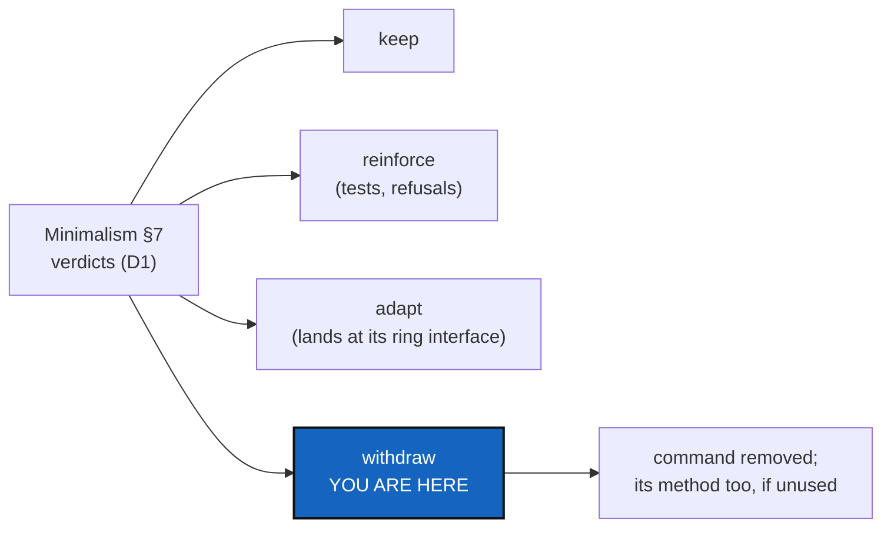

# CliReduction — apply the map: each command kept, reinforced, adapted or withdrawn

*Created: 2026-10-27*

*Branch: main*

> **Implemented — 2026-10-27 (the orchestrator sets the level).** Decisions asked through
> `AskUserQuestion` before the first edit:
> - **`submodules`** (the owner's own wording): `submodules import` on its own is a syntax
>   error; `submodules import --dry-run` is the old `report`; `submodules import --now`
>   converts, and the run is logged. `submodules report` disappears with no transition
>   message (D1 of this ticket).
> - **Dead code:** the 14 names the map listed are removed with the tests that existed only for
>   them.
> - **Below the client:** the three behaviour calls go through the client; the value types stay.
>
> What changed is §6.

> **Owner's answers, 2026-10-27 (Minimalism D1, D2, D3, D7).** The verdicts are the
> owner's *autonomous rule*: a command stays if `cgitsync` needs it to run with no gx4g,
> so `memory *` and `branch create` stay. **44 keep, 4 adapt, 5 reinforce, 13 withdraw**
> (Minimalism §7.3). The 13 withdrawals are `repo create` and the 12 `omniscience *`
> commands, all gx4g's, executed by ProviderMigration, not here. **This ticket therefore
> withdraws nothing before gx4g offers it.** It adapts and reinforces: `submodules
> report` and `import` become one command with `--apply`; `memory setup`'s create step
> prints the provider command until gx4g offers it (ProviderMigration); `unlock` gains a
> client method (D2: the CLI mirrors the API **one way**: every command has its method,
> a method may have no command); and `pull`, `autofix`, `branch delete`, `verify repair`
> and `memory reboot` gain the guards §2 lists. `AdditionalSpecs.md` states the new
> mirror rule.

> **Ticket review — 2026-10-27, seventh pass (short ticket `gitRepo`).**
> Rank unchanged. It runs before SrcLayout, so that what is withdrawn is
> never moved first. The register-writing commands (`omniscience mount`,
> `register` and `observe`) are gx4g's now. Like the provider commands, they
> are withdrawn by ProviderMigration once gx4g writes, not here. Minimalism
> D7 gives the verdict on the register reads.

> **From the owner's short ticket `minimalism` (2026-10-27).** Filed at
> `main_1-5` by the ticket review of the same day, as BeforeBeta's step S7,
> after Minimalism and MerkleRoot. The owner's words: *"From this map CLI cmd
> may be kept, reinforce, adapted or disclosed."* "Disclosed" means
> **withdrawn from the CLI** (owner, the same review). Before beta.

## Abstract — read this first

**The one-line version.** Minimalism's map gives every command a verdict.
This ticket carries them out: the withdrawn commands leave the CLI, the
methods nothing else calls leave `src/`, and the kept commands land at the
ring interface the map names.

**What this document is.** The input (§1), what each verdict means in code
(§2), what must not break (§3), the decisions (§4) and acceptance (§5).

**Why it exists.** Every command removed is surface nobody can misuse. That
is the security the owner asked for. It is also fewer pages in the user guide
for a beta user to get wrong.

**Who it is for.** The worker, the orchestrator, and the owner, who answered
Minimalism D1 and answers §4 here.

**What you need to do with it.** Nothing until Minimalism's D1 is answered.
Then follow §2.

---

## 1. The input

Minimalism's §7, verdict column, as the owner answered it in its D1. Its D2
fixes the mirror rule this ticket applies. Nothing is withdrawn on a guess.

## 2. What each verdict means

- **Keep.** No change. The command is listed in the user guide's command
  table as it is.
- **Reinforce.** The command gains whatever the map found missing: a refusal
  before anything is touched, a test of its failure path, or a lock it did
  not take (StateLocking's `WRITING_METHODS`).
- **Adapt.** The command is moved to land at the ring interface the map names.
  That means one client method, the CLI only collecting and printing, and the
  document it crosses being the one §1 of Minimalism gives. `unlock`, which
  has no client method, is adapted if Minimalism D2 says every command keeps
  one.
- **Withdraw.**
  - The command leaves the parser, `help_text.py`, the user guide, the
    tutorials and `test_cli_grammar.py`'s expectations.
  - Its client method stays if anything in `src/` other than the CLI still
    calls it, and goes otherwise.
  - The map's *unused* and *deprecated* methods go in the same change, each
    with its tests.
  - A withdrawn command that a tutorial runs is the tutorial's change too, in
    the same commit.
- **A provider command (`repo create`, `memory setup`'s create step), or a
  register-writing one (`omniscience mount`, `register`, `observe`).** It is
  not withdrawn before gx4g can do it (ProviderMigration). Its verdict is
  carried out there.

## 3. What must not break

- Every tutorial still runs end to end with the commands it keeps
  (`tests/integration/test_tuto_*`).
- `cgitsync help`, `help --all` and the "did you mean" hint list exactly the
  commands that remain. Withdrawing a command never leaves a dangling
  example.
- No State, ledger entry or register file changes meaning. Reading a memory
  written by a withdrawn command still works.
- The provider-call check that Minimalism leaves in `tests/` still passes,
  with no new call.

## 4. Decisions for the owner

| D | Question | Recommendation |
|---|---|---|
| **D1** | Does a withdrawn command print a one-line "withdrawn in <version>; use <x>" for one release, or vanish? | **Vanish,** with the user guide's *What changed* paragraph naming it. A beta has no installed base to warn. |
| **D2** | The version level: is a withdrawal `major`? | The orchestrator's call under `Versioning.md`. A removed public command is a breaking change. |

## 5. Acceptance

- Every verdict in Minimalism D1 is carried out, one line per command in a new
  §6 of this ticket with the commit that did it.
- The CLI's leaf count and `ComplexGitSyncClient`'s public method count are
  recorded before and after.
- Minimalism's map script, rerun, shows no command off its ring interface,
  and no method marked unused or deprecated that this ticket kept without a
  reason.
- `pixi run lint`, `pixi run test`, `bump-build`, and `cgitsync status` with
  `errors=0`. The user guide, `api_python.tex` and the tutorials match the
  CLI that remains.

## 6. What was done, command by command (2026-10-27)

**Counts, before and after** (`scripts/map_surface.py`):

| | before | after |
|---|---|---|
| CLI leaf commands | 66 | 65 |
| Public client methods | 115 | 117 (`unlock`, `memory_repo_names`) |
| …reached by a command | 86 | 88 |
| Public names nothing in `src/` refers to | 25 | 13 (0 used by nothing; 13 by a test only) |
| Commands naming a class below the client for behaviour | 3 (`ReleaseCommands.subject`, `MemoryMergeOperation.is_memory`, `WorkspaceLock`) | 0, bar the plumbing every command shares and one record formatter (`ConformityScale.render`) |

**Adapted (4 of the verdict table; 2 here, 2 are ProviderMigration's):**
- `submodules report` and `submodules import` became one command, `submodules import (--dry-run | --now)`.
- `unlock` gained a client method, `unlock(cgshome, force=False)`, and the command only calls it.
- `memory setup` and the register commands are carried out by ProviderMigration, as the banner says.

**Reinforced (5):**
- `verify repair`: `verify(repair=True)` now takes the workspace lock (`WRITING_WHEN`); `verify check` never does.
- `pull`, `merge`: no longer name `MemoryMergeOperation` (`client.memory_repo_names()`).
- `release freeze --dry-run`: no longer calls `ReleaseCommands.subject` (`next_release_tag(..., message)` carries the subject).
- `autofix`, `branch delete`, `memory reboot`: unchanged here. `autofix` already takes the lock (7.3.0), `branch delete` waits for BranchProtection, and `memory reboot` for RobustnessCrash D7. Nothing in the map asked more of them in this ticket.

**Removed, 14 names with the tests that existed only for them:** `CgsDocument.from_project_definition`,
`BranchResolution.is_default`, `GitRepo.resolved_group_name`, `RepoAddress.from_repo`,
`GitTree.force_repo_sha` and `force_repo_keys`, `CommitLog.find_state_for_commit`,
`MemoryFacts.release_snapshot_slug`, `Orchestre.register_repo`, `PathResolver.resolve_clone_root`,
`LedgerStore.append_entry` (its chain-building helper moved to `tests/support/ledgers.py`, because
production chains onto the folded and pending ledger, not one directory), `MemoryStates.resolve_directory`
and `snapshot_candidates_for_id`, and `SyncLedger.record_event` (the legacy `.lgr` writer; its reader stays,
tested against a hand-written fixture). Removing `resolve_directory` orphaned `MemoryStates.temporary_directory_name`, removed with it.

**Kept without a caller in `src/`, each with its reason (13):**

| Name | Why it stays |
|---|---|
| `CgsDocument.to_git_tree`, `WorkingGitTree.to_gts`, `GitTree.propagate_tag`, `GitTreeBranches.refresh` | documented in the architecture or API guide |
| `ConfigDocumentIOMixin.to_json`, `from_json`, `to_yaml`, `from_yaml` | the documented way to read and write a config document in another format |
| `GitTree.add_repo`, `WorkingGitTree.add_repo` | how a Python caller, and every test, builds a tree |
| `Toolchain.reset_cache`, `TreeObserver.reset_cache` | seams a test needs to re-observe |
| `MemoryStates.directory_name` | the one statement of the legacy State directory name, the inverse of `order_from_directory_name` |

**Held by a test:** `tests/unit/test_map_surface.py` fails when a command reaches a class below the
client for behaviour beyond the one known formatter.

