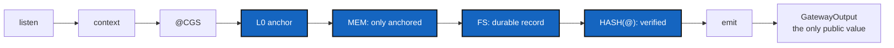

# TypedPipeline — anchor, ink, prove and emit in one order the types enforce (CorPlan C11–C17)

*Created: 2026-10-27*

*Branch: main*

> **Ticket review — 2026-10-28, BeforeCgitsyncMerge implemented.** Part of this
> ticket is already done, and its scope shrinks. `Gateway::execute` is the one
> path that runs the phases in their fixed order, and the only way to obtain an
> `ExecutionHash`; the phase functions and every module are private; `fs::write`
> is renamed `execution_hash` and is crate-private (T2, F03). The hash domain
> is `V2` with a type label per operand, a golden hash recomputed
> independently, and a migration note (T3's encoding). T4's compile-fail
> tests exist in `tests/ui/`, and a test pins the export list. **Still open:**
> the anchor `@` and L0 (T1), a durable owned MEM record (T2), HASH(@) derived
> from the anchor (T3), and `Gateway` folded under `G` so that `G` is the one
> public API (T4). Re-read §3 against `src/` before starting T1.

> **Owner direction — 2026-10-27, answering D6 of BeforeCgitsyncMerge:**
> *"C11-17 reorganise new ticket."* CorPlan's compatibility rows C11–C17
> and the phases that fix them leave CorPlan and become this ticket.
> CorPlan keeps C01–C10 and C18–C20 and says so in a banner.

## Abstract — read this first

**The one-line version.** Today anyone can call `persist`, `write` and
`emit` in any order on any bytes and obtain a genuine HASH(@). This ticket
makes the pipeline `listen → context → CGS → L0 anchor → MEM → FS →
HASH(@) → emit` a single path that the Rust types enforce, so a proof
exists only if the gate ran.

**What this document is.** A plan for the part of CorPlan that is about
*order and exposure*: anchoring, durable inking, the proof, the public
boundary. The theory-to-type work (PRIME G, topology, COMPUTO) stays in
CorPlan.

**Why it exists.** BeforeCgitsyncMerge found the same defects as security
findings (F01 forged proof, F03 `write` that does not write). A defect with
two tickets gets two fixes; the owner chose one ticket for C11–C17.

**What you will find.** §1 the rows moved here. §2 the target. §3 the
phases. §4 the decisions inherited from CorPlan. §5 the tests. §6 the
relation to the other tickets. §7 acceptance.

**Who it is for.** The Dev and Orchestration roles.

**What you need to do with it.** Read CorPlan §5 D04–D07 first: they are
the open theory questions this ticket cannot start without. They are answered
under *Owner decisions* below. Then follow §3.

---

## 1. The rows moved from CorPlan

Verbatim intent of CorPlan §4; the current state is re-read at 0.1.1.

| ID | Requirement | Current Rust state | Verdict |
|---|---|---|---|
| C11 | Time precedes Memory; no STATE is inked without `@` | `persist(state, space)` is callable with no anchor | Direct violation |
| C12 | MEM permanently inks anchored execution | `FileSystem` holds borrowed references in memory | Incompatible |
| C13 | FS materializes persistent Graph relationships | `fs::write` hashes and writes nothing (BeforeCgitsyncMerge F03) | Incompatible |
| C14 | HASH(@) identifies an anchor | the hash holds STATE and SPACE, no `@` | Direct violation |
| C15 | Only HASH(@) crosses PUBLIC/PRIVATE | `compute_operands`, `persist`, `write` are public; a hash can be forged (F01) | Partial |
| C16 | Execution order is immutable | free functions callable in any order | Missing |
| C17 | Gateway owns communication only | Gateway methods expose private context | Partial |

The G-Class decision (BeforeCgitsyncMerge D2: **`G{NAME-G, NODE-G, EDGE-G,
OP*-G}`**) fixes what the public type is: the one API is over `G`. The
phases below hide everything else behind it.

## 2. Target

Only the request and the final `GatewayOutput { HASH(@) }` are public.
`Anchor`, `AnchoredComputo`, the ink record, the backend and the
unverified hash are `pub(crate)` or sealed. `Gateway::emit` accepts only a
verified HASH(@) built by the verifying path. The Rust vocabulary for the
owner is in BeforeCgitsyncMerge §6.

## 3. Phases (moved, with their tests, from CorPlan Phases 4–7)

Each phase ends with executable tests and the checks of `gx4g-dev.md`. A
phase starts after the previous one passes.

### T0 — Settle D04, D05, D06 (CorPlan §5)

Unique anchor against same-input hash (CONTENT_HASH versus HASH(@)); the
MEM / FS / HASH order; the durability contract. Write the answers into
`doc/` and `AdditionalSpecs.md`. No code before this.

### T1 — L0 anchoring (C11, C14)

Add `src/l0.rs`: opaque `Anchor`, `AnchoredComputo`, an injected clock or
provider so tests are reproducible. Exactly one anchor per COMPUTO; L0
owns no STATE and persists nothing.
Tests: one anchor per COMPUTO; a second is impossible; fixture anchors
reproduce exactly; live runs differ; MEM rejects unanchored input at
compile time.

### T2 — MEM inking and FS materialization (C11, C12, C13)

MEM accepts only `AnchoredComputo` and builds an **owned** canonical ink
record. A persistence trait with an atomic filesystem backend; MEM inking
and FS materialization are separate; a record can be reloaded and
validated. `fs::write` is renamed to what it does (F03).
Tests: no STATE without `@`; the record outlives CLIENT and SERVER; round
trip preserves it; a partial write is not a valid record; MEM does not
compute; FS does not anchor or emit.

### T3 — CONTENT_HASH and HASH(@) (C14)

Versioned canonical encoding (the domain string moves `V1` → `V2`, with a
golden-hash test and a migration note); HASH(@) derived from the anchor
and the inked record; verification and corruption detection.
Tests: same content, same CONTENT_HASH; same anchored record, same
HASH(@); distinct anchors, distinct HASH(@); any changed constituent
changes the proof; framing cannot collide; corrupted bytes fail.

### T4 — The strict boundary and the one path (C15, C16, C17)

One orchestrating `Gateway` path (or typestate) so phases cannot be
skipped or reordered; every PRIVATE type crate-private or sealed; a
verified HASH(@) is the only way to build `GatewayOutput`; Gateway owns no
STATE, COMPUTO, DELTA or backend.
Tests: external-crate compile-fail cases (`trybuild`) reject COMPUTO,
STATE, SPACE, DELTA, NABLA, Anchor, ink records and raw hashes; no forged
`ExecutionHash`; rustdoc shows no PRIVATE getter; the whole pipeline runs
each phase once and a failure stops all later phases.

## 4. Decisions inherited

D04, D05, D06 and D07 of CorPlan §5 are not re-asked here; they are T0.
D02 of BeforeCgitsyncMerge (the G-Class) is answered above.

## 5. Tests

Compile-fail through `trybuild` and the framing property tests through
`proptest` are the tools the owner allowed (BeforeCgitsyncMerge D7). The
existing four compile-fail doctests stay.

## 6. Relation to the other tickets

| Ticket | Relation |
|---|---|
| CorPlan (2-1) | Keeps C01–C10 and C18–C20. Its Phases 4–7 are here. Its Phase 8 (CLI) and 9 (integration) later re-read this ticket's order. |
| BeforeCgitsyncMerge (archived 2026-10-28) | Its A2 did only the *minimum* that makes F01 and F03 testable and cites this ticket for the typed pipeline; its A1 tests are the first tests here. |
| EnvConnect (1-1) | E0 (`pixi run gx4g`) calls this pipeline; E6 reads the proof through it. |

## 7. Acceptance

- C11–C17 resolved as in §3, each by a test that failed before;
- an outside crate cannot obtain an `ExecutionHash` the pipeline did not
  produce, and cannot call a phase out of order;
- a record is durable, owned, verifiable, and a corrupted one is refused;
- the hash encoding is versioned and the migration is written down;
- `AdditionalSpecs.md`, `doc/`, the tutorials and the README are updated;
- the orchestrator's record is appended below.

## Owner decisions

*Answered 2026-10-28, in conversation, at `implement`.*

| ID | Answer |
|---|---|
| D04 | **`CONTENT_HASH` and `HASH(@)`.** `CONTENT_HASH` is the deterministic hash of the canonical content: same content, same value. `HASH(@)` is the hash of `{anchor, content_hash, canonical ink record}`: distinct anchored executions differ, and replay with the recorded anchor reproduces it. |
| D05 | **`CGS → L0 → MEM → FS → HASH → emit`.** L0 anchors the computed STATE and SPACE. MEM builds the owned canonical ink record (it owns serialization). FS writes it durably (it owns materialization). `HASH(@)` is derived last, from the anchor, the content hash and the record FS just wrote and re-read, so the proof names what is on disk. |
| D06 | **Atomic write and an append-only log.** Records are written atomically (temp file, `fsync`, rename). Every record is also committed in a hash-chained, append-only log in the same directory. A record can be reloaded and verified; a partial or corrupted one is refused. This adds the first file I/O to `src/`, `std` only. |
| D07 | **Small facade, and `Gateway` folded under `G` now.** Only the proof (`GatewayOutput`, `ExecutionHash`), the request-side traits, `G` and the host types stay public. `State`, `Space`, `CgsOutput`, `FileSystem`, `ExecutionContext`, `Gateway`, anchors and ink records become crate-private. `G` is the single public entry. |
| Anchor | **A UTC timestamp and the log sequence number**, unique per COMPUTO, supplied by a sealed `AnchorSource`: `SystemClock` (live; the only place the wall clock is read) and `FixedAnchor` (fixtures and replay). Only the supplied value enters the hash. The digest line "no clock enters a hash" is reworded in this change: no *ambient* clock, randomness, environment or iteration order; an anchor enters only as a supplied value. |
| G entry | **`G::execute(&self, client, server)`.** `G` keeps its EDGE and also holds its L0 (the `AnchorSource`) and its MEM (the `Store`). The constituents `NAME`, `NODE` and `OP*` join `G` with EnvConnect E2, as planned. |
| Store | **A sealed `Store` trait with crate backends only**: a file store (atomic write and hash-chained log, in a directory the caller names) and an in-memory store for tests. "Pluggable" means swappable inside the crate. |

### What the answers mean in code (T0)

The order, with the one module that owns each step and the one type that
passes to the next:

| Step | Module | Takes | Returns |
|---|---|---|---|
| `.listen`, `build_context` | `gateway.rs` | the request's CLIENT and SERVER | `ExecutionContext` (borrowed) |
| `@CGS` | `cgs.rs` | `ExecutionContext` | `CgsOutput`: STATE and SPACE |
| L0 | `l0.rs` | `CgsOutput`, an `AnchorSource` | `AnchoredComputo`: stamped with a `Moment` |
| MEM | `mem.rs` | `AnchoredComputo` | `InkRecord`: owned, canonical bytes |
| FS | `fs.rs` | `InkRecord`, a `Store` | `Written`: the record is on disk, re-read, and has a log position |
| `HASH(@)` | `hash.rs` | `Written` | `ExecutionHash` |
| `.emit` | `emit.rs` | `ExecutionHash` | `GatewayOutput` |

Each step takes only the type the one before returned, so the order is the
types' and nothing can skip or reorder a phase. Five hashes, five domain
strings, one module (`hash.rs`) that hashes:

| Hash | Preimage (every part is an 8-byte big-endian length, then the bytes) |
|---|---|
| `CONTENT_HASH` | `GX4G\0CONTENT\0V1`, then STATE and SPACE as role, type label, bytes |
| record hash | `GX4G\0RECORD\0V1`, then the record's bytes |
| log entry hash | `GX4G\0ENTRY\0V1`, then the entry's bytes |
| `HASH(@)` | `GX4G\0PROOF\0V3`, then moment, sequence, `CONTENT_HASH`, record hash |

`V3` because it supersedes the `GX4G\0FS\0V2` hash of 0.2.0, which covered
STATE and SPACE only. The anchor is `(moment, sequence)`: L0 stamps the
moment before MEM, and the log numbers it when FS commits the record, so a
record that fails to commit leaves no anchor and no orphan entry. The log is a
directory of immutable, numbered entries, each naming the hash of the one
before; an entry is published atomically and exclusively (hard link), so two
writers never share a sequence number.

## Worker's report

*Worker: Claude (Sonnet 5.5), 2026-10-28. Build counter bumped to `0001.04`.
The release version, the PDFs and the record below are the orchestrator's.*

### What was built, by phase

| Phase | Result |
|---|---|
| T0 | D04 to D07 and three design questions were answered, and recorded above with the design before any code. |
| T1 | `src/l0.rs`: `Moment`, the sealed `AnchorSource` with `SystemClock` and `FixedAnchor`, the crate-private `Anchor` and `AnchoredComputo`. |
| T2 | `src/mem.rs`: the owned `InkRecord` and its strict decoder. `src/fs.rs` and `src/fs/`: the sealed `Store`, `FileStore` (atomic, flushed, exclusive), `MemoryStore`, the hash-chained log, read-back, `verify_log`, `locate`. |
| T3 | `src/hash.rs`: the one module that hashes; `CONTENT_HASH`, the record and entry hashes, `HASH(@)` at domain `V3`. |
| T4 | `Gateway` and every type that passes between the steps are crate-private; `G::execute`, `G::verify` and `G::verify_log` are the public entry; `Gateway::emit` became `GatewayOutput::new`. |

### The rows

| Row | Verdict | Evidence |
|---|---|---|
| C11 time precedes memory | **resolved** | `mem::ink` takes only `AnchoredComputo`. A clock with no moment, or a missing edge, writes nothing: `g/tests.rs` counts the calls to L0 and the entries in the store. |
| C12 MEM inks | **resolved** | `InkRecord` owns its bytes; a test drops the CLIENT and SERVER and reads it; it round-trips; every truncation and a flipped byte at every position is refused. |
| C13 FS materializes | **resolved** | `FileStore` writes atomically into `records/` and `ledger/`; the log's tests run on both backends, and damage to a record, an entry, a missing file or a stray one is named or ignored. |
| C14 `HASH(@)` identifies an anchor | **resolved** | `V3` covers the moment, the sequence, the content hash and the record hash. Goldens for sequence 1 and 2 reproduced by `tests/spec/spec.py`, which shares no code. |
| C15 only `HASH(@)` crosses | **resolved** | The types cannot be named from outside (`name_a_private_type`), `ExecutionHash` and `GatewayOutput` cannot be written down, and the surface test names the types that must stay private. |
| C16 the order is immutable | **resolved** | Each step takes the type before it; a failure stops the rest, shown for context, anchor and store failures. |
| C17 the Gateway owns communication only | **resolved** | `Gateway` keeps `new`, `listen`, `build_context`. Its `left`, `right`, context accessors and `emit` are gone. |

### Where the worker interpreted, for the orchestrator to judge

1. **The anchor is complete at FS, not at L0.** The ticket's T1 names `Anchor`
   and `AnchoredComputo` as L0's output. Owner's answer: the anchor is the moment
   and the log's sequence number. L0 "persists nothing", so it cannot reserve a
   number; the log gives it when FS commits. `AnchoredComputo` therefore carries
   the moment only, and `Anchor` is built by FS. A record that fails to commit
   leaves no anchor and no entry.
2. **Order inside the crate is held by signatures and unit tests, not by
   compile-fail tests.** T1 asks that "MEM rejects unanchored input at compile
   time". `mem::ink(AnchoredComputo)` does, but the types are private, so no
   outside program can try it and no `trybuild` case can pin it. The outside
   cases pin what a caller can try.
3. **`GitProvider::host` returns an `Option`, and `Offline` exists.** `G` must
   be built with an EDGE, and the only provider outside tests was the test-only
   fake, so no caller could make a proof. `Offline` reaches no host and refuses
   every repository (`GitError::NoHost`). This breaks the trait of 0.2.0.
4. **`G` is now `G<Edge, L0, Mem>` and `G::new(edge, l0, mem)`.** Also a break of
   0.2.0. Examples, tests and the guide are updated.
5. **`Gateway::emit` is now `GatewayOutput::new`.** Publishing needs no gateway,
   and clippy's `unused_self` said so.
6. **The four compile-fail doctests are gone,** replaced by `trybuild` cases
   that say why they fail. The digest line that cited them is reworded.
7. **First file I/O in `src/`, `std` only.** No new dependency and no new
   feature. `FileStore` relies on `hard_link` being atomic and exclusive; the
   limits are in `audit.md`.
8. **The digest's clock rule is reworded as agreed:** no *ambient* clock; the
   anchor enters as a supplied value, and `SystemClock` is the one reader.
9. **Four `#[allow]`s, each with its reason in the attribute:** `listen` keeps
   its place in the order and its `Result`; `materialize` and `ink` consume their
   argument on purpose (a record is committed once).
10. **The `CanonicalBytes` doc sentence** the last orchestrator asked for is in,
    since `src/` changed anyway. Its line is out of `audit.md`.
11. **Hash domains.** `GX4G\0FS\0V2` (0.2.0) is superseded by
    `GX4G\0PROOF\0V3`; a `V2` proof is never valid as a `V3` one. This is the
    migration note; the old function no longer exists.

### Checks run

`cargo fmt --check`; clippy `-D warnings` with and without `--all-features`;
**204 tests** with the feature and **197** without; no doctest; `cargo deny
--all-features check`; `cargo audit` (70 crates); `cargo build --release`;
both examples (`phase5`'s proof is the `tests/spec/spec.py` value). Outside test modules,
`src/` has no `unsafe`, `unwrap`, `expect`, `panic!`, `unreachable!` or `todo!`.
Five deliberate bugs were each caught, and each file was restored byte for byte:
the log forgetting its chain (19 tests fail), FS skipping its read-back, an entry
published by rename instead of hard link (4), the proof forgetting the sequence
(8), a record decoding with trailing bytes. All six PDFs build in a scratch copy,
the figures of the guide were read page by page, and every Mermaid block parses.

### Not done, on purpose

The release version bump, the PDF rebuild in `doc/`, the commit message and this
ticket's record: they are the orchestrator's. No commit and no push.

### Worker's follow-up, after the first quote

The first quote found two blocking defects, both real and both missed by every
test. **B1:** `Store: Backend` is a supertrait, so a generic `S: Store` bound let
an outside caller call `put_record` and `publish_entry`; a hand-built, validly
chained entry made `verify_log` confirm an execution that never ran the gate.
Every backend primitive now takes a `Permit` that only this crate can make, and
`tests/ui/call_a_store_primitive` pins that a bare call and a call with `()` in its
place both fail to compile. **B2:** `last + 1` overflowed on a stray
`ledger/18446744073709551615.entry`: a panic in debug, and in release a wrap to 0
and a proof `verify` could never find. The increment is checked and the case is a
named `Corruption::BadEntry`; the new test fails on the old code with the exact
panic. The non-blocking findings were fixed too: the `FileStore` doc (a record is
published by hard link, like an entry), `FileStore`'s `Debug` no longer prints a
path, the bound of `read_bounded` is pinned by reading an endless file
(`/dev/zero`), the stale mentions of doctests, and the specification now states
the byte-level choices the orchestrator had to guess (the moment's layout, the
type labels, which operand is STATE, what the record hash covers). The
orchestrator's independent recomputation of the proof, from the text of §2.2,
matched `8e11c057…59e2`.

## Orchestrator's record

*Quoted: 2026-10-28 · worker: Claude (Sonnet 5.5) · orchestrator: Claude (claude-sonnet-5-5)*

| Step | Verdict | Note |
|---|---|---|
| 1 checks | met | fmt, clippy (both ways), 207 tests with the feature and 200 without, no doctest, deny, audit, spec.py all pass. My independent recomputation of the proof (8e11c057...59e2) matches. |
| 2 build counter | met | 0001.04, absent from public text. |
| 3 tree status | n.a. | No `pixi run gx4g` yet. |
| 4 release | met | 0.2.0 -> 0.3.0 in Cargo.toml, Cargo.lock, README title, `\gxversion`; version_tests pass. |
| 5 PDFs | met | All six rebuilt. |
| 6 AdditionalSpecs | met | Section 2.2 matches the code, including the exact bytes and the Permit. |
| 7 user docs | met | README, tutorials and doc/ agree with `cargo run --example phase5`. |
| 8 commit message | met | One message, below the record in the report. |

First quote found two blocking defects, both fixed and re-verified: B1 (Store primitives callable through the `Store` bound; now closed by `Permit`, nine further attempts to call or fake one failed to compile, one that still compiles is only a name) and B2 (sequence overflow at `u64::MAX`; now `Corruption::BadEntry` in debug and release). Mutations caught: proof preimage order, moment comparison, entry sequence check, `locate` returning the first entry, and the read bound (by the endless-file test).

Release: 0.2.0 -> 0.3.0 (minor), because 0.x is alpha and this breaks the public API (`G::new`, `GitProvider::host`, removed exports, the hash domain V2 -> V3).
Re-quotes: 1. Blocking defects left: none.
