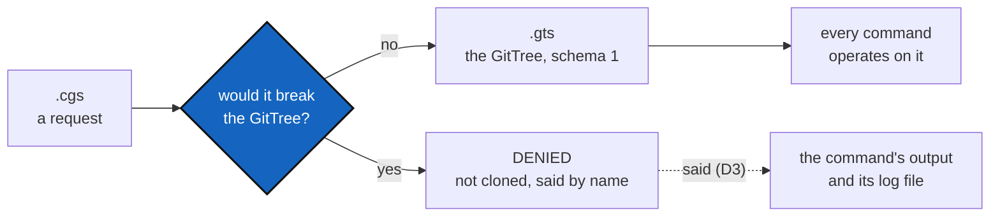

# IntegrityMount — the `.gts` refuses a mount that would break the GitTree, and 8.2.0's schema 2 and aliases are undone

*Created: 2026-10-28*

*Branch: main*

> **From the owner, 2026-10-28, after 8.2.0 (NestedAgentMaster) was committed.** *"Les
> modifications ne me semblent pas acceptables. La seule mission de cgitsync est de garantir
> l'intégrité du GitTree. DevPlanTicket IntegrityMount pour assurer cette mission. Je préfère un
> DENIAL de mount plutôt qu'une structure de type 2 etc. L'architecture doit rester minimaliste.
> La seule référence est GitTree, et donc .gts. .cgs est une demande, .gts est le résultat
> opérable qui peut refuser un mount demandé par .cgs."* Filed at `main_1-8`, the slot
> NestedAgentMaster left, and run by BeforeBeta as **S10** in its place.

> **Owner's answers, 2026-10-28 (at filing).** **D1:** a repository may be mounted twice when
> its **cgitsync branches are distinct** (*".claude peut être accepté deux fois si les cgitsync
> branch sont distinctes. Il faut alors s'assurer de la parfaite gestion des branches par
> cgitsync"*); so integrity is one repository **on one branch**, once. Two leaves on one schema-1
> key are still **denied** (the farther), even on distinct branches: schema 1 is not widened. A
> nested Parent's private/local repository takes the branch **`<Parent>_<Project>`**, the twin's
> rule generalised (`ComplexGitSync_gx4g` for ComplexGitSync's `.claude` under gx4g). **D2:** the
> request farther from the trunk is denied. **D3:** the denial is **not** in the `.gts`; it is
> written to the log file. **D4:** the command completes with the tree it can hold. **D5:** 8.2.0
> was never used, so no schema-2 State exists: the reader goes with no transition. **D6:** the
> agent rules stay.

## Abstract — read this first

**The one-line version.** A `.cgs` asks for mounts; the `.gts` is what the tree actually is, and
it may say no. When a requested mount would break the GitTree, `cgitsync` **denies** it: nothing
is cloned for it, the State stays schema 1, and the denial is said by name in the command's output
and its log file. A repository is held once **per branch**, so a nested Parent's private
repository gets a branch of its own, `<Parent>_<Project>`. 8.2.0's integrity
schema 2, its `tree_path` key, its aliases and its symlinks are removed.

**What this document is.** The rule (§1), what 8.2.0 changed and what goes (§2), when a mount is
denied (§3), the steps (§4), the decisions (§5) and acceptance (§6).

**Why it exists.** NestedAgentMaster made the GitTree accept what the `.cgs` asked for by growing
the State: a second key, aliases, links on disk. The owner's rule goes the other way: the GitTree
is the one reference, so a request it cannot hold is refused, and the State's shape never changes
to make room for it.

**Who it is for.** The worker who undoes 8.2.0's structure and builds the denial, the
orchestrator who quotes it, and the owner, for §5.

**What you need to do with it.** D1–D6 are answered (banner). Worker: §4 in order;
N1 (the removal) and N2 (the denial) land in one release, so no build ever writes a schema-2
State again.

---

## 1. The rule

- **cgitsync's one mission is the GitTree's integrity.** The GitTree, and so the `.gts`, is the
  only reference: every command reads it and operates on it.
- **A `.cgs` is a request.** Discovery reads it and its nested `.cgs` files as requests for mounts.
- **The `.gts` is the operable result.** It holds the mounts that keep the GitTree whole, and it
  may refuse a requested mount. A refusal is a result, not a failure of the tree.
- **Minimalism.** The State keeps one shape: schema 1, one leaf per clone, keyed by
  `relative_path`. Nothing is added to the State, the Merkle code or the disk to make a request fit.

## 2. What 8.2.0 changed, and what goes

| 8.2.0 added | Where | Fate |
|---|---|---|
| Integrity schema 2: `TREE_PATH_SCHEMA`, `SCHEMAS`, `schema_of`, leaves keyed and proved by `tree_path` | `merkle/merkle_root.py`, `operating_space/operating_space.py` (`inclusion_proof`) | **Removed.** `SCHEMA = 1` is the only State schema again |
| `tree_path` and `aliases` in a leaf, schema 2 accepted and stamped | `tree/gts_document.py` | **Removed** |
| `tree_path` and `aliases` written to and read from `[[repo_state]]`, `needs_tree_path` | `tree/registry.py`, `tree/mount_alias.py` | **Removed** |
| `WorkingRepo.aliases` | `git_repo/git_repo.py` | **Removed** |
| An alias in place of a nested duplicate, and a relative symlink at its path | `MountAlias.link`, `tree/discovery.py` | **Replaced** by a denial (§3): nothing linked, nothing created on disk |
| `MountAlias.identity_*`, `depth`, `master_of`, shallow-first discovery | `tree/mount_alias.py`, `tree/discovery.py` | **Kept**, renamed for what they now decide (D5): they find the mount a request would duplicate |
| `refuse_clash`: a different repository at a used path | `tree/mount_alias.py` | **Kept**: it is already a denial, the first of §3's cases |
| The nearer mount wins *whatever branch the nested spec asked for* | discovery | **Replaced**: the farther request is denied, its branch request is not silently overridden |
| Tests: `tests/unit/test_mount_alias.py`; schema-2 proof and surface tests | `tests/unit/` | Rewritten for the denial; the schema-2 ones go. `NEWER_SCHEMA` stays (`max(SCHEMAS)+1` becomes `SCHEMA + 1`) |
| Docs: `AdditionalSpecs.md` §One clone per repository, `digest.md`, Tutorial 5's nested section, the user guide's "Nested projects" paragraph | specs and docs | Rewritten for the denial |
| §7 agent rules (Q2, Q4, Q6) in `.localSpec/AGENT.md` and `AdditionalSpecs.md` | specs | D6 |

**Nothing else is touched.** Every schema-1 State, `gittree_root`, `os_id` and `H_GLOBAL` stays
byte for byte, as it did under 8.2.0. A State written under schema 2 exists only in a tree that
ran 8.2.0 on a nested duplicate (gx4g's DEV tree, if it was opened with it); D4 says what reads it.

## 3. When a mount is denied

**Integrity is one repository on one branch, once** (owner, D1). A requested mount is denied when
accepting it would make the GitTree hold something it cannot be:

1. **A different repository at a path the tree already uses** (8.2.0's `refuse_clash`).
2. **A repository the tree already mounts on the same branch**, at another path: gx4g mounting
   DevSpec on `main`, and ComplexGitSync's nested spec asking for DevSpec on `main` again. The
   same repository on a *distinct* branch is a distinct state and is accepted (case 3 aside).
3. **Two leaves on one schema-1 key**: two requests placing repositories at the same
   `relative_path` from two parents (gx4g's own `.agent/.local/.claude` and ComplexGitSync's),
   **even on distinct branches**. Schema 1 is the only key and is not widened.

The request that loses is the one **farther from the trunk** (D2); at one distance, the one
discovered later. The denial happens **before anything is cloned** for that request, in discovery,
so a denied mount never enters `DECLARED`, never reaches `READY` and is never in a leaf.

**The branches that make two mounts distinct** (D1). A nested Parent's private/local repository
is not filed under the Project's branch alone any more, where it would meet the Project's own:
it takes **`<Parent>_<Project>`** (and `<Parent>_<Project>_<X>` on project branch `X`), the rule
the twin's memory already follows (`TWIN_BRANCH_OWNER`, EnvConnect C8), generalised from
ComplexGitSync to any Parent. `git_branch.private_local_branch` stays the only place the name is
composed. Every command that moves, creates, merges, closes or reports a branch must then handle
these branches exactly as it handles the Project's own (N3).

**What this means in gx4g's DEV tree.** ComplexGitSync's nested requests for `.agent/.distant/*`
are denied (same repository, same branch `main`). Its `.agent/.local/.dev`: denied if gx4g's `.dev`
is on the branch the nested one asks for, accepted on `ComplexGitSync_gx4g` otherwise, but then
denied by case 3 when gx4g mounts its own `.dev` at the same `relative_path`. Its `.claude` and
`.localSpec`: accepted on `ComplexGitSync_gx4g` unless gx4g mounts its own at the same
`relative_path` (case 3). Its `docs` and `.cgitsync/.memory`: as the same three cases say.

## 4. Steps

- **N1 — undo the structure.** Remove §2's "Removed" rows in one change, with their tests. The
  golden vectors and every schema-1 test pass unchanged.
- **N2 — the denial.** In discovery, each of §3's three cases denies the request: no
  `WorkingRepo` is added, nothing is created on disk, and the denial carries the requesting spec,
  the entry, the case and the mount it collides with. Identity for case 2 is the repository *and*
  the branch it would be on (after `private_local_branch`).
- **N3 — the branches.** `private_local_branch` gains the Parent: a nested Parent's private/local
  repository resolves to `<Parent>_<Project>[_<X>]`, a top-level one to `<Project>[_<X>]` as
  today, and the twin's memory keeps `ComplexGitSync_<Project>[_<X>]`, now the same rule with
  ComplexGitSync as its Parent. `is_twin_branch`, `branch list`, `branch close`/`delete`, `checkout`,
  `merge`, `push`, `refresh --private` and the dead-branch findings (`orphaned-private`) read the
  new names through `git_branch` only. Tests cover each command on a tree with one nested Parent.
- **N4 — where the denial is said** (D3, D4). Not in the `.gts`. The command that discovered it
  prints one `denied:` line per denial and completes with the tree it can hold (exit 0); each
  denial is written to the command's log file (the run log, `CommandRunLogger`), so it can be read
  after the fact. `status` reads the `.gts` and so does not list them.
- **N5 — documentation.** `AdditionalSpecs.md` (*The install frontier*: a `.cgs` is a request,
  the `.gts` may refuse it; the section 8.2.0 added is rewritten; the branch rule in *Memory
  architecture* and the private/local rule), `digest.md`, Tutorial 5, the user guide (discovery,
  the private branch names, the log file).

## 5. Decisions for the owner

Answered at filing (banner). Kept here as asked and answered.

| D | Question | Answer (owner, 2026-10-28) |
|---|---|---|
| **D1** | Which cases are denied? | Same repository **on distinct branches** may be mounted twice; same repository on the same branch is denied; two leaves on one schema-1 key are denied even on distinct branches. A nested Parent's private repository takes `<Parent>_<Project>`, so branch management must be exact (N3). |
| **D2** | Which request is denied? | The one farther from the trunk. |
| **D3** | Is the denial in the `.gts`? | **No.** In the log file. |
| **D4** | Does a denial stop the command? | No: the command completes with the tree it can hold. |
| **D5** | A State written under schema 2 by 8.2.0? | 8.2.0 was never used: none exists. The reader goes with no transition and no MAJOR for it. |
| **D6** | The §7 agent rules? | Kept, without the sentences about aliases and links. |

Asked at `implement` (owner, 2026-10-28): the log file is **the existing run log**
(`CommandRunLogger`, a `mount_denied` event); a nested Parent already opened on the old branch name
gets **nothing automatic**: the existing fallback applies until the new branch is created, nothing is
renamed. The version level is the orchestrator's.

## 6. Acceptance

- `MerkleRoot` has one State schema, 1; `schema_of`, `TREE_PATH_SCHEMA`, `SCHEMAS`, `tree_path`,
  `aliases` and `MountAlias.link` are gone; `map_surface` and the surface tests say so.
- Every schema-1 State verifies byte for byte; `cgitsync verify check` on this tree answers as before.
- On a tree like gx4g's DEV tree: ComplexGitSync's nested requests for `.agent/.distant/*` are denied,
  nothing is cloned for them, no symlink is created, the State is schema 1 and valid, and each
  denial is printed and written to the log file, never to the `.gts`.
- The same repository on two distinct branches is held twice when no schema-1 key collides, and
  denied (the farther) when one does.
- A nested Parent's private repository is on `<Parent>_<Project>`; `checkout`, `branch`, `merge`,
  `push`, `branch close` and `branch list` handle it; the twin's memory still lands on
  `ComplexGitSync_<Project>`.
- A different repository at a used path is denied before any clone, naming both specs.
- No tree holds two clones of one repository on one branch.
- A standalone `bootstrap examples/complexgitsync4dev.cgs` behaves as before 8.2.0.
- `pixi run lint`, `pixi run test`, `bump-build`, `check-ceilings`, `check-oo`, `check-spectree`
  pass, and `cgitsync status` shows `errors=0`.

Related: `archive/20261028_NestedAgentMaster_DevPlanTicket.md` (the analysis of gx4g's failure, §1
and §2, still holds; its §3 rule and N1–N4 are what this ticket reverses).

## 7. As delivered (2026-10-28)

- **N1.** `git_repo.py`, `merkle_root.py`, `operating_space.py`, `gts_document.py`, `registry.py` and the four
  adjusted tests are back to their 8.1.0 content; `tree/mount_alias.py` and its tests are deleted. One State
  schema (1), no `tree_path`, no aliases, no link on disk.
- **N2.** `tree/mount_guard.py` (`MountGuard`, ring 1): identity, distance, `clash` (denial 1, inline in discovery),
  `owner` and `base`. `tree/mount_denial.py` (`MountDenial.deny`, ring 2): denials 2 and 3, run by the client right
  after discovery, once privacy has propagated, so a private repository's real branch is compared; a denied entry
  is removed from the registry before any clone and is not also reported as discovered. Identity is host, group,
  owner and name; case 2 compares it *and* the branch `GitTreeBranches.target` gives. A mount already in the tree is
  never displaced: a holder cloned late, whose request meets a deeper mount kept before, is the one denied.
- **N3.** `private_local_branch(..., owner=)` and `resolve_propagated_ref(..., owner=)`; `MountGuard.owner` names
  the Parent from the tree, never from the entry's own `source_cgs_path` (promotion overwrites it): none for an entry
  the root's spec declared; else its parent when that parent holds a nested spec in its own directory or shares its
  spec, or the parent's own Parent when the parent is private (so this tree's `.self-history` stays on
  `ComplexGitSync`, and a nested Parent's memory's `.self-history` follows its memory); `GitTreeBranches.target` passes
  it, `merge` (both forms, and the dry run) passes `MountGuard.base`, and `orphaned-private` findings read the
  Parent's base. `checkout`, `branch`, `push`, `close` and `branch list` resolve through `GitTreeBranches.target`.
- **N4.** `ComplexGitSyncClient._log_nested_discovery` warns `denied: <repo_id>: <why>` and logs `mount_denied`
  (repo_id, reason) to the run log. Nothing in the `.gts`.
- **N5.** `AdditionalSpecs.md` §A `.cgs` asks, the `.gts` may refuse (replacing 8.2.0's section; the agent rules
  kept), `digest.md` (two lines), `.localSpec/AGENT.md`, Tutorial 5, the user guide, `docs/DocCGS.cgs`'s comment.
- **Tests.** `tests/unit/test_mount_guard.py`: each denial, a distinct-branch repository held twice, the Parent's
  branch and `base`, the Project's own private repository and the memory's nested one unchanged, a schema-1 State
  that never names a denial, the client's warning and run-log event.
- **Re-quote round (orchestrator's B1, B2, M1–M5).** The owner approved restoring the lines the worker had joined
  to fit the ceilings, with the exact raise (merge.py, git_branch.py, git_tree_branch.py, tree_commands.py,
  discovery.py). Tests added: the promoted holder keeps its Parent's branch, a top-level entry under a container has
  no owner, a denied request is not also reported as discovered.
- **Not done.** No test per command (`checkout`, `push`, `close`) on a tree with a nested Parent: they all resolve
  through `GitTreeBranches.target`, which the tests cover. The live gx4g DEV run is S12's.
- **Released as 8.3.0 (MINOR)** after the orchestrator's re-quote: no blocking defect; 2618 passed, 4 skipped after the bump.
