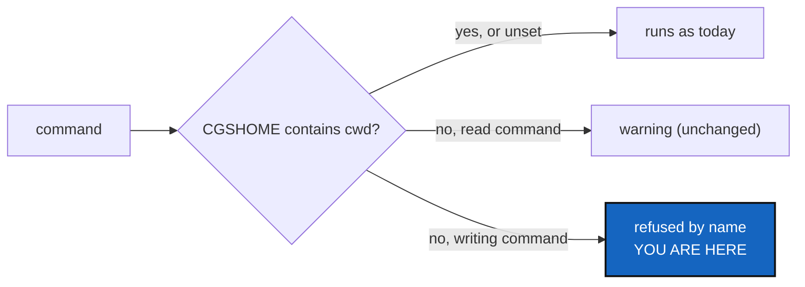

# CgshomeMismatch — a writing command refuses when `CGSHOME` does not contain the current directory

*Created: 2026-10-30*

*Branch: main*

> **From the owner's short ticket `no-upstream`**, split off from
> [NoUpstream](../archive/20261030_NoUpstream_DevPlanTicket.md) on the owner's answer
> of 2026-10-30 (its §5, Q3).

## Abstract — read this first

**The one-line version.** When `$CGSHOME` names a workspace that does not
contain the current directory, read commands keep today's warning, and
writing commands refuse by name before touching anything, naming the
two ways out: `--search-dir <here>` or `unset CGSHOME`.

**What this document is.** The plan for one refusal: the case, the rule,
the steps and acceptance.

**Why it exists.** On 2026-10-30 the owner bootstrapped
`ComplexGitSync-20261030150348` and worked there, while `CGSHOME` still named
`ComplexGitSync-20261030093858`. Every command printed two warnings and went
on. `add` and `commit` reported "nothing to stage" against the other
workspace, so the `git rm` staged in the tree the owner stood in was never
committed, and `push` pushed the other workspace. A warning above a
successful-looking result is not read. A write to the wrong workspace is
the cost.

**Who it is for.** The worker and orchestrator who implement it.

**What you need to do with it.** Follow §2. The owner already decided that
writes refuse and reads warn. Two smaller points are still open (§3).

---

## 1. The rule

- The test is the one `cli/_shared.py` already makes for its warning: the
  resolved `CGSHOME` (from `$CGSHOME`, not from `--search-dir`) does not
  contain the current directory.
- A **writing** command is one whose client method is in `WRITING_METHODS`
  (the set `Op` already uses), plus `fetch`. It is refused before any lock,
  log or Git call, with a message that names both directories and the two
  ways out. The set is not listed again in `cli/`.
- An explicit `--search-dir` always wins and is never refused: it is the
  user saying which workspace they mean.
- Read commands (`status`, `branch list`, `view-tree`, `validate`, …) keep the
  current two-line warning unchanged.

## 2. Steps

1. Tests: a writing command from outside `$CGSHOME` is refused and touches
   nothing (no log file, no lock); the same command with `--search-dir`
   runs; a read command still warns and runs.
2. Implementation: in the client, not in `cli/`, so the Python API and
   the CLI refuse the same way (`DevSpecs.md`, Monolithic Canonical API).
   The CLI only prints.
3. Docs: `docs/Text/user_guide.tex`, where `CGSHOME` resolution is
   described; rebuild the PDFs.
4. `pixi run lint`, `pixi run test`, `pixi run bump-build`; the orchestrator
   decides the level (a new refusal: at least `minor`, its call).

## 3. Decisions for the owner

Answered 2026-10-30:

- **Where.** The CLI layer, at one choke point in `cli/_shared.py` beside
  `_cgshome_warnings`; not the client. The origin of `CGSHOME` and the
  "current directory" exist only there (`tree/snapshot_resolver.py`,
  `CgshomeResolution`); the client is handed a snapshot path. The Python API
  is unchanged: a caller names its workspace. §1's "in the client" is
  superseded by this.
- **Q1, `fetch`.** Refused with the writing commands.
- **Q2, an override.** The owner asked for an evaluation, not a flag: would
  unsetting `$CGSHOME`, or an internal `CGSHOME` that is not a system variable
  and not read in Ring 0, fix the cause? The evaluation is §4; no opt-out
  variable is added.

## 4. Evaluation: can `$CGSHOME` stop being a system variable?

What the code does today (2026-10-30):

- `$CGSHOME` is read in two places: `describe_cgshome`
  (`tree/snapshot_resolver.py`, every command that finds a workspace) and
  `resolve_named_cgshome` (`tree/paths.py`, `initialise` without
  `--output-path`). Neither is in Ring 0, whose purity check forbids
  `os.environ`; the variable is already outside it.
- `bootstrap` does **not** read it: it makes a fresh `~/.cgs/<name>-<stamp>`.
  So "unset `CGSHOME` before `bootstrap`" changes nothing; the 2026-10-30
  bootstrap went to the right place. The mistake was in the *later* commands,
  in a shell still exporting the previous workspace.
- `initialise` does read it, when it has no `--output-path`. Ignoring it
  there is cheap, but it is not the incident either.
- The workflow is documented around it: `bootstrap` prints
  `export CGSHOME=…`, six tutorials, the README and the user guide tell the
  user to run it, and 80 test lines and `conftest.py` (which unsets it for
  every test) deal with it.

Options:

| | Closes the incident | Cost |
|---|---|---|
| **A.** Refuse writes when `$CGSHOME` names a workspace that does not contain the current directory (this ticket) | Yes, for writes; reads still warn | Small, no behaviour change when it matches; the export workflow keeps working |
| **B.** Ignore `$CGSHOME` in `initialise` and `bootstrap` only | No (bootstrap already ignores it) | Small, and mostly nothing |
| **C.** Retire `$CGSHOME`: the workspace is found by walking up from the current directory or `--search-dir`, else the default workspace; `bootstrap` prints a `cd` and `--search-dir` line, not an `export` | Yes, for reads and writes; trees are isolated by construction | Breaking: scripts that run from outside the workspace need `--search-dir`; README, six tutorials and the user guide change; many tests change. Its own ticket, with a warning release first |

An env var honoured only when the current directory is inside it is the same
as the walk up, so it adds nothing: A and C do not combine usefully; C makes A
unnecessary, and A is the step that is safe now.

## 5. Acceptance

- The 2026-10-30 session replayed: `add`, `commit` and `push` from
  `…150348` with `CGSHOME=…093858` are each refused, and `…093858` is
  unchanged.
- `status` in the same situation warns and runs, as today.
- `pixi run lint`, `pixi run test` pass; `cgitsync status` from the tree's
  own root shows `errors=0`.

## 6. As delivered (2026-10-30)

Released as 8.6.2 (patch: it adds neither a command, a flag nor a `--json`
field, and reuses the existing refused exit code).

- **Where.** `CgshomeGuard` in `cli/cgshome_guard.py`, at one choke point in
  the CLI, not in the client (§3): `note()` from the two announce functions of
  `cli/_shared.py`, `check()` first in `_run_with_logging`, `reset()` first in
  `main()`. The Python API is unchanged.
- **The rule as built.** Refused: a command in `WRITING_COMMANDS` when
  `$CGSHOME` alone chose the workspace and the current directory is not in it,
  `--dry-run` forms included. Not refused: `--search-dir` (even equal to
  `$CGSHOME`), an explicit snapshot, `unset CGSHOME`, every read command (they
  keep the warning). Refused before any log, lock or git call.
- **Ratchet.** The owner approved raising `cli/_shared.py` to 616 and
  `cli/__init__.py` to 93.
- **Existing tests.** 37 tests set `$CGSHOME` and ran a writing command from an
  unrelated directory, the behaviour now refused; they `chdir` into the
  workspace. `tests/conftest.py` resets the guard per test.
- **Known limits.** `WRITING_COMMANDS` omits `memory-initialise`,
  `memory-clone` and `memory-mount`, which change the workspace but are not in
  `WRITING_METHODS`; to follow with CgshomeInternal. The message prints the
  path with the platform's separators. The owner's request to retire
  `$CGSHOME` is CgshomeInternal.
