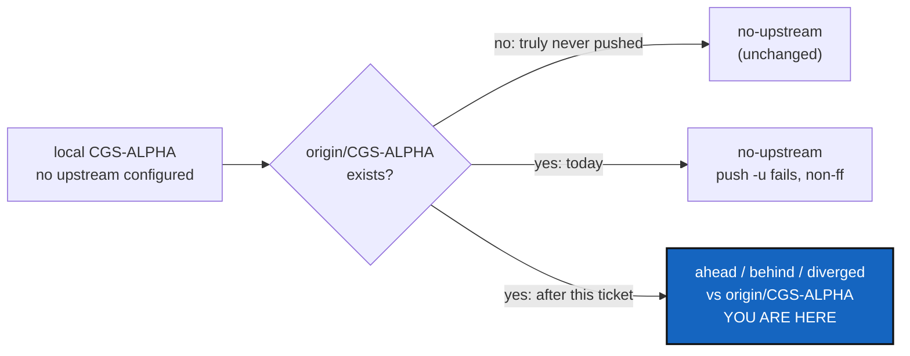

# NoUpstream — a local branch that shares a name with a remote branch is measured against it, not called "never pushed"

*Created: 2026-10-30*

*Branch: main*

> **From the owner's short ticket `no-upstream`** (a terminal session of
> 2026-10-30, ending "DevPlanTicket for no-upstream fixing"). The short ticket
> stays in `shortTickets/` until this plan lands (TICKETLIFECYCLE §6).

## Abstract — read this first

**The one-line version.** When the current branch names no upstream but
`origin/<branch>` exists, `status` measures against it and says ahead, behind
or diverged, and `push` refuses a non-fast-forward before sending anything,
naming the command that repairs it, instead of printing `no-upstream`
and then failing inside `git push -u`.

**What this document is.** The plan for one defect and the two smaller
hazards the same session exposed: what happened, why, the change, the
decisions the owner owes, and how it is accepted.

**Why it exists.** `no-upstream` is documented as "this branch was never
pushed, so there is nothing to measure" (`status_render.py`, the legend). That
is false when the remote already holds a branch of the same name. In the
reported session `status` said `no-upstream` for `CGS-ALPHA` in both
repositories, before and after `cgitsync fetch`, while `origin/CGS-ALPHA`
existed (at `49f4dd5`). `push` then ran `git push -u origin CGS-ALPHA` and
GitHub rejected it (`non-fast-forward`). `DocComplexGitSync` went through
and `ComplexGitSync` did not, so the tree is split. The user acts on that
answer: "nothing to measure" reads as "safe to push".

**What you will find.** §1 what happened, §2 the cause in the code, §3 the
change, §4 the steps, §5 the decisions for the owner, §6 acceptance.

**Who it is for.** The worker and the orchestrator who implement it, and the
owner who answers §5.

**What you need to do with it.** §5 is answered; follow §4.

---

## 1. What happened

1. `bootstrap examples/complexgitsync-dev.cgs` built the new tree at
   `ComplexGitSync-20261030150348` on `main`.
2. Every later command ran with `CGSHOME` pointing at the **other**
   workspace, `ComplexGitSync-20261030093858`. The tool printed two warnings and
   went on, so `add`, `commit` and `push` acted on that workspace, not the one
   the owner was standing in. `git rm` had staged the deletion in the new
   tree, which is why `add` and `commit` reported "nothing to stage" there.
3. In that workspace both repositories were on `CGS-ALPHA` with no upstream.
   `status` showed `no-upstream`, `unmeasured=2`, `errors=0`. `fetch` changed
   nothing in that row.
4. `push` set the upstream and pushed `DocComplexGitSync`; `ComplexGitSync`
   was rejected as non-fast-forward. The tool reported the part-way failure
   correctly (`TreePartialFailure`) and wrote no State.
5. `status` afterwards: Doc `synced`, root `no-upstream`. The owner's local
   `CGS-ALPHA` (`5b0a120`) and `origin/CGS-ALPHA` (`49f4dd5`) had diverged,
   and no command said so.

## 2. Cause

- `GitRunner.branch_tracking_counts` returns `None` whenever
  `upstream_ref` is `None` (`git_runner.py`), and `_repo_status_row`
  (`orchestre/client.py`) turns `None` plus "not configured" into
  `no-upstream`. Nothing looks for a remote-tracking branch of the same name.
- `PushOperation` (`tree/operations/push.py`) sets `set_upstream = not
  has_upstream(...)` and calls `git push -u`. It never asks whether
  `origin/<branch>` is ahead of or diverged from HEAD, so the preflight
  `commits_ahead_of_upstream` is `None` and the push is attempted blind. It
  is the sweep's failure that stops it, after the first repository has
  already been pushed.
- `has_upstream` is also what `pull` and `release freeze` use to decide to
  skip (`release_commands.py`): the same blind spot applies to them.
- The `CGSHOME` mismatch is only a warning (`cli/_shared.py`), even for
  commands that write.

## 3. The change

1. **A name for the branch's counterpart.** `GitRunner` gains one method that
   answers "which remote-tracking ref stands in for this branch": the
   configured upstream if it resolves, else `<remote>/<branch>` if that
   remote-tracking branch exists, else `None`. `upstream_ref`,
   `has_upstream` and `upstream_configured` keep their meaning; callers that
   need "is it configured" are not changed.
2. **`status`** measures against that counterpart when no upstream is
   configured, with the same words as today (`synced`, `ahead`, `behind`,
   `diverged`; §5, Q1). The `UPSTREAM_BRANCH` column shows the ref followed
   by `(same name)`, and `--json` carries the ref plus a boolean
   `upstream_configured: false`. `no-upstream` is kept for a branch the
   remote does not hold, which is the only case the legend's sentence is
   true for, and the legend gains one line for `(same name)`.
3. **`push`**, before pushing anything, reads the same counterpart for every
   repository in scope. A repository that is behind or diverged is refused
   by name, for the whole tree, so the tree is never split by it. The
   message names the repository, the two short SHAs and the ahead/behind
   counts, and the repair (§5, Q2): `cgitsync pull` when behind;
   `git -C <path> merge <remote>/<branch>`, then `cgitsync push`, when
   diverged. No new command or option. Nothing is forced, per the hard
   prohibitions.
4. **`pull` and `release freeze`** treat the counterpart as the thing to pull
   from, so "no upstream yet — nothing to pull" is said only when the remote
   holds no such branch. `pull` stays `--ff-only`, and a successful pull
   from the counterpart sets the upstream.
5. **`checkout <branch>`** sets the upstream to `<remote>/<branch>` when that
   remote-tracking branch exists and the local branch names none (§5, Q4).
   It writes `branch.<b>.remote` and `branch.<b>.merge` only, moves no
   commit, and is logged. This removes the state at its source; items 2–4
   still cover trees that already sit in it.
6. **`CGSHOME` outranking the current directory** is not this ticket
   (§5, Q3): it is CgshomeMismatch.

## 4. Steps

1. Tests first, in `tests/integration/test_upstream_tracking.py`: a
   repository whose local branch has no upstream and whose `origin/<branch>`
   is (a) level, (b) behind, (c) ahead, (d) diverged, (e) absent; each the
   expected SYNC word and `(same name)` marker. A two-repository tree where
   one is diverged: `push` refuses before pushing the other, and the
   message holds the `git -C … merge` line. A `checkout` of a branch that
   `origin` holds leaves it tracking `origin/<branch>`.
2. `GitRunner` method and its protocol entry; unit tests in
   `tests/unit/test_git_runner.py`.
3. `_repo_status_row` and `status_render.py`: the marker, the legend line,
   `--json`.
4. `PushOperation` preflight; `Preflight` messages.
5. `pull` and `release freeze` skips; `pull` sets the upstream.
6. `checkout` sets the upstream (one `GitRunner` call, in `git_runner.py`).
7. Docs: `docs/Text/user_guide.tex` (the SYNC legend, the refusal, what
   `checkout` and `pull` now set), rebuild the PDFs. `AdditionalSpecs.md`
   only if a responsibility moves, which it should not: everything new
   stays in `git_runner.py`.
8. `pixi run lint`, `pixi run test`, `pixi run bump-build`; the orchestrator
   decides the version level and runs `bump-version`.

## 5. Decisions for the owner

All four answered by the owner on 2026-10-30.

- **Q1 — the SYNC word. Decided: reuse the words, add a marker.**
  `synced`/`ahead`/`behind`/`diverged` as today, with `(same name)` after
  the ref in `UPSTREAM_BRANCH`. The count is the same fact, and scripts
  matching on `diverged` keep working.
- **Q2 — the repair a refusal names. Decided: `cgitsync pull` when behind,
  the exact `git -C <path> merge <remote>/<branch>` when diverged.**
  `cgitsync pull` is `--ff-only` and `cgitsync merge` takes only a project
  branch, so no cgitsync command repairs a diverged branch today. This
  ticket adds none: no new CLI option, no client method, no Minimalism row.
- **Q3 — `CGSHOME` that does not contain the current directory. Decided:
  writing commands refuse, in a separate ticket,** CgshomeMismatch.
  Read commands keep the warning.
- **Q4 — `checkout` sets the upstream. Decided: yes, in this ticket**
  (§3, item 5).

## 6. Acceptance

- The reported situation (local branch with no upstream, same-name remote
  branch, diverged) gives `diverged` in `status` and a refusal from `push`
  that names the repository, before any repository is pushed.
- A branch the remote does not hold still says `no-upstream`, and its first
  `push` still sets the upstream.
- After `cgitsync checkout CGS-ALPHA` on a tree where `origin/CGS-ALPHA`
  exists, every repository's `CGS-ALPHA` tracks it, and no commit moved.
- A configured upstream is measured exactly as before; no existing
  `test_upstream_tracking.py` or `test_status_render.py` expectation changes
  except the legend's sentence.
- No command rewrites history or forces (`digest.md`, the hard
  prohibitions).
- `pixi run lint`, `pixi run test` pass; `cgitsync status` from the tree's own
  root shows `errors=0`.

## 7. As delivered (2026-10-30)

Released as 8.6.0 (minor: a new `--json` field and new refusals, no new
command or option).

- **Where the logic lives.** Not in `GitRunner` as §3 item 1 first said: the
  module ratchet and the 2000-line rule for `git_runner.py` would have failed.
  The owner chose one new class, `SameNameRemote` in
  `git_repo/same_name_remote.py` (`ref`, `counts`, `state`, `adopt`,
  `refusal`). `git_runner.py` is unchanged.
- **Ratchet.** The owner approved raising seven LOC baselines by the call-site
  lines only: `json_render` 207, `status_render` 255, `release_commands` 345,
  `branch` 608, `restart` 309, `preflight` 410, `client` 1404.
- **Q1–Q4 as decided.** `status` keeps the SYNC words and shows
  `(same name)`; `--json` adds `upstream_configured`; `push` refuses a
  behind or diverged branch for the whole tree before sending anything;
  `checkout` and `pull` set the upstream. `release freeze` pulls when the
  remote holds a branch of the root's name.
- **Known limits.** `SameNameRemote` calls `GitRunner._run`/`_query`, which are
  private; a public method for the `rev-list` count would be tidier.
  `checkout` adopts only `origin`. `--json` derives `upstream_configured` from
  the `(same name)` suffix.
- **Gates.** `pixi run test` showed 12 failures, all from the owner's
  uncommitted rename of `examples/complexgitsync4dev.cgs` (a missing file and a
  `CORR:` note); `check-spectree` and `cgitsync status` could not run for the
  same reason, and were left to that change.
