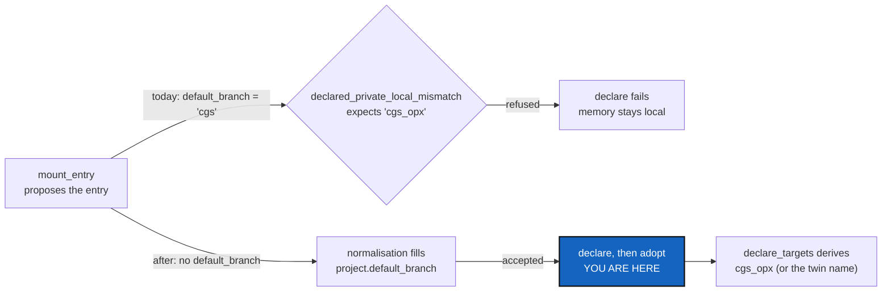

# MemorySetupBranch — the memory entry the tool proposes validates on any project branch

*Created: 2026-11-03*

*Branch: CGS-ALPHA*

> **From the owner's short ticket `memory-setup-default-branch`** (2026-11-03,
> "write a short ticket in ComplexGitSync … I'll execute the fix from a proper
> env"). The short ticket stays in `shortTickets/` until this plan lands
> (TICKETLIFECYCLE §6).

## Abstract — read this first

**The one-line version.** `MemoryRepository.mount_entry` stops writing
`default_branch = <project name>`, so the entry that `memory setup`,
`memory init` and the default-memory hint propose passes the `.cgs`
validator on every project branch, not only on `main`.

**What this document is.** The plan for one defect: what happened, the cause,
the change, the steps, the decisions the owner owes, and how the work is
accepted.

**Why it exists.** On any project that is not on `main`, `cgitsync memory
setup` creates the memory repository and then fails at its own `declare`
step. The memory stays local, with no back-up and no global ledger record.
The `init` line and the default-memory hint give the same entry, so a user
who pastes either one by hand gets the same refusal.

**What you will find.** §1 what happened, §2 the cause, §3 the change, §4 the
steps, §5 the decisions for the owner, §6 acceptance, §7 what this ticket
leaves alone.

**Who it is for.** The worker and the orchestrator who implement it, and the
owner, who answers §5.

**What you need to do with it.** Ask §5 before the first edit, then follow
§4.

---

## 1. What happened

In atCGS, the owner bootstrapped `examples/cgs-opx.cgs` from a ComplexGitSync
checkout on `CGS-ALPHA` (`dd3472b`) and ran `cgitsync memory setup`. The
`create` step made `flipoyo/.memory`, then `declare` refused the entry it had
just proposed:

    repos[8].default_branch = 'cgs' disagrees with the branch a private, writable
    repository takes from this project: 'cgs_opx'.

`adopt` never ran. Project `ComplexGraphSync` on `CGS-ALPHA` fails the same
way (`'ComplexGraphSync'` against `'ComplexGraphSync_CGS-ALPHA'`). The defect
is on `origin/main` too: it has the same `mount_entry` line.

## 2. Cause

- `MemoryRepository.mount_entry` (`tree/memory/repository.py`) writes
  `"default_branch": project_name`. Its docstring says the branch "is left to
  the ordinary derivation". The code does not do that.
- `declared_private_local_mismatch` (`git_repo/git_branch.py`) accepts a
  private/local entry only with no `default_branch`, the derived
  `private_local_branch(project, project.default_branch)`, or the document's
  own `project.default_branch`. `CgsDocument` validation calls it
  (`tree/cgs_format.py`) on every `.cgs` written or read.
- The project's name equals the derived branch only when the project is on
  `main`, so every other project fails.
- Three callers share the entry: `MemorySetup.proposal`
  (`orchestre/memory_setup.py`), `memory init` (`orchestre/memory_commands.py`)
  and `DefaultMemory.publish_hint` (`orchestre/default_memory.py`).

**The value is never used.** `GitTreeBranches.declare_targets` overwrites the
`default_branch` and `target_ref_name` of every private/local repository with
the derived branch at load time (twin or not). Dropping the line removes the
refusal and changes nothing in which branch is cloned or checked out. The
shape without the line is already what `examples/cgs-opx.cgs`,
`examples/complexgitsync-dev.cgs` (LinkAtCGS row 13) and
`tests/integration/test_env_connect.py` declare.

**The twin case (the short ticket's "not checked" item).** The
`memory_defaulted` log names twin branches (`ComplexGitSync_cgs`,
`ComplexGitSync_ComplexGraphSync_CGS-ALPHA`), which the non-twin validator
would refuse if they were written as `default_branch`. With the fix, the tool
writes no `default_branch` at all, so the validator accepts the entry and
`declare_targets` still gives a twin tree its twin branch. A user who types
the twin name by hand is still refused, and the message's first piece of
advice (drop `default_branch`) is correct; its second ("or write
`'cgs_opx'`") is harmless, since the value is overwritten anyway. Whether to
change that is §5, Q1. The doubled `ComplexGitSync_ComplexGitSync_…` prefix,
for the project ComplexGitSync itself, is LinkAtCGS RD3, not this ticket.

## 3. The change

1. Remove `"default_branch": project_name,` from `MemoryRepository.mount_entry`,
   and make its docstring say what the code does: the entry names no branch,
   normalisation fills `project.default_branch`, and `declare_targets`
   derives the real one (`MemoryRepository.branch`).
2. Nothing else in `src/`: no new command, option, client method or
   Minimalism row. `git_branch.py` is unchanged unless §5, Q1 says otherwise.

## 4. Steps

1. **Tests first.**
   - `tests/integration/test_memory_repository.py` (or a sibling under
     `tests/integration/`): `memory setup`, with `repo_create` stubbed, on a
     project whose `project.default_branch` is not `main` (for example
     `name = "cgs"`, `default_branch = "opx"`). It ends with
     `failed is None` and `done == ["create", "declare", "adopt"]`, and the
     written `.cgs` loads through `CgsDocument` without error.
   - The same for `memory init`: its `line`, written into the `.cgs` by hand,
     validates.
   - A unit test: `mount_entry(...)` holds no `default_branch` key.
   - A twin tree (the shape `test_env_connect.py` uses): after `declare`, the
     memory still targets `ComplexGitSync_<project>[_<branch>]`.
2. **Update what expected the old key.** Grep `tests/` for `mount_entry`,
   `publish_hint`, `"line"` and `memory init` / `memory setup` output.
   `test_init_proposes_the_entry_that_mounts_the_memory` compares against
   `mount_entry` itself and needs no change. A test that pins
   `default_branch = "<project>"` on its own hand-written memory entry
   (`test_commit_memory.py`, `test_tree_merge_memory.py`,
   `test_pull_outside_root.py`) is on `main` and passes either way; leave it
   alone.
3. The `mount_entry` edit and its docstring.
4. `pixi run lint`, `pixi run test`, `pixi run bump-build`. The orchestrator
   decides the version level (no command or option changes, so `patch` is
   the floor) and runs `bump-version`, then rebuilds the PDFs.
5. `cgitsync status`, from the tree's own root: `errors=0`.
6. In atCGS, once the release is installed: rerun `cgitsync memory setup` on
   `examples/cgs-opx.cgs`. It should declare and adopt the local memory that
   the failed run left behind (`create` reports the repository already
   exists).

## 5. Decisions for the owner

Open. Ask each with `AskUserQuestion` before the first edit.

- **Q1 — a hand-typed twin branch on the memory entry.** The validator cannot
  know a tree is a twin (only the memory's checked-out branch says so), so it
  refuses `default_branch = "ComplexGitSync_cgs_opx"` even though the value
  would be overwritten. (a) Leave it: the tool never writes it, and the
  message already says to drop the key. (b) Also accept the twin form, in
  `declared_private_local_mismatch`, for the entry at `.cgitsync/.memory`.
  *Recommendation: (a).* (b) adds a special case to the one module that owns
  the privacy rule, for a value that does nothing.
- **Q2 — `fallback_branch = "main"` in the same entry.** `mount_entry` also
  writes `fallback_branch = "main"`. For a private/local entry with no
  fallback, `apply_declared_defaults` would use its own `default_branch`
  instead ("never another project's `main`"). It is unclear whether a memory
  whose project branch is absent on the remote clones the memory repository's
  `main`. (a) Out of this ticket: write a short ticket after checking.
  (b) Look at it here. *Recommendation: (a).* This ticket changes no runtime
  behaviour, and that one might.

## 6. Acceptance

- `cgitsync memory setup` on a project whose branch is not `main` runs
  `create`, `declare` and `adopt` with no error, and the `.cgs` it wrote
  validates.
- The `memory init` line and the default-memory hint, pasted into a `.cgs`,
  validate on any project branch.
- On `main`, and on a twin tree, the memory is on the same branch as before
  the change.
- No existing test expectation changes, except one that asserted the
  `default_branch` key in a proposed entry.
- `pixi run lint`, `pixi run test` pass; `cgitsync status` from the tree's
  own root shows `errors=0`.

## 7. Not this ticket

- The doubled twin prefix for the project ComplexGitSync, and moving this
  tree's memory: LinkAtCGS, RD3.
- Who runs `gh repo create` for `memory setup`: ProviderMigration.
- Until this lands, the short ticket's workaround stands: declare the memory
  by hand without `default_branch`, then rerun `cgitsync memory setup` so it
  adopts the local memory.
