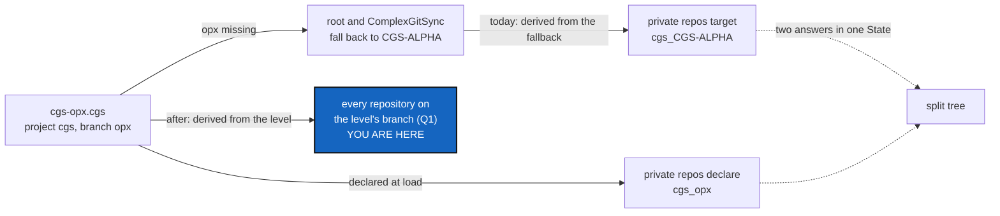

# BehindGate — the branches of a `yyyy-xxx.cgs` tree, for its project and for the tool mounted behind its gate

*Created: 2026-11-04*

*Branch: CGS-ALPHA*

> **From the owner's short ticket `cgitsync-behing-gate`** (2026-11-04): the owner bootstrapped atCGS's
> `examples/cgs-opx.cgs` and ran `cgitsync status`. Its last line, as written: *"ComplexGitSync and atCGS should be on
> project-name_branch, but they are on branch"*. The short ticket stays in `shortTickets/` until this plan lands
> (TICKETLIFECYCLE §6).

## Abstract — read this first

**The one-line version.** In a tree opened from a `yyyy-xxx.cgs`, every repository takes its branch from the level the
file names (`xxx`), not from the fallback the root happened to land on. The tool mounted behind the project's gate gets
a branch of the project's own, not a branch it shares with every other project.

**What this document is.** The plan for that change: what happened, the cause, the change, the steps, the decisions the
owner owes, and how the work is accepted.

**Why it exists.** In atCGS's OPX tree, one State holds two answers for every private repository (`cgs_opx` declared,
`cgs_CGS-ALPHA` targeted). The two project repositories sit on `CGS-ALPHA`, a branch every project's tree shares, so OPX
work done there would land on ComplexGitSync's own line. Nothing creates the level's branches, so the tree stays split.

**What you will find.** §1 what happened, §2 the cause, §3 the change, §4 the steps, §5 the decisions for the owner,
§6 acceptance, §7 what this ticket leaves alone.

**Who it is for.** The worker and the orchestrator who implement it, and the owner, who answers §5.

**What you need to do with it.** Ask §5 before the first edit: Q1 decides most of §3. Then follow §4.

---

## 1. What happened

The owner bootstrapped `examples/cgs-opx.cgs` (atCGS, project `cgs`, `default_branch = "opx"`,
`fallback_branch = "CGS-ALPHA"`) into `~/.cgs/cgs-20261104014355`, with ComplexGitSync 8.7.x on `CGS-ALPHA`. `status`
shows `errors=0` and READY, but warns that the tree is split. The State it wrote (read-only check, 2026-11-04):

| Repository | Declared `default_branch` | `target_ref` | On disk | Why |
|---|---|---|---|---|
| atCGS (root, shown as `cgs`) | — | `opx` | `CGS-ALPHA` | `opx` not on the remote; fell back |
| ComplexGitSync | — | `opx` | `CGS-ALPHA` | the same |
| `.dev`, `.localSpec`, `.claude`, `.omniscience` | `cgs_opx` | `cgs_CGS-ALPHA` | `main` | `cgs_CGS-ALPHA` not on the remote |
| `.memory` (twin) | `ComplexGitSync_cgs_opx` | `ComplexGitSync_cgs_CGS-ALPHA` | `main` | the same |
| `.ticketing`, `DevSpec`, `DocSpec` | `main` | — | `main` | private/distant, as expected |

The remotes hold no `opx`, no `cgs_opx` and no `cgs_CGS-ALPHA` branch. `status` also warns *"the project is 'cgs' but
its root repository is 'atCGS'"*, which is true and expected (§7).

## 2. Cause

- **Two derivations of one rule.** `GitTreeBranches.declare_targets` (`tree/git_tree_branch.py`) runs at load, before
  anything is cloned, and derives each private/local branch from the root's *declared* target (`opx` → `cgs_opx`). Once
  the root is cloned, `GitTreeBranches.target` is asked with `tree_branch`, the root's *observed* branch. That is the
  fallback, `CGS-ALPHA`, which gives `cgs_CGS-ALPHA`. Both are written into the same State. `deviations`, the commit
  preflight and `missing_private_branches` measure against the second.
- **A fallback is read as a project branch.** `CGS-ALPHA` is where a repository of such a tree *waits* until its
  level's branch exists (LinkAtCGS §7.1). Deriving private branches from it creates, on the first private commit or
  `memory branch`, branches (`cgs_CGS-ALPHA`) that the next install abandons once `opx` exists. That is how LinkAtCGS
  row 10 got its stray branches. 8.7.5 (MemoryMount) already answers this for the memory alone: on its fallback base,
  the State's recorded target decides, not the observed branch.
- **The tool behind the gate shares a branch with every project.** ComplexGitSync is a *project* repository of `cgs`,
  so it targets the project branch itself, `opx`. Every `yyyy-opx.cgs` that mounts the tool (`gx4g-opx.cgs`,
  `complexgitsync-opx.cgs`) asks for that same `opx` in ComplexGitSync's own repository. Until it exists, they all sit
  on `CGS-ALPHA`, ComplexGitSync's own line. IntegrityMount already namespaces another owner's *private* repositories
  (`<Parent>_<Project>`, `git_branch.private_local_branch(owner=)`). Nothing namespaces a *project* repository that
  belongs to another project.
- **Nothing creates the level's branches.** `branch create` refuses a new name holding `_` (EnvConnect), so `cgs_opx`
  cannot be typed. `checkout opx` would create `opx` in the project repositories and the derived names in the private
  ones, but nothing says so: C7 reports only private repositories, and names a command only for the memory.

## 3. The change

Subject to §5. Every rule stays in `git_repo/git_branch.py`, the only implementation of the fallback chain and the
privacy rule. `tree/git_tree_branch.py` only asks it.

1. **One derivation.** When the root sits on its fallback (`root.fallback_branch`, or `main`) and its recorded target
   differs, the tree's branch for derivation is the root's target, as 8.7.5 does for the memory. `declare_targets`, `target`,
   `deviations` and the State then agree. A private repository waiting on its fallback is measured against `cgs_opx`.
2. **The tool behind the gate** (Q1). A project repository of this tree whose own project is another one gets the
   branch Q1 chooses, composed in `git_branch.py` only. ComplexGitSync, mounted by `cgs`, is the case.
3. **Say how to create the level** (Q2). After an install that fell back, the report names, once, the command that
   creates the level's branches in every repository that lacks them, with no push. The pattern is C7's.
4. **Specs.** `AdditionalSpecs.md`, *The install frontier* and *A `.cgs` asks, the `.gts` may refuse*. The digest lines
   on the `yyyy-xxx.cgs` rule and on the private branch. LinkAtCGS §7.1 gets a pointer to this ticket. The user guide's
   *Branches in a `.cgs`* section, if Q1 changes what a user sees.

No new command, option or client method unless Q2 answers (c), which needs a Minimalism row.

## 4. Steps

1. **Tests first**, in `tests/integration/test_env_connect.py` or a new `test_behind_gate.py`. Build bare remotes as
   `_tree` does: a root `demo`, a `tool` project repository whose remote has only `CGS-ALPHA` and `main`, a private
   writable `.localSpec`, a twin `.memory`. Bootstrap `demo-opx.cgs`
   (`project = { name = "demo", default_branch = "opx", fallback_branch = "CGS-ALPHA" }`). Assert:
   - every private/local repository's `default_branch` equals its `target_ref` in the State written, and both are
     `demo_opx` (the memory: `ComplexGitSync_demo_opx`);
   - `tool` targets the branch Q1 chooses;
   - after the command Q2 chooses, every repository is on its target, `status` shows no split-branch warning, and
     nothing was pushed;
   - a plain `.cgs` (not named `yyyy-xxx`) on `main` installs exactly as before.
2. Change `git_branch.py`, then `git_tree_branch.py`, as §3 says.
3. `pixi run lint`, `pixi run test`, `pixi run bump-build`; the ceilings without a raise, or the raise asked of the owner
   (CLAUDE.md, step 2 of the `implement` orders). The orchestrator decides the level: `minor` if Q1 changes the branch a
   user's repository is on, else `patch`.
4. Specs and digest (§3.4), in the same change; `pixi run check-spectree`.
5. `cgitsync status` from this tree's root: `errors=0`. In atCGS, a fresh bootstrap of `examples/cgs-opx.cgs` meets §6.

## 5. Decisions for the owner

Open. Ask each with `AskUserQuestion` before the first edit.

- **Q1 — which branch the project repositories of a `yyyy-xxx.cgs` tree are on.** The short ticket says
  *"project-name_branch"*.
  (a) **Both on `<project>_<xxx>`**, `cgs_opx`, as written. Every repository of the level then shares one name. The
  root's own project branch becomes `cgs_opx`, so the private rule must not double it into `cgs_cgs_opx`.
  (b) **Both on `xxx`**, `opx`, as LinkAtCGS §7.1 says today. Only §3.1 and §3.3 change. ComplexGitSync keeps one `opx`
  shared by every project's OPX tree.
  (c) **The root on `xxx`, the tool on `<project>_<xxx>`.** atCGS on `opx`, ComplexGitSync on `cgs_opx`. The project's
  own repository keeps the project's branch. The repository of another project is namespaced, as IntegrityMount does
  for private ones.
  *Recommendation: (c).* It removes the collision the short ticket points at (`gx4g-opx` and `cgs-opx` both writing
  ComplexGitSync's `opx`), and it leaves the root's branch, and so every private derivation, as §7.1 defines them. (a)
  is the literal reading; it renames the root's branch and needs a no-doubling rule.
- **Q2 — what creates the level's branches.**
  (a) Nothing new: the install report names `cgitsync checkout <xxx>`, which creates every derived name, local only.
  (b) `bootstrap` of a `yyyy-xxx.cgs` creates them itself, locally, and says so.
  (c) A new command.
  *Recommendation: (a).* A branch is never invented by an install (the C7 rule and `memory branch`), and `checkout`
  already composes the derived names that `branch create` refuses to have typed.
- **Q3 — the private branch while the root waits on its fallback.**
  (a) Derive from the level (`cgs_opx`), as §3.1.
  (b) Keep deriving from the fallback (`cgs_CGS-ALPHA`), and only make `declare_targets` agree with it.
  *Recommendation: (a).* A fallback is a place to wait, and (b) creates branches the next install abandons
  (LinkAtCGS row 10).

## 6. Acceptance

- A fresh bootstrap of atCGS's `examples/cgs-opx.cgs` writes a State in which every private/local repository's
  `default_branch` equals its `target_ref`, and both name the level (`cgs_opx`; the memory `ComplexGitSync_cgs_opx`).
- ComplexGitSync and atCGS target the branches Q1 chose; ComplexGitSync's `CGS-ALPHA` receives no commit from the OPX
  tree.
- After the Q2 command, `status` shows every repository on its target and no split-branch warning; nothing was pushed.
- A tree from a `.cgs` that is not named `yyyy-xxx` (`install.cgs`, `examples/complexgitsync-dev.cgs`) installs on the
  same branches as before.
- `pixi run lint`, `pixi run test` pass; `cgitsync status` from this tree's root shows `errors=0`.

## 7. Not this ticket

- The `the project is 'cgs' but its root repository is 'atCGS'` warning: true, and the project's name is the one used,
  as it says.
- `.omniscience`, `.memory` and the other private repositories waiting on `main` until their branch exists: since 8.7.6
  a commit and a push only warn about them, and `omniscience register` creates its branch by name.
- The doubled twin prefix for the project ComplexGitSync itself: LinkAtCGS, RD3.
- Who creates the remote branches, and who protects them on the provider: gx4g (LinkAtCGS §3c).
