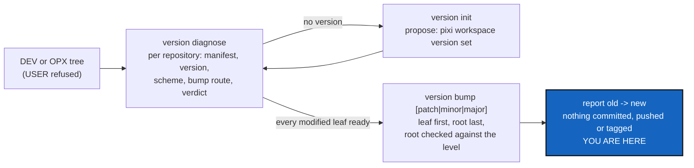

# TreeVersion — `cgitsync version diagnose | init | bump`, every repository's version through Pixi

*Created: 2026-11-11*

*Branch: CGS-ALPHA*

> **From the owner, 2026-11-11:** *"write a DevPlanTicket for adding a cgitsync CMD bump-version by default patch but
> possibility to say minor or major. It controls the SemVer of the Tree root and uses the proper command for the
> modified leaves. This way projet administrated by cgitsync would be capable of updating each leaf version and all
> documents related. Let see what is possible without agent for doing it (the files update was until now performed by
> agent)"*
>
> **Second pass, the same day:** *"for bump-version, cgitsync must first verify at the repo level if it contains a
> SemVer and propose to install one with pixi if none. It is asked to DEV or OPX only. the CMD is version, subcommand
> is diagnose (check every repo versioning, can be a build or SemVer or something else but always with pixi)
> init(propose to install if not installed yet at the repo level) and then bump (what you just did)"*
>
> That answers the first draft's Q1 (the name) and adds `diagnose` and `init`. The first draft,
> `CGS-ALPHA_1-2_ReleaseBump` (`.dev` commit 6cd47c1), is rewritten here under this name, before any implementation.
> Its other decisions keep their substance and are renumbered in §9.

## Abstract — read this first

**The one-line version.** A new command group, `cgitsync version`, refused outside a DEV or OPX tree. `diagnose`
reports how each repository is versioned: SemVer, a build counter, something else, or nothing, always as Pixi sees it.
`init` offers to install a version with Pixi where there is none. `bump [patch|minor|major]`, `patch` by default, bumps
each modified leaf and then the root, and checks that the root moved by that level.

**What this document is.** The plan for those three subcommands: what an agent does today on a release, what Pixi
already does by itself, each subcommand, the contract a repository meets, architecture constraints, spec changes,
steps, the owner's decisions, and acceptance.

**Why it exists.** A release today is `pixi run bump-version` in one repository, then `latexmk` in `docs/`, run by the
orchestrator agent. In a tree of several versioned repositories (atCGS with ComplexGitSync behind its gate), nothing
says which repository has a version, nothing installs one, nothing bumps each one, and nothing checks that the root
moved. `cgitsync` knows the tree, so it is the place to do it, with or without an agent.

**What you will find.** §1 what an agent does today. §2 what Pixi does by itself (tried 2026-11-11). §3 the level
gate. §4 `diagnose`. §5 `init`. §6 `bump`. §7 architecture constraints and spec changes. §8 steps. §9 decisions for
the owner. §10 acceptance. §11 what this ticket does not do.

**Who it is for.** The worker and the orchestrator who implement it, and the owner, who answers §9.

**What you need to do with it.** Read §9: every decision is answered. Land the short ticket `alpha-examples` first, because
`bump_version.py` still points at a `.cgs` that does not exist (§7).

---

## 1. What an agent does today on a release

| Step | Who today | Mechanical? |
|---|---|---|
| Choose `major`, `minor` or `patch` from the diff | orchestrator | **No.** A judgement (shared `Versioning.md` §2) |
| `pixi run bump-version <level>`: five targets, three in ComplexGitSync, two in `docs/` | orchestrator | Yes, already a script |
| Rebuild every PDF in `docs/` | orchestrator | Yes, one `latexmk` command |
| Do the same in every other versioned repository of the tree | nobody | Yes, if each has a route |
| Check that the commit prefix carries the new version | `cgitsync commit` already does | Yes |
| Self-history record and conformity score | orchestrator | No. It records agent work, and has nothing to record without one |

Everything but the level, the record and the score can run without an agent. The level stays a person's judgement,
and **the owner typing `minor` is that person**: shared `Versioning.md` §2 asks for a reader, not for an agent. CI
still never writes a version.

## 2. What Pixi does by itself (tried in scratch, Pixi 0.65.0, 2026-11-11)

`pixi workspace version {get,set,major,minor,patch}` exists, with `--manifest-path`:

| Case | Result |
|---|---|
| `pixi.toml` with no `version` | `get` prints nothing and exits 0; `patch` fails, *"No version found in manifest"*; `set 0.1.0` adds the field |
| `8.8.0`, `minor` | `8.9.0` |
| `1.9.1-alpha` (atCGS's form), `patch` | `1.9.2-alpha`: the suffix is kept |
| `1.2.3-rc.1`, `patch` | `1.2.4-rc.1`: the suffix is kept, not finalised |
| `2026.07`, a calendar build, `set` then `minor` | written `2026.7`, then `2026.8`: the leading zero is lost, and the scheme is read as SemVer |
| A `pyproject.toml` workspace (`[tool.pixi.workspace]`) | reads and writes `[project].version` there |

Two consequences:

- **Pixi's own bump is enough only for a repository whose version lives in its manifest alone.** In ComplexGitSync it
  would move `pixi.toml` and leave `pyproject.toml`, `__init__.py`, `README.md` and both `.tex` macros behind. A
  repository's own `bump-version` task always wins (§6).
- **Pixi's own bump must never touch a version that is not SemVer.** A calendar build is mangled. `diagnose` tells the
  schemes apart (§4).

`ProjectVersion` reads `pixi.toml` only, and stays so (Q5): `cgitsync` manages projects in any language, and
`pixi.toml` is the one manifest they all share.

## 3. The level gate: DEV or OPX only

Every `version` subcommand is refused in a USER tree, before any repository is read. The tool has no OPX profile:
`WorkingGitTree.profile` is DEV or USER, and an OPX tree holds private repositories, so it is DEV (`PoE.of_profile`).
The gate is therefore `WorkingGitTree.require_dev`. Its refusal message today speaks of closing branches, so it takes
the reason as a parameter, and `branch close` and `branch delete` keep their wording.

A USR or PUB tree cannot bump anyway: the leaves' scripts live in private mounts (shared `Versioning.md` §6).

## 4. `cgitsync version diagnose [--json]`

Reads only. Writes nothing, runs no bump. One row per repository of the tree, private ones included and marked
`private`, never initialised or bumped (Q1).

| Column | Says |
|---|---|
| `MANIFEST` | `pixi.toml`, or `none` (a `pyproject.toml` workspace is `none`, Q5) |
| `VERSION` | the version as written, read with `ProjectVersion`, or `-` |
| `SCHEME` | `semver`, `semver-pre` (with a suffix), `calendar` (`YYYY.XX`), `other`, or `none` |
| `BUMP` | `task` (a `bump-version` task in the manifest), `pixi` (Pixi's own command will do), or `none` |
| `BUILD` | `task` when a `bump-build` task exists, else `-`: reported only, never run |
| `MIRRORS` | how many other tracked files hold the version string (`git grep -F`, through `GitRunner`) |
| `VERDICT` | `ready`, `init` (no version: §5 proposes one), `task needed` (mirrors or a non-SemVer scheme, and no task), `not versioned` (no `pixi.toml`, Q3), `private` (Q1), `other project` (Q6), `no pixi` (`pixi` not on PATH) |

`BUMP = pixi` only when the scheme is `semver` or `semver-pre`, `MIRRORS` is 0, and there is no task. A `private` or
`other project` row is read for its version and scheme only, and never judged further. The last line is the summary:
`ready=N init=N task_needed=N not_versioned=N private=N other_project=N no_pixi=N`, and the next command to run.

Today's two trees, as `diagnose` would show them:

- **This tree.** ComplexGitSync: `pixi.toml`, `8.8.0`, `semver`, `task`, `BUILD task`, mirrors 4, `ready`.
  `docs`: `none`, so `not versioned` (its version is written by ComplexGitSync's task, Q3). Each private mount:
  `private`.
- **atCGS's tree.** atCGS: `1.9.1-alpha`, `semver-pre`, `task`, `ready`. ComplexGitSync: `8.8.0`, `semver`,
  `other project` (Q6). It is bumped from its own tree, where its script is: atCGS's tree does not mount
  ComplexGitSync's `.agent/.local/.dev`.

For a `task` route, `diagnose` also checks that the script the task runs exists, and reports `task needed`, naming the
missing path, when it does not.

## 5. `cgitsync version init [<repository>...] [--yes]`

For each repository whose verdict is `init`, it proposes the Pixi command that installs a version. It
asks before each one. With `--yes` it asks nothing, and with no repository named it covers every row that needs it.

| Repository has | Proposed |
|---|---|
| A `pixi.toml` with no version | `pixi workspace version set <initial>` (Q2) |
| No `pixi.toml` | nothing for now: it is reported `not versioned` (Q3) |
| A version in another scheme, or mirrors and no task | nothing: it is reported, because only the project can write its own `bump-version` task |

`init` runs only `pixi` commands, never edits a manifest itself, and never commits. It ends by printing `diagnose`'s
summary again.

## 6. `cgitsync version bump [patch|minor|major] [--dry-run]`

`patch` when no level is given.

1. The level gate (§3).
2. **Find the modified leaves** (Q4), among the repositories `diagnose` covers.
3. **Diagnose them.** A modified leaf that is `not versioned`, `private` or `other project` is listed and skipped
   (Q1, Q3, Q6). Any other
   verdict that is not `ready` refuses the whole bump, naming the leaf, its verdict and the command that fixes it
   (`version init`, or the task it lacks). Nothing is written yet. The root, modified or not, must be `ready`.
4. **The route per leaf**: `pixi run bump-version <level>` when `BUMP = task`, else
   `pixi workspace version <level> --manifest-path <leaf>/pixi.toml`.
5. **Dry run** every task route with `--dry-run` (the contract below). Pixi's own route has no dry run, so the new
   version is computed and shown instead. If one fails, nothing has been written yet.
6. **Apply, leaf first, root last**, the order `merge` uses. The level is the same for every leaf (Q7).
7. **Check the root**: `ProjectVersion.read` before and after. The base `MAJOR.MINOR.PATCH` must have moved by exactly
   the level asked. A pre-release suffix is not judged (Q8).
8. **Report** `old -> new` per repository, then the next step: `cgitsync add`, then `cgitsync commit` with the
   `<project>-<new version>` prefix. Nothing is committed, pushed or tagged.

**A failure part-way** is reported by `repo_id`: completed, failed, never tried, as `TreePartialFailure` does for a
tree-wide `push`. Nothing is rolled back, because the changes are uncommitted files and the report says how to discard
them (`git -C <path> restore .`).

**The contract a `bump-version` task meets**, written in the user guide beside the command:

- it takes `major`, `minor` or `patch` as its first argument;
- it takes `--dry-run`, writes nothing with it, and exits non-zero when the real run would fail;
- it is atomic, all its targets or none (shared `Versioning.md` §6);
- it prints `old -> new` on its last line;
- it updates every document that embeds the version, PDFs included (Q9).

ComplexGitSync's `bump_version.py` meets the first four today.

## 7. Architecture constraints and spec changes

**Constraints.**

- **One method per subcommand, one command group.** `version_diagnose`, `version_init` and `version_bump` on
  `ComplexGitSyncClient` delegate to an operation module under `tree/operations/`, since `orchestre/client.py` is at
  its recorded size. `cli/` collects arguments and prints. Three rows in Minimalism's map (`scripts/map_surface.py`).
  The group sits in the Minimalist section of `--help`, next to `release`.
- **No `subprocess` outside `git_runner.py`.** `pixi` runs through `GitRunner`, as `Toolchain.tool_version("pixi", ...)`
  already does. `pixi` missing on PATH is `no pixi`, read once through `Toolchain`.
- **`ProjectVersion` stays the only reader** of a project's version, and it never interprets one. Classifying a scheme
  and comparing two versions by level is a small class of its own (for example `tree/version_scheme.py`).
- **No version in any hash.** Nothing is written to the `.gts`, the ledger, the memory or the register.
- **No project's file paths in `cgitsync`.** The tool runs Pixi or a repository's task. It writes no manifest, `.tex`
  or `README.md` itself.
- **A dead path to fix first.** `bump_version.py`'s `BOOTSTRAP_CGS_PATH` names `examples/complexgitsync4dev.cgs`,
  which does not exist (short ticket `alpha-examples`).

**Spec changes, in the same change.**

- `Versioning.md` (`.dev`): the three subcommands, and who runs which. Under `implement`, the orchestrator runs
  `cgitsync version bump`. By hand, the owner does.
- `cgitsync-dev.md` steps 4 and 5 (the PDFs are rebuilt by the task, Q9), CLAUDE.md step 4 and order 4 of
  `implement`.
- `digest.md`: one line (DEV or OPX only, the route order, leaf first, never commits, never in CI).
- `AdditionalSpecs.md`, *Responsibility boundaries*: the new operation module and the scheme class.
- User guide (`docs/Text/user_guide.tex`): the group, its subcommands and the task contract. API docs: the three
  methods. Never `README.md`.
- Shared `DevSpec` `Versioning.md` is unchanged: the level is still a person's choice, and a project's script stays
  in its private mount.

## 8. Steps

1. Read §9's answers. Check that the short ticket `alpha-examples` has landed.
2. **Tests first** (`tests/integration/test_tree_version.py`, and a unit test for the scheme class). Bare remotes as
   `_tree` builds them: a root `demo` with a `bump-version` task (a small Python script meeting §6's contract), a leaf
   `tool` with a SemVer `pixi.toml` and no task, a leaf `bare` with a `pixi.toml` and no version, a leaf `plain` with no
   `pixi.toml`, a leaf `cal` on `2026.07` with no task, a private writable `.localSpec`, and a leaf named
   `ComplexGitSync` with a SemVer `pixi.toml`. Assert:
   - `diagnose` gives `ready` (task), `ready` (pixi), `init`, `not versioned`, `task needed`, `private`,
     `other project`, and writes nothing;
   - a modified `ComplexGitSync` leaf is listed `other project` and never bumped; the same leaf at the root of a tree
     whose project is `ComplexGitSync` is bumped;
   - `init` proposes `0.1.0` and takes another version typed at its prompt;
   - `init --yes` runs `pixi workspace version set` in `bare` only, and `diagnose` then says `ready` for it; `plain`
     and `.localSpec` are untouched;
   - a modified `plain` is listed `not versioned` and does not stop the bump;
   - `bump` with no level moves `demo` and `tool` by `patch`, and `minor` and `major` likewise;
   - a modified `cal` refuses the bump before any write, naming `task needed`;
   - an unmodified leaf is not bumped (Q4);
   - a task whose dry run fails: nothing is written anywhere;
   - a failure during apply is reported as completed, failed, never tried, with nothing rolled back;
   - a root moved by another level than asked is refused, naming both versions;
   - every subcommand is refused in a USER tree before any repository is read;
   - nothing is committed, pushed or tagged, and `cal`'s `2026.07` is never passed to Pixi.
   Pixi runs for real in these tests, since CI already has it.
3. The scheme class, the `git_branch.py` predicate for Q6 (with `behind_gate` rewritten on top of it, its tests
   unchanged), the operation module, the three client methods, the CLI group, the Minimalism rows, and the
   parameterised `require_dev` message.
4. The `latexmk` step in ComplexGitSync's `bump_version.py` (in `.dev`), after its five targets (Q9).
5. `pixi run lint`, `pixi run test`, `pixi run bump-build`, the ceilings. The orchestrator decides the level: a new
   command group is `minor`, at least.
6. Specs, digest and docs (§7). `pixi run check-spectree`.
7. Dogfood: `cgitsync version diagnose` on this tree and on atCGS's tree, and the orchestrator releases this change
   with `cgitsync version bump` instead of `pixi run bump-version`. `cgitsync status` from this tree's root:
   `errors=0`.

## 9. Decisions for the owner

**Every decision is answered (owner, 2026-11-11).** The name: `cgitsync version`, subcommands `diagnose`, `init`,
`bump`, DEV or OPX only. Q1, Q3 and Q5 in the owner's words, quoted under each. Q6 as the owner put it: *"atCGS is not
part of ComplexGitSync"*. The rest: *"Record your recommandations"*, so each recommendation below is the answer.
Nothing is left to ask before the first edit.

- **Q1 — which repositories `diagnose` lists. Answered:** *"Q1 yes"*. Every repository. A private one is listed as
  `private`, and is never initialised or bumped.
- **Q2 — the version `init` proposes. Answered: asked each time, `0.1.0` offered.** `init` already asks before each
  repository, so it asks the version in the same prompt. `--yes` takes `0.1.0`.
- **Q3 — a repository with no `pixi.toml`** (`docs`, here). **Answered: left for now,** *"leave it for now cause it is
  sync by agents"*. `docs`' version macro keeps being written by ComplexGitSync's task, which agents run. So
  `diagnose` lists a repository with no `pixi.toml` as `not versioned`, `init` proposes nothing for it (no `pixi init`),
  and `bump` lists it as `not versioned` without refusing. Detecting that a parent covers a leaf is not in this ticket.
- **Q4 — which leaves `bump` counts as modified. Answered: what the next commit and push will publish.** A leaf is
  modified when it has uncommitted changes, or commits its upstream does not have. Releases are rarely frozen here
  (last tag `ComplexGitSync-8.5.0`, version now 8.8.0), so counting from the last release tag would bump work already
  released. An unmodified leaf is listed and left alone.
- **Q5 — `pyproject.toml`-only Pixi workspaces. Answered: `pixi.toml` only,** *"pixi.toml cause i'll manage other
  language projet that python"*. A version is read and bumped only in `pixi.toml`, whatever the project's language.
  `ProjectVersion` is unchanged. A repository whose Pixi workspace lives in `pyproject.toml` is `not versioned`, as in
  Q3, and Pixi's own route always passes `--manifest-path <repo>/pixi.toml`.
- **Q6 — another project's repository mounted in the tree. Answered: only the tree's own project is versioned,**
  *"atCGS is not part of ComplexGitSync"*. ComplexGitSync mounted as a leaf of atCGS's tree belongs to its own
  project, not to atCGS. `diagnose` lists it as `other project`, `init` and `bump` never touch it, and its versions are
  bumped from ComplexGitSync's own tree. The test is `behind_gate`'s without its level condition: a project
  repository named ComplexGitSync, in a tree whose project is not ComplexGitSync. `behind_gate` itself only answers
  for a tree whose root falls back to `CGS-ALPHA`, which `cgs-alpha.cgs` does not declare. The new predicate sits
  beside it in `git_branch.py` (for example `foreign_tool`), and `behind_gate` is rewritten on top of it, so the rule
  lives in one place. Another project's tool, other than ComplexGitSync, needs a declaration the `.cgs` does not have
  yet (§11).
- **Q7 — the level given to a leaf. Answered: the same level as the root, the one typed.** A bigger bump than needed
  keeps SemVer's promise. A smaller one breaks it, and `patch` for every leaf would under-state a leaf that gained a
  command.
- **Q8 — pre-releases. Answered: not in this ticket.** Pixi keeps the suffix on a bump (`1.2.3-rc.1` →
  `1.2.4-rc.1`), and ComplexGitSync's script expects `-<stage>.<N>`. `bump` checks the base `MAJOR.MINOR.PATCH` and
  leaves the suffix to the route, so no project's suffix rule is encoded in the tool. No `--pre` or `--release`.
- **Q9 — the documents, PDFs included. Answered: the task rebuilds them.** ComplexGitSync's `bump_version.py` gains the
  `latexmk` step after its five targets. `cgitsync` stays ignorant of LaTeX, and "all documents related" is part of
  the task contract (§6).

## 10. Acceptance

- `cgitsync version diagnose` on this tree lists every repository Q1 covers, with ComplexGitSync `ready` through its
  task, and writes nothing.
- On atCGS's tree, it lists ComplexGitSync as `other project`, and `bump` there never touches it.
- `cgitsync version init` on a repository with no version installs one with Pixi only after it asks, and `diagnose`
  then reports it `ready`.
- `cgitsync version bump` with no level moves ComplexGitSync from 8.x.y to 8.x.(y+1) in all five targets. `minor` and
  `major` move the root by that level, and its `pixi.toml` agrees with the report.
- A modified leaf that is not `ready`, or a dry run that fails, refuses the bump with nothing written anywhere.
- A calendar or other non-SemVer version is never passed to `pixi workspace version`.
- Every subcommand is refused in a USER tree before any repository is read. No workflow calls them.
- Nothing is committed, pushed or tagged, and nothing is written to the `.gts`, the ledger, the memory or the register.
- `pixi run lint` and `pixi run test` pass, `check-spectree` passes, `cgitsync status` shows `errors=0`.
- This ticket's own release was cut with `cgitsync version bump` (§8 step 7).

## 11. Not this ticket

- Choosing the level from a diff. It stays a person's judgement.
- The self-history record and the score, still the orchestrator's under `implement`.
- Writing a repository's `bump-version` task for it. `diagnose` names the need, and the project writes the task.
- Running `bump-build`. `diagnose` reports it, and it stays a worker's step on each change to `src/`.
- Chaining `commit`, `push` or `release freeze` after the bump.
- Adopting the contract in atCGS: atCGS's own ticket, once this lands.
- A `.cgs` declaration that a repository belongs to another project. Q6's test covers ComplexGitSync mounted as a
  tool, the only case that exists today; another tool would need that declaration.
- `pixi init` for a repository with no `pixi.toml`, and detecting that a parent's task covers it (Q3).
- Pre-release cycles through the command (Q8).
