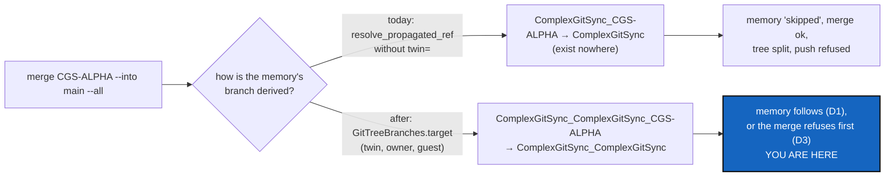

# TwinMemoryMerge — a tree-wide merge carries a twin's memory, or refuses before anything moves

*Created: 2026-11-11*

*Branch: CGS-ALPHA*

> **From the owner's short ticket `merge-into-twin-memory`** (2026-11-11), written after
> `cgitsync merge CGS-ALPHA --into main --all` and `cgitsync push --all`: *"why is everything not synced ?"*. The merge
> left `.memory` and `.self-history` on their CGS-ALPHA branch, ended `ok`, and the push was refused. The owner put the
> memory right by hand. This plan says what the short ticket asked for, so the short ticket is closed with it
> (TICKETLIFECYCLE §6): `archive/.closedUserTicket/20261111_merge-into-twin-memory.md`.
>
> **Every decision answered, 2026-11-11 (owner):** *"i accept all your recommandations"*. D1 = (a), D2 = (a), D3 = (a),
> as written in §5. Nothing is left to ask before the first edit.

## Abstract — read this first

**The one-line version.** In a bootstrap twin tree, `merge`, `merge --into` and `merge --resolve` now derive the
memory's branches with the twin rule, through the one resolver that `checkout` and `pull --private` already use. A merge that
moves the project and cannot move its memory refuses before anything moves, instead of skipping the memory and
reporting `ok`.

**What this document is.** The plan for that fix: what happened, the cause, the change, the steps, the decisions the
owner owes, and how the work is accepted.

**Why it exists.** The memory is the one repository a merge must never leave behind: the next `push` refuses because of
it, and `status` reports the tree split. Today the merge does leave it behind, and says nothing worse than "skipped".

**What you will find.** §1 what happened. §2 the cause. §3 the change. §4 the steps. §5 the decisions for the owner. §6
acceptance. §7 what this ticket leaves alone.

**Who it is for.** The worker and the orchestrator who implement it, and the owner, who answers §5.

**What you need to do with it.** Read §5: every decision is answered. D1 decides what the memory looks like after the
merge; D3 decides when the merge refuses.

---

## 1. What happened

The tree `~/.cgs/ComplexGitSync-20261111084907` is a bootstrap twin (`examples/cgitsync-alpha.cgs`): its memory is
filed under `ComplexGitSync_<project>`.

| Repository | On `CGS-ALPHA` | On `main` | The merge derived |
|---|---|---|---|
| `.memory` | `ComplexGitSync_ComplexGitSync_CGS-ALPHA` | `ComplexGitSync_ComplexGitSync` (only `origin/` had it) | `ComplexGitSync <- ComplexGitSync_CGS-ALPHA`, *no such branch here — skipped* |
| `.self-history` | the same | the same | the same |
| `.dev`, `.localSpec`, `.claude` | `ComplexGitSync_CGS-ALPHA` | `ComplexGitSync` | correct, fast-forwarded |

The merge ended `status: ok`. `push --all` was refused: *branch misalignment: expected 'ComplexGitSync_ComplexGitSync',
found 'ComplexGitSync_ComplexGitSync_CGS-ALPHA'*. `main`'s memory was an ancestor of CGS-ALPHA's (0 commits of its own;
16 behind in `.memory`, 7 in `.self-history`), so the owner fixed it by hand with
`git checkout -b ComplexGitSync_ComplexGitSync origin/ComplexGitSync_ComplexGitSync` and
`git merge --ff-only ComplexGitSync_ComplexGitSync_CGS-ALPHA` in each.

## 2. Cause

**One resolver bypassed.** `MergeOperation.merge_source_ref` (`tree/operations/merge.py`) calls
`git_branch.resolve_propagated_ref(repo, branch, project_name=...)` and passes neither `twin=` nor `owner=`. The tree
already has one place that pairs them: `GitTreeBranches.target` (`tree/git_tree_branch.py`), which asks
`WorkingGitTree.memory_twin` and `in_memory(repo)` for the twin, and `MountGuard.owner` for a nested Parent. `checkout`,
`memory branch` and the memory guard go through it; the merge family does not.

**The dry run and the merge disagree.** `merge_into_tree` passes `MountGuard.base(tree, repo, project_name)` as the
project name, a stand-in for `owner=`. `TreeCommands.merge_into_plan` (`orchestre/tree_commands.py`, the dry run) and
its sibling at the plain `merge` dry run pass the bare project name. For a nested Parent's repository, the dry run can
promise a branch the merge then does not use.

**A missing memory branch is reported as a skip.** `merge_into_status` answers `no-source` for any repository whose
derived source is missing, and `merge_into_tree` only warns about it. For the memory, that leaves the tree split.

## 3. The change

1. **`merge_source_ref` resolves through `GitTreeBranches(tree).target(repo, branch).name`.** It takes the tree, not a
   project name. Its callers (`merge_status`, `merge_into_status`, `merge_tree_one_at_a_time`, and the two dry runs in
   `tree_commands.py`) pass the tree. `MountGuard.base` is no longer needed by the merge, and the dry run and the merge
   derive the same names by construction.
2. **The memory follows the project** (D1). With the twin names, `merge_into_status` already sends the memory to
   `MemoryMergeOperation.tree_status`, which never merges file by file. D1 decides what that does when `main`'s memory
   is an ancestor of CGS-ALPHA's, as here.
3. **A memory that cannot follow refuses the whole merge** (D3), before anything is checked out, with the same
   all-or-nothing as a conflict. The message names the memory, the branch it lacks, and the command that fixes it.
4. **A target memory branch only the remote holds** (D2) is handled as D2 says.
5. `pull --private` (`tree/operations/restart.py`) is not affected: it already resolves its base through
   `GitTreeBranches.target` (checked 2026-11-11). A test pins that for a twin memory, so it cannot regress.

**As delivered (2026-11-11):** the refusal wording lives in `tree/operations/merge_target.py` (`MergeTarget.stranded_memory`, status `memory-cannot-follow`), and `tree_status(..., fast_forward=True)` is asked by the merge family only, so `pull --private` keeps its own side. `.self-history` is not `MemoryMergeOperation.is_memory`, so a diverged one merges as an ordinary repository; its records are named by their own hash. `MountGuard.base` is no longer used by `src/` (left for a cleanup).

No new command, option or client method, so no Minimalism row. The user guide's `merge` section and tutorial 7 §5 (*the
memory is kept, not merged*) gain the twin case.

## 4. Steps

1. **Tests first**, in `tests/integration/test_tree_merge_memory.py` or a new `test_twin_memory_merge.py`. Build bare
   remotes for a bootstrap twin tree: a root `demo` with `main` and `CGS-ALPHA`, a twin `.memory` with
   `ComplexGitSync_demo` and `ComplexGitSync_demo_CGS-ALPHA`, a nested `.self-history` with the same pair, and a private
   writable `.conf` with `demo` and `demo_CGS-ALPHA`. Assert:
   - the dry run of `merge CGS-ALPHA --into main --all` names `ComplexGitSync_demo <- ComplexGitSync_demo_CGS-ALPHA`
     for both memory repositories, and the merge does what the dry run said;
   - `main`'s memory behind CGS-ALPHA's: the result is what D1 chose, and `status` shows no split;
   - both memories with commits of their own: the result is what D1 chose for that case, and the chain verifies
     (`cgitsync verify check`);
   - a memory with no branch for the source: the merge refuses (D3), naming it, and nothing is checked out anywhere;
   - a target memory branch only the remote holds: D2;
   - `push --all` after a successful merge passes its preflight (bare remotes, nothing real pushed);
   - a tree that is not a twin merges exactly as before (`test_merge_into.py` and `test_tree_merge_memory.py` unchanged).
2. Change `merge.py` and `tree_commands.py`; add the `pull --private` twin test of §3.5.
3. `pixi run lint`, `pixi run test`, `pixi run bump-build`, the ceilings with no raise, or the raise asked of the owner.
   The orchestrator decides the level: a bug fix with no new interface is `patch`.
4. User guide, tutorial 7, `AdditionalSpecs.md` (*Responsibility boundaries*, the merge row), and the digest line on
   the memory if D1 changes it; `pixi run check-spectree`.
5. `cgitsync status` from this tree's root: `errors=0`. In this workspace, `merge CGS-ALPHA --into main --all
   --dry-run` names the twin memory branches.

## 5. Decisions for the owner

**Answered (owner, 2026-11-11): all three take the recommendation.**

- **D1 — what the memory looks like after a merge into a branch whose memory is behind. Answered: (a).**
  (a) **Fast-forward when the target's memory is an ancestor of the source's**, since nothing of the target is lost;
  when both have commits of their own, keep the target's whole and record the source's as history, as today.
  (b) Always keep the target's whole and record the source's as history, even when the target is an ancestor. Here,
  `main` would keep the 2026-10-31 memory, with today's 16 commits only as history.
  (c) Always keep the source's whole (`memory merge --theirs`).
  *Recommendation: (a).* It is what the owner did by hand, it loses nothing, and the rule "never merged file by file"
  holds either way. (b) leaves `main` with the old memory in view.
- **D2 — a target memory branch only the remote holds** (`origin/ComplexGitSync_ComplexGitSync`, as here). **Answered: (a).**
  (a) Refused with the `git branch` command, as MergeIntoLocalTarget does for every other repository.
  (b) The memory is the exception: created from the remote, because it must follow.
  *Recommendation: (a).* One rule for every repository, and the owner chose it for MergeIntoLocalTarget (Q1).
- **D3 — when a memory that cannot follow refuses the merge. Answered: (a).**
  (a) Whenever the merge moves the project and the memory would end on a branch other than the one the tree expects
  on the target. A memory with no source branch that already sits on the target's branch, or waits on its fallback
  base, is not a refusal.
  (b) Whenever the memory has no source branch at all.
  *Recommendation: (a).* It refuses exactly the split `status` would report, and lets a memory that never left the
  target's branch through.

## 6. Acceptance

- In a twin tree, `merge CGS-ALPHA --into main --all` and its dry run name the memory's branches as
  `ComplexGitSync_<project>[_<branch>]`, and agree.
- After the merge, `status` shows no split, and `push --all` passes its preflight.
- A memory that cannot follow refuses the merge before anything is checked out or merged, by name.
- The memory is never merged file by file, and `cgitsync verify check` passes after every merge.
- A tree that is not a twin merges as before.
- `pixi run lint` and `pixi run test` pass; `cgitsync status` shows `errors=0`.

## 7. Not this ticket

- `.omniscience` on `main` while the tree expects `ComplexGitSync`: a warning only, since its branch does not exist
  yet and nothing there is unsaved; `omniscience register` creates it by name.
- The orphaned-private and split-branch warnings `status` lists for old project branches (`multi-branch`,
  `cgs_opx`, ...): `branch close` and BranchProtection.
- Creating a missing local target branch automatically, for the memory or any repository (D2 (b), not recommended).
