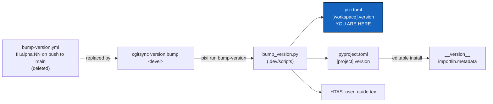

# SemVerPixi — HTAS manifests and SemVer laid out as ComplexGitSync's, bumped by cgitsync version

*Created: 2026-11-19*

*Branch: HT-BETA*

> **Owner's decisions, 2026-11-19.** HTAS enters the cgitsync universe with
> ComplexGitSync's layout: a root `pixi.toml` (the Pixi manifest, which
> holds the version) beside a `pyproject.toml` kept for the Python build.
> The `pyproject.toml` stays because the next ticket gives HTAS a CLI,
> `pixi run htas`, built exactly as `cgitsync`'s, exposing the commands and
> subcommands of HTAS's general and DEV APIs: its console script is a
> `[project.scripts]` entry. The version is bumped through the agentic
> process (`cgitsync version bump`), not by CI.

> **Decisions for the owner answered — 2026-11-19.** D1 `1.0.0`; D2 tag
> `000.alpha.40` before the switch; D3 adopt the build counter
> (`__build__`, `bump-build`); D4 `requires-python >= 3.11`; D5
> `bump-version` writes the user guide's `\def\version`. §3 is written with
> these answers; nothing is left to ask before the first edit.

## Abstract — read this first

**The one-line version.** Move the Pixi configuration out of `pyproject.toml`
into a root `pixi.toml` holding SemVer; keep `pyproject.toml` for the build;
add a `bump-version` task that writes every copy of the version, so
`cgitsync version bump` can run it; delete the CI workflow that bumps the
version today.

**What this document is.** The request (§1), what exists today (§2), the
work (§3), the decisions for the owner (§4) and acceptance (§5).

**Why it exists.** Today CI writes an `III.alpha.NN` version on every push
to `main`, nobody decides the level, and the user guide's copy has drifted
(`000.alpha.18` against `000.alpha.40`). `cgitsync version` reads only
`pixi.toml`, so HTAS is `not versioned` for it (`cgitsync version diagnose`,
2026-11-19).

**What you need to do with it.** Pile 1, rank 1: steps 2, 4 and 8 of
`htas-dev.md` wait on it, and the CLI ticket builds on its layout.

---

## 1. The request

Lay HTAS out as ComplexGitSync is laid out:

- **`pixi.toml`**: `[workspace]` (name, version, channels, platforms),
  `[tasks]`, `[dependencies]`, and `[pypi-dependencies]` with the editable
  self-install `HydrologicalTwinAlphaSeries = { path = ".", editable = true }`.
  It is where `cgitsync` reads the version.
- **`pyproject.toml`**: `[build-system]` (hatchling), `[project]`
  (metadata, runtime dependencies, the version's copy, and, at the next
  ticket, `[project.scripts]`), `[tool.hatch.*]`, and the pytest and ruff
  settings. No `[tool.pixi.*]` table any more.
- The version is SemVer, moved only by `pixi run bump-version <level>`, which
  `cgitsync version bump` runs. CI never writes it.

## 2. What exists today

- `pyproject.toml` holds everything, Pixi included (`[tool.pixi.workspace]`,
  tasks, dependencies, the editable self-install); `[project].version =
  "000.alpha.40"`; `requires-python >= 3.10`; no `pixi.toml`.
- `.github/workflows/bump-version.yml`: on push to `main`, bumps `NN` (`99`
  rolls into `III`), commits `chore: bump version ...` and pushes.
- `src/HydrologicalTwinAlphaSeries/__init__.py`: `__version__` from
  `importlib.metadata`, which the editable install keeps working.
- `tests/unit/test_version.py`: checks `__version__` against the metadata
  and `[project].version`, and asserts `[tool.pixi.workspace]` repeats no
  name or version, a check the new layout makes obsolete.
- `docs/hydrological_twin/HTAS_user_guide.tex`: `\def\version{000.alpha.18}`,
  by hand.
- ComplexGitSync's model: its root `pixi.toml` and `pyproject.toml`, and
  `.dev/scripts/bump_version.py` on branch `ComplexGitSync_CGS-ALPHA` (every
  target or none, `--pre`, `--release`, `--dry-run`, ending on `old -> new`
  as `cgitsync version bump` requires).

## 3. The work

0. **Tag the last alpha first (D2)**: an annotated tag
   `HydrologicalTwinAlphaSeries-000.alpha.40` on the current head of
   `HT-BETA`, before any file below changes. Pushing it is the owner's call.
1. **Write `pixi.toml`** from the `[tool.pixi.*]` tables, with
   `[workspace].version = "000.alpha.40"` carried over as it is (step 3
   moves it); remove those tables from `pyproject.toml`. Set
   `requires-python = ">=3.11"` (D4), matching Pixi's `python = "3.11.*"`
   and ruff's `target-version = "py311"`.
2. **Port the two scripts where ComplexGitSync keeps them**, and declare
   both tasks in `pixi.toml`:
   - `bump_version.py` in the private `.agent/.local/.dev/scripts/`,
     `bump-version = "python .agent/.local/.dev/scripts/bump_version.py"`,
     with HTAS's targets: `pixi.toml` (read first), `pyproject.toml`,
     `HTAS_user_guide.tex`'s `\def\version` (D5); it stops with nothing
     changed when `docs/hydrological_twin` is absent.
   - `bump_build.py` in the public `scripts/` (ComplexGitSync's is there
     too), `bump-build = "python scripts/bump_build.py"` (D3): writes
     `__build__` in `src/HydrologicalTwinAlphaSeries/__init__.py`,
     ComplexGitSync's `YYYY.XX` counter, started at the current year's
     `.01`. ComplexGitSync's `check_build_version.py`, which checks a
     `bump-build` is followed by a `bump-version`, may come with it.
3. **Set `1.0.0` (D1)** with `pixi run bump-version`, never by hand.
   ComplexGitSync's script has no option to set a version outright (only a
   level, `--pre` and `--release`); add `--set <version>`, accepted only
   when the current version is not SemVer, so it serves this one migration
   and cannot skip a level later.
4. **Delete `.github/workflows/bump-version.yml`**; check `ci.yml` writes
   nothing.
5. **Tests**: `test_version.py` asserts `pixi.toml`, `pyproject.toml` and
   `__version__` agree, that `__build__` exists and has the `YYYY.XX` shape,
   and that the user guide's `\version` equals the version when
   `docs/hydrological_twin` is mounted (skipped otherwise).
6. **Docs**: `tests/README.md` names `pixi.toml` as the root marker;
   `Versioning.md`'s *Status* and `htas-dev.md`'s *(SemVerPixi)* marks go;
   `audit.md` #1, #2 and #8 move to *Closed*.

## 4. Decisions for the owner — answered 2026-11-19

- **D1. The first SemVer: `1.0.0`.** (Offered: `0.40.0`, `0.1.0`, a
  pre-release.) From `1.0.0` on, a break of the public interface is a MAJOR
  bump (SemVer §5).
- **D2. The last alpha: tagged.** `HydrologicalTwinAlphaSeries-000.alpha.40`,
  before the switch (§3 step 0). No earlier alpha was tagged (the only tag
  is `vCGS1`), and the `chore: bump version` commits stay, since nothing is
  rewritten.
- **D3. A build counter: adopted.** `__build__` and `bump-build`, as in
  ComplexGitSync; the coming `htas --version` shows it next to the version.
- **D4. `requires-python`: `>=3.11`**, aligned on ComplexGitSync and on
  Pixi's pin.
- **D5. The user guide's version: written by `bump-version`**
  (`\def\version` in `HTAS_user_guide.tex`).

One point the answers leave to the worker to check, not to decide: whether
the Python CaWaQS-ViZ runs inside QGIS is 3.11 or newer (D4). If it is not,
stop and ask the owner before §3 step 1.

## 5. Acceptance

- `pixi install`, `pixi run lint`, `pixi run test` and `pixi run run` pass,
  the QGIS-free guard included; `pyproject.toml` holds no `[tool.pixi.*]`.
- The tag `HydrologicalTwinAlphaSeries-000.alpha.40` points at the last
  commit before the switch.
- `cgitsync version diagnose` shows HydrologicalTwinAlphaSeries with
  `MANIFEST pixi.toml`, `VERSION 1.0.0`, `SCHEME semver`, `BUMP task`,
  `BUILD task`, verdict `ready`.
- `pixi run bump-build --dry-run` shows the next `__build__` and writes
  nothing.
- `cgitsync version bump patch --dry-run` shows `old -> new` and writes
  nothing; without `--dry-run`, every target moves or none does.
- No workflow under `.github/workflows/` writes a version.
- `cgitsync status` shows `errors=0`; `cgitsync commit` accepts
  `HydrologicalTwinAlphaSeries-<version>`.
