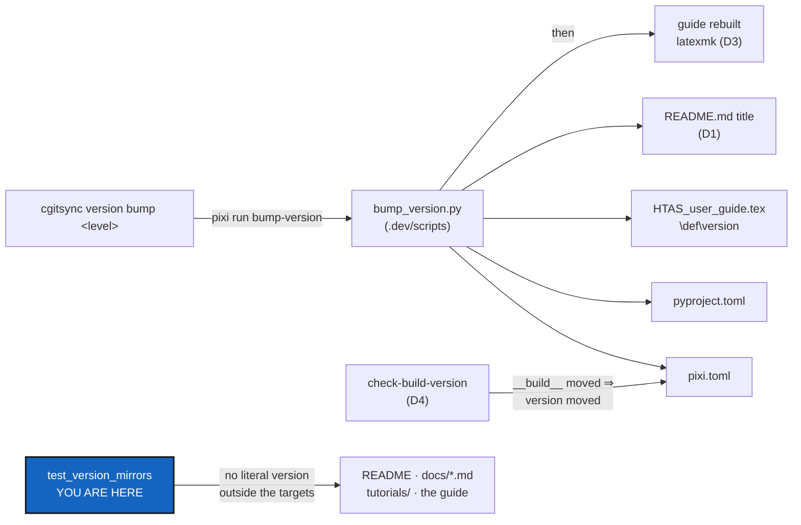

# VersionSync — every document that states the version moves with a bump, and a test fails when one does not

*Created: 2026-11-20*

*Branch: HT-BETA*

## Abstract — read this first

**The one-line version.** After `cgitsync version bump`, every copy of the
version (the two manifests, the user guide, the README and anything added
later) states the new version, and the rebuilt guide shows it. A test fails
when a document holds a literal HTAS version that `bump-version` does not
write. This is what ComplexGitSync's own release tooling already does.

**What this document is.** The request (§1), what exists today and why the
existing rule did not hold (§2), the design (§3), the work (§4), the
decisions for the owner (§5), and acceptance (§6).

**Why it exists.** `digest.md` and `Versioning.md` (.dev) already say that
every copy of the version is a `bump-version` target, "or holds no literal
version at all". Nothing checks it. An agent that writes `1.2.0` into a
document creates a copy the bump will never touch, and nothing reports it.
ComplexGitSync, whose agentic setup HTAS was seeded from, writes its README
title and its LaTeX macro, and rebuilds its PDFs, in the bump itself. HTAS's
port (SemVerPixi) kept three targets and left the rest to the checklist.

**What you need to do with it.** Pile 1, rank 3. It is filed at 3 because
the pile already uses 2, and §2.1 of TICKETLIFECYCLE leaves compacting the
ranks to the next Ticket review. §5 is answered (owner, 2026-11-20): read
*The owner's answers* before §3. D2, and whether `MASTER.pdf` is tracked,
are asked during the `implement`. One `implement`.

---

## 1. The request

The owner, 2026-11-20, short ticket `README-SemVer`: *Add an automatic
update of README, docs by agents following a bump-version. Those docs and
files must always be synced with the version of pyproject and pixi. This
was already part of cgitsync agentic that should have constrain the current
agentic.* It is filed, closed, as
`archive/.closedUserTicket/20261120_README-SemVer.md`.

"Automatic" is read here as two things together: **the bump script writes
every copy**, which is mechanical and needs no agent judgement (shared
`Versioning.md` §2 and §6), and **a test stops an agent from adding a copy
the script does not write**. Without the test, the first half only holds
until the next agent writes a version into a document by hand.

## 2. What exists today

**Where the version is written** (`bump_version.py`, .dev, from
SemVerPixi): `pixi.toml` `[workspace].version`, `pyproject.toml`
`[project].version`, and `HTAS_user_guide.tex` `\def\version`, all or none.
`__version__` reads `importlib.metadata`. `__build__` is `bump-build`'s.

**What ComplexGitSync's `bump_version.py` writes** (its `.dev`): the same
two manifests, `__version__`, **the README title** (`# ComplexGitSync
v8.9.4`, matched by `_README_TITLE_VERSION_RE`), and the `\cgsversion`
macro in its two LaTeX sources. It then **rebuilds the tracked PDFs**
(`latexmk`, looked for before anything is written; `--no-pdf` skips it).
It also ships `scripts/check_build_version.py`, which checks that a
`bump-build` was followed by a `bump-version`. SemVerPixi said that script
"may come with it". It did not.

**What is checked.** `test_version.py` checks that `pixi.toml`,
`pyproject.toml` and `__version__` agree, and that the guide's `\version`
equals them when `docs/hydrological_twin` is mounted. No test looks at the
README, `docs/*.md`, the tutorials, or the rest of the guide.

**Where a version appears today** (`grep`, 2026-11-20). Only in the three
targets, plus one historical mention, README line 116 ("since `1.0.0`").
`HTAS_FR.tex` defines `\cawversion{3.57}` and `\cwvversion{000.11}`, which
are the versions of CaWaQS and CaWaQS-ViZ, not of HTAS. Nothing has drifted
yet. The problem is that nothing would catch it if it did.

**What the checklist says.** Step 4 bumps, step 5 rebuilds the guide by
hand, and step 7's doc-impact map has no row for a bump. The orchestrator's
quote has a *Docs touched* line (`AGENT.md`) and nothing about the version.
`MASTER.pdf` is not tracked in `docs/hydrological_twin`, so a rebuild only
refreshes the local copy.

**Why the rule did not hold.** It is written as a sentence that each agent
has to remember. ComplexGitSync's version of it is written into the script
and the tests, so an agent cannot forget it.

## 3. The design

**3.1 The bump writes every copy.** `bump_version.py` gains the targets D1
chooses, keeps its all-or-none behaviour (shared `Versioning.md` §6), and
then rebuilds the guide (D3), with `latexmk` looked for before anything is
written and `--no-pdf` to skip the rebuild.
`cgitsync version bump` needs to know nothing about any of this, because the
task is where the documents are kept true.

**3.2 A test forbids stray copies** (`tests/unit/test_version.py`,
`test_version_mirrors`). It scans `README.md`, `docs/*.md`, `tutorials/*.md`
when that directory exists, and `docs/hydrological_twin/**/*.tex` when it
is mounted, for a literal SemVer (`\d+\.\d+\.\d+`, with an optional
pre-release). Every match must either be a `bump-version` target holding the
current version, or appear on the allowlist that D2 chooses. A new mention
then has two options: it becomes a target in the same change, or it is
reworded to point at `pixi run htas --version`.

**3.3 The test and the script share one list.** The targets are declared
once, in `bump_version.py`, and `test_version_mirrors` reads that list.
Then adding a target and checking it cannot fall out of step. The test
skips the private targets when `.agent/.local/.dev` is absent, as it does
for the guide.

**3.4 The checklist carries it.**

- The doc-impact map gets a row: *A version bump (step 4)* updates every
  `bump-version` target, and the guide is rebuilt (step 5, or by the bump
  itself under D3).
- The orchestrator's quote gets a *Version synced* line: the version in
  `pixi.toml` after the bump, and `test_version_mirrors` passing.
- `digest.md` gets one line saying that a literal HTAS version outside the
  `bump-version` targets fails `test_version_mirrors`.
- `Versioning.md` (.dev) *Where the version lives* lists the new targets,
  and its *`bump-version`* section describes the rebuild.

**3.5 `check_build_version.py`** (D4). ComplexGitSync's script, ported to
`scripts/`, with a `check-build-version` task. It fails when a commit range
moves `__build__` without moving the version.

## 4. The work — one `implement`

1. Ask the owner whether `MASTER.pdf` becomes tracked (D3).
2. `bump_version.py`: add the README title target (D1) and the rebuild
   (D3: `latexmk` checked first, `--no-pdf`), and expose the target list
   (§3.3). `--dry-run` shows every target it would write.
3. `test_version_mirrors`. Ask the owner about each mention it flags (D2),
   then write the allowlist or the rule the answers give.
4. The README title is added by the worker without a number in it, as
   `# HydrologicalTwinAlphaSeries v<version>`. The orchestrator's
   `cgitsync version bump` writes the number. No one types it by hand.
5. D4: `scripts/check_build_version.py` and its task.
6. The specs of §3.4. `htas-dev.md` step 5 says the bump rebuilds the guide
   and that only a change to `docs/hydrological_twin` without a bump needs
   a rebuild by hand. The orchestrator's brief (`AGENT.md`) gets
   `check-build-version`.
7. The gates: `pixi run lint`, `pixi run test`, `cgitsync status` at
   `errors=0`.

No file under `src/` changes, so there is no `bump-build`. `bump-version`
is a command of the project whose behaviour changes, so the orchestrator
still releases it, at `patch` at least (shared `Versioning.md` §3).

## 5. Decisions for the owner

- **D1. Does the README state the version?**
  - (a) Yes, in the title as ComplexGitSync's does
    (`# HydrologicalTwinAlphaSeries v1.2.0`), written by `bump-version`.
  - (b) No literal version anywhere in the README. It says
    `pixi run htas --version`, and the test keeps it that way.
- **D2. Historical and foreign versions.** Today these are "since `1.0.0`"
  and the CaWaQS and CaWaQS-ViZ macros of `HTAS_FR.tex`.
  - (a) An explicit allowlist in the test, one entry per file and phrase,
    each with its reason.
  - (b) A fixed rule: allowed only after "since" or "from", or inside a
    `\cawversion` or `\cwvversion` definition. Everything else fails.
- **D3. The guide's rebuild.**
  - (a) `bump-version` rebuilds it, as ComplexGitSync's does, with
    `--no-pdf` to skip and step 5 reduced to changes in
    `docs/hydrological_twin` alone.
  - (b) Keep step 5 by hand. The PDF is untracked, so a stale local copy
    misleads nobody but its reader.
- **D4. Port `check_build_version.py`?** Yes, with a `check-build-version`
  task, or no.

### The owner's answers (2026-11-20)

- **D1: (a).** The README title carries the version
  (`# HydrologicalTwinAlphaSeries v<version>`), written by `bump-version`.
- **D2: open, asked on the fly.** It is not settled yet. During the
  `implement`, the worker asks the owner with `AskUserQuestion` about each
  version mention the new test flags that is not a bump target, one at a
  time, before the allowlist or the rule is written. The known cases today
  are "since `1.0.0`" in the README and `\cawversion` and `\cwvversion` in
  `HTAS_FR.tex`.
- **D3: (a), as ComplexGitSync does it.** *When the orchestrator runs
  bump-version it must subsequently rebuild the docs and README.* The
  owner's follow-up was "do the same as cgitsync". ComplexGitSync's
  `bump_version.py` does the following:
  1. it looks for `latexmk` on `PATH` before writing anything, on a
     `--dry-run` too, and stops with nothing changed when it is missing;
  2. it writes every version target in memory, the README title and the
     LaTeX version macro included, and writes them to disk only when every
     one was found;
  3. it then runs `latexmk -pdf` from `docs/` on every top-level document
     (`MASTER.tex` and each `c_*.tex`), not only the ones whose text
     changed, so every title page shows the new version;
  4. when `latexmk` fails after the sources are written, it says so and
     names the rebuild to run by hand;
  5. `--no-pdf` skips the rebuild;
  6. the rebuilt PDFs are tracked and committed in the same change;
  7. `cgitsync version bump` knows nothing about LaTeX, because the task is
     where the documents are kept true.

  HTAS follows the same steps on `docs/hydrological_twin`. One difference
  must be settled during the `implement`: `MASTER.pdf` is not tracked in
  `docs/hydrological_twin` today, while ComplexGitSync commits its PDFs.
  The worker asks the owner whether HTAS starts tracking it.
- **D4: port it.** `scripts/check_build_version.py` and a
  `pixi run check-build-version` task. It reads the commits and fails when
  one changed `__build__` without changing the version. The orchestrator
  runs it before it proposes the commit message, and its quote reports the
  result.

## 6. Acceptance

- `pixi run bump-version patch --dry-run` lists every target, the D1
  README one included, and writes nothing. Without `--dry-run`, every
  target moves or none does.
- `test_version_mirrors` passes. It fails when a test adds `9.9.9` to
  `docs/api_examples.md`, and when a test leaves a target one version
  behind.
- The test and the script read one list of targets (§3.3).
- The rebuilt guide's title page shows the new version, and a missing
  `latexmk` stops the bump with nothing changed, on a `--dry-run` too.
- The README title reads `# HydrologicalTwinAlphaSeries v<version>`,
  equal to `pixi.toml`'s.
- `pixi run check-build-version` passes on `HT-BETA`. It fails on a commit
  made in a test that moves `__build__` and leaves the version.
- `htas-dev.md` has the doc-impact row, `AGENT.md` has the *Version synced*
  line, `digest.md` has the rule, and `Versioning.md` (.dev) lists the
  targets.
- `pixi run lint` shows no new error, `pixi run test` passes, and
  `cgitsync status` shows `errors=0`.
