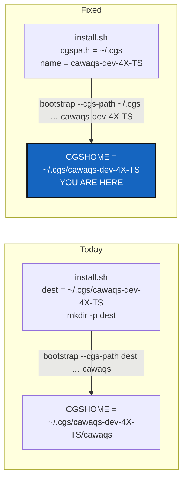

# DevWorkspaceNesting — `pixi run install -s -dev-4X` makes one directory level too many

*Created: 2026-11-23*

*Branch: 4X*

> **Owner's request, 2026-11-23** (in conversation):
> `pixi run install -s cawaqs-dev-4X` creates
> `.cgs/cawaqs-<timestamp>/cawaqs`. It should not create the second
> folder `cawaqs` after `cawaqs-<timestamp>`.

## Abstract — read this first

**The one-line version.** By default, `install.sh` should bootstrap the
development workspace straight into `$HOME/.cgs/cawaqs-dev-<branch>-<timestamp>/`.
Today it lands one level lower, in `…-<timestamp>/cawaqs/`. The fix changes
only the path that `dev_install` hands to `cgitsync bootstrap`, and the
three places that document it.

**What this document is.** The cause (§1), the change (§2), the decisions
to confirm (§3) and the acceptance checks (§4).

**Why it exists.**
- Every dev workspace so far has the extra level, including
  `~/.cgs/cawaqs-dev-4X-20261123150454/cawaqs`.
- The extra level is an empty wrapper. It holds nothing but `cawaqs/`.
- It departs from the layout ComplexGitSync itself gives a bootstrap,
  `$HOME/.cgs/<name>-<timestamp>/`, which is how `~/.cgs/cawaqs-2026…`
  workspaces look.

**Who it is for.** The worker who edits `install.sh`, and the owner, who
confirms §3.

**What you need to do with it.** Pile 1, rank 3. It is small and needs no
`src/` change. Confirm D1 and D2, then do §2 in one commit.



---

## 1. Cause

Two layers each add a directory level, and nothing stops them from
stacking.

1. **`install.sh` makes its own timestamped directory**
   ([install.sh:153](../../../../../install.sh#L153)):
   `dest="$HOME/.cgs/cawaqs-dev-$branch-$(date +%Y%m%d%H%M%S)"`, then
   `mkdir -p "$dest"`.
2. **It hands that directory to bootstrap as CGSPATH, with the name
   `cawaqs`** ([install.sh:176](../../../../../install.sh#L176)):
   `bootstrap --cgs-path "$dest" "$spec" cawaqs`.
3. **`cgitsync bootstrap` (HT-BETA) puts CGSHOME at `<cgs_path>/<name>`**
   whenever `--cgs-path` is given (`PathResolver.resolve_bootstrap_root`,
   `tree/paths.py`). Without `--cgs-path`, CGSHOME is
   `$HOME/.cgs/<name>-<timestamp>`, a single level.

So CGSHOME is `~/.cgs/cawaqs-dev-4X-<TS>/cawaqs`.
[install.sh:158](../../../../../install.sh#L158) states this layout outright
(`local cgshome="$dest/cawaqs"`), and so do the `--dest` help and the
README. The bug is the default, not a slip in one line.

**Checked, 2026-11-23, against the installed HT-BETA**
(`.pixi/envs/dev/.../ComplexGitSync`):
- the positional `project_name` of `bootstrap` is used only to resolve the
  target directory. `Installer.bootstrap` does not pass it to `clone_cgs`.
  The project the tree records is still the `[project] name` of the `.cgs`,
  `cawaqs`, so the private branches keep their names (`cawaqs_4X`,
  `ComplexGitSync_cawaqs_4X`);
- `_require_fresh_target` accepts a target that is absent or empty, so it
  does not matter whether `install.sh` creates the directory first.

## 2. The change

All of it is in `install.sh` and `README.md`. Nothing under `src/` changes.

1. **`dev_install`**
   ([install.sh:149-176](../../../../../install.sh#L149-L176)): split the
   destination into the CGSPATH and the name that bootstrap combines.

   ```bash
   local cgspath name
   if [ -n "$dest" ]; then
       :   # -d: DIR is the workspace (D2)
   else
       dest="$HOME/.cgs/cawaqs-dev-$branch-$(date +%Y%m%d%H%M%S)"
   fi
   dest="$(realpath -m "$dest")"; cgspath="$(dirname "$dest")"; name="$(basename "$dest")"
   if [ "$DRY_RUN" != 1 ]; then
       mkdir -p "$cgspath" || die "cannot create $cgspath"
       cgspath="$(cd "$cgspath" && pwd -P)"
   fi
   local cgshome="$cgspath/$name"
   ...
   run "${cgs[@]}" bootstrap "${force[@]}" --cgs-path "$cgspath" "$spec" "$name"
   ```

   - Only CGSPATH is created. The new CGSHOME is left for bootstrap to
     create, as it does for a plain `cgitsync bootstrap`.
   - Everything after the bootstrap call already goes through `$cgshome`:
     `--search-dir`, the `.self-history` clone and `cd "$cgshome/src"`.
     Those lines do not change.
2. **Header comment**
   ([install.sh:43-47](../../../../../install.sh#L43-L47)): the default
   becomes `$HOME/.cgs/cawaqs-dev-<branch>-<timestamp>`, which is CGSHOME
   itself. `--dest DIR` makes `DIR` the workspace (D2).
3. **`usage`**
   ([install.sh:74-76](../../../../../install.sh#L74-L76)): the same two
   facts. With `-d`, the workspace is `DIR`. Without it, the
   workspace is `$HOME/.cgs/cawaqs-dev-<branch>-<timestamp>`.
4. **`README.md`** ([README.md:108](../../../../../README.md#L108)): the
   default becomes `$HOME/.cgs/cawaqs-dev-4X-<timestamp>`. `-d <dir>` is the workspace itself.

**Out of scope.** Existing workspaces keep their extra level. A CGS tree
records absolute paths (`.cgitsync/state/`), so moving one is not a rename.
Re-bootstrap if the extra level bothers you.

## 3. Decisions

- **D1: the name of the default workspace.** Keep
  `cawaqs-dev-<branch>-<timestamp>`, the name the outer directory already
  carries. *Recommended:* it is what the owner described, and what
  `ls ~/.cgs` already shows. The alternative is to drop `--cgs-path` and let
  bootstrap name it `<name>-<timestamp>` itself. That gives the same shape,
  but `install.sh` would then have to work out the timestamp after the fact
  to learn `$cgshome`.
- **D2: what `-d DIR` means.** *Decided by the owner, 2026-11-23:* `DIR`
  is the workspace itself (CGSHOME), empty or missing, so `-d ~/work/x`
  gives `~/work/x` and never `~/work/x/cawaqs`. `install.sh` splits it into
  `dirname` (the CGSPATH) and `basename` (the name) for bootstrap. This
  changes the documented option: `-d DIR` used to give `DIR/cawaqs`.
- **D1** was confirmed as recommended: `cawaqs-dev-<branch>-<timestamp>`.

## 4. Acceptance

- `bash -n install.sh` passes.
- **Dry run, default:** `pixi run install -s -dev-4X -n` prints
  `development workspace: $HOME/.cgs/cawaqs-dev-4X-<TS>`, with no trailing
  `/cawaqs`. Its bootstrap line reads
  `bootstrap --cgs-path $HOME/.cgs <spec> cawaqs-dev-4X-<TS>`.
- **Dry run, `-d`:** `pixi run install -s -dev-4X -d /tmp/x/w -n` prints
  `/tmp/x/w`, with bootstrap given `--cgs-path /tmp/x` and the name `w`.
- **Real run, default:** `pixi run install -s -dev-4X` leaves
  `~/.cgs/cawaqs-dev-4X-<TS>/.git`, the cawaqs root, with no `cawaqs/`
  subdirectory.
  - `.agent/.local/.dev` is on `cawaqs_4X`.
  - `cgitsync status --search-dir ~/.cgs/cawaqs-dev-4X-<TS>` shows
    `errors=0`.
  - `make_Cawaqs_fromCGS.sh` builds.
- `grep -rn "CGSPATH/cawaqs\|<timestamp>/cawaqs" install.sh README.md`
  finds nothing.
- Before-committing checklist (`.claude/CLAUDE.md`): no `src/` change, so
  no `bump-build`. Deliver one commit message for the cawaqs root, plus one
  for `.dev` if this ticket and the short ticket are archived in the same
  change (TICKETLIFECYCLE §5.1).
