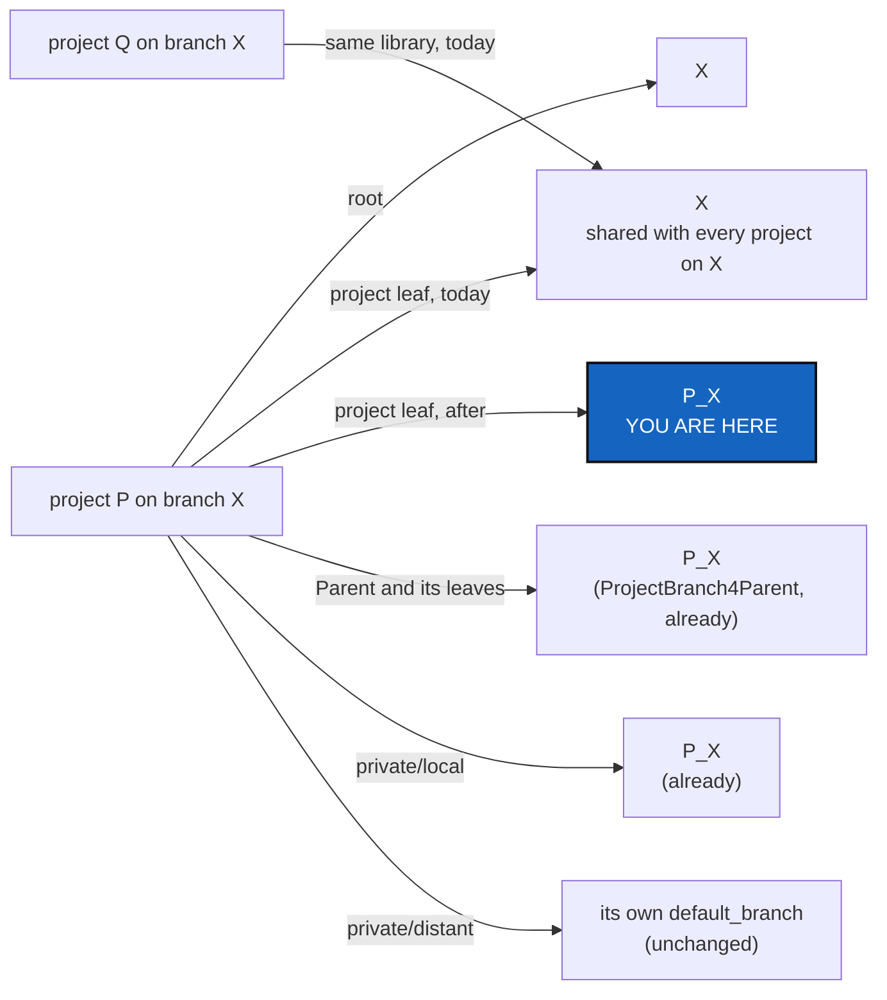

# RootBareBranch — only the root is on the project's bare branch; every other project repository is on `<project>_<branch>`

*Created: 2026-11-23*

*Branch: HT-BETA*

> **From the owner's request in conversation** (2026-11-23), as written: *"Change the rule. only the root should ever be
> on the bare project branch, that is a code change in resolve_propagated_ref. It would be an implement ticket with the
> worker/orchestrator pair, and it would affect every project-scope repository. This way almost all parent repos in the
> project behave as private local. It will be much easier to understand and follow. For library as in cawaqs it is also
> mandatory for coupling within various projects."* It came after the owner asked why `DocComplexGitSync` sits on
> `HT-BETA` and not on `ComplexGitSync_HT-BETA`. The request was filed and closed when this plan was written
> (TICKETLIFECYCLE §6), as `20261123_root-bare-branch.md` in `archive/.closedUserTicket/`.

## Abstract — read this first

**The one-line version.** The root repository is the only one on the project's bare branch `X`. Every other
repository that is not private takes `<project>_X`, the same name a private/local repository already takes.

**What this document is.** The plan for that change: what happens today, the cause, the change, the steps, the
decisions the owner owes, and how the work is accepted.

**Why it exists.** Today a project-scope leaf follows the bare branch. `DocComplexGitSync` is on `HT-BETA`, and each
`lib*` of `examples/cawaqs.cgs` is on `C365`. A library is mounted by several projects and committed to by each, so two
projects with the same branch name write to the same branch of it, and the library cannot couple the projects safely.
ProjectBranch4Parent fixed this only for a repository that holds a nested `.cgs` naming another project, and for the
repositories that `.cgs` declares. A plain library holds no `.cgs`, so it is still exposed. The rule also needs three
cases explained (project leaf, Parent, private/local) where two would do: the root on `X`, everything writable on
`<project>_X`.

**What you will find.** §1 what happens, §2 the cause, §3 the change, §4 the steps, §5 the decisions for the owner,
§6 acceptance, §7 what this ticket leaves alone.

**Who it is for.** The worker and the orchestrator who implement it, and the owner, who answers §5 first.

**What you need to do with it.** Answer §5. §3 is written to the recommendations and is corrected to the answers
before §4 starts.

---

## 1. What happens today

`cgitsync status` in this tree, 2026-11-23, ComplexGitSync 8.10.0, tree on `HT-BETA`:

| Repository | Scope | Branch it is on | Should be |
|---|---|---|---|
| ComplexGitSync (the root) | project | `HT-BETA` | `HT-BETA` |
| DocComplexGitSync (`docs`) | project | `HT-BETA` | `ComplexGitSync_HT-BETA` |
| `.dev`, `.localSpec`, `.claude`, omniscience | private/local | `ComplexGitSync_HT-BETA` | unchanged |
| `.memory`, `.self-history` (twin) | private/local | `ComplexGitSync_ComplexGitSync_HT-BETA` | unchanged |
| `.ticketing`, DevSpec, DocSpec | private/distant | `main` | unchanged |

Read from the spec, not run: `examples/cawaqs.cgs` on `C365` puts the root `cawaqs` and all eighteen `lib*`/`scripts`
leaves on `C365`. Under this ticket the leaves go on `cawaqs_C365`. Another project mounting `libhyd` on `C365` would put
it on `<its project>_C365`, a different branch.

## 2. Cause

- **`git_branch.resolve_propagated_ref` has one answer for "not private": follow `X`.** It was meant for the project's
  own repositories. Since ProjectBranch4Parent, a *guest* (`behind_gate`: a Parent, a repository a Parent declares, or
  ComplexGitSync mounted by another project) takes `private_local_branch(project, X)` instead. Any other project leaf
  still falls through to `X`.
- **Whether a repository is a guest is decided by what it holds, not by where it sits.** `MountGuard.is_parent` and
  `follows_parent` need a nested `.cgs`. A library has none, so nothing in the tree marks it as shared. Asking "is this
  the root?" needs no reading of the repository at all.
- **Every tree-wide branch command already asks one resolver.** `checkout`, `branch create/close/delete`, `merge`,
  `merge --into`, `merge --resolve`, `pull --private`, the dead-branch findings, the ancestors check and the install all
  go through `GitTreeBranches.target`. The change is in `git_branch.py` and `GitTreeBranches.guest`, not in each command.

## 3. The change

Written to the recommendations in §5. Every naming rule stays in `git_repo/git_branch.py`, the only implementation of the
fallback chain and the privacy rule. `tree/git_tree_branch.py` only asks it.

1. **The rule.** For a branch move to `X`:
   - the **root** (the entry at the tree's root, the one `GitTreeBranches.root` returns) targets `X`;
   - every **other repository that is not private** targets `private_local_branch(<tree project>, X)`: `<project>_X`,
     and `<project>` on `main` (Q1);
   - **private/local** and **private/distant** are unchanged, and so are the twin memory and a Parent's private
     repositories (`<Parent>_<Project>_X`, IntegrityMount);
   - a **tag** still reaches every repository unchanged.
2. **The base is always the tree's project**, never a Parent's and never a chain: a leaf under a Parent under the root
   is on `P_X`, never `Q_P_X`. This is ProjectBranch4Parent's no-doubling rule, now applied to every leaf.
3. **`guest` becomes "not the root, not private"**, in every tree. `behind_gate`, `foreign_tool` and
   `MountGuard.follows_parent` stop deciding the branch. `foreign_tool` stays for `version bump` (§7). Whether
   `is_parent` and `follows_parent` are still needed elsewhere (`Installer._reaim_parents`, `--commit-gitignore`) is for
   the worker to find out. Remove any that are left unused. Generalise in place rather than adding a public symbol:
   `git_branch.py` is at its public-symbol ceiling.
4. **A same-project nested `.cgs`** (one repository of a project split across several) takes `P_X` too (Q3). Only the
   root is on `X`.
5. **A branch typed on a leaf's entry wins** (Q4). `_declared_pin` and *pinnable* extend from Parents to every leaf: a
   `branch` or `default_branch` the root's `.cgs` types on the entry, which is neither the tree's default nor a
   `<project>_...` name, is kept, and a tag still wins outright.
6. **No fallback is silent**, as ProjectBranch4Parent Q5 set it. The clone chain stays the target, the entry's
   `fallback_branch` (or `project.fallback_branch`), then `main`, with no `X` added to it. Every leaf that lands on its
   fallback is named in the install report (`missing_private_branches`) with the command that creates its branch.
   `status` and `--json` report a leaf on any other branch as off its target, with the same command. `commit` and `push`
   refuse it as a branch misalignment. Nothing is renamed or pushed.
7. **A leaf already on bare `X`** (DocComplexGitSync on `HT-BETA`, `CGS-ALPHA`): the command `status` names creates
   `<project>_X` **from the tip of the bare `X`** that the leaf is on, so no work on `X` is left behind (Q5). The bare
   branch itself is never renamed or deleted (the hard prohibitions). Retiring it is the owner's call, through
   `branch close`.
8. **A USER tree follows the same rule** (Q2). `install.cgs` puts DocComplexGitSync on `ComplexGitSync`, which falls
   back to `main` until that branch exists, and the fallback is reported. A USER tree never commits, so the report is
   a one-line `info:`, not a warning.
9. **`ancestors`** and `restart.py`'s `DEFAULT_BRANCH` are also asked through `target`. A leaf's `ancestors` must derive
   the way a private/local repository's does (`<project>_ancestors`), or be exempted in `git_branch.py` with the reason.
   A test says which.
10. **`status`'s scope column is unchanged** (Q6): a leaf is still `project`. The legend gains one clause: "only the
    root is on the project's branch; every other writable repository is on `<project>_<branch>`".
11. **Specs.** `AdditionalSpecs.md`: the *A nested Parent itself is on `<project>_<branch>`* paragraph becomes the
    general rule for every non-root, non-private repository, and `behind_gate`'s line in *Format ownership* with it. The
    digest lines on ParentBranch (§151) and on `behind_gate` (§150) are merged into one. In the user guide, the
    *Branches in a `.cgs`* section. In this tree's `.cgs` files (`examples/cgitsync-alpha.cgs`,
    `examples/cgitsync-ht-beta.cgs`, `examples/cawaqs.cgs`), the comments that name a leaf's branch.
    `git_branch.resolve_propagated_ref`'s docstring: "Not private — follows the move to `ref_name`" becomes root only.
    LinkAtCGS §7.1 names this ticket beside ProjectBranch4Parent (done when this plan was written).

No new command, option, client method or `.cgs` field.

## 4. Steps

1. **Tests first**, extending `tests/integration/test_parent_branch.py` (bare remotes, no network):
   - a root `demo` on `dev` with a plain leaf `lib` (no `.cgs`) and a private writable `.localSpec`. Assert the root
     targets `dev`, and `lib` and `.localSpec` target `demo_dev`.
   - a second root `other`, also on `dev`, mounting the same `lib` remote. Assert `lib` targets `other_dev`.
   - on `main`: `lib` targets `demo` (Q1).
   - a same-project nested `.cgs`: `demo_dev` (Q3). `nested_config = "disabled"`: `demo_dev`.
   - a typed `default_branch` on `lib`'s entry: kept (Q4). A tag: reaches `lib` unchanged.
   - `lib`'s remote has `dev` and no `demo_dev`: `lib` lands on its fallback chain, never on `dev`, and is named in the
     install report and `status --json` with the creating command. A commit to it is refused. A State recorded with
     `lib` on `dev`: `status` reports it off target, and nothing moves. The creating command starts `demo_dev` at the tip
     of `dev` (Q5).
   - `checkout`, `branch create`, `branch close`, `merge --into` over the tree, each moving `lib` on its derived name.
   - a USER tree (no private repository): the same targets, the fallback reported as `info:` (Q2).
   - every test in `test_behind_gate.py`, `test_parent_branch.py` and the rest of the suite that pins a leaf on bare `X`
     is inverted and renamed to say what it now pins. The worker lists them for the orchestrator.
2. Change `git_branch.py` (the rule), `git_tree_branch.py` (`guest`), and whatever `mount_guard.py` and `installer.py`
   no longer need, as §3 says.
3. `pixi run lint`, `pixi run test`, `pixi run bump-build`. Stay under the ceilings, or ask the owner for the raise before
   making it (CLAUDE.md, step 2 of the `implement` orders). The orchestrator decides the level. This moves the branch of
   every user's project leaves, so `minor` at least, and the orchestrator may judge it `major`.
4. Specs, digest, user guide and `.cgs` comments (§3.11), in the same change; `pixi run check-spectree`.
5. In this tree: create `ComplexGitSync_HT-BETA` for DocComplexGitSync with the command `status` names, check it out,
   and run `cgitsync status` from the root: `errors=0`, DocComplexGitSync on `ComplexGitSync_HT-BETA`. The owner pushes
   the new branch.

## 5. Decisions for the owner

To be asked with `AskUserQuestion` before the first edit. The recommendation is written first and is never taken as
the answer.

| | Question | Recommendation | Alternative |
|---|---|---|---|
| Q1 | A leaf's branch when the project is on `main` | `<project>`, as `private_local_branch` gives a private/local repository: one rule on every branch | Leaves stay on `main` when the project is on `main`. Simpler for a user install, but two projects on `main` share a library's `main` again |
| Q2 | A USER tree (`install.cgs`, no private repository) | The same rule. The fallback is reported as `info:`, since a USER tree never commits | Exempt a USER tree: leaves follow `X` there, and the rule depends on the profile |
| Q3 | A repository whose nested `.cgs` names the tree's own project (one project split across repositories) | `P_X`: only the root is on `X` | Keep it on `X`, as ProjectBranch4Parent did |
| Q4 | A `branch` or `default_branch` typed on a leaf's entry in the root's `.cgs` | It wins, as for a Parent (ProjectBranch4Parent Q6) | The derived name always wins over anything typed on a leaf, except a tag |
| Q5 | Where the reported command starts `<project>_X` for a leaf already on bare `X` | At the tip of `X`, so work already on `X` carries over | At the leaf's fallback, as a fresh branch. Work on `X` stays only on `X` |
| Q6 | `status`'s scope column for a leaf | Unchanged (`project`), with one clause added to the legend | A new scope value for a non-root project repository (for example `project/leaf`), which changes `--json` |

## 6. Acceptance

- In this tree, on `HT-BETA`: ComplexGitSync is on `HT-BETA`, DocComplexGitSync on `ComplexGitSync_HT-BETA`, and every
  private repository is on the branch it was on before. Until `ComplexGitSync_HT-BETA` exists, DocComplexGitSync is
  named by the install report and by `status`, with the creating command, and is never silently left on `HT-BETA`.
- `examples/cawaqs.cgs` on `C365`: `cawaqs` targets `C365`, and every `lib*` and `scripts` targets `cawaqs_C365`. A
  second project on `C365` mounting the same library targets a different branch of it. No tree-wide command run in one
  tree moves or writes the other's branch.
- `examples/cawaqsviz.cgs` and a level tree (`yyyy-xxx.cgs`) install as ProjectBranch4Parent and BehindGate delivered,
  since their Parents and the tool already take `<project>_X`.
- No leaf falls back, or sits off its target, without a line in the install report and in `status`.
- Nothing is renamed, nothing is pushed, a release tag still reaches every repository unchanged, and no `.gts` changes
  shape: a State stays schema 1, and only the branch names it records change.
- `pixi run lint` and `pixi run test` pass. `cgitsync status` from this tree's root shows `errors=0`.

## 7. Not this ticket

- `foreign_tool` in `tree/operations/version.py`. `version bump` never versions another project's tool. This ticket
  changes only branches.
- The bare branches leaves already hold (`HT-BETA`, `CGS-ALPHA` on DocComplexGitSync, `C365` on the cawaqs libraries).
  ComplexGitSync never renames or deletes them. Retiring them is the owner's call, through `branch close`.
- Who creates `<project>_X` on a leaf's remote, and who protects it on the provider: gx4g (LinkAtCGS §3c).
- The release flow from `CGS-ALPHA` to `main` for DocComplexGitSync, whose branches become `ComplexGitSync_CGS-ALPHA`
  and `ComplexGitSync` (Q1). How the public docs repository is released from them is a separate decision.
- A collision-proof naming scheme (`_` inside a project name): deferred to industrialisation, as EnvConnect left it.
