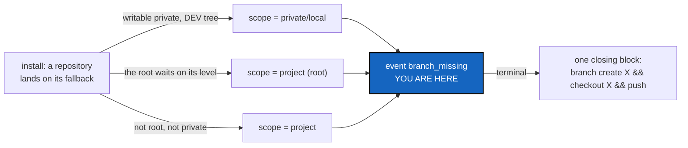

# BranchMissingEventName — a repository waiting for its branch is logged as `branch_missing`, not `private_branch_missing`, and the install closes with one instruction

*Created: 2026-11-24*

*Branch: HT-BETA*

> **From the owner's short ticket** `HT-BETA-20261124_BranchMissingEventName.md` (2026-11-24). It was filed and closed
> when this plan was written (TICKETLIFECYCLE §6), as `20261124_BranchMissingEventName.md` in
> `archive/.closedUserTicket/`. In the owner's words: the bootstrap of cawaqs's `.config/cawaqs-dev-4X.cgs` (cgitsync
> 8.11.1) logged `private_branch_missing` 18 times, for 17 libraries and `scripts`, none of them private. *"The
> bootstrap did the right thing … But the event name says 'private', so a normal first-install fallback looked like a
> bug."* The owner also asks that *"it should be written explicitly at the end of the bootstrap that the user must run
> `pixi run cgitsync branch create` … followed by checkout and push"*, and asks why the private/local repositories
> were not in that list: *"It should be the same for project parent."*

## Abstract — read this first

**The one-line version.** The install's record of a repository left on its fallback branch is renamed from
`private_branch_missing` to `branch_missing`, with a `scope` field saying which case fired. The terminal report stops
printing one warning per repository and ends with one block: which repositories wait for which branch, that this is
expected on a first install, and the one command line that creates, checks out and pushes them all.

**What this document is.** The plan for that change: what happens today, the cause, the change, the steps, the
decisions the owner owes, and how the work is accepted. §1.1 answers the owner's question about the private
repositories.

**Why it exists.** Since RootBareBranch (8.11.1), every repository that is not the root and not private is on
`<project>_<branch>`. On the first install of a new branch line, none of those branches exists yet, so every library
falls back, and each is recorded under an event whose name says "private". A correct install looked like a bug, and it
took a ticket on the cawaqs side to show that cgitsync was not at fault.

**What you will find.** §1 what happens, §2 the cause, §3 the change, §4 the steps, §5 the decisions for the owner,
§6 acceptance, §7 what this ticket leaves alone.

**Who it is for.** The worker and the orchestrator who implement it, and the owner, who answers §5 first.

**What you need to do with it.** Answer §5. §3 is written to the recommendations and is corrected to the answers
before §4 starts.



---

## 1. What happens today

Bootstrap of `cawaqs-dev-4X.cgs`, cgitsync 8.11.1, 2026-11-24 (`~/.cgs/cawaqs-20261124160131`, run log
`clone-20261124T160352473816Z.log`). The root `cawaqs` is on `4X`. Every library targets `cawaqs_4X`, which none of
their remotes has, so every one lands on `main`:

```
{"event": "private_branch_missing", "repo": "libgc", "wanted": "cawaqs_4X", "landed": "main", "config": null,
 "command": "cgitsync branch create 4X && cgitsync checkout 4X", "project_branch": null}
```

This line is written 18 times. On the terminal, `cli/memory_prompt.offer_missing_branches` prints 18 `warning:` lines
("libgc has no branch 'cawaqs_4X' yet, so it was cloned on 'main'. Do not commit to it there …"), then the command
once. Nothing says this is the expected first install of a branch line, and nothing says to push afterwards.
`cgitsync status` then prints one line per library, each ending with the same command
(`orchestre/reporting._branch_incoherence`).

### 1.1 The owner's question: why were the private/local repositories not listed?

They are treated exactly the same way. The rule is in `_assert_nested_discovery_complete`: a writable private
repository in a DEV tree that fell back is recorded (`fell_back`), and so is every repository that is not the root and
not private (`waits`, through `GitTreeBranches.guest`). In this run the private/local mounts were not listed because
**their remotes already had `cawaqs_4X`** (created by an earlier install of the same line), so they did not fall back.
A nested Parent is a non-root, non-private repository, so it is listed the same way as a library.

**But the printed command was not the same** (found while implementing). A private/local repository that fell back
while the root was on its branch got `command: None`, and the CLI told the user to create the branch by hand in its
path, although `cgitsync branch create 4X` creates it there too. That is the difference the owner noticed. §3.7 fixes
it: every repository but the memory gets the same tree-wide command.

The same single command covers all of them. `cgitsync branch create 4X` is tree-wide: it skips a repository that
already has its branch, and gives every other one the name the rule derives for it, `cawaqs_4X` for a library, a
Parent or a private/local repository. The command therefore takes the **bare** branch `4X`, never `cawaqs_4X`. Typing
`cgitsync branch create cawaqs_4X` would put the root on `cawaqs_4X` and every library on `cawaqs_cawaqs_4X`. The
closing block (§3.3) names the derived branch next to the command so a reader sees both.

The short ticket says the bootstrap "already says, for the private mounts' fallback seed", that the fallback is
expected. cgitsync prints no such wording today (no "seed" or "first install" text in `src/`). That wording is
written by this ticket (§3.3).

## 2. Cause

- **One event name for three cases.** `_assert_nested_discovery_complete` (`orchestre/client.py`, about line 1534)
  logs `private_branch_missing` for a writable private repository that fell back (EnvConnect C7), for the root waiting
  on its fallback (BehindGate), and for a guest (ProjectBranch4Parent). Before RootBareBranch a guest was rare. Since
  8.11.1 it is every library.
- **The attribute has the same name problem.** `ComplexGitSyncClient.missing_private_branches` holds all three cases.
  `AdditionalSpecs.md` (lines 417 and 483) and four integration tests read it.
- **The terminal report is per repository.** `offer_missing_branches` was written for one or two private repositories.
  With 18 it buries the one line that matters, the command.

## 3. The change

Written to the recommendations in §5.

1. **The event** (Q1). `private_branch_missing` becomes `branch_missing`, with every field it has today plus `scope`:
   `private/local` for a writable private repository, `project` for any other. A field `root: true` marks the root
   waiting on its level. The scope values are the `status` labels (`status_render.PROJECT_SCOPE_LABEL`,
   `PRIVATE_LOCAL_SCOPE_LABEL`), so a reader sees the same word in both places. The old name is no longer written.
   `CHANGELOG.md` and the user guide's run-log paragraph say so. Nothing in this tree parses the event: run logs stay
   on the machine that wrote them.
2. **The attribute** (Q2). `missing_private_branches` becomes `missing_branches`. Each entry gains `scope` and `root`,
   the same fields as the event. No alias is kept. Every reader in `src/`, the tests and `AdditionalSpecs.md` is
   updated, and `CHANGELOG.md` says so.
3. **The closing block** (Q3). `offer_missing_branches` prints one block at the end of the install, after the workspace
   instructions, grouped by command. In a DEV tree:

   ```
   warning: first install of branch 4X: 18 repositories have no branch of their own yet and were cloned on 'main'.
     This is expected. Do not commit to them until their branches exist.
     project: libgc, libpc, libts, …, scripts  (each on cawaqs_4X)
   to create, check out and publish every missing branch at once, run:
     cgitsync branch create 4X && cgitsync checkout 4X && cgitsync push
   ```

   - A private/local repository gets its own line (`private/local: .dev, .localSpec (each on cawaqs_4X)`) in the same
     block, under the same command.
   - A nested config missing for want of the branch keeps its own sentence after the repository's name.
   - The memory keeps its own command (`cgitsync memory branch --project-branch <branch>`) and its interactive offer,
     unchanged.
   - A repository with no command (`command` is `None`) keeps its own line, naming the branch to create and the path.
   - A USER tree prints the same block as `info:`, without `&& cgitsync push` and without "Do not commit": a USER tree
     never commits (RootBareBranch Q2).
   - The per-repository detail stays in the run log (`branch_missing`) and in `ComplexGitSyncClient.missing_branches`; no command prints it in `--json`.
4. **The command** (Q4). The printed command is `cgitsync branch create <X> && cgitsync checkout <X> && cgitsync push`
   in a DEV tree, where `<X>` is the bare branch. The `command` field in the event and the attribute stays the create
   and checkout pair, because push is a separate decision that cgitsync never makes (it pushes nothing by itself).
   The `push` is added only in the printed advice.
5. **`status`** (§1, last paragraph). `_branch_incoherence` stops appending the same command to every line. It lists
   each deviation as today, then prints the command once after the list, as the install does.
6. **Specs and docs.** `AdditionalSpecs.md` lines 417 and 483 name `missing_branches`. The user guide's paragraph *A
   developer tree whose memory branch does not exist yet* and the RootBareBranch paragraph describe the closing block.
   The digest line on RootBareBranch is unchanged (it says "reported at install and by `status` with the command",
   which stays true). `CHANGELOG.md` gets an entry for the new version.
7. **One command for every repository but the memory** (owner's short ticket: *"It should be the same"*). The
   `command` of a private/local repository that fell back while the root is on its branch was `None`. It becomes the
   same `cgitsync branch create X && cgitsync checkout X` a library gets. The memory keeps its own command. Each entry
   also carries `tree_branch`, the bare branch the command takes, so the closing block can name it.

No new command, option, client method or `.cgs` field.

## 4. Steps

1. **Tests first.**
   - `test_root_bare_branch.py`: the run log of an install whose leaves fall back holds `branch_missing` with
     `scope: project`, and no `private_branch_missing`. `client.missing_branches` lists them, each with its `scope`.
   - `test_env_connect.py`: a private/local repository that fell back is `scope: private/local`.
   - `test_behind_gate.py`: the root waiting on its level is `root: true`.
   - A CLI test (capsys) for `offer_missing_branches`: one `warning:` block for 3 leaves and 1 private/local
     repository, the command printed once and ending with `&& cgitsync push`, and an `info:` block without `push` in a
     USER tree.
   - A `status` test: the creating command is printed once for several deviating leaves.
2. Change `orchestre/client.py` (event, attribute, fields), `cli/memory_prompt.py` (the block),
   `orchestre/reporting.py` (the `status` hint), `orchestre/installer.py` (its docstring).
3. `pixi run lint`, `pixi run test`, `pixi run bump-build`. Stay under the ceilings, or ask the owner for the raise
   before making it. The orchestrator decides the level. A renamed log event and a renamed public client attribute
   suggest `minor`.
4. Specs, user guide, `CHANGELOG.md` (§3.6), in the same change; `pixi run check-spectree`.
5. `cgitsync status` from this tree's root: `errors=0`.

## 5. Decisions for the owner

To be asked with `AskUserQuestion` before the first edit. The recommendation is written first and is never taken as
the answer.

| | Question | Recommendation | Alternatives |
|---|---|---|---|
| Q1 | The event's name and the old one | `branch_missing` with `scope` (`private/local`, `project`) and `root`, the old name no longer written, the change in `CHANGELOG.md` | Keep `private_branch_missing` for the private case and log the others as `branch_missing`; or write both names for one release |
| Q2 | The client attribute | Rename to `missing_branches`, no alias, the change in `CHANGELOG.md` | Rename and keep `missing_private_branches` as a read-only alias for one release; or keep the old name |
| Q3 | The terminal report | One closing block grouped by command, the per-repository detail in the run log and `missing_branches` only | Keep the per-repository warnings and add the closing block after them |
| Q4 | The printed command | `cgitsync branch create X && cgitsync checkout X && cgitsync push`, with the bare branch `X`, as every other hint cgitsync prints | The same, prefixed with `pixi run`; or without `&& cgitsync push` |

**The owner's answers (2026-11-24, asked with `AskUserQuestion`):** Q1 `branch_missing` with `scope` and `root`, the
old name no longer written. Q2 rename to `missing_branches`, no alias. Q3 one closing block, and `status` prints the
command once. Q4 `cgitsync branch create X && cgitsync checkout X && cgitsync push`, without `push` in a USER tree.
§3 already matches these answers.

**Ceiling raise (owner, 2026-11-24, asked with `AskUserQuestion`):** `cli/memory_prompt.py` LOC baseline 142 → 158, for
the closing block. `orchestre/client.py` stays at its ceiling (1419).

## 6. Acceptance

- A bootstrap of `cawaqs-dev-4X.cgs` on a fresh `CGSHOME`, with the libraries' remotes lacking `cawaqs_4X`, writes
  `branch_missing` with `scope: project` once per library, and no `private_branch_missing`.
- The terminal shows one closing block naming the 18 repositories, saying the fallback is expected, and giving the one
  command line. Running that line leaves every library on `cawaqs_4X` and pushed.
- A private/local repository whose branch is missing is in the same block, under `private/local`, with the same
  command.
- `cgitsync status` in that tree prints the command once.
- `pixi run lint` and `pixi run test` pass. `cgitsync status` from this tree's root shows `errors=0`.

## 7. Not this ticket

- cgitsync 8.9.4 reporting libraries on `cawaqs_<branch>` as "tree is split across branches … expected '4X'". That was
  the version cawaqs had locked, and 8.11.1 no longer does it. No change is needed here.
- Creating or pushing any branch during the install. The install stays read-only for branches: it names the command,
  and the user runs it.
- Who creates `<project>_X` on a library's remote and who protects it on the provider: gx4g (LinkAtCGS §3c).
