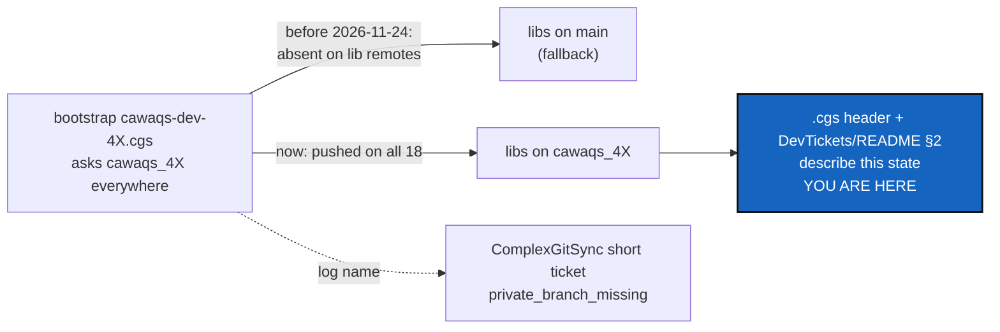

# LibsOnCawaqs4X — the 17 libraries and scripts carry `cawaqs_4X`, and the specs say so

*Created: 2026-11-24*

*Branch: 4X*

> **Owner's request, 2026-11-24**, short ticket
> [libs-on-cawaqs_4X.md](.closedUserTicket/20261124_libs-on-cawaqs_4X.md):
> the bootstrap of `.config/cawaqs-dev-4X.cgs` (cgitsync 8.11.1) put the
> cawaqs root on `4X` and every private/local mount on `cawaqs_4X`, but the
> 17 libraries and `scripts` landed on `main`. The libraries must carry
> `cawaqs_4X` like the rest. Rewrite the `.cgs` header and `DevTickets/README.md`
> §2 to match. Carry the misleading `private_branch_missing` log name to
> ComplexGitSync's own tickets.
>
> **Owner, 2026-11-24 (in conversation):** the `cawaqs_4X` branches of the
> libraries and `scripts` are now pushed.

## Abstract — read this first

**The one-line version.** The branches exist now, so nothing is left to
create. What remains is a tree check, then rewriting the two documents that
still describe the old state. They must describe the new steady state:
the libraries are on `cawaqs_4X`, and a fresh bootstrap finds the branch on
every library remote, so it no longer falls back to `main`.

**What this document is.** What was found on 2026-11-24 (§1), the work left
(§2), the decisions for the owner (§3) and acceptance (§4).

**Why it exists.**
- The header of `.config/cawaqs-dev-4X.cgs` still describes cgitsync before
  8.11.1 and a tree where no library has `cawaqs_4X`. Followed as written,
  it gives the wrong install steps.
- `DevTickets/README.md` §2 says which branch each private mount is on, but
  not which branch the libraries are on.
- ComplexGitSync's log name `private_branch_missing` made a normal fallback
  look like a bug. It has to be fixed in ComplexGitSync, not here.

**Who it is for.** The worker who edits the two documents, and the owner,
who answers §3 and files the ComplexGitSync short ticket.

**What you need to do with it.** Pile 1, rank 3. Answer §3, then do §2 in
one change. No file under `src/` changes, so there is no `bump-build`.

---

## 1. State on 2026-11-24

Checked in `~/.cgs/cawaqs-20261124160131`:

- **The branches exist.** In all 18 repositories (`libgc`, `libpc`, `libts`,
  `libprint`, `libio`, `libchronos`, `libspa`, `libfp`, `libnsat`, `libhyd`,
  `libaq`, `libwet`, `librsv`, `libmesh`, `libttc`, `libseb`, `libap`,
  `scripts`):
  - the checkout is on `cawaqs_4X`, tracking `origin/cawaqs_4X`;
  - `HEAD` = `origin/cawaqs_4X` = `origin/main`, so each branch starts at the
    tip of `main`;
  - the working tree is clean.

  This is step 1 of the short ticket (`branch create 4X`, `checkout 4X`,
  `push`). It is done, so this ticket does not repeat it.
- **Nothing else moved.** `ComplexGitSync` is on `HT-BETA`, the memory is
  on `ComplexGitSync_cawaqs_4X`, and `.agent/.distant/{dev-sync,documentation,ticket}`
  are on `main`. All of them are clean.
- **The header of [cawaqs-dev-4X.cgs](../../../../../.config/cawaqs-dev-4X.cgs)**
  (lines 9–24) still says:
  - "cgitsync 8.9.4";
  - "4X exists in cawaqs only";
  - a plain `checkout 4X` "would also create a local 4X in every lib and
    scripts".

  None of this is true any more. The libraries now take `cawaqs_4X`, not a bare `4X`.
- **[install.sh](../../../../../install.sh) `dev_install`** runs `branch create`,
  `checkout` and `push` with `--private` only. With the library branches
  published, a fresh bootstrap should find `cawaqs_4X` on each library
  remote and clone it directly. That needs checking (§4), not new code.
- **[README.md:108](../../../../../README.md#L108)** says the dev install
  "puts the private mounts on their `cawaqs_4X` branches". It does not
  mention the libraries.
- **[.config/cawaqs.cgs](../../../../../.config/cawaqs.cgs)**, the user
  install, has the same `default_branch = "4X"`. Its header says "every
  repository falls back to main, where the libs matching cawaqs 4.01 live".
  If `initialise` resolves library branches the way `bootstrap` does, user
  installs now get `cawaqs_4X` too (D1).

## 2. The work

1. **Check the tree.** Run `cgitsync status` from the workspace root. It
   must show `errors=0`, with every library on `cawaqs_4X` and no divergence
   from `origin/cawaqs_4X`.
2. **Rewrite the header of `.config/cawaqs-dev-4X.cgs`** (lines 9–24). Only
   the comments change. No entry changes.
   - Name the cgitsync version (8.11.1, `HT-BETA`) and the branch layout:
     - the root is on bare `4X`, and only the root;
     - the 17 libraries and `scripts` are on `cawaqs_4X`, published since
       2026-11-24;
     - the private/local mounts are on the branches the existing block
       already lists.
   - The install steps:
     - On a first install of a **new** branch line, the library branches
       must be created and pushed too: `branch create <b>`, `checkout <b>`,
       `push`, without `--private`, alongside the `--private` steps that
       exist today.
     - On 4X, they exist. A bootstrap clones them, and only the `--private`
       steps remain.
   - Drop the "a plain `checkout 4X` would also create a local 4X…" remark.
   - Keep `fallback_branch = "main"` on the libraries. It is still the seed a
     new line's `branch create` starts from.
3. **`DevTickets/README.md` §2**, the paragraph *The private configuration
   repositories keep their own branches*: add that the 17 libraries and
   `scripts` (`src/lib*`, `src/scripts`) are on `cawaqs_4X`, and that the
   cawaqs root alone is on bare `4X`. The ticket prefix stays `4X_`. A
   ticket's branch line still names the root's branch.
4. **`README.md:108`**: "puts the private mounts **and the libraries** on
   their `cawaqs_4X` branches". Change it only if the check in §4 confirms
   the behaviour.
5. **`.config/cawaqs.cgs`**: as D1 decides.
6. **ComplexGitSync's `private_branch_missing`**
   ([orchestre/client.py:1575](../../../../../ComplexGitSync/src/ComplexGitSync/orchestre/client.py#L1575)).
   It is logged for repositories that are not private, here every library
   whose `cawaqs_4X` was absent. The `ComplexGitSync` mount is private and
   read-only in this tree, and its tickets live on `ComplexGitSync_CGS-ALPHA`
   of `.dev`, not here. Write the short ticket's third paragraph as a short
   ticket for ComplexGitSync (D2), with the evidence: cgitsync 8.11.1, this
   bootstrap, and the fact that the event fired on non-private entries.

7. **Found during implementation, 2026-11-24: the pixi `dev` environment
   was locked to cgitsync 8.9.4** (`pixi.lock`, HT-BETA `20d6047`), which predates
   RootBareBranch. A fresh `pixi run install -s -dev-4X` with it put every
   library on a local bare `4X`, not `cawaqs_4X`, and its `status` reported
   the libraries of an 8.11.1 tree as "split across branches, expected 4X".
   `pixi update complexgitsync` moved the lock to `838ee24` (8.11.1). The
   `pixi.toml` comment on `[feature.dev]` now says the lock must be 8.11.1 or later.

**Owner's answers, 2026-11-24.**
- D1: follow `cawaqs_4X` in the user install too.
- D2: ComplexGitSync's line is `HT-BETA`, so the request goes in a new
  `DevTickets/dependency/CGS/` folder, named `HT-BETA-<YYYYMMDD>_<Name>.md`.
  The owner assesses it and transfers it. `DevTickets/README.md` §1
  documents the folder.

**Out of scope.**
- Creating or pushing branches, which is done.
- Any change under `src/`.
- Changing cgitsync itself.

## 3. Decisions for the owner — answered 2026-11-24

> Answered: D1 as recommended (follow `cawaqs_4X`). D2 neither option: the
> request goes in `DevTickets/dependency/CGS/` (see *Owner's answers*, §2).

- **D1. The user install, `.config/cawaqs.cgs`.** Now that `cawaqs_4X`
  exists on every library, a user `pixi run install` may put the libraries
  on `cawaqs_4X` instead of `main`. The two have the same content today, but
  they will diverge once 4X work lands in a library. Options:
  - *Recommended:* accept it, and rewrite the header to say the libraries
    follow `cawaqs_4X` and fall back to `main` only for a line that lacks
    the branch. The user install then builds what 4X is tested with.
  - Pin the user install to `main`, with `default_branch = "main"` on each
    library entry, so users keep the published libraries until the owner
    merges.

  Either way, first check what `initialise` actually does (§4).
- **D2. Where the ComplexGitSync ticket goes.** Options:
  - *Recommended:* the owner files it from a ComplexGitSync workspace, in
    its `.dev` on `ComplexGitSync_CGS-ALPHA`. This tree mounts ComplexGitSync
    read-only, and its `.dev` sits on `cawaqs_4X`.
  - The worker writes the text into the report of this ticket, for the
    owner to paste.

## 4. Acceptance

- `cgitsync status` (from the workspace root) shows `errors=0`. All 18
  repositories are on `cawaqs_4X` and match `origin/cawaqs_4X`.
- **A fresh dev bootstrap lands the libraries on `cawaqs_4X`.** Run
  `pixi run install -s -dev-4X -d <empty dir>`:
  - the bootstrap logs no fallback, and no `private_branch_missing`, for any
    library;
  - every `src/lib*` and `src/scripts` is on `cawaqs_4X`;
  - `cgitsync status --search-dir <dir>` shows `errors=0`, and the build
    succeeds.
- **The user install behaves as D1 decides**, checked with `pixi run install`
  into a scratch checkout (or `initialise` with `--dry-run`, if it has one).
- `grep -n "8.9.4\|exists in cawaqs only\|local 4X in every lib" .config/cawaqs-dev-4X.cgs`
  finds nothing.
- `DevTickets/README.md` §2 names the libraries' branch.
- The ComplexGitSync short ticket exists where D2 says, or its text is in
  the report.
- Before-committing checklist: no `src/` change, so no `bump-build`. Deliver
  one commit message, used in the cawaqs root (`.config/`, `README.md`) and
  in `.dev` (README §2, this ticket archived, the short ticket closed to
  `archive/.closedUserTicket/20261124_libs-on-cawaqs_4X.md`,
  TICKETLIFECYCLE §5.1 and §6).
