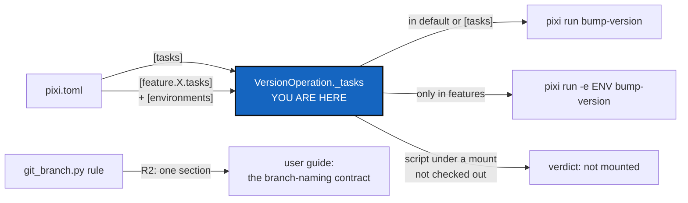

# VersionFeatureTasks — `cgitsync version` finds a bump task declared in a Pixi feature, and the branch-naming rule is written down as a contract

*Created: 2026-11-25*

*Branch: HT-BETA*

> **From the owner's short ticket** `HT-BETA-20261124_VersionFeatureTasks.md` (revised 2026-11-25). It was filed and
> closed when this plan was written (TICKETLIFECYCLE §6), as `20261125_VersionFeatureTasks.md` in
> `archive/.closedUserTicket/`. It holds three proposals, seen with cgitsync 8.11.1: R1, *"`version diagnose` / `bump`
> find a version task declared in a pixi feature"*; R2, *"the branch-naming rule, written as a stable, documented
> contract"*; R3, *"a version kept outside `pixi.toml`"*, marked *"for consideration"*, with *"nothing waits on it"*.

## Abstract — read this first

**The one-line version.** `version diagnose` and `version bump` read the `bump-version` and `bump-build` tasks from
every `[feature.<name>.tasks]` as well as from `[tasks]`, and run a feature task with `-e <environment>`; a task whose
script sits in a mount that is not checked out is named as such, not as `task needed`. The rule that names every
repository's branch gets one section of its own in the user guide, and a change to it is declared a breaking change.
R3 is planned here as a design, and is built only if the owner says so (Q5).

**What this document is.** The plan for that change: what happens today, the cause, the change, the steps, the
decisions the owner owes, and how the work is accepted.

**Why it exists.** A project that keeps bumping as a developer-only act declares its `bump-version` task in a feature,
so a user's environment has none. ComplexGitSync then calls the repository `task needed` and `version bump` refuses
the tree, although `pixi run bump-version` finds the task. Separately, since RootBareBranch (8.11.1) anyone can clone
a tree by hand and land on the same branches with Git alone, but only if the rule is written down in one place.

**What you will find.** §1 what happens today, §2 the cause, §3 the change (R1, R2, R3), §4 the steps, §5 the
decisions for the owner, §6 acceptance, §7 what this ticket leaves alone.

**Who it is for.** The worker and the orchestrator who implement it, and the owner, who answers §5 first.

**What you need to do with it.** Answer §5. §3 is written to the recommendations and is corrected to the answers
before §4 starts.



---

## 1. What happens today

**R1.** A root `pixi.toml` with

```toml
[feature.dev.tasks]
bump-version = "python .agent/.local/.dev/scripts/bump.py"

[environments]
dev = ["dev"]
```

gives, in `cgitsync version diagnose`:

```
<project> . pixi.toml 4.1.3 semver none … task needed   1 other file(s) hold 4.1.3: declare a bump-version task …
```

and `version bump` refuses the tree. Pixi 0.66.0 (checked 2026-11-25, in a scratch workspace) behaves this way:

- a task defined in **one** environment only: `pixi run --manifest-path m bump-version` finds and runs it there;
- a task defined in **several** environments, none of them `default`: Pixi refuses when it cannot ask
  (`stdin` not a terminal) and names `--environment`; `pixi run -e ci bump-version` runs it.

So ComplexGitSync cannot rely on Pixi's own lookup in every case: it must pass `-e` when there is a choice.

**R2.** The rule is in the code (`git_repo/git_branch.private_local_branch`, `GitTreeBranches.guest`,
`git_branch.behind_gate`) and, in pieces, in the user guide: *Only the root is on your branch* (about line 2803), the
level paragraph above it (about line 2790), the memory's `ComplexGitSync_<project>_<branch>` (about line 278), and a
private/local repository's `<project>_<branch>` (about line 691). No section states the whole rule, and nothing says
that changing it breaks anyone.

**R3.** `VersionScheme.read` reads only `pixi.toml`. A repository with none is `not versioned`, even when it carries a
version of its own, for example a C library's `MAJOR.XX` in a `Makefile` variable repeated in a header `#define`.

## 2. Cause

- `VersionOperation._tasks` (`tree/operations/version.py`, line 95) returns `tomllib.loads(...)["tasks"]` only. A
  feature's tasks are never read, so `command` is empty, `bump` falls to `none` when a mirror file holds the version,
  and the verdict is `task needed`. The `BUILD` column has the same gap.
- `VersionOperation._route` (line 225) runs `pixi run --manifest-path m bump-version <level>` with no `-e`, which is
  refused in the several-environments case even once the task is found.
- `_missing_script` only knows that a `.py` file is missing; it cannot say why. In a DEV tree the script usually sits
  in a private mount (`.agent/.local/.dev/…`), and "task needed" sends the reader to repair a task that is correct.

## 3. The change

Written to the recommendations in §5.

### 3.1 R1 — tasks declared in a feature

1. **Read every task table.** `_tasks(path)` returns, for each task name, the environments it can run in and its
   command: `[tasks]` counts as the `default` feature, and each `[feature.<f>.tasks]` is mapped to every environment
   in `[environments]` that lists `<f>` (both the list form `env = ["f"]` and the table form
   `env = { features = ["f"], no-default-feature = … }`). A feature that no environment lists is ignored, as Pixi
   ignores it. Still structured TOML, read with `tomllib`; no new subprocess in `diagnose`.
2. **Choose the environment** (Q1, Q2). A task in `[tasks]`, or in a feature the `default` environment includes, runs
   with no `-e`. Otherwise, a task in exactly one environment runs with `-e <env>`. A task in several takes the first
   of them in `[environments]` order. The choice is fixed once, in `_row`, and kept on the row.
3. **Say which one ran.** `VersionRow` gains `environment: str | None` (`None` for the default). `diagnose`'s
   `BUMP` column prints `task` for the default and `task (<env>)` otherwise; `--json` carries the field.
   `VersionMove.route` is `task (<env>)` likewise, so the `bump` report says it.
4. **Run it there.** `_route` adds `-e <env>` to both the dry run and the real run when `row.environment` is set.
5. **`bump-build` the same way**: the `BUILD` column reads `task` or `task (<env>)` from the same lookup.
6. **A script in a mount that is not there** (Q3). `_missing_script` stays. When the missing script's path lies under
   a repository the tree declares and that is not checked out (for example a private mount the install skipped), the
   verdict is `not mounted` with the detail *"developer task: its script <path> is in <repo>, which is not checked out
   here"*. A missing script anywhere else stays `task needed`, as today. `not mounted` refuses a `bump` exactly as
   `task needed` does (it is not `ready`), and it is not in `SKIPPED`. `version` is already refused outside a DEV
   tree, so this only ever shows in one.

No new command, option, client method or `.cgs` field. `VersionRow` gains one field, `--json` one key.

### 3.2 R2 — the branch-naming contract

1. **One section in the user guide**, *The branch-naming contract*, beside *Only the root is on your branch*. It
   states, with one example tree (`demo` on `dev`):
   - the root is on the bare branch `<b>`;
   - every other repository that is not private (a library, a nested Parent and what its `.cgs` declares, a
     same-project split, ComplexGitSync mounted by another project) is on `<project>_<b>`, and on `<project>` when
     `<b>` is `main`;
   - `<project>` is the tree's project name, `GitTree.project_name`: the `.cgs` `project.name`, else what the install
     derived it from (the user guide already says where; the section points there rather than restating);
   - the separator is `_`, which is why a project or branch name holding `_` is refused where it is created;
   - a private, writable repository is on `<project>_<b>` too; one under a nested Parent on `<Parent>_<project>_<b>`;
     a private, read-only one stays on its own branch;
   - the memory is on `<project>_<b>` in a nested tree and `ComplexGitSync_<project>_<b>` in a standalone one;
     `.self-history` follows the memory;
   - a branch or `default_branch` typed on an entry, and a tag, win over the rule;
   - when the derived branch does not exist, the repository lands on its `fallback_branch`, then `main`; the
     fallback is never silent (the `branch_missing` run-log event, the closing block, `status`).

   The existing passages (about lines 278, 691, 2790, 2803) keep their sentences and point to the section; none is
   duplicated in full (DOCSTYLE §7).
2. **A change to the rule is a breaking change** (Q4). The section says so. `Versioning.md` (.dev)'s MAJOR row
   gains *"the branch a repository is derived onto changes"*, and the digest gains one line citing it. `CHANGELOG.md`
   gets an entry for this release saying the rule is now a documented contract.
3. **No code change.** `git_branch.py` stays the only implementation. Its module docstring cites the user guide
   section as the public statement of the rule it implements.

### 3.3 R3 — a version kept outside `pixi.toml`

Planned here as a design; built in this ticket only if the owner answers Q5 *build it now*. Otherwise §3.3 moves to a
planning ticket of its own when the owner asks, and this ticket does R1 and R2.

The shape, in `VersionScheme`'s own terms:

- **A `build` scheme**: `MAJOR.XX` (two-digit minor). `next(v, "patch")` and `next(v, "minor")` give `+0.01`
  (`3.07 → 3.08`, `3.99 → 4.00`); `next(v, "major")` gives `(MAJOR+1).00`. `moved_by` judges it on the same terms.
  `classify` already tells it apart only as `calendar`/`other`, so `build` is named only where it is declared.
- **Where the fields sit is declared by the project, never in the shared repository** (Q6): on the repository's entry
  in the `.cgs`, for example
  `version = { scheme = "build", fields = [ { file = "Makefile", pattern = "^VERSION *= *(\\S+)" }, { file = "include/lib.h", pattern = "#define LIB_VERSION \"(\\S+)\"" } ] }`.
  `cgs_format.py` validates it; `VersionScheme.read` takes the entry's declaration when there is one and reads each
  field; every field must agree, or the row is `task needed` with *"Makefile says 3.07, include/lib.h says 3.06"*.
- **`diagnose`** shows such a repository with its scheme and `manifest` = the first declared file, instead of
  `not versioned`.
- **`bump`** (Q7) either writes the fields itself (one regex substitution per declared field, the only write
  ComplexGitSync would make to a project's file), or runs the root's own task with the repository's path. The
  recommendation is the root's task, because `cgitsync` never writes a project's file today (TreeVersion) and the
  owner's workspace already keeps this in a private script.
- A `.cgs` grammar addition, so a `minor` release at least, and a new key the `.gts` must carry or ignore: the
  orchestrator checks the State's schema is untouched (`version` is a request field, not hashed into a State's name).

## 4. Steps

For R1 and R2. If Q5 is *build it now*, R3's steps are written into this section from the answers to Q6 and Q7 before
the first edit.

1. **Tests first** (`tests/unit/test_version_operation.py`, or the file that already covers `VersionOperation`):
   - a `bump-version` in `[feature.dev.tasks]`, `dev = ["dev"]`: `diagnose` is `ready`, `bump` = `task (dev)`, and
     `bump`'s dry run calls `pixi run --manifest-path … -e dev bump-version patch --dry-run` (the runner is faked);
   - the same task in `[tasks]`: no `-e`, `bump` = `task`, as today;
   - in a feature the `default` environment includes: no `-e`;
   - in two environments (`dev`, `ci`): `-e dev`, the first in `[environments]` order;
   - the table form `dev = { features = ["dev"] }`;
   - a feature no environment lists: ignored, `task needed` as today;
   - `bump-build` in a feature: `build` = `task (dev)`;
   - a missing script under a declared repository that is not on disk: `not mounted`, and `bump` refuses naming it;
     a missing script elsewhere: `task needed`, as today.
2. Change `tree/operations/version.py` (`_tasks`, `_row`, `_route`, `VersionRow`) and `cli/version_command.py`
   (the `BUMP` and `BUILD` columns, if it formats them).
3. User guide: the `version diagnose` paragraph (about line 1140) names `task (<env>)` and `not mounted`; the
   `bump-version` contract paragraph says the task may be in a feature. The R2 section (§3.2). The API docs, if
   `VersionRow` is documented there.
4. `AdditionalSpecs.md`'s `tree/operations/version.py` row if its contract sentence changes (it names
   `bump-version` "own task"; add "from `[tasks]` or a feature"). `Versioning.md` (.dev) MAJOR row and its `cgitsync
   version` section. The digest (§3.2.2), `pixi run check-spectree`. `CHANGELOG.md`.
5. `pixi run lint`, `pixi run test`, `pixi run bump-build`. Stay under the ceilings, or ask the owner for the raise
   before making it. The orchestrator decides the level: a new verdict and a new `--json` key, no removal, suggest
   `minor`.
6. `cgitsync status` from this tree's root: `errors=0`.

## 5. Decisions for the owner

To be asked with `AskUserQuestion` before the first edit. The recommendation is written first and is never taken as
the answer.

| | Question | Recommendation | Alternatives |
|---|---|---|---|
| Q1 | How a feature task is run | ComplexGitSync reads the manifest and passes `-e <env>` whenever the task is not in the default environment | Pass nothing and rely on Pixi's own lookup (refused when several environments hold it); or always call `pixi task list --json` and follow it |
| Q2 | A task in several environments, none the default | The first in `[environments]` order, named in `diagnose` and in the bump report | Refuse the repository as `task needed`, naming the environments, until one is the default; or prefer an environment named `dev` |
| Q3 | A script in a mount that is not checked out | New verdict `not mounted`, refusing `bump` like `task needed`, with the repository named | Keep `task needed` and only change the detail text |
| Q4 | How binding the branch-naming contract is | A change to the rule is a MAJOR bump, written in `Versioning.md` (.dev) and the digest, announced in `CHANGELOG.md` | A MINOR bump with a `CHANGELOG.md` notice; or documentation only, no versioning rule |
| Q5 | R3 in this ticket | Not built now: §3.3 stays a design, opened as its own ticket when the owner asks | Build it in this ticket; or drop R3 |
| Q6 | (only if Q5 is *build*) where the fields are declared | On the repository's entry in the `.cgs` | In the root's `pixi.toml` under a ComplexGitSync table |
| Q7 | (only if Q5 is *build*) who writes the fields | The root's own task, run with the repository's path | ComplexGitSync writes them itself, one substitution per declared field |

**The owner's answers (2026-11-25, asked with `AskUserQuestion`):** Q1 read the manifest and pass `-e <env>` whenever
the task is not in the default environment. Q2 the first in `[environments]` order, named in `diagnose` and the bump
report. Q3 a new verdict `not mounted`, refusing `bump` like `task needed`. Q4 a change to the rule is a MAJOR bump,
in `Versioning.md` (.dev) and the digest, announced in `CHANGELOG.md`. Q5 R3 is not built now: §3.3 stays a design.
Q6 and Q7 are therefore not asked. §3 already matches these answers.

## 6. Acceptance

- A tree whose root declares `bump-version` only in `[feature.dev.tasks]` with `dev = ["dev"]`: `version diagnose`
  shows it `ready`, `bump` = `task (dev)`; `version bump patch --dry-run` runs the task with `-e dev` and the root
  moves by `patch`.
- The same with the task in two environments: the first in `[environments]` order runs, and the report names it.
- A DEV tree whose task's script is in a private mount not checked out: `not mounted`, naming the mount; `bump`
  refuses before any write.
- A tree whose task is in `[tasks]`: unchanged output, unchanged command line.
- The user guide has one section stating the whole branch-naming rule, and the four passages that stated pieces of it
  point there; `Versioning.md` (.dev), the digest and `CHANGELOG.md` say a change to it is breaking (as Q4 answers).
- `pixi run lint`, `pixi run test` and `pixi run check-spectree` pass. `cgitsync status` from this tree's root shows
  `errors=0`.

## 7. Not this ticket

- Changing the branch-naming rule itself. R2 writes it down as it is in 8.12.0.
- Reading a version from `pyproject.toml` or any manifest other than `pixi.toml` (R3 is about files a project
  declares, not about other package managers).
- A `pixi.toml` in a shared repository: R3 is for the repositories that cannot take one.
- Running `bump-version` in a USER tree: `version` stays refused there (TreeVersion).
