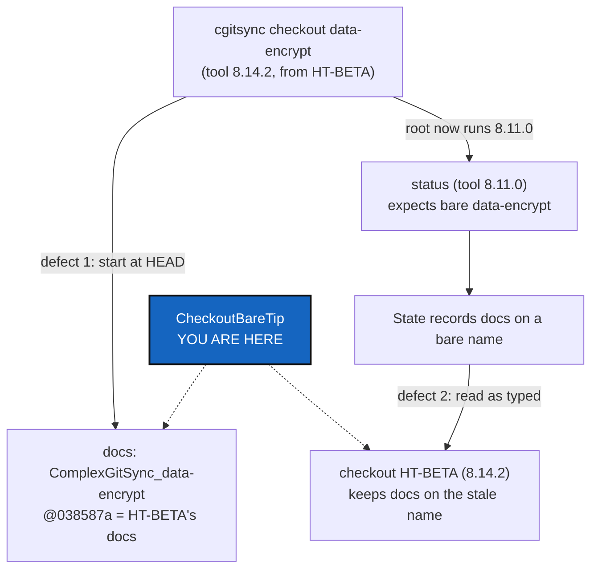

# CheckoutBareTip — a derived branch starts where the bare branch is, and a branch the tree merely landed on is never taken for one the Project typed

*Created: 2026-11-27*

*Branch: HT-BETA*

> **From the owner, 2026-11-27, after a terminal session on this tree:** *"There is a PB with branch data-encrypt
> for DocComplexGitSync it should be ComplexGitSync_data-encrypt. It is not stable. fix it before implementing
> tickets."* The owner's answers, through `AskUserQuestion` the same day: a ticket of its own, **first in pile 1**,
> where checkout **starts the derived branch at the bare branch's tip and says so**. The tree itself was repaired
> by hand the same day (§1.3). This ticket removes the causes. MergeDataEncrypt and every later ticket move down by
> one.

## Abstract — read this first

**The one-line version.** Two defects in `HT-BETA`'s branch derivation made one tree land on two different branches
for `DocComplexGitSync`, depending on the command. (1) `checkout` and `branch create` start a missing
`<project>_<branch>` at HEAD, even when the repository already holds the bare `<branch>`. So the content comes from
the branch the tree was leaving. (2) A branch recorded in a `.gts` only because the tree last landed there is read as
a branch the Project typed, and it pins the repository for good. A third hazard makes both easy to trigger.
`pixi run cgitsync` runs the root's own working tree, so a `checkout` of the root swaps the tool, and its branch
rules, between two commands.

**What this document is.** What happened (§1), the steps (§2), acceptance (§3), and the owner's decisions (§4).

**Why it exists.** MergeDataEncrypt starts by putting `DocComplexGitSync` on `ComplexGitSync_data-encrypt`. Every
HTBS space mounts ComplexGitSync and its docs on derived branches. A tree whose docs silently carry another
branch's content, or follow a stale State, cannot be frozen or compared bit for bit.

**Who it is for.** The worker and orchestrator, and the owner, who answers §4.

**What you need to do with it.** Answer §4, then follow §2.

---

## 1. What happened on 2026-11-27

### 1.1 The owner's session

Starting from `HT-BETA` (8.14.2), with `DocComplexGitSync` on `ComplexGitSync_HT-BETA` at `038587a`:

| Command | Tool that ran | What `DocComplexGitSync` did |
|---|---|---|
| `checkout data-encrypt` | 8.14.2 | A new local `ComplexGitSync_data-encrypt` was made **at HEAD, `038587a`**, which is `HT-BETA`'s docs. The bare `origin/data-encrypt` (`e4cefed`) was ignored, and nothing was reported |
| `status` | 8.11.0, since the root is now `data-encrypt` | *"split across branches — expected 'data-encrypt'"*: 8.11.0 predates RootBareBranch |
| `branch create data-encrypt`, `checkout data-encrypt` | 8.11.0 | docs moved to bare `data-encrypt` (`e4cefed`), and the State recorded `ref = "branch:data-encrypt"` |
| `checkout data-encryupt` (a typo) | 8.11.0 | **eight new branches**, one per writable repository, each at its HEAD, with no warning |
| `checkout HT-BETA` (during the repair) | 8.14.2 | every repository moved **except docs**. `_declared_pin` read the State's `ref = "branch:data-encryupt"` as a typed branch, and kept it there |

### 1.2 The causes in the code

- **Defect 1.** `BranchOperation.create_global_branch` (`tree/operations/branch.py`) looks for the *target* name
  locally, as a remote-tracking ref, and through `ls-remote`. If none has it, it runs
  `git_runner.create_branch(path, target)`, which starts at HEAD. When the target is derived
  (`<project>_<branch>`, RootBareBranch), the bare `<branch>` that the repository may hold is never consulted.
  CheckoutForkGuard closed the same failure for a name the remote already had. This is that failure again, under
  the derived name.
- **Defect 2.** `git_branch._declared_pin` treats as typed any name that is neither the tree default nor
  `<project>_…`, and it reads `entry.target_ref_name` as well as `entry.default_branch`. In a tree loaded from a
  `.gts`, `target_ref_name` comes from `ref`, the branch last landed on. That is a record, not a declaration. One
  bare name written by an older tool, or by a typo, is enough to pin the repository from then on.
- **The hazard.** The root is the running tool. A `checkout` to a branch whose cgitsync predates a branch rule
  leaves the next command running the older rule. Nothing says so.
- **The typo.** `checkout` of a name that exists nowhere creates it in every writable repository, at its HEAD.

### 1.3 The repair made by hand the same day (no code changed)

1. `DocComplexGitSync`: `ComplexGitSync_data-encrypt` was moved from `038587a` to `e4cefed` (it had no commit of
   its own, and had never been pushed). It was then pushed with upstream. The bare `data-encrypt` is kept until
   MergeDataEncrypt closes the line (owner: *push, keep bare*).
2. The root was moved to `HT-BETA` by plain `git checkout`, so that 8.14.2, not 8.11.0, moved the rest.
3. The eight `*data-encryupt` branches were deleted. Each tip was checked to be a commit already on a remote
   branch.
4. `docs` was put on `ComplexGitSync_HT-BETA` by hand. `cgitsync pull examples/cgitsync-ht-beta.cgs` then
   rewrote the State from the `.cgs`, so the stale `ref` is gone. `status` shows `recorded_mismatch=0 errors=0`,
   and a fresh `checkout HT-BETA` keeps docs on `ComplexGitSync_HT-BETA`.

## 2. Steps

1. **Start a derived branch at the bare branch's tip, and say so** (owner, 2026-11-27).
   - `create_global_branch` handles the case where the target is derived (`target != branch_name`) and missing
     everywhere. Before starting at HEAD, it looks for the bare `branch_name`: local first, then remote-tracking,
     then one `ls-remote` (the CheckoutForkGuard pattern). If the bare branch exists, the derived one starts at its
     tip.
   - The new branch is created **without** an upstream, so a later `push` creates the derived name on the remote
     and never writes to the bare one.
   - One line per repository joins the end-of-command report, in BranchMissingEventName's block, for example:
     *"DocComplexGitSync: ComplexGitSync_data-encrypt created from data-encrypt's tip e4cefed; run 'cgitsync push'
     to publish it."* The same line goes to the run log as an event.
   - This covers `checkout` and `branch create`, which share the function. Nothing is renamed, deleted or pushed.
2. **A pin is what the `.cgs` types, never where the tree landed** (CD1).
   - `_declared_pin` stops reading `target_ref_name`. Whether a branch was typed is decided from the declaration
     (`branch` or a non-derived `default_branch` on the entry), carried as such.
   - For a tree loaded from a `.gts`, that needs the State to say which branch was declared. CD1 decides how,
     against the rule that a released integrity schema is immutable.
3. **Name the tool swap** (CD2). After a `checkout` that moves the root, compare the cgitsync version now in the
   root's `pixi.toml` with the one that ran. When they differ, print one warning: *"the root is now cgitsync
   8.11.0 (this command ran 8.14.2); its branch rules may differ — run 'pixi install' and check 'cgitsync status'"*.
4. **A new name is checked for a misspelling before `checkout` creates it** (owner, 2026-11-27: *"What if we use
   branch create first, then we can checkout and pull. What you wrote is relevent for switch that doesn't exist in
   cgitsync. what you can do is double check there is no misspell if no branch already exists"*).
   - `cgitsync checkout` keeps `git checkout`'s meaning: a name that exists nowhere is created, as today.
     `branch create <name>`, then `checkout <name>`, then `pull` is unchanged.
   - **The check runs only when the name exists nowhere**: not as a local branch, a remote-tracking ref or on the
     remote of any repository the move touches. The candidates are every branch name the tree already knows: local
     and remote-tracking, in every repository, with derived names also counted without their `<project>_` prefix.
   - **A close candidate stops the command before anything moves.** The candidate must be close by CD3's measure,
     for example `data-encryupt` against `data-encrypt`. The refusal names the candidate and gives both ways
     forward: *"no branch 'data-encryupt' exists; did you mean 'data-encrypt'? To create the new name, run
     'cgitsync branch create data-encryupt' then 'cgitsync checkout data-encryupt'."* After `branch create`, the
     name exists, so `checkout` no longer checks it.
   - **No close candidate:** `checkout` creates the name, as today.
   - **Where:** the comparison is a pure Ring-0 function beside `git_branch.py`'s naming rules, fed the names the
     tree already read. It adds no Git call beyond the existence checks `create_global_branch` already makes.
5. **Docs.** The user guide's branch-naming contract gets one sentence per rule above. Tutorial 02 gets the
   `branch create` then `checkout` line. CHANGELOG entry.

## 3. Acceptance

An integration test with local bare remotes replays §1.1 on a root, a docs repository and one private/local
mount. The branch-naming contract itself does not change (digest: that would be a MAJOR bump). It now holds when
the bare branch already exists.

- `checkout X`, where docs has only `origin/X`: docs lands on `<project>_X` at `origin/X`'s tip, with no upstream,
  and the report names it. The private/local mount lands on `<project>_X` as before.
- A `.gts` that records docs on a bare name, loaded and then `checkout Y`: docs lands on `<project>_Y`. A branch
  typed in the `.cgs` still wins, as ProjectBranch4Parent's tests require.
- `checkout` from a root whose target branch has another cgitsync version prints the warning (CD2).
- `checkout data-encryupt`, a name that exists nowhere while `data-encrypt` does, is refused before anything moves,
  naming `data-encrypt` and the `branch create` line. No branch is created anywhere. After `branch create
  data-encryupt`, the same `checkout` succeeds. `checkout feature-x`, with no close name, creates `feature-x` as
  today (CD3).
- Every golden State keeps its name. `pixi run lint`, `pixi run test`, `pixi run check-ceilings`, and
  `cgitsync status` with `errors=0`.

## 4. Decisions for the owner

- **CD1. How does a State say that a branch was typed?** Recommended: read the declaration from the `.cgs` when
  the State names its source, and else treat no `.gts` name as typed. That changes nothing in the State. The
  alternative adds a `declared_branch` field to `repo_state`, kept outside the State's hash. That is a schema
  question, so `gts_document.py`'s integrity rules decide it.
- **CD2. The tool swap: warn, refuse, or nothing?** Recommended: warn. A refusal would forbid the merge work itself,
  where checking out the older line is the point.
- **CD3. What counts as a close name?** The rule is the owner's (step 4). The measure is still to decide.
  Recommended: an edit distance of at most 2, counting a swap of two neighbouring letters as one edit, or at most 1
  for a name of five characters or fewer. Case is ignored, and a `<project>_` prefix is stripped before comparing.
  That catches `data-encryupt` and `HT-BTEA`, but not `CGS-ALPHA` against `CGS-BETA`. The alternative is
  `difflib`'s ratio of at least 0.85, which is in the standard library but harder to predict on short names.
