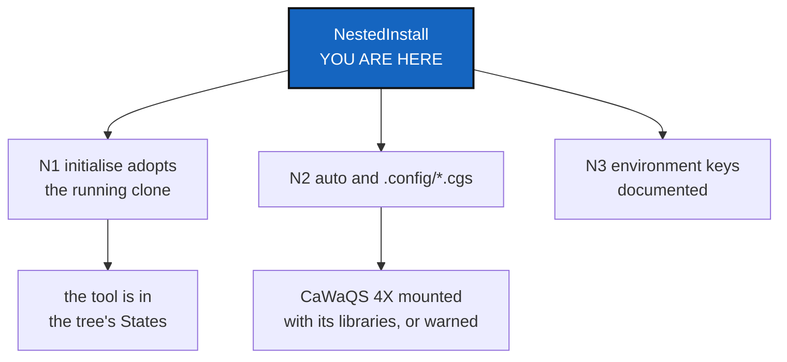

# NestedInstall — a nested `.cgs` can declare the tool it runs from, finds a `.config/` spec, and says what its environment keys mean

*Created: 2026-11-27*

*Branch: HT-BETA*

> **Implemented — 2026-11-27 (`cgitsync-8.16.2`), by a worker and a launched orchestrator, its five decisions asked first
> and answered as recommended.** N1, N2 and N3 as written, with these differences from the plan. *(1)* The predicate that
> says a declared entry is the running installation is `RunningInstall` in `orchestre/running_install.py`, not a Ring-0
> function beside `git_branch.foreign_tool`: it must read the package's own path, and `git_branch.py` is at its
> public-symbol ceiling. *(2)* A declared repository that holds the running tool in a folder inside it, not being the tool,
> is refused by name before anything is deleted; before, it would have been re-cloned, deleting the tool. *(3)* The
> `.config/` hint in `status` is read from `discovery_state`, since a State does not record `nested_config`; it can be
> noisy for an explicit `.config` spec that declares no repository. *(4)* The owner moved the developer specs
> `cgitsync-alpha.cgs` and `cgitsync-ht-beta.cgs` from `examples/` to `.config/` during the work, and every live reference
> was updated. A tool declared without `private = true` is reported off-target on the bare branch; the user guide says to
> declare it `private = true` on a fixed branch, as HTBS does.

> **Ticket review — 2026-11-27, on the owner's request** *"shortTicket review and write DevPlanTickets in a proper
> order of execution. Merge paralell tasks in the same tickets. The goal is a CGS-HT-BETA ready for htbs."* This
> ticket carries three short tickets filed for HTBS (HtbsFirstSpecs, in HTAS's `DevTickets/dependency/HTBS/`) and
> closed with this review:
> [initialise-running-tool](../archive/.closedUserTicket/20261127_initialise-running-tool.md),
> [nested-config-dotconfig](../archive/.closedUserTicket/20261127_nested-config-dotconfig.md) and
> [environment-declaration-docs](../archive/.closedUserTicket/20261127_environment-declaration-docs.md).
> They do not depend on each other, and all three are about what a project's nested `.cgs` declares: the tool, the
> libraries of a mounted project, the environment. So they are one ticket with three parallel steps. It comes after
> MergeDataEncrypt, which also edits `orchestre/installer.py`.

## Abstract — read this first

**The one-line version.** Three things stop a nested tree from describing itself fully, and each has a workaround
written in a comment in HTBS's sources. (1) `initialise` deletes the ComplexGitSync clone it is running from, if a
`.cgs` declares it. (2) `nested_config = "auto"` does not see a spec kept in `.config/`, so a mounted CaWaQS 4X
silently comes without its 17 libraries. (3) The environment keys are used by every example and documented
nowhere. This ticket removes the first two workarounds and documents the third.

**What this document is.** Three steps that can run at the same time (N1, N2, N3), their acceptance, and the
owner's decisions.

**Why it exists.** HTBS's resimulation space (steps P1 and C1 of HtbsFirstSpecs) must pin every tool of a
bit-for-bit rerun. Today the tool's own version is missing from the tree's States, because ComplexGitSync is cloned
by hand and gitignored. The CaWaQS mount works only because HTBS spells `nested_config = ".config/cawaqs.cgs"`. A
twin that keeps the default, as `gitlab:htas1/ht-synthcase-1` does, loses the libraries with no message.

**Who it is for.** The worker and orchestrator, and the owner, who answers §4.

**What you need to do with it.** Answer §4, then take N1, N2 and N3 in any order.

---

## 1. What the code does today

- **`initialise`** re-clones every dependency whose destination already holds files, once
  `git_repo/clone_guard.py` has checked that none holds work no remote has (`orchestre/installer.py`, the docstring
  that says *"Dependencies are re-cloned, not adopted"*). Nothing exempts the clone that holds the running
  package. A nested install has that clone inside the tree. Declaring it makes `initialise` delete the tool it
  runs from.
- **`_resolve_nested_config_path`** (`tree/discovery.py`) globs only `<repo>/*.cgs`. It finds none on a 4X CaWaQS,
  whose specs are `.config/cawaqs.cgs` and `.config/cawaqs-dev-4X.cgs`. The entry then resolves as a leaf, and
  `auto` reports no problem, by design: zero files is a normal leaf. Two root files are refused by name.
- **HTAS**, mounted with `auto`, still holds `htas-beta.cgs` at its root. That file is grafted, and it brings
  ComplexGitSync and `github:flipoyo/.memory` under `postProc/`. The report does not name the graft.
- **The environment keys** (`tree/environment_spec.py`, `tree/tree_env.py`). `environment.tools` is a list of
  minimum versions: it adds probes, and makes `env check` and the install warn on drift. `environment.manifests`
  adds globs to a built-in list, and every example repeats a built-in one. `environment_root` is checked against the
  configured repositories and recorded. It does not change where manifests are read, which is always the root's
  subtree.

## 2. Steps

### N1. `initialise` adopts the running ComplexGitSync clone, or refuses by name

- **Detect it once.** A declared entry *is the running installation* when the package's resolved source directory
  lies inside the entry's destination. This needs one Ring-0 predicate beside `git_branch.foreign_tool`. It reads
  no wall clock and no process, and the path of the running package is handed to it.
- **Adopt (D1).** Before `clone_guard` and the delete, an entry that is the running installation is checked:
  - its `origin` must name the declared repository, through `parse_repo_id()`; a different repository is refused
    by name before anything is deleted;
  - its branch is compared with the one the tree derives for it (`git_branch.behind_gate`, `<project>_<branch>`);
  - it is never deleted, re-cloned or checked out while it runs (D2). An off-target branch is reported with the
    `checkout` line to run after the install, in the same block as BranchMissingEventName's waiting repositories.
- **Record it.** The adopted clone joins the registry like any other repository, so `.gts` and `release freeze`
  record its commit. That is what HtbsFirstSpecs P1 and C1 need.
- **Docs.** The nested-install section of the user guide drops "do not declare ComplexGitSync". Tutorial 04 shows
  ComplexGitSync declared in a nested `.cgs`.

### N2. `auto` and a spec kept in `.config/`

- **The rule (D3).** Recommended (b): `auto` keeps its meaning. When it resolves to a leaf and the repository holds
  `.config/*.cgs`, the install and `status` warn. The warning names the files and the spelling
  `nested_config = ".config/<file>.cgs"`. Option (a) makes `auto` adopt a single `.config/*.cgs` when the root has
  none. It is friendlier, but it changes the topology, and so the States, of every existing tree that mounts such a
  repository, with no change in its `.cgs`. And CaWaQS has two files there, so (a) would hit the ambiguity refusal
  on the very case that motivated it.
- **Name a graft.** When `auto` grafts a root `.cgs`, the install report says which file it grafted and how many
  repositories it brought. The HTAS case becomes visible without a new refusal.
- **One place.** Both live in `tree/discovery.py`, beside the ambiguity refusal, and reuse its wording.
- **Check from HtbsFirstSpecs §7.1, step 4.** In a tree that mounts CaWaQS private and read-only with
  `nested_config = ".config/cawaqs.cgs"`, the 17 libraries and `scripts` under `cawaqs/src/` sit on the branch that
  CaWaQS's own `.cgs` declares (`cawaqs_4X`), not on `main`. An integration test with local bare remotes proves it.
  If they land on `main`, fix it here.
- **Docs.** The user guide states the rule. A tutorial section, *Mounting another project's repository*, shows
  three cases: a root `.cgs`, a `.config/` spec named on the entry, and the warning.

### N3. The environment keys, documented

- **User guide:** a section on `environment = { tools, manifests }` and `environment_root`. It says what each key
  adds to what cgitsync records anyway, what `env show` prints, and when `env check` exits non-zero.
- **Tutorial:** a section, *Declaring a project's minimum environment*, in tutorial 03, with `env show` and
  `env check` output.
- **`environment_root` (D4).** Recommended: say it is a label only, recorded in the Environment record and checked
  against the configured repositories. Giving it an effect (reading manifests from another repository's subtree)
  changes what a State's environment digest covers, which needs a ticket of its own.
- **Examples (D5).** *(On 2026-11-27 the owner moved `cgitsync-alpha.cgs` and `cgitsync-ht-beta.cgs`, the developer specs, from
  `examples/` to `.config/` at the root, as the other projects keep theirs; every reference was updated.)* Drop the `manifests` entries that repeat a built-in pattern from
  `.config/cgitsync-alpha.cgs`, `.config/cgitsync-ht-beta.cgs` and `examples/gx4g-alpha.cgs`, and keep `tools`.
  Check whether a State's environment digest changes: it must not, since the effective list is the same.
- The README is not touched (digest: no option list in the README).

## 3. Acceptance

- **N1:** an integration test runs `initialise` from a ComplexGitSync clone that the nested `.cgs` declares. The
  clone survives with its inode and commit unchanged, the `.gts` records its commit, and a declared remote that
  differs from the clone's `origin` is refused before any directory is deleted. A clone off its derived branch is
  reported with the `checkout` line, and not moved.
- **N2:** an `auto` entry on a repository with no root `.cgs` and one `.config/x.cgs` warns, naming
  `.config/x.cgs`. With two files, both are named. An `auto` graft is named in the report. The CaWaQS-shape test
  shows the libraries on the declared branch.
- **N3:** the user guide and tutorial sections exist. Every example still validates. A State built from an example
  before and after the `manifests` change has the same name.
- `pixi run lint`, `pixi run test`, `pixi run check-ceilings` and `cgitsync status` (`errors=0`) pass. The PDFs are
  rebuilt.

## 4. Decisions for the owner

- **D1. Adopt the running clone in place, or refuse with a message?** Recommended: adopt, with the checks of N1. A
  refusal keeps today's workaround and leaves the tool out of every State.
- **D2. An adopted clone on another branch: report it, or check it out?** Recommended: report it, with the line to
  run once the install is done. Checking out the code that is running is how a half-switched tool happens.
- **D3. `auto` and `.config/`: warn (b), or adopt a single file (a)?** Recommended: (b), for the reasons in N2.
- **D4. `environment_root`: a label only, or an effect?** Recommended: a label, documented as such.
- **D5. Drop the redundant `manifests` entries from the examples, or keep them with a comment?** Recommended: drop
  them.
