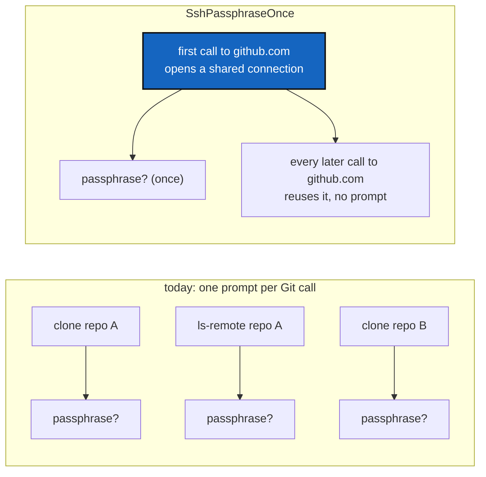

# SshPassphraseOnce — on a terminal with no SSH agent, a key's passphrase is asked once per host, not once per Git call

*Created: 2026-11-27*

*Branch: HT-BETA*

> **Dropped — 2026-11-27, owner's decision.** An SSH agent on the server removes the cause for every tool, not only
> cgitsync: with `SSH_AUTH_SOCK` pointing at a running agent the passphrase is asked once and then reused, and
> cgitsync passes the environment through to Git. The owner runs `ssh-agent` as a per-user systemd service on the
> AlmaLinux server (`AddKeysToAgent yes` in `~/.ssh/config`). Nothing was built, so the ticket has no orchestrator's
> record. The one-line hint (§3 step 3) was dropped with it.

> **From the owner's short ticket** [sshPsswd-noX](../archive/.closedUserTicket/20261127_sshPsswd-noX.md)
> (2026-11-27): *"On a distant server without X11, i work on OperatingSpace with terminals. when bootstraping, every
> leaf ask for the sshKey passwd [...] It should be implemented so that each time i go to a repo i don't have to
> rewrite the passwd. When using a code with X11, i just write the passwd once."*
> **Placement (owner, 2026-11-27, in conversation):** *"It is a priority one out of the Roadmap for implementation
> before 1-3_DEV2."* The short ticket asked for a place on the roadmap for DEV2. The owner's later word wins: this
> ticket carries no role and is on no roadmap. It is ranked 1-2, the slot MergeDataEncrypt left, so it comes before
> NestedInstall (1-3) and no other ticket is renamed.

## Abstract — read this first

**The one-line version.** Every Git call cgitsync makes to a remote opens its own SSH connection: clone, fetch, the
`ls-remote` existence checks, and push. With a passphrase-protected key and no SSH agent, which is the normal state of a
terminal on a server without X11, OpenSSH asks for the passphrase at every one of them. One `bootstrap` of an
eleven-repository tree asks dozens of times. This ticket makes cgitsync share one SSH connection per host across its
own Git calls, so the passphrase is asked once per host and then reused for a while. cgitsync never sees, stores or
passes the passphrase.

**What this document is.** What happens today (§1), the options (§2), the steps (§3), acceptance (§4) and the owner's
decisions (§5).

**Why it exists.** On a desktop, an agent started by the session (a keyring) unlocks the key once and every connection
uses it. On a remote server reached over a terminal there is none. A developer working an Operating Space there types
the same passphrase for every repository, and several times for each one. HTBS's spaces live on such a server.

**Who it is for.** The worker and orchestrator, and the owner, who answers §5 and checks §4's last item on
zagros-fon.

**What you need to do with it.** Answer §5, then follow §3.

---

## 1. What happens today

- **Every Git call runs its own `ssh`.** Clone and fetch, but also `ls-remote`: CheckoutForkGuard's existence check,
  `fetch_branch_if_remote_has_it`, `remote_branch_exists`, and `NewBranch.refuse_misspelt`'s fetch. With an SSH remote,
  each of these is a new SSH connection.
- **No agent means a prompt per connection.** OpenSSH unlocks a passphrase-protected key for one connection only.
  With no agent (`SSH_AUTH_SOCK` unset), it asks on the terminal every time. `GIT_TERMINAL_PROMPT=0` and
  `GIT_ASKPASS=echo` (`git_runner._non_interactive_git_env`) silence Git's own prompts, not OpenSSH's passphrase
  prompt, which reads the terminal directly.
- **cgitsync holds no secret, by design.** `_non_interactive_git_env` says cgitsync "stores no credentials" and runs
  on ambient ones. EncryptedRepos settled that it never handles a key. This ticket keeps both rules.
- **The tool here:** OpenSSH 8.9 (zagros-fon). It supports connection sharing (`ControlMaster`) on Linux and macOS.
  The Windows OpenSSH does not.

## 2. Options

| Option | What it does | Verdict |
|---|---|---|
| **A. Share one SSH connection per host** | cgitsync's Git calls use `ssh -o ControlMaster=auto -o ControlPath=~/.ssh/cgs-%C -o ControlPersist=<t>`. The first call to a host opens the connection and OpenSSH asks once. Every later call to the same host, user and port reuses it with no prompt, within this command and the next ones, for `<t>` after the last use | **Recommended.** cgitsync never sees the passphrase, OpenSSH asks for it. Nothing is installed, and no file is written but OpenSSH's own socket |
| **B. Start an agent for the run** | cgitsync starts `ssh-agent`, runs `ssh-add` (one prompt), and stops the agent at the end | Asks once per **command**, not once per host for a while. cgitsync would then be loading keys into an agent, which is closer to handling a key than EncryptedRepos allows |
| **C. Say how to start an agent** | When an SSH remote is used and no agent is running, print once: `eval "$(ssh-agent -s)" && ssh-add`, and suggest `AddKeysToAgent yes` in `~/.ssh/config` | Changes no behaviour. On its own it leaves the pain, but it names the lasting fix for a login session, so it is **recommended beside A** |
| **D. HTTPS with a credential cache** | `--force-protocol https` and `git credential-cache`: the "gitProvider hidden passwd" of the short ticket | Changes the protocol, and needs a provider token in place of the SSH key the owner uses. It is already possible by hand with `--force-protocol https`. Out of scope |

## 3. Steps

1. **`SshSharing`, Ring 0** (`git_repo/ssh_sharing.py`, pure). Its input is the environment mapping, the platform and
   the persistence (D2). It answers the `GIT_SSH_COMMAND` to use, or `None`. The rules:
   - **`None` when the user already chose.** That is, `GIT_SSH_COMMAND` or `GIT_SSH` is set. The user's own command
     always wins, and `GIT_SSH_COMMAND=ssh` is how to switch the sharing off (D4).
   - **`None` on Windows**, whose OpenSSH has no `ControlMaster`.
   - **Otherwise** `ssh -o ControlMaster=auto -o ControlPath=~/.ssh/cgs-%C -o ControlPersist=<D2>`. `~/.ssh` exists
     wherever an SSH key does, and is the user's private directory. `%C` is OpenSSH's hash of host, user and port,
     which keeps the socket path under the Unix length limit. OpenSSH creates the socket; cgitsync writes no file.
2. **One place.** `git_runner._non_interactive_git_env` adds the variable from `SshSharing`, so every Git call cgitsync
   makes gets it, and nothing else in the package sets it. An HTTPS or `file://` remote is untouched, since Git uses
   `GIT_SSH_COMMAND` only for SSH. The docstring gains a sentence saying cgitsync still holds no secret: OpenSSH asks.
3. **The hint (option C, D3).** When a command reached an SSH remote and no agent is running, print one line on
   stderr at the end of the command: the `ssh-agent` line, and that the passphrase is now asked once per host for
   `<D2>`. Print it at most once per command, and never in `--json` output. It is a message only, through the existing
   reporting, and adds no command, option or client method.
4. **Docs.** A user-guide section, *Working over SSH on a terminal with no agent*: what cgitsync does, how long a
   connection is kept, the security note below, how to switch it off, and the lasting fix with `ssh-agent`.
   CHANGELOG entry. The README is not touched.
5. **Security note, in the docs and in AdditionalSpecs.** While a shared connection is open, any process of the same
   user can use it without the passphrase, as with an agent. The socket is in `~/.ssh`, which is the user's alone. It
   closes `<D2>` after its last use, or with `ssh -O exit -o ControlPath=~/.ssh/cgs-%C <host>`.

## 4. Acceptance

- **Unit tests for `SshSharing`:** the command when nothing is set; `None` with `GIT_SSH_COMMAND` set, with `GIT_SSH`
  set, and on Windows; the persistence value given by D2.
- **The runner:** `_non_interactive_git_env` carries `GIT_SSH_COMMAND` only when `SshSharing` says so, and leaves a
  user's own value byte for byte.
- **No regression:** every existing test runs on `file://` remotes and passes unchanged. `pixi run lint`,
  `pixi run test`, `check-ceilings`, `check-oo` and `cgitsync status` (`errors=0`) pass.
- **The hint:** printed once when an SSH remote is used and `SSH_AUTH_SOCK` is unset, and not otherwise.
- **On zagros-fon, by the owner,** in a terminal with no agent: `bootstrap .config/htbs-dev-beta.cgs` asks the
  passphrase once for `github.com` and once for `gitlab.com`. A `pull` within `<D2>` asks nothing.

## 5. Decisions for the owner

- **D1. Which mechanism?** Recommended: A (a shared connection per host) with C (the hint). The alternatives are B (an
  agent started for each command), C alone, or D (HTTPS with a credential cache).
- **D2. How long is a shared connection kept after its last use?** Recommended: 10 minutes. That is long enough for a
  working session of several commands, and short enough that an idle connection closes. A connection kept only for
  one command would need it to stay open until that command ends, which OpenSSH does only with a persistence time.
- **D3. Where does the hint appear?** Recommended: at the end of any command that reached an SSH remote with no agent
  running, once. The alternative is only in `cgitsync env check`.
- **D4. How is the sharing switched off?** Recommended: by setting `GIT_SSH_COMMAND` (for example to `ssh`). cgitsync
  never overrides it, so there is no new option or variable. The alternative is a `.cgs` key, which a tree would then
  carry for every machine.
