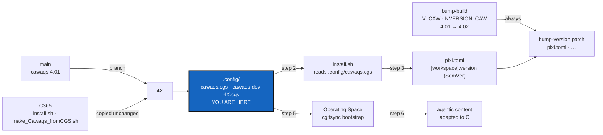

# CGSCaWaQS4X — CaWaQS 4.x installed by ComplexGitSync from .config/, versioned by pixi.toml, developed in an Operating Space

*Created: 2026-11-22*

*Branch: 4X*

> **Owner's decisions, 2026-11-22.** The Operating Space (the agentic layout
> of ComplexGitSync) comes to CaWaQS as it came to
> HydrologicalTwinAlphaSeries. First step: stabilise the CGS install
> for the current main (cawaqs 4.01), as C365 did for 3.65, and give CaWaQS
> a `pixi.toml` for its version. The work lands on branch `4X`, created
> from `main` (the first try, `CGS-CAW`, came from C365 and was
> remade from main, then renamed `4X`). The specs live in
> `.config/`: `cawaqs.cgs` (the install) and `cawaqs-dev-4X.cgs` (the
> agentic workspace, like `htas-dev-beta.cgs`). `install.sh` is
> brought over from C365 unchanged. This ticket is filed in `.config/` too.

> **Owner's decisions, 2026-11-22 (second).** CaWaQS already has a build
> number, as ComplexGitSync does: `4.01` is a build, not a release. So
> CaWaQS gets both `bump-build` and `bump-version`, and **every `bump-build`
> forces a `bump-version patch`**. The ticket also plans the adaptation of
> the agentic content to CaWaQS, as was done for HydrologicalTwinAlphaSeries,
> knowing CaWaQS is written in ANSI C. Both points are sketched here and
> refined later in a dedicated ticket.

> **Owner's decisions, 2026-11-22 (third): the goal.** For now, the target is
> one ecosystem, HydrologicalTwin, CaWaQS and ComplexGitSync, administered
> by pixi, with pixi running the Operating Spaces. Each Operating Space is a
> Digital Twin of the **AlphaSeries**, meaning it has no gate (reading
> confirmed by the owner, 2026-11-22):
> - one branch line per project (`4X`, `HT-BETA`, `CGS-ALPHA`), with no level
>   branch (opx, dev, usr);
> - no blocking check between a change and its push: the checks are run
>   locally through pixi.
>
> The dependency runs one way: **cawaqs is a dependency of HTAS**, never the
> reverse. CaWaQS is to become HTAS's first computational pipeline.
>
> Consequences here:
> - the root `pixi.toml` also gives access to `cgitsync` (§3 step 3);
> - task names are the ones HTAS and ComplexGitSync already use;
> - `check-build-version` is a local pixi task, not a new CI job (§3 step 4).

> **Decisions for the owner answered — 2026-11-22.**
> - D1: SemVer `4.1.0`.
> - D2: libs fall back to `main`, pinned later.
> - D3: tag `cawaqs-4.01`, local (done).
> - D4: the ticket moves to `.dev` after step 5.
> - D5: push `4X` and delete `CGS-CAW` when the owner asks.
> - D6: ComplexGitSync on `HT-BETA`.
> - D7: rollover `4.99 → 5.01`, plus an explicit `--major`.
> - D8: SemVer is the communication channel; the build is for developers only.
> - D9: no C standard fixed yet.
>
> §3 is written with these answers; nothing is left to ask before the
> first edit.

> **Implementation decisions — 2026-11-22**, asked at `implement`.
> - This ticket implements steps 0, 1, 2, 3 and 5. Steps 4 and 6 go to a
>   dedicated ticket, so `pixi.toml` gets no bump tasks here.
> - Step 5 runs to the end, `cgitsync push` of the private branches
>   included.
> - The orchestrator quotes the work and writes the self-history record in
>   the new Operating Space. It runs no version bump: `4.1.0` is the first
>   version.

> **Owner's decision at implement — 2026-11-22: three layers, two opt-in.**
> `pixi.toml` must not present cgitsync as part of CaWaQS: a C maximalist
> who wants neither cgitsync nor the agentic layer must not get them.
> cgitsync and the agentic layer are also distinct, since cgitsync works
> on a public tree with no agentic mount.
> - **default** environment: the C toolchain and the tasks `install`,
>   `build`.
> - **feature/environment `cgs`**: the `cgitsync` task (`pixi run -e cgs
>   cgitsync …`), matching `cawaqs.cgs`. cgitsync's own private mounts
>   belong to this layer: `.cgitsync/.memory` with its `.self-history`,
>   and `.omniscience`.
> - **feature/environment `agentic`** (`["cgs", "agentic"]`): only the
>   private `.agent/` mounts of `cawaqs-dev-4X.cgs` (`.local`: `.dev`,
>   `.localSpec`, `.claude`; `.distant`: `.ticketing`, DevSpec, DocSpec).
>   It is filled by BuildSemVerAgenticC (bump tasks), and empty or absent
>   here.
>
> `install.sh` still clones ComplexGitSync, because `cgitsync initialise`
> is how the libs are fetched. The legacy `make_Cawaqs.sh` stays the route
> with no CGS at all.

## Abstract — read this first

**The one-line version.** Step 0 is done in this change: branch `4X` from
`main`, the two specs in `.config/`, and `install.sh` and
`src/make_Cawaqs_fromCGS.sh` taken unchanged from C365. Next:
1. `install.sh` reads `.config/cawaqs.cgs`.
2. A root `pixi.toml` holds the SemVer.
3. `bump-build` moves the build `4.01` and always triggers `bump-version patch`.
4. The Operating Space is bootstrapped from `cawaqs-dev-4X.cgs`.
5. Its seeded content is adapted from Python (ComplexGitSync, HTAS) to C.

**What this document is.** The request (§1), what exists today (§2), the
work (§3), the decisions for the owner (§4) and acceptance (§5).

**Why it exists.** On `main`, CaWaQS is still installed by
`src/make_Cawaqs.sh`, which runs `git clone`, `git checkout` and `rm -rf` in
every lib. Its build number is typed by hand in two places, and copied into
`CITATION.cff` and the README. There is no release number, and
`cgitsync version` sees no manifest. The CGS install built on C365 (tickets
CGSCaWaQSInstall and CGSCompile, branch C365) never reached the 4.x line.

**Who it is for.** The owner, and the agent who carries out §3.

**What you need to do with it.** Pile 1, rank 1, the first ticket of the 4X
line. §4 is answered. Steps 4 and 6 are refined in a dedicated ticket
before they are implemented.

---

## 1. The request

- Branch `4X` from `main` (cawaqs 4.01).
- `.config/cawaqs.cgs`: ComplexGitSync's `examples/cawaqs.cgs` (written for
  C365) adapted to `main`. The whole tree tracks `4X` and falls back to
  `main`.
- `.config/cawaqs-dev-4X.cgs`: the same product tree plus the agentic mounts,
  laid out as HydrologicalTwinAlphaSeries's `.config/htas-dev-beta.cgs`.
- `install.sh` as in C365.
- A `pixi.toml` that versions CaWaQS. Two numbers: the existing build, and a
  SemVer release. `bump-build` forces `bump-version patch`.
- The agentic content (seeded from ComplexGitSync, in Python) adapted to a
  C code base, as it was for HTAS.

## 2. What exists today

- **`main` (943eeac, cawaqs 4.01)**: `src/make_Cawaqs.sh` and
  `src/make_Cawaqs_from_branches.sh` (clone, checkout, pull, `rm -rf`).
  `src/Makefile` declares each lib's version (`V_AQ=0.74`, `V_FP=0.35`,
  `V_NSAT=0.20`, …), and uses `bison -y` and `flex`. `.gitignore` ignores
  `cawaqs*`, which also matches `.config/cawaqs*.cgs`.
- **The build number, `MAJOR.XX`**, typed by hand in two places that must
  agree:
  - `src/Makefile:37` `V_CAW=4.01`. It names the binary (`cawaqs$(V_CAW)`)
    and the library `libcawaqs$(V_CAW)_<cc>.a`.
  - `src/param_caw.h:32` `#define NVERSION_CAW 4.01`. It is a C
    floating-point literal, printed `%4.2f` in the usage line and the log
    header, so `XX` is always two digits.

  The history moves it on every code change: 3.65 → 3.66 → 3.67 → 4.0 → 4.01.
  4.0 was a deliberate major step, not an overflow of `XX`. Copies:
  `CITATION.cff` (`version: '4.01'`, `date-released`), the README badges
  (`Current_version-4.01`, `Documentation-4.01.1`, and `Latest_major_release-3.57`
  with its citation line). `main_cawaqs.c:8` says `VERSION ID : 3.x`, which is
  out of date. `make version` calls `./update_version.sh`, which does not exist.
- **The CI** (`.gitlab-ci.yml`) builds with `make_Cawaqs.sh` and runs two
  regression cases from `gitlab:cawaqs/gtest/testcases`
  (`HYDRO_COUPLED.COMM`, `HYDRO_REPSUR.COMM`). It also publishes the
  Doxygen pages. Its `clang-format` check is commented out, though
  `.clang-format` is present.
- **The C dialect**: the code base is ANSI C, but `src/*.c` uses `//`
  comments (117 in `main_cawaqs.c` alone), which is C99, not C89. The
  Makefile passes no `-std` and no warning flags (`OPTCOMP = -g`).
- **`C365`**: `install.sh` (ssh by default, `--https`, `-b`, `-c`, `-n`),
  `src/make_Cawaqs_fromCGS.sh` (compiles with no git operation),
  `cawaqs-C365.cgs` at the root, and the CGSCaWaQSInstall and CGSCompile
  tickets. `install.sh` reads `<root>/cawaqs-<branch>.cgs`, with default
  branch `C365`.
- **ComplexGitSync 8.9.4 (CGS-ALPHA)**:
  - A `<project>-<xxx>.cgs` whose `xxx` has three characters is a level file
    (`tree/named_cgs.py`). `cawaqs-dev.cgs` would be one; `cawaqs-dev-4X.cgs`
    is not.
  - Its two numbers: `__version__` (SemVer, `bump-version`) and `__build__`
    (`YYYY.XX`, `scripts/bump_build.py`), on two cadences.
  - `scripts/check_build_version.py --range` fails any commit that moves
    `__build__` without moving `__version__` up.
- **HTAS's agentic adaptation (branch `HydrologicalTwinAlphaSeries_HT-BETA`)**:
  - `.claude`: `CLAUDE.md` and `AGENT.md`.
  - `.localSpec`: `AdditionalSpecs.md` (what the package is, layers, import
    rules, public interface, module shape), `AgenticManifest.md`, `audit.md`,
    `digest.md`.
  - `.dev`: `htas-dev.md` (commands, the before-committing fill-ins, the
    doc-impact map, testing), `Versioning.md`, `DevTickets/README.md`, and
    `scripts/bump_version.py`.

  All were seeded from ComplexGitSync and cut to what HTAS has. Their rules
  assume Python: pytest, ruff, Pythonic names, pyproject, module ceilings.
- **Private repositories**: `.dev`, `.localSpec` and `.claude` have
  `ComplexGitSync_CGS-ALPHA`, the seed. `.memory` has no
  `ComplexGitSync_cawaqs_4X` (checked 2026-11-22).
- **Remote**: `origin/CGS-CAW` exists at 943eeac (main), under the old name.
  *(Update 2026-11-22: the owner pushed `4X`, 7854d55 then 3d91665;
  `origin/4X` is the line and `CGS-CAW` is to be deleted on request, D5.)*

## 3. The work

0. **Done in this change.** Branch `4X` from `main`; `.config/cawaqs.cgs`
   and `.config/cawaqs-dev-4X.cgs`; `install.sh` and
   `src/make_Cawaqs_fromCGS.sh` copied from C365 unchanged;
   `.gitignore`: `!.config/*.cgs`, then `.cgitsync/`, `ComplexGitSync`,
   `.pixi/*` and the agentic mounts. This ticket.
1. **Check the specs as they are.** From a nested ComplexGitSync, with
   `CGSHOME=<root>`, run `pixi run cgitsync initialise ../.config/cawaqs.cgs`,
   then `src/make_Cawaqs_fromCGS.sh gcc`. On a fresh clone this must
   produce `src/cawaqs4.01` (§5). Any lib whose `main` no longer
   compiles with 4.01 goes to D2. `src/make_Cawaqs_fromCGS.sh` was written
   for 3.65; any fix it needs for 4.01 belongs here.
2. **`install.sh` reads `.config/cawaqs.cgs`.** As copied it looks for
   `<root>/cawaqs-<branch>.cgs`, with default branch `C365`, so on `4X` it
   stops with "`cawaqs-4X.cgs` not found". Change: `spec=$root/.config/cawaqs.cgs`
   and `DEFAULT_BRANCH="4X"`. ComplexGitSync is cloned with `-b HT-BETA`,
   the line HTAS uses and `cawaqs-dev-4X.cgs` declares (D6), not its
   default branch. `-b` still checks out the cawaqs root. Update
   the header comment and the README install section. Every other C365
   behaviour stays (ssh by default, `--https` as `--force-protocol https`,
   `CGSHOME` exported, `main "$@"; exit`).
3. **Root `pixi.toml`**, laid out as ComplexGitSync's and HTAS's:
   - `[workspace]`: `name = "cawaqs"`, `version = "4.1.0"` (D1),
     `channels = ["conda-forge"]`, `platforms = ["linux-64"]`;
   - `[dependencies]`: the build toolchain (`c-compiler`, `make`, `bison`,
     `flex`), and `python = "3.11.*"` for the bump scripts and `cgitsync`.
     Versions are pinned once step 1 has built with them;
   - `[pypi-dependencies]`: `complexgitsync = { path = "ComplexGitSync", editable = true }`.
     This is the nested clone that `install.sh` makes. `pixi run cgitsync …`
     then works from the cawaqs root, so pixi administers the Operating
     Space, as in HTAS (third decision);
   - `[tasks]`:
     - `install = "./install.sh"`
     - `build = { cmd = "./make_Cawaqs_fromCGS.sh gcc", cwd = "src" }`
     - `bump-version = "python .agent/.local/.dev/scripts/bump_version.py"`
     - `bump-build = "python scripts/bump_build.py"`
     - `check-build-version = "python scripts/check_build_version.py --range"`
   - `.config/cawaqs-dev-4X.cgs`: `environment` gains `manifests = ["pixi.toml"]`.
4. **Two numbers, two scripts** (sketch; refined in the dedicated ticket).
   The rule written in `.dev/Versioning.md` is ComplexGitSync's, with one
   difference: in CaWaQS a build bump **always** carries a release bump.
   - **`bump-build`** (`scripts/bump_build.py`, public: anyone who changes
     `src/` runs it):
     - It moves the build `MAJOR.XX` by one `XX` (`4.01 → 4.02`) in
       `src/Makefile` `V_CAW` and `src/param_caw.h` `NVERSION_CAW`, both or
       neither. It refuses if they disagree.
     - Then it runs `pixi run bump-version patch` itself, so neither number
       moves alone. If that patch bump fails, the build bump is undone.
     - `--dry-run` shows both moves and writes nothing.
     - After `.99` it rolls over: `4.99 → 5.01`, as ComplexGitSync's
       `__build__` does (D7).
     - `--major` makes a deliberate build major at once: `4.xx → 5.0`
       (printed `5.00`), as 3.67 → 4.0 was. So `.0` marks a deliberate
       major, and `.01` the first build after a rollover (D7).
     - Like every build bump, `--major` also runs `bump-version patch`.
       `XX` stays two digits because of `%4.2f`.
   - **`bump-version <level>`** (`.agent/.local/.dev/scripts/bump_version.py`,
     ported from ComplexGitSync's):
     - It writes the SemVer, the communication channel (D8). Targets:
       `pixi.toml` (read first), `CITATION.cff` `version` and
       `date-released`, and the README `Current_version` badge.
     - It writes every target or none, and ends on `old -> new`, as
       `cgitsync version bump` requires.
     - It never touches the build. A `minor` or `major` release is
       cut on its own, without a build bump.
   - **`check-build-version`** (`scripts/check_build_version.py`, ported):
     it fails any commit in a range that moves `V_CAW`/`NVERSION_CAW`
     without moving `pixi.toml`'s version up by at least a patch. It is run
     locally (`pixi run check-build-version <range>`) as part of the
     before-committing steps. Since the Operating Space is AlphaSeries (no
     gate), it is not added as a blocking job to `.gitlab-ci.yml`.
   - The build is for developers only (D8). It appears in the code, in the
     binary's name (`cawaqs4.02`) and in the log header, beside the SemVer.
     It is never in a user-facing document. The log-header change to
     `main_cawaqs.c` is settled by the dedicated ticket. Fix
     `main_cawaqs.c:8`, and either replace the dead `make version` target
     with `bump-build` or remove it.
   - The badges `Latest_major_release` and the citation line move only
     when a release is published, by hand. `Documentation-4.01.1` follows
     the PDF; how the PDF is numbered (today after the build, `401_1`) is
     settled by the dedicated ticket.
   - The libraries keep their own build numbers (`V_AQ`, …) and are out of
     scope.
5. **Bootstrap the Operating Space** in the order given at the top of
   `.config/cawaqs-dev-4X.cgs`: `bootstrap`, `branch create 4X --private`,
   `checkout 4X`, `self-history adopt`, `push`. `bump_version.py` (step 4)
   waits for this, since it lives in `.dev`.
6. **Adapt the agentic content to CaWaQS and to C** (sketch; refined in the
   dedicated ticket). On `cawaqs_4X`, file by file as HTAS did, keeping
   ComplexGitSync's shape and replacing every Python assumption:
   - **`.claude/CLAUDE.md` and `AGENT.md`**: CaWaQS's layout (the root,
     `src/lib*`, `src/scripts`, the two levels), "implement `<ticket>`",
     and the before-committing steps with C commands. Those commands are
     `pixi run build` with no new warning, the regression cases, the format
     check, and `bump-build`.
   - **`.localSpec/AdditionalSpecs.md`**:
     - What CaWaQS is: the coupled model and its 17 libraries.
     - The layers: the `cawaqs` root over the libs; the libs among themselves
       (`list_all.dat`, `print_dependencies.awk`).
     - The C equivalents of import rules: which headers a file may include
       (`functions_*.h`, `param_*.h`), and linking through `Makefile_tmp`.
     - The public interface: the `.COMM` command language (`input.y`,
       `lexical.l`) and the output files.
     - Module shape: the file prefixes `CAW_`, `AQ_`, `HYD_`, `AP_`, …, and
       a size ceiling in C lines.
     - The C dialect: none is fixed yet (D9). The spec records the code as it
       is (ANSI C with `//` comments, no `-std`), and the dedicated ticket
       decides.
   - **`.localSpec/AgenticManifest.md`, `digest.md`**: the mounts of
     `cawaqs-dev-4X.cgs`, and the MUST/NEVER rules restated for C.
   - **`.localSpec/audit.md`**, seeded with what §2 found:
     - the build typed by hand in two places;
     - the dead `make version` target;
     - `VERSION ID : 3.x`;
     - the destructive `make_Cawaqs.sh` still used by CI;
     - the commented-out format check;
     - no `-std` or warning flags;
     - two regression cases as the only tests.
   - **`.dev/cawaqs-dev.md`** (HTAS's `htas-dev.md`):
     - Commands: `pixi run build`, `install`, `bump-build`, `bump-version`,
       `check-build-version`.
     - Bootstrapping a working checkout.
     - The checklist fill-ins.
     - The doc-impact map: README, `CITATION.cff`, the PDF documentation,
       Doxygen.
     - Testing: the `gtest/testcases` regression cases, and how a new one is
       added.

     No pytest and no ruff. The format check is `clang-format -n -Werror`
     with the repository's `.clang-format`.
   - **`.dev/Versioning.md`**: the two numbers of step 4, and the rule that
     a build bump forces a patch bump.
   - **`.dev/DevTickets/README.md`**: branch `4X`, prefix `4X_`. Move this
     ticket (with `git mv` in the cawaqs repository, then add it in `.dev`)
     into `openTickets/`, so `.config/` holds only specs (D4).
   - **DevSpecs rules that are Python only** (Pythonic names, `pip`, `uv`,
     the Python API/CLI mirror, Python logging): `AdditionalSpecs.md` states
     the C rule that replaces each one. The shared `DevSpec` is not edited
     from here.

## 4. Decisions for the owner — answered 2026-11-22

- **D1. The first SemVer: `4.1.0`.** (Offered: `1.0.0`, `4.0.0`.) It is
  aligned on the build `4.01` on the day of the switch, then independent.
- **D2. The libs fall back to `main`, pinned later.** (Offered: a branch
  `4X` in each lib, waiting for CGS tags.) Each lib's `main` may move past
  what 4.01 declares. A pin is made before the first release made with
  this install.
- **D3. The last hand-versioned state: tagged, locally.** The annotated
  tag `cawaqs-4.01` is on 943eeac *(done, 2026-11-22)*. Pushing it is the
  owner's call.
- **D4. This ticket moves to `.dev` after step 5.** `gitlab:cawaqs/cawaqs`
  is public, and TICKETLIFECYCLE §1.1 keeps `DevTickets/` private. Until
  `.dev` is mounted it stays in `.config/`; then `.config/` holds only
  specs (§3 step 6).
- **D5. The remote branch: push `4X`, delete `CGS-CAW`**, both at the
  owner's request. Nothing is done on GitLab before that.
- **D6. ComplexGitSync on `HT-BETA`.** (Offered: `CGS-ALPHA`, `main`.)
  `install.sh` clones it with `-b HT-BETA` (§3 step 2), and
  `cawaqs-dev-4X.cgs` declares it on `HT-BETA` *(done, 2026-11-22)*. This
  is the line HTAS moved to (HTAS commit 2bc7f3b). The `.local` seeds stay
  `ComplexGitSync_CGS-ALPHA`.
- **D7. The build rolls over `4.99 → 5.01`, with an explicit `--major`**
  (`4.xx → 5.0`) for a deliberate major (§3 step 4).
- **D8. The SemVer is the communication channel; the build is for
  developers only.** Every user-facing copy (`CITATION.cff`, the README
  `Current_version` badge) follows the SemVer. The build is only in the
  code, the binary's name and the log header (§3 step 4).
- **D9. No C standard fixed yet.** (Offered: C99 with `-Wall`, strict C89.)
  The Makefile stays as it is. The dedicated ticket decides.

## 5. Acceptance

- `git check-ignore .config/cawaqs.cgs .config/cawaqs-dev-4X.cgs` reports
  neither. *(done, 2026-11-22)*
- `diff <(git show C365:install.sh) install.sh` is empty until step 2.
  *(done, 2026-11-22)*
- On a fresh ssh clone of cawaqs on `4X`, `./install.sh` produces
  `src/cawaqs4.01`, and `git status` is clean in the root and in every lib.
  The same with `--https` on a machine with no ssh key. `./install.sh -n`
  prints the command list and changes nothing.
- `pixi install` and `pixi run build` pass. `cgitsync version diagnose` shows
  cawaqs with `MANIFEST pixi.toml`, `VERSION 4.1.0`, `SCHEME semver`,
  `BUMP task`, `BUILD task`, verdict `ready`.
- `pixi run bump-build --dry-run` shows `4.01 -> 4.02` and the SemVer's
  patch move, and writes nothing. Without `--dry-run`, `V_CAW`,
  `NVERSION_CAW` and `pixi.toml` all move in the same commit, and
  `pixi run build` produces `src/cawaqs4.02`. From `4.99`, `bump-build`
  gives `5.01`; `bump-build --major` gives `5.0`, and both also move the
  SemVer by a patch.
- After a `bump-version`, `CITATION.cff` and the README `Current_version`
  badge show the SemVer, and no user-facing document shows the build.
- `pixi run check-build-version <range>` fails on a commit that moves
  `V_CAW` without the SemVer, and passes on a `bump-build` commit.
- `cgitsync version bump patch --dry-run` shows `old -> new` and writes
  nothing. A `bump-version minor` leaves the build unchanged.
- `cgitsync bootstrap .config/cawaqs-dev-4X.cgs cawaqs` and the steps after
  it end with `cgitsync status` at `errors=0`. ComplexGitSync stays on
  `HT-BETA`, and no branch `4X` is pushed to `github:flipoyo/ComplexGitSync`.
- After step 6, no file under `.agent/.local/` on `cawaqs_4X` prescribes
  pytest, ruff, pyproject or a Python naming rule. Each such rule from the
  seed is either replaced by its C rule or recorded as not applicable.

## 6. What was done — 2026-11-22

Steps 0, 1, 2, 3 and 5 were implemented. Three workers ran in parallel and
an independent orchestrator quoted the work; this section records where
the work departed from §3, and why.

- **Step 1 (done).** A fresh ssh clone of `4X`, then `initialise` of
  `.config/cawaqs.cgs`: all 18 repositories fell back to `main` (D2). The
  build gives `src/cawaqs4.01`, and the two CI regression cases
  (`HYDRO_COUPLED`, `HYDRO_REPSUR`) exit 0. Departures:
  - **`src/make_Cawaqs_fromCGS.sh`** no longer sources
    `scripts/scripts_functions.sh`, which exists only on gutil/scripts
    `C365`, not on `main`. The script inlines the helpers (`prepare_makefile`,
    `set_dependencies`, `build_lib`) without their git arguments. They call
    only the awk and sh helpers that `main` and `C365` share.
  - **The toolchain.** The host's gcc 15, like any gcc ≥ 15, defaults to C23
    and fails on libgc's `sparse_11_7_2011/spTest.c`. libgc also needs
    gfortran (`caplu1.f`). What builds is conda-forge gcc 13.4 and gfortran
    13.4, make 4.4.1, bison 3.8.2 and flex 2.6.4. The binary finds
    `libgfortran` and `libgomp` through an RPATH into `.pixi/envs/default/lib`.
  - **`.gitignore`.** `cgitsync initialise` and `bootstrap` append the 17
    `src/lib*` paths, `src/scripts` and `.cgitsync/.memory`. They are now
    listed verbatim, so the root stays clean after an install.
- **Step 2 (done).** `install.sh` reads `.config/cawaqs.cgs`, defaults to
  `4X`, and clones ComplexGitSync with `-b HT-BETA` (D6). Every other C365
  behaviour is kept. A plain `./install.sh` compiles with the system
  toolchain, so the recommended command is `pixi run install` (README,
  `cawaqs.cgs` header).
- **Step 3 (done).** Root `pixi.toml` with `version = "4.1.0"` (D1) and no
  bump task. Departures:
  - The toolchain is pinned (`gcc`/`gfortran` `13.*`), not `c-compiler`.
  - There is no `[pypi-dependencies]` entry for ComplexGitSync, since
    `ComplexGitSync/` does not exist on a fresh clone and `pixi install`
    would fail. The `cgitsync` task delegates to the nested clone's own
    manifest instead.
  - The layout follows the owner's decision at implement (three layers):
    the default environment is the C product only, and cgitsync is the
    opt-in feature `cgs`.
- **Step 5 (done).** The Operating Space is at
  `~/.cgs/cawaqs-20261122180859`, and `cgitsync status` gives `errors=0`.
  - **Pushed:** `cawaqs_4X` to omniscience, `.dev`, `.localSpec` and
    `.claude`; `ComplexGitSync_cawaqs_4X` to `.memory` and `.self-history`.
  - **Not pushed:** nothing reached ComplexGitSync, cawaqs or any lib.
  - **Departures**, now written in the `cawaqs-dev-4X.cgs` header:
    - `--search-dir <CGSHOME>`, since cgitsync refuses an exported CGSHOME
      that does not contain the current directory;
    - `checkout 4X --private`, since a plain checkout also creates a local
      `4X` in every lib. The 18 it created, all at `origin/main` and never
      pushed, were deleted;
    - `self-history adopt --owner flipoyo`, since the owner is otherwise read
      from gitlab:cawaqs;
    - `push --private`, since a plain push acts on the product repos.
  - **Spec fix:** the ComplexGitSync entry gains `default_branch = "HT-BETA"`.
    Without it the tree gives the tool target `4X`, and `checkout` fails.
    This was not re-tested by a fresh bootstrap.
- **Planning surface.** `.dev` on `cawaqs_4X` held ComplexGitSync's
  tickets, inherited from its seed: 328 files, all still on
  `ComplexGitSync_CGS-ALPHA`. They are removed, and `DevTickets/README.md`
  is rewritten for cawaqs. Planning starts from zero on `4X`, as HTAS's did
  (owner's request at implement). The rest of the seed (`CLAUDE.md`,
  `.localSpec/*`, `cgitsync-dev.md`, `Versioning.md`) stays ComplexGitSync's
  until BuildSemVerAgenticC step 6. It must be adapted before any agentic
  work runs in the cawaqs Operating Space.
- **Quote.** First quote 80/100, with two blocking defects (README install
  path, this section missing), both fixed. Final quote **92/100**, no
  blocking defect. Both records are in the Operating Space's
  `.cgitsync/.self-history`.
- **Steps 4 and 6** go to
  [BuildSemVerAgenticC](20261125_BuildSemVerAgenticC_DevPlanTicket.md).

**§5 status.**
- **Pass:**
  - `check-ignore` reports neither spec.
  - `install.sh` was unchanged from C365 before step 2.
  - `pixi run install` on a fresh ssh clone gives `src/cawaqs4.01`, with every
    lib clean.
  - `-n` changes nothing.
  - `pixi install` and `pixi run build` pass.
  - The bootstrap gives `status errors=0`; ComplexGitSync stays on
    `HT-BETA`, and no `4X` is on ComplexGitSync or any lib.
- **Moved to BuildSemVerAgenticC:** `version diagnose`, `bump-build` and
  `bump-version`.
- **Untested:**
  - `--https` on a keyless machine;
  - the root checked out from another branch;
  - a fresh bootstrap with the corrected spec.

## Notes

- Related, on branch C365: CGSCaWaQSInstall
  ([ticket](https://gitlab.com/cawaqs/cawaqs/-/blob/C365/CGSCaWaQSInstall-DevPlanTicket.md))
  and CGSCompile
  ([ticket](https://gitlab.com/cawaqs/cawaqs/-/blob/C365/CGSCompile-DevPlanTicket.md)).
- `cawaqs-C365.cgs` is not carried over: on `4X`, the specs are only in
  `.config/`.
- Ecosystem convergence (third block above) goes beyond this ticket. Two
  examples:
  - cawaqs as a pixi dependency of HTAS, of which it becomes the first
    computational pipeline;
  - one set of pixi task names shared by the three projects.

  So this ticket keeps cawaqs consumable from outside: its `pixi.toml`
  exposes `build` and the version with no reference to HTAS, and nothing in
  cawaqs depends on HTAS.
- Steps 4 and 6 are sketches by the owner's decision (second block above).
  The dedicated ticket that refines them is opened when step 3 lands, and
  this ticket then links to it.
