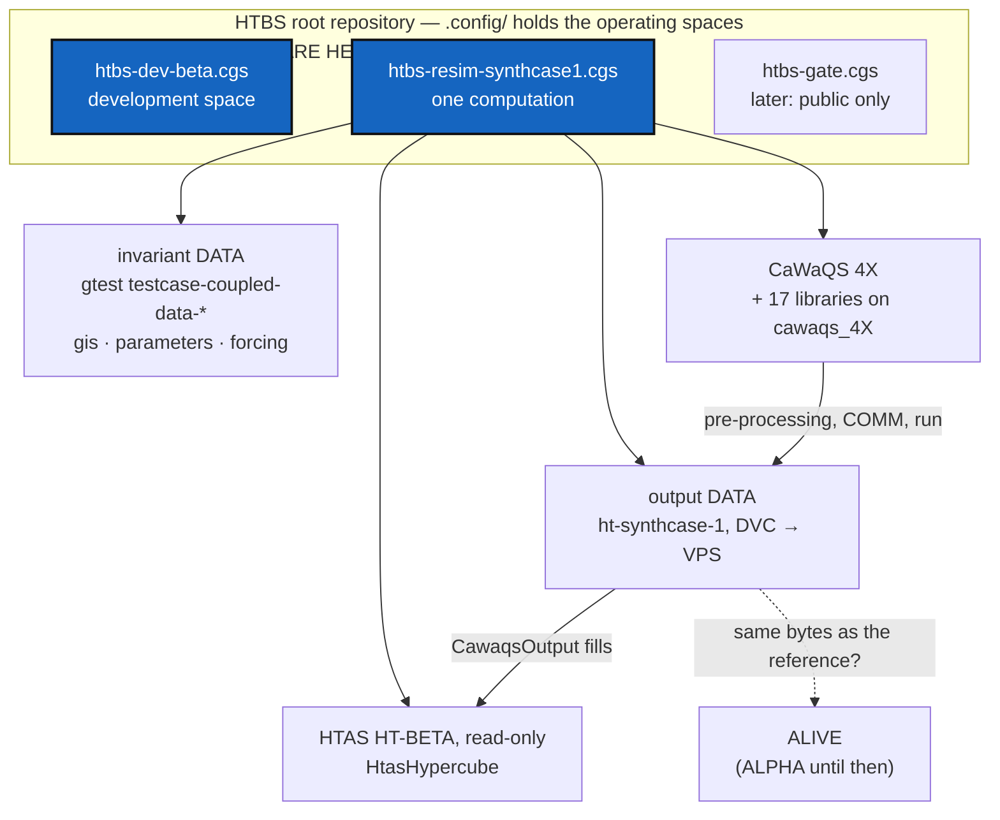
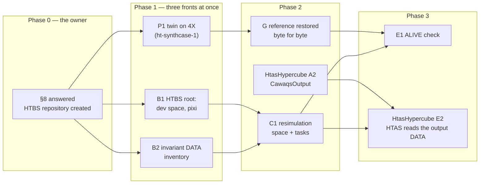

# HtbsFirstSpecs — HydrologicalTwinBetaSeries as operating spaces of order 1

*Created: 2026-11-26*

*Branch: HT-BETA*

> **Split — 2026-11-27, owner's decision.** This ticket held both the HTAS
> work and the HTBS work. The HTAS part (the hypercube classes, steps A1 to
> A3 and E2, decisions D2, D6, D9 to D13) is now HydrologicalTwinAlphaSeries's
> planning ticket `HtasHypercube`. This one keeps what is HTBS's own. It is
> filed in HTAS's `DevTickets/dependency/HTBS/`, to be moved into HTBS's own
> `DevTickets/` once its development space is installed (§7.1, step 5).
> Decision numbers are kept from the joint ticket, so references to them stay
> true.

## Abstract — read this first

**The one-line version.** Build HydrologicalTwinBetaSeries (HTBS): a root
repository whose `.config/` holds flat operating spaces (OSp of order 1, as
MOLONARI1D's CGS-MOLO does). They couple HTAS, CaWaQS 4X, the invariant DATA
of a twin and its output DATA. HTBS is ALIVE once one of those spaces
resimulates `ht-synthcase-1`'s reference output bit for bit.

**What this document is.** The request (§1); what the repositories named in
it actually hold today (§2); the GitTrees and GitRepos (§3); how pixi
drives them (§4); how privacy and the developer spaces are kept apart (§5);
what HTBS needs from HTAS (§6); the steps, their order and what runs in
parallel (§7); the decisions for the owner (§8); acceptance (§9).

**Why it exists.** The owner wants HTBS to produce the forward model's
output itself, from invariant data. Every piece needed already exists
somewhere: CaWaQS 4X has a cgitsync install, ht-synthcase-1 has a first run
on DVC, and MOLONARI1D has an order-1 layout with a bit-for-bit experiment.
This ticket says how they fit together, and in what order.

**Who it is for.** The owner, who answers §8, and the agents that implement
the steps of §7 in HTBS and in ht-synthcase-1.

**What you need to do with it.** D1, D3 and D8 are answered, and the
repository exists (§7.1). Answer D4, D5 and D7, then install the
development space (§7.1, step 3).

---

## 1. The request

The owner, 2026-11-26, short ticket `htbs` (closed as
`archive/.closedUserTicket/20261126_htbs.md`), and the correction made the
same day: **CaWaQS's branch is `4X`**, not HT-BETA.

- **HTAS is centred on its hypercube**, not on the `.bin` files CaWaQS
  writes, because those depend on the forward model. State variables and
  hypercubes are explicit classes, and HTAS protects them.
- **HTBS builds on HTAS** and takes forward-model outputs as input: a data
  type of the forward model, whose method fills the hypercubes.
- **HTBS adds invariant DATA**: the boundary conditions and parameters a
  pipeline needs, in CaWaQS formats. Neumann conditions are flux forcings:
  rainfall, ETP, upstream discharge for river reaches at the frontier, the
  same at aquifer unit (layer) boundaries, and withdrawals in river and
  aquifer units. Dirichlet and Cauchy conditions sit at the frontiers, or on
  river cells for aquifer units alone. The parameters are CaWaQS's.
- **A pipeline** holds the forward model's Git hash (SemVer). It
  pre-processes the input data and the CMD file, runs the compiled forward
  model and produces output DATA. That output is, for now, what HTAS reads.
  For HTBS it is a forward-model output DATA repository.
- **HTBS is a cgitsync project** coupling operating spaces: HTAS, the
  pipeline, and the invariant DATA. Its first use resimulates bit for bit
  the forward-model output HTAS takes as input. Once that is proven, HTBS is
  **ALIVE**; until then it is **ALPHA**.
- **Repositories:** ComplexGitSync HT-BETA, HTAS HT-BETA,
  `gitlab.com:cawaqs/cawaqs` **4X**. The first twin is
  `gitlab.com:htas1/ht-synthcase-1`, built on `cawaqs/gtest/testcases`.
- **Structure:** operating spaces of order 1, after
  `github.com:flipoyo/MOLONARI1D`, branch CGS-MOLO.
- **Later:** CaWaQS-ViZ (`gitlab.com:cawaqs/gviz/cawaqsviz`) served by HTAS
  deployed on a GATE, a server the client cannot reach directly.

## 2. What the named repositories hold today

Read on 2026-11-26, at the tips named.

**MOLONARI1D, CGS-MOLO (`15b6256`, MOLONARI-1.0.11).**

- `.config/` holds one flat `.cgs` per purpose: `molonari.cgs` (the full
  space), `molonari-vps.cgs` (the server: public repositories only), and
  until 1.0.11 `simu-direct.cgs` and `install-orx.cgs`.
- Every entry is a leaf of the root, none is grafted from another `.cgs`, so
  an OSp of order 1 is one root with leaves, no nested Parent.
- The root `pixi.toml` "needs no other repository". It carries only
  cgitsync (a PyPI Git dependency, pinned by `pixi.lock`), a front end
  (`pixi run molo load|update|status <cgs>` → `bootstrap|pull|status`) and
  its own version tasks. The tasks of the mounted repositories "belong to
  the Operating Space, not to this file".
- `scripts/simu_direct.sh` is the bit-for-bit experiment HTBS needs:
  - one space serves one computation;
  - it refuses dirty repositories, and commits that differ from the
    machines already exported;
  - it builds, runs the twin and exports to a SIMU repository, under
    `forward/<case>/<machine>/`, with `commits.json` and
    `cgitsync env show`;
  - it compares with the other machines' exports, and its exit codes are
    0 identical, 1 different, 2 refused.

**CaWaQS 4X (`137a79e`, cawaqs-4.3.1).**

- `.config/cawaqs.cgs` is the user install: the root on `4X` and the 17
  libraries plus `gutil/scripts` under `src/`, on `cawaqs_4X`.
  `.config/cawaqs-dev-4X.cgs` adds the agentic mounts, as
  `htas-dev-beta.cgs` does.
- The root holds no `.cgs`, only `.config/`, so a tree that mounts cawaqs
  with `nested_config = "auto"` gets the root alone, without its libraries.
- `pixi.toml` has four layers:
  - `default`: the toolchain, pinned at gcc and gfortran 13, because 15+
    fails in C23; with `install` and `build` (`make_Cawaqs_fromCGS.sh gcc`);
  - `cgs`: `pixi run -e cgs cgitsync`, on the nested clone;
  - `dev`: a standalone cgitsync from HT-BETA;
  - `agentic`: the private version tasks.

**ht-synthcase-1, branch `twin-launch` (`ec16bd0`).** `main` holds only a
README.

- `.config/ht-testcase-coupled-hydro.cgs` is installed in nested mode, with
  ComplexGitSync cloned by hand and not declared (`BUGS.md` #2). The tree:

  | Path | Repository |
  |---|---|
  | root, with `data = { backend = "dvc" }` | ht-synthcase-1 |
  | `data/gis`, `data/parameters`, `data/forcing` | `cawaqs/gtest/testcase-coupled-data-{gis,parameters,forcing}`, private |
  | `computo/cawaqs` | cawaqs on **C365**, `nested_config = "auto"` |
  | `postProc` | HTAS HT-BETA, private, `nested_config = "auto"` |
  | `.cgitsync/.memory` | `mazzarelli12/memory-twin-synthcase` |

- `HYDRO_COUPLED.COMM` is a C365 adaptation of a 4.x COMM file, with
  `inputs_C365/` copies made by a converter. It writes every output
  `FORMATTED`.
- `results/coupled_hydro.dvc` points to 19 files (22 MB) on the VPS
  remote, configured by hand in `.dvc/config`.
- The report `20261125_Report_TwinLaunch.md` has steps A to E done. Step G
  (restore elsewhere, compare `sha256sum` per file) is open; it is the
  first half of the ALIVE check.

**What that means for this plan.**

| Finding | Consequence |
|---|---|
| The case runs CaWaQS C365; the owner names 4X | Move the case to 4X and use the original 4.x COMM, which drops the C365 converter (step P1) |
| cawaqs is mounted with `auto`, and its root has no `.cgs` | On 4X, mount it with `nested_config = ".config/cawaqs.cgs"`, or list the libraries flat (D3) |
| HTAS is mounted with `auto`, and its root holds `htas-beta.cgs` | That file is grafted: ComplexGitSync, `hydrological_twin` and `github:flipoyo/.memory` come into the twin under `postProc/`. Mount HTAS with `nested_config = "disabled"` |
| `ht-testcase-libaq-hydro.cgs` and `-surf-hydro.cgs` say `nested_config = "activated"` | Not a valid value (`auto`, `disabled` or a `.cgs` path): both fail `cgitsync validate` |
| The outputs are `FORMATTED`; HTAS reads only unformatted `.bin` | Either the COMM writes the outputs HTAS reads unformatted, or `CawaqsOutput` reads both (D6) |
| `testcase-coupled-data-parameters` and `testcase-libaq-hydro` need credentials | Part of the invariant DATA is private: any space that mounts it is a DEV tree (§5) |
| In ComplexGitSync 8.14.2, `DataManager` registers no backend: `dvc` answers UNSUPPORTED, and `data.service` waits for DataArchitecture C2 | DVC runs by hand for now, and the `.cgs` cannot name the VPS (dependency, §7) |
| The report writes HTAS's branch `HT_BETA` | It is `HT-BETA` |
| HTAS today: `Temporal.readSimDataFromBin`, `Compartment.out_caw_path`, the `.npy` cache of `_ensure_disk_cache` | No class names a state variable or a hypercube (§6) |

## 3. The GitTrees and the GitRepos

**Does HTBS need its own repository? Yes.** An operating space is
materialised from a `.cgs`, and the `.cgs`, the pipeline scripts, the
`pixi.toml` that installs cgitsync and the HTBS classes need a root
repository of their own. ht-synthcase-1 cannot be that root: it is one
twin, and its results move with every run. HTAS cannot be either: it is the
Alpha series, and the Beta series is "not in this repository" (`CLAUDE.md`).

**The GitRepos.**

| Repository | Branch in HTBS spaces | Role | Write from HTBS |
|---|---|---|---|
| HTBS root (new, D1) | HT-BETA | `.config/*.cgs`, `pixi.toml`, pipeline, invariant-DATA and pipeline classes | yes |
| `flipoyo/HydrologicalTwinAlphaSeries` | HT-BETA, pinned | hypercube, `CawaqsOutput` (D2), post-processing | no |
| `cawaqs/cawaqs` + 17 libraries + `gutil/scripts` | `4X`; libraries `cawaqs_4X` | the forward model, built by its own pixi | no |
| `cawaqs/gtest/testcase-coupled-data-gis`, `-parameters`, `-forcing` | main | invariant DATA of the first twin (`parameters` private) | no |
| `htas1/ht-synthcase-1` | `twin-launch`, then D4 | reference output (DVC pointers), the case's COMM | the resimulation's exports only (D5) |
| `.memory` of each space | derived | the ledger | yes |
| `.dev`, `.localSpec`, `.claude` | `HydrologicalTwinBetaSeries_HT-BETA`, derived | HTBS's tickets and specs | yes |
| `.ticketing`, `DevSpec`, `DocSpec` | main | shared rules | no |
| `flipoyo/ComplexGitSync` | HT-BETA, through pixi | the tool | no |

**The GitTrees.** Each is a flat `.cgs` in a root's `.config/`.

| Tree | Where its `.cgs` lives | Holds | Profile |
|---|---|---|---|
| HTAS development | HTAS `.config/htas-dev-beta.cgs` (exists) | HTAS, its docs, the agentic mounts | DEV |
| CaWaQS development and install | cawaqs `.config/cawaqs-dev-4X.cgs`, `cawaqs.cgs` (exist) | cawaqs, the libraries; plus the agentic mounts for development | DEV / USER |
| The first twin | ht-synthcase-1 `.config/ht-testcase-coupled-hydro.cgs` (exists, C365) | the case, its inputs, cawaqs, HTAS | DEV |
| HTBS development | HTBS `.config/htbs-dev-beta.cgs` (new) | the HTBS root, the agentic mounts, ComplexGitSync | DEV |
| HTBS resimulation | HTBS `.config/htbs-resim-synthcase1.cgs` (new) | the HTBS root, cawaqs 4X and its libraries, the invariant DATA, HTAS read-only, the output DATA | DEV, because one input is private |
| HTBS gate (later) | HTBS `.config/htbs-gate.cgs` | HTAS and the output DATA, nothing private, as `molonari-vps.cgs` | USER |

None of these trees nests another one's `.cgs`. Each repository from
another project is mounted `private = true` with `nested_config =
"disabled"`, except CaWaQS, whose libraries come from a named `.cgs` or are
listed (D3). This is what "order 1" buys: the tree is exactly the `.cgs`
you read. It also keeps clear of the mount guard, under which a repository
can be held only once, on one branch. Grafting `htas-dev-beta.cgs` into an
HTBS tree would mount `.ticketing`, `DevSpec` and `DocSpec` twice on `main`,
and the deeper copies would be refused.

**The file names.** `htbs-dev-beta.cgs` and `htbs-resim-synthcase1.cgs` are
not level files. cgitsync reads `<project>-<xxx>.cgs` as branch `xxx` only
when `xxx` has three characters (`tree/named_cgs.py`), so `opx`, `dev`,
`usr` and `pub` are reserved for the PoE levels (§5) and must not be used
by accident.

## 4. How pixi makes it happen

The pattern is CaWaQS 4X's and MOLONARI1D's, reused.

- **Each repository's `pixi.toml` stands alone**: HTAS's builds and tests
  HTAS, and cawaqs's pins gcc 13 and builds CaWaQS. None names another
  repository.
- **The HTBS root's `pixi.toml` drives the space.** Its layers:
  - `default`: the HTBS classes and their tests;
  - `dev`: cgitsync from ComplexGitSync HT-BETA, pinned by `pixi.lock`,
    as HTAS has it since 1.2.4;
  - `agentic`: the version tasks;
  - a front-end task in the style of `molo`: `pixi run htbs load <space>`,
    `update`, `status`, mapped to `cgitsync bootstrap`, `pull`, `status`.
- **The pipeline is a chain of pixi tasks** run from the HTBS root.
  `pixi run -m <path>` runs a mounted repository's own manifest, as cawaqs's
  `cgs` task does with `-m ComplexGitSync`:
  1. `check`: clean repositories, the commits of the reference run
     (`commits.json`), `cgitsync env check`;
  2. `preprocess`: the invariant DATA to CaWaQS input folders and a COMM
     file;
  3. `build`: `pixi run -m computo/cawaqs build`;
  4. `run`: the compiled CaWaQS on that COMM;
  5. `export`: the outputs, `commits.json` and `cgitsync env show` into the
     output DATA;
  6. `compare`: against the reference, with exit codes 0 identical,
     1 different, 2 refused (D7);
  7. `postproc`: `pixi run -m postProc htas ...` on the output DATA.
- **Bit for bit rests on pixi.** The lock files pin the compiler and the
  Python stack. cgitsync records their digests (`pixi.toml`, `pixi.lock`)
  and the tool versions in each State's environment, and
  `environment = { tools = ... }` makes a space refuse a machine below the
  minimum.

## 5. Privacy, and the developer spaces of HT-BETA

What ComplexGitSync does, and what HTBS takes from it.

- **The profile is read off the tree.** A tree that holds any `private`
  repository is DEV; one that holds none is USER. Only a DEV tree may close
  branches or sync its memory to a remote. The PoE levels expose, of
  {NAME, NODE, EDGE, OP}: OPX nothing, DEV the NAME, USR the NAME and the
  NODE, PUB all four (`orchestre/op_levels.py`). A USER install is
  `initialise install.cgs`, a DEV one `bootstrap <project>-dev.cgs`.
- **Every developer space has its own branch in the shared agentic
  repositories.** `.dev`, `.localSpec` and `.claude` are the same three
  GitHub repositories for every project. cgitsync files each project's
  content on `<Project>_<branch>`, never typed
  (`git_branch.private_local_branch`):
  - HTAS's tickets are on `HydrologicalTwinAlphaSeries_HT-BETA`, CaWaQS's on
    `cawaqs_4X`;
  - HTBS's will be on `HydrologicalTwinBetaSeries_HT-BETA`, seeded once
    from `ComplexGitSync_HT-BETA` (D8);
  - a ticket written in one space is never visible from another, unless
    someone checks out that branch.
- **The project's own non-private repositories** also go on
  `<Project>_<branch>`, except the root (RootBareBranch, cgitsync ≥ 8.11.1).
  That is why HTAS's `docs/hydrological_twin` is on
  `HydrologicalTwinAlphaSeries_HT-BETA`, and the CaWaQS libraries on
  `cawaqs_4X`.
- **A space never writes into another project.** HTAS, CaWaQS and the
  invariant DATA are mounted `private = true` without `writable`: they are
  read-only, pinned by `release freeze`, and never committed, pushed or
  tagged from HTBS. A repository nested under a private one inherits its
  privacy, and its writability is capped by it (`propagate_privacy`).
  Work on HTAS's tickets is done in HTAS's own development space, then
  reaches HTBS when HTBS moves its pin.
- **Private data stays in DEV trees.** `testcase-coupled-data-parameters` is
  private on GitLab, so the resimulation space is DEV, and a user who lacks
  access cannot install it. The gate space holds nothing private: what the
  client sees is what HTAS serves from the hypercube, not the repositories
  behind it.
- **Secrets never enter a `.cgs`.** DVC's user and password stay in
  `.dvc/config.local`, as in the twin today. cgitsync scrubs secrets from
  data results and from its run log.

## 6. What HTBS needs from HTAS

HTAS's planning ticket `HtasHypercube` holds that work. HTBS relies on it
at two points only:

- **The forward-model output contract** (HtasHypercube A2, D2): the class
  that knows a model's output files and fills HTAS's hypercubes.
  `CawaqsOutput` is the proof of concept. Where it lives (HTAS or HTBS) and
  whether it reads `FORMATTED` output (D6) decide what P1 writes in the COMM
  file and what C1's `postproc` task calls.
- **HTAS reading the output DATA** (HtasHypercube E2): the `postproc` task of
  C1 runs HTAS on the resimulation's output. Until E2, `postproc` runs HTAS's
  current `.bin` readers.

Neither blocks the ALIVE check (E1), which compares the forward model's
output and never goes through HTAS.

## 7. The steps, their order, and what runs in parallel

| Step | Repository and space | What | Depends on | Runs alongside |
|---|---|---|---|---|
| **P0** | — | Answer §8; create the HTBS repository (D1) and its HT-BETA branch | — | — |
| **P1** | ht-synthcase-1, its maintainer | Move the twin to cawaqs 4X with the 4.x COMM, and drop `inputs_C365`. Mount cawaqs with `.config/cawaqs.cgs` (D3), HTAS with `disabled`. Fix `activated`. Set the output format (D6). One new reference run | D3, D6 | B1, B2 |
| **B1** | HTBS, `htbs-dev-beta.cgs` | The root repository: README, `pixi.toml` (`default`, `dev`, `agentic`, front end), `.config/htbs-dev-beta.cgs` with the agentic mounts on `HydrologicalTwinBetaSeries_HT-BETA` (D8), its own memory; then `branch create --private`, `checkout`, `self-history adopt`, `push` | P0 | P1, B2 |
| **B2** | HTBS | Inventory of the invariant DATA from the three gtest repositories and the COMM: each Neumann forcing, each Dirichlet and Cauchy condition (`AQ_param_BOUND.txt` and the river cells), each parameter file, as one table. Then the class that reads them | P0 | P1, A2 |
| **G** | ht-synthcase-1 | Report step G: restore the reference elsewhere, compare `sha256sum` per file. It proves the reference is stable before HTBS compares against it | P1 | A2, C1 |
| **A2** | HTAS: HtasHypercube | The forward-model output contract and `CawaqsOutput` (HtasHypercube D2, D6) | — | B2, G, C1 |
| **C1** | HTBS, `htbs-resim-synthcase1.cgs` | The resimulation space (§3) and the tasks of §4, in the style of `simu_direct.sh` | B1, B2 | A2, G |
| **E1** | HTBS | The ALIVE check: the resimulated output equals the reference (D7). Pass: HTBS ALIVE; fail: ALPHA, with the reason in the export | G, C1 | E2 |
| **E2** | HTAS: HtasHypercube | HTAS reads the output DATA of C1 through `CawaqsOutput`, in the `postproc` task | A2, C1 | E1 |
| later | HTBS, `htbs-gate.cgs` | The gate space and CaWaQS-ViZ | E1, E2 | — |

### 7.1 B1 so far: the HTBS folder, and what comes before its registration (2026-11-27)

The owner's answers: D8 `ComplexGitSync_HT-BETA` (2026-11-27); D1 `github:flipoyo/HydrologicalTwinBetaSeries`,
branch HT-BETA; D3 CaWaQS mounted private and distant (read-only) with
`nested_config = ".config/cawaqs.cgs"`. The owner prefers nesting to a pixi
dependency, because it depends less on pixi and keeps the tree portable to
other tools.

Done, not yet a Git repository: `/home/nflipo/.cgs/htbs/HydrologicalTwinBetaSeries`.

- `.config/htbs.cgs`: the HTBS root, `htas` (HT-BETA, read-only,
  `nested_config = "disabled"`), `cawaqs` (4X, read-only, its libraries from
  `.config/cawaqs.cgs`) and `.cgitsync/.memory`.
- `.config/htbs-dev-beta.cgs`: the same, plus ComplexGitSync (HT-BETA,
  read-only), `.omniscience`, and the `.agent/.distant` and `.agent/.local`
  mounts.
- `pixi.toml` (0.1.0, a `dev` layer with cgitsync from HT-BETA, pinned by
  `pixi.lock`), `pyproject.toml`, `README.md`, `LICENSE.md` (EPL-2.0),
  `.gitignore`, `src/HydrologicalTwinBetaSeries/__init__.py`, and
  `tests/unit/test_version.py`.
- `pixi run test` and `pixi run lint` pass, and `cgitsync validate` accepts
  both `.cgs` files with no warning.

To do, in this order:

1. ~~Answer D8~~ (owner, 2026-11-27): the three `.agent/.local` mounts of
   `htbs-dev-beta.cgs` fall back to `ComplexGitSync_HT-BETA`, which exists in
   `.dev`, `.localSpec` and `.claude`.
2. ~~Create the repository~~ (2026-11-27): `github:flipoyo/HydrologicalTwinBetaSeries`,
   public. First commit `03d5517` (`HydrologicalTwinBetaSeries-0.1.0`)
   on `main`, which is protected against force pushes and deletion, admins
   included, with no pull request required. `HT-BETA` was created from it,
   and both are pushed. The remote is SSH (`git@github.com:...`), because
   git has no HTTPS credential helper on this machine.
3. **Install the development space** with the sequence in
   `htbs-dev-beta.cgs`'s header: `bootstrap`, then `branch create HT-BETA
   --private`, `checkout HT-BETA`, `self-history adopt` and
   `push --private`. Then adapt `CLAUDE.md`, `AGENT.md` and `DevTickets/` on
   the new `HydrologicalTwinBetaSeries_HT-BETA` branch.
4. **Check the CaWaQS libraries' branch** at that first install:
   `cgitsync status` must show the 17 libraries and `scripts` under
   `cawaqs/src/` on `cawaqs_4X`. `validate` cannot show it: ComplexGitSync
   leaves a private read-only mount on the branch its own `.cgs` declares
   (`declare_targets`), and only a clone settles it. If they land on `main`,
   that is a ComplexGitSync dependency ticket, next to
   `nested-config-dotconfig`.
5. **Move this plan** to HTBS's own `DevTickets/` once the development space
   is installed (owner, 2026-11-27: it goes there first). HTAS keeps
   HtasHypercube.

**Dependencies outside this project.** None blocks phase 1. The
ComplexGitSync ones are filed as short tickets in `dependency/CGS/`
(2026-11-26), for the owner to transfer:

| Project | What |
|---|---|
| ComplexGitSync | `dvc-backend-registration`: `dvc` answers UNSUPPORTED, so DVC runs by hand around cgitsync (G, C1, E1). `data-service-remote`: `data.service` waits for DataArchitecture C2, so a `.cgs` cannot name the VPS (G, C1, gate). `initialise-running-tool`: `initialise` deletes a declared ComplexGitSync clone it runs from, so nested trees leave the tool out of their States (P1, C1). `nested-config-dotconfig`: `auto` reads only a root `*.cgs`, and silently mounts a 4X cawaqs without its libraries (D3, P1, C1). `environment-declaration-docs`: the environment keys are undocumented |
| ht-synthcase-1 | P1 and G |
| CaWaQS | None found; 4X already has its cgitsync install |

## 8. Decisions for the owner

The HTAS decisions D2, D6 and D9 to D13 are in HtasHypercube. D6 (the output
format) matters here too, for P1.

- **D1. The HTBS repository.** **Answered (owner, 2026-11-27):**
  `github:flipoyo/HydrologicalTwinBetaSeries`, public, HT-BETA (§7.1).
- **D3. How a space mounts CaWaQS's libraries.** (a) `nested_config =
  ".config/cawaqs.cgs"` on the cawaqs entry: one line, CaWaQS stays the
  authority on its libraries, and the tree is of order 2 for that branch.
  (b) The 17 libraries and `scripts` listed flat in each HTBS `.cgs`: strict
  order 1, but a copy to keep in step with cawaqs.
  **Answered (owner, 2026-11-27): (a), cawaqs private and distant.** Nesting
  depends less on pixi than a pixi dependency would, which keeps the tree
  portable to other tools.
- **D4. ht-synthcase-1's line.** Keep `twin-launch` as the reference, or open
  a `4X` branch for the move to 4X.
- **D5. Where a resimulation's exports go.** (a) A branch of ht-synthcase-1,
  one per run, as the report's step H. (b) A SIMU-style repository with one
  folder per machine, as MOLONARI's.
- **D7. "Bit for bit".** (a) The output files' bytes are equal, `sha256sum`
  per file. (b) The decoded values are equal. Either way, on the same
  compiler and platform, as cgitsync records them.
- **D8. HTBS's agentic branch.** **Answered (owner, 2026-11-27):** seeded
  from `ComplexGitSync_HT-BETA`.

## 9. Acceptance

- The HTBS repository exists with `htbs-dev-beta.cgs` and
  `htbs-resim-synthcase1.cgs`. Both pass `cgitsync validate` and install
  with `errors=0`; neither nests another project's `.cgs` except as D3
  says.
- HTBS's tickets are on `HydrologicalTwinBetaSeries_HT-BETA` in `.dev`, and
  no HTBS space writes into HTAS, CaWaQS or the invariant DATA.
- ht-synthcase-1 runs on cawaqs 4X, and its reference restores byte for
  byte (G).
- The resimulation's `compare` task exits 0 against that reference: HTBS is
  ALIVE. Or it exits 1, and HTBS stays ALPHA with the differing files named.
- For each HTBS change: `pixi run lint` and `pixi run test` pass in the HTBS
  root, and `cgitsync status` shows `errors=0`.
