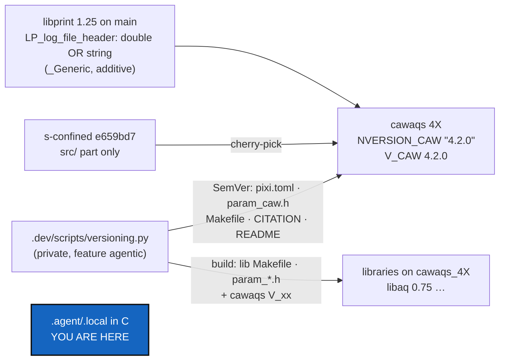

# BuildSemVerAgenticC — CaWaQS's one SemVer into the C code, its libraries' build numbers, a private versioning tool, and an Operating Space speaking C

*Created: 2026-11-22*

*Branch: 4X*

*Revised: 2026-11-24, on the SemVer of `src/param_caw.h` on branch `s-confined`*

> **Owner's decisions, 2026-11-24** (in conversation). They replace the
> two-number model of 2026-11-22.
> - **One SemVer for CaWaQS**, as Nicolas Gallois's `s-confined` commit
>   `e659bd7` puts it in C: `#define NVERSION_CAW "x.y.z"`, `V_CAW`, and
>   every print in `%s`. `pixi.toml` stays the reference.
> - **Only what versioning needs is taken from `s-confined`**: the `src/`
>   part of `e659bd7`. Nothing else comes in: not its README edits, not the
>   CONFINED/binary-source features, not `libaq` 0.75 or `libio` 0.26.
> - **`libprint` changes additively.** It keeps the build-number header used
>   across the ecosystem and adds the SemVer one beside it, under the same
>   name, so that it can go to `main`. `s-confined`'s `libprint` commit
>   `946195c`, which changes the signature, is not taken.
> - **The libraries keep their build numbers** (`MAJOR.XX`, e.g. libaq
>   0.75).
> - **Versioning is a developer feature, not a user one.** It lives in the
>   private Operating Space as `.agent/.local/.dev/scripts/versioning.py`,
>   not in the public cawaqs repository. A user install cannot bump.
> - **Nicolas Gallois is told what to do on `s-confined`.** The owner sends
>   the message.

> **Owner's decisions, 2026-11-22**, carried over from
> [CGSCaWaQS4X](../archive/20261122_CGSCaWaQS4X_DevPlanTicket.md). Each one
> is marked with its status on 2026-11-24.
> - ~~CaWaQS has two numbers, a build `MAJOR.XX` and a SemVer.~~
>   **Superseded:** one SemVer.
> - ~~Every `bump-build` forces a `bump-version patch`.~~ ~~The build rolls
>   over `4.99 → 5.01`, and `bump-build --major`.~~ **Superseded:** CaWaQS
>   has no build to bump. A library's build is bumped by `versioning.py`
>   (§3.3).
> - Every user-facing copy (`CITATION.cff`, the README `Current_version`
>   badge) follows the SemVer. *Kept.*
> - The agentic content seeded from ComplexGitSync is adapted to C, as for
>   HTAS. *Kept.*
> - No C standard is fixed yet, and this ticket decides it (D1). *Kept.*
> - AlphaSeries Digital Twin: one branch line, no level branch, no
>   blocking gate. Checks run locally through pixi. *Kept.*
> - cawaqs is a dependency of HTAS, never the reverse. *Kept.*
> - `pixi.toml` has three layers: default (the C product), `cgs` and
>   `agentic`. The tasks that need the private `.dev` mount (`bump-version`)
>   go in `[feature.agentic]`. *Kept, and restored:* cawaqs 4.1.1 had put a
>   public `scripts/bump_version.py` in `[feature.dev]`. This ticket moves it
>   back into the private `.dev`.

## Abstract — read this first

**The one-line version.**
- `libprint` 1.25 gains a SemVer log header beside the build one, and goes
  to `main`.
- cawaqs takes the `src/` part of `e659bd7`, so that `NVERSION_CAW` and
  `V_CAW` carry the SemVer of `pixi.toml`.
- A private `versioning.py` moves that SemVer everywhere it is copied, and
  moves the libraries' build numbers.
- Then the seeded agentic files of `.agent/.local/` are rewritten to speak
  C.

**What this document is.**
- §1: what exists on 4X and on `s-confined`;
- §2: what is taken from `s-confined`, and why `param_caw.h` alone is not
  enough;
- §3: the work;
- §4: the decisions still open;
- §5: acceptance.

**Why it exists.**
- Two version models are about to meet. 4X has the SemVer `4.1.3` in
  `pixi.toml` and the build `4.01` in C. `s-confined` has `"4.1.0"` in C.
  Until one model holds, every merge between them conflicts on the version.
- `libprint` is shared by the whole ecosystem. A signature change there
  would break every program that passes a build number to the log header.
- Bumping is a developer act. It sits today in cawaqs's public `scripts/`.
- The Operating Space still carries ComplexGitSync's Python rules.

**Who it is for.**
- The owner, who answers §4 and sends the message to Nicolas Gallois.
- The worker and orchestrator, who implement §3.

**What you need to do with it.** Pile 1, rank 2. Answer §4, then implement
§3.1 → §3.4 in that order.



---

## 1. What exists on 2026-11-24

**On 4X** (cawaqs 4.1.3):
- `pixi.toml` `version = "4.1.3"`.
  - The public `scripts/bump_version.py` (from MOLONARI1D) runs as
    `pixi run -e dev bump-version` / `check-version`.
  - Its mirrors are `pixi.toml` and the README sentence "the SemVer in
    `pixi.toml` (`…`)". Nothing in `src/`, and neither `CITATION.cff` nor
    the badges.
  - Its suggested commit subject uses the directory name (line 179).
- The build `4.01`:
  - `src/Makefile` `V_CAW=4.01` names the binary;
  - `src/param_caw.h` has `NVERSION_CAW 4.01` (a float) and an unused
    `#define NVERSION`;
  - 111 prints use `%4.2f`;
  - `LP_log_file_header` takes a `double` (`libprint` 1.24 on `cawaqs_4X`
    = `main`).
- `CITATION.cff` `version: '4.01'`. The README badges say `4.01`.
  `pixi.toml:7-9` describes the build. `main_cawaqs.c:8` says
  `VERSION ID : 3.x`. `make version` calls a missing `update_version.sh`.
- Each library holds its build in its own `Makefile` (`V_AQ=0.74`, …) and
  `param_*.h` (`VERSION_AQ 0.74`, …). cawaqs's `src/Makefile` repeats every
  one (`V_AQ=0.74` → `-laq0.74_gcc`). A library bump that forgets cawaqs's
  copy breaks the link.
  - The libraries' own Makefiles also repeat their dependencies' versions.
    They use them only to link their standalone programs, not for their
    `lib` target.
  - `V_LP` is written in 17 Makefiles: cawaqs and 16 libraries. 16 say
    1.24. `libwet/src/Makefile` already says 1.22, a copy that drifted.
- `cgitsync version diagnose` (8.11.1):
  - it reports the 18 libraries as *not versioned* (no `pixi.toml`);
  - it reports cawaqs as *task needed*: it reads only the top-level
    `[tasks]`, and `bump-version` sits in `[feature.dev.tasks]`.
- The Operating Space is bootstrapped on `cawaqs_4X`, unadapted.

**On `s-confined`** (Nicolas Gallois; cawaqs 6 commits ahead of their
common ancestor `943eeac`, 7 behind 4X):

| Commit | What it carries | Taken here |
|---|---|---|
| `e199b39`, `39e0d9a` | Porosity/S switch and S modulation in CONFINED mode; needs `libaq` 0.75 | no |
| **`e659bd7`** | **SemVer in C.** In `src/`: `param_caw.h`, `Makefile` `V_CAW`/`V_LP`, 120 changed print lines in 17 `.c`/`.y`/`.l` files, all version-related except one "Done" → "Done." and four deleted Makefile comments. Outside `src/`: README badges and "3.x" wording | **`src/` only** |
| `b6e14e3`, `c1b44a9`, `9df6bbb` | Reversible S modulation, binary source inputs; needs `libaq` 0.75, `libio` 0.26 | no |
| `libprint` `946195c` | libprint 1.25: `LP_log_file_header`/`LP_file_header` take a `char *` instead of a `double` | **no** (§3.1 replaces it) |

**Who calls the log headers**, across every tree under `~/.cgs`:
- `main_cawaqs.c` (a string on `s-confined`);
- `libhyd/src/main_HYDRO.c` (`NVERSION_HYCU`);
- `libmesh/src/test_MSH.c` (`VERSION_MSH`);
- `libaq/src/test_AQ.c` (`VERSION_AQ`), which `libaq` 0.75 deletes.

The last three are standalone programs that pass a `double`. Programs of
the ecosystem that are not on this machine may call it too.
`LP_file_header` has no caller.

## 2. What is taken from `s-confined`, and why `param_caw.h` alone is not enough

**`param_caw.h` alone does not work.** `NVERSION_CAW "x.y.z"` would hand a
`char *`:
- to 111 `%4.2f` conversions, which is undefined behaviour. `LP_printf` and
  `LP_error` carry no `format` attribute, so gcc does not warn;
- to `LP_log_file_header(…, double, …)` in `libprint` 1.24, which does not
  compile.

The minimum is the `src/` part of `e659bd7`, together with a `libprint`
whose log header accepts a string.

**Tested on 2026-11-24**, in a scratch worktree:
1. `origin/4X`, then `git cherry-pick -n e659bd7`;
2. `libprint` 1.25;
3. `make_Cawaqs_fromCGS.sh gcc` with the pixi toolchain.

What it showed:
- Only the two version lines conflict, in `param_caw.h` and in the
  `Makefile` `V_CAW`. Resolved to `"4.1.3"` and `4.1.3`.
- The build passes and gives `src/cawaqs4.1.3`. None of its 27 warnings
  concerns the version.
- A scan of the 111 calls found every `NVERSION_CAW` argument matched by a
  `%s`.

**`V_CAW` must be unquoted.** With `V_CAW="4.1.0"`, make takes the quotes
into the target `cawaqs"4.1.0"`, a file that never exists. The binary is
then relinked on every build (`make -q` returns 1). `V_CAW=4.1.3` is up to
date after a build (`make -q` returns 0).

**The additive `libprint` was tested too** (gcc 13, `-Wall -Wextra`, and
`-std=gnu89`). Under one name, `LP_log_file_header`:
- the string `"4.1.3"` prints `# CaWaQS 4.1.3 -- Log file`;
- the doubles `0.75` and `0.47` print `# libaq 0.75 -- Log file` and
  `# HyCu 0.47 -- Log file`;
- an object compiled against the old prototype still links.

## 3. The work

### 3.1 `libprint` 1.25, additive, on `main`

On `libprint`, from `main`:
- **`function_lprint.h`**: the two existing prototypes stay as they are.
  Add the string variants, and one dispatching macro per name:

  ```c
  void LP_log_file_header(FILE *, char *, double, char *, char *);
  void LP_log_file_header_semver(FILE *, char *, const char *, char *, char *);
  #define LP_log_file_header(fp, prog, v, date, cmd) _Generic((v), \
      char *: LP_log_file_header_semver, const char *: LP_log_file_header_semver, \
      default: LP_log_file_header)(fp, prog, v, date, cmd)
  ```

  `LP_file_header` gets the same treatment. A function-like macro does not
  expand its own name, so the `default:` branch reaches the real function.
- **`usual_functions.c`**: define the originals as
  `void (LP_log_file_header)(…)` and `void (LP_file_header)(…)`. The
  parentheses stop the macro from expanding. Add the two `_semver`
  functions, printing `%s`.
- **`param_lprint.h` and `src/Makefile`**: 1.24 → 1.25. The `V_LP` of the
  16 dependent libraries and of cawaqs moves too, on their `cawaqs_4X`.
  `pixi run bump-lib libprint` does all of it once §3.3 exists, so build
  §3.3's `bump-lib` first, or move the copies by hand.
- Push it to `main`, then fast-forward `cawaqs_4X` to it. Every program
  keeps compiling, so no source in the ecosystem has to change.
  - Caveat: a library's standalone program on `main` links
    `-lprint$(V_LP)`. Until that library's `V_LP` moves to 1.25, it needs
    a `libprint1.24_gcc.a` built from an older checkout.
  - CaWaQS and the libraries' `lib` targets are unaffected.
- `_Generic` is C11, and gcc accepts it in every mode, `-std=gnu89`
  included. This is noted for D1.

### 3.2 cawaqs: the SemVer in C (4X)

1. `git cherry-pick -n e659bd7`, then `git restore --staged --worktree
   README.md`. The README is not taken: its badges are moved by
   `versioning.py` (§3.3), and its "3.x" wording is a separate edit (D11).
   The commit stays credited to its author in the commit message.
2. Resolve the two conflicts:
   - `param_caw.h`: `#define NVERSION_CAW "<pixi.toml version>"`, with
     Nicolas Gallois's comment kept. `NVERSION` is dropped, as the commit
     does.
   - `src/Makefile`: `V_CAW=<version>`, **unquoted**. `V_LP=1.25` comes
     with the commit.
3. Tidy-up:
   - `main_cawaqs.c:8` → `VERSION ID : see pixi.toml`;
   - `make version` → D3;
   - `pixi.toml:7-9` is rewritten for one number;
   - the README row "Produces `src/cawaqs4.x`" → `src/cawaqs<SemVer>`.
4. The first bump after it: **minor**, to `4.2.0`. The log header and the
   binary name change visibly. `4.2.0` also leaves `s-confined`'s "4.1.0"
   behind, so the two lines never give one number to different content.

### 3.3 `versioning.py`, private, in `.dev`

- **Where**: `.agent/.local/.dev/scripts/versioning.py`, branch
  `cawaqs_4X`, with its tests beside it (D4). This is where ComplexGitSync
  keeps its own bump script.
  - `scripts/bump_version.py` and the `[feature.dev.tasks]`
    `bump-version`/`check-version` leave the public cawaqs repository.
  - The `[feature.dev]` environment keeps only what `install.sh` needs (the
    standalone `cgitsync`).
- **How it is run**: a pixi feature `agentic` (`python`), and an
  environment `agentic = ["cgs", "agentic"]`, as decided on 2026-11-22.
  - Its tasks: `bump-version`, `check-version`, `bump-lib`.
  - The task is defined only in that environment, so
    `pixi run bump-version minor` finds it by itself.
  - On a user install the `.dev` mount is absent. The script is not there,
    the task stops with a clear "developer only" message, and nothing is
    written.
- **What it moves**, all files or none. A field found other than exactly
  once stops it with nothing written.
  - `bump-version <patch|minor|major>`, the CaWaQS SemVer:
    - `pixi.toml`;
    - `src/param_caw.h` `NVERSION_CAW`;
    - `src/Makefile` `V_CAW`;
    - `CITATION.cff` `version` and `date-released`;
    - the README `Current_version` badge and the "SemVer in `pixi.toml`"
      sentence;
    - the `Documentation` badge as D7 says.

    It ends on `old -> new`, as `cgitsync version bump` expects. Its
    suggested commit subject takes the name from `pixi.toml`, not from the
    directory.
  - `bump-lib <lib> [--major]`, a library's build:
    - `MAJOR.XX` + 0.01 in the library's `src/Makefile` `V_xx` and
      `src/param_*.h` `VERSION_xx`;
    - **and every copy of `V_xx`** in cawaqs's `src/Makefile`, so that the
      link follows, and in each other library's `src/Makefile`. `libprint`
      alone has 16 dependents.
    - `--major` gives `(MAJOR+1).00`.

    No `pixi.toml` and no agentic file enters a shared library.
  - `check-version`:
    - every SemVer copy agrees with `pixi.toml`;
    - every `V_xx`, in cawaqs and in each library, agrees with that
      library's own `param_*.h` and `Makefile`.

    It reports `libwet`'s `V_LP=1.22` today. The §3.1 bump to 1.25 aligns
    all 17 copies.
- **`cgitsync version bump`** cannot see a `[feature.*.tasks]` task today,
  so it cannot drive cawaqs. A request is filed for ComplexGitSync:
  [HT-BETA-20261124_VersionFeatureTasks](../dependency/CGS/HT-BETA-20261124_VersionFeatureTasks.md).
  Until it lands, run `pixi run bump-version` directly.

### 3.4 The Operating Space in C (CGSCaWaQS4X §3 step 6)

Each file is edited on `cawaqs_4X`, keeping ComplexGitSync's shape and
replacing every Python assumption.

- **`.claude/CLAUDE.md`, `AGENT.md`**:
  - the layout (root, `src/lib*`, `src/scripts`);
  - the `implement <ticket>` orders (AgentConduct §4.1). The worker runs
    `pixi run bump-lib` for a library it changed; the orchestrator runs
    `pixi run bump-version`;
  - the before-committing steps, with C commands: `pixi run build` with no
    new warning, the regression cases, the format check,
    `pixi run check-version`, `cgitsync status`, and the commit message
    `cawaqs-<SemVer>`.
- **`.localSpec/AdditionalSpecs.md`**:
  - what CaWaQS is;
  - the layers: the root over the 17 libraries on `cawaqs_4X`, in the
    `list_all.dat` order;
  - which headers a file may include;
  - the `.COMM` interface (`input.y`, `lexical.l`) and the output files;
  - module shape: the file prefixes, and a size ceiling in C lines (D5);
  - the C dialect (D1);
  - the rule that cawaqs never depends on HTAS;
  - **the version rules**:
    - `NVERSION_CAW` is the SemVer string, printed with `%s`, never `%f`;
    - a library's `VERSION_xx` is its build, printed with `%4.2f`;
    - `LP_log_file_header` takes either.
- **`.localSpec/AgenticManifest.md`, `digest.md`, `audit.md`**:
  - the mounts;
  - the MUST/NEVER rules restated for C;
  - the findings: `make version`, `VERSION ID 3.x`, the destructive
    `make_Cawaqs.sh` used by CI, the commented-out format check, no `-std`
    or warnings, two regression cases.
- **`.dev/cawaqs-dev.md`**:
  - the commands;
  - bootstrapping;
  - the checklist fill-ins;
  - the doc-impact map (README, `CITATION.cff`, the PDF, Doxygen);
  - testing with `gtest/testcases`.

  No pytest and no ruff for the C code.
- **`.dev/Versioning.md`**:
  - one SemVer for CaWaQS and its copies;
  - a build per library, and its copy in cawaqs's `Makefile`;
  - how a branch that predates this (`s-confined`) merges: keep 4X's
    version, and bump by what the merge brings.
- **Python-only DevSpecs rules**: `AdditionalSpecs.md` states the C rule
  that replaces each.

### 3.5 Nicolas Gallois, `s-confined`

The owner sends him the message (drafted on 2026-11-24, outside the
repository). It tells him to:
- drop `libprint` `946195c` once §3.1 is on `main`;
- unquote `V_CAW`;
- expect 4X's version line to win at the merge;
- ignore `libap`, which needs nothing.

## 4. Decisions for the owner — open

- **D1. Which C.** Options:
  - C99 with `-Wall`, checked against the 17 libraries;
  - strict C89, which means rewriting every `//` comment;
  - document the code as it is.

  Note: the `libprint` macro uses C11 `_Generic`, which gcc accepts in
  every mode. With `-Wall`, adding
  `__attribute__((format(printf, 2, 3)))` to `LP_printf`/`LP_error` would
  make gcc check every print, and catch any future `%f`/`char *` mismatch.
- **D2. The log header.** *Answered:* the SemVer only, `# CaWaQS x.y.z --
  Log file`.
- **D3. `make version`.** Options:
  - a target that says "developer only: `pixi run bump-version`";
  - removed.
- **D4. Tests of `versioning.py`.** Options:
  - pytest beside it in `.dev/scripts/tests/`;
  - none beyond `--dry-run` in the acceptance.
- **D5. A size ceiling for C files.** Options:
  - a ceiling with a baseline;
  - none for now.
- **D6. The CI.** `.gitlab-ci.yml` builds with the destructive
  `make_Cawaqs.sh`. Options:
  - move it to `./install.sh --https` and `pixi run build`;
  - leave it.
- **D7. The PDF documentation number.** `s-confined` points the README to
  `CaWaQS_4_1_0_1_Documentation.pdf`, which does not exist on 4X. Options:
  - name it after the SemVer, and let `versioning.py` move the
    `Documentation` badge and link;
  - keep its own number.
- **D8.** *Answered:* only the `src/` part of `e659bd7`.
- **D9.** *Answered by the additive `libprint`:* the standalone programs of
  `libhyd`, `libmesh` and `libaq` are unaffected.
- **D10. A range check.** Options:
  - `check-version --range <a>..<b>` fails a commit that touches `src/`
    without moving `pixi.toml` (or a library's `src/` without moving its
    build), run locally;
  - dropped.
- **D11. `e659bd7`'s README wording** ("CaWaQS 3.x" → "CaWaQS",
  `cawaqs3.x` → `cawaqsX.Y.Z` in the old `make_Cawaqs*.sh` tables).
  Options:
  - take it by hand in this change;
  - leave it to the `s-confined` merge.

## 5. Acceptance

- **`libprint` 1.25 on `main`.** A program passing a `double` and one
  passing a string to `LP_log_file_header` both compile with
  `-Wall -Wextra` and print the right header. `libhyd`'s `main_HYDRO.c`
  compiles unchanged.
- `src/libprint` is on `cawaqs_4X` = `main`, at 1.25.
- `pixi run build` gives `src/cawaqs4.2.0`. Its log opens with
  `# CaWaQS 4.2.0 -- Log file`. A second build relinks nothing.
- `grep -rnE '%[0-9.]*f.*NVERSION_CAW' src/*.[cyl]` finds nothing.
- **`pixi run bump-version minor --dry-run`** (environment `agentic`)
  lists `4.2.0 -> 4.3.0` for:
  - `pixi.toml`;
  - `param_caw.h`;
  - `Makefile`;
  - `CITATION.cff`;
  - the README;

  and writes nothing.
- **`pixi run bump-lib libaq --dry-run`** lists `0.74 -> 0.75` in:
  - libaq's `Makefile` and `param_AQ.h`;
  - cawaqs's `V_AQ`;
  - every library `Makefile` that names `V_AQ`.
- After §3.1, all 17 `V_LP` copies read 1.25.
- `pixi run check-version` fails when any copy is edited by hand.
- **A user install** (`pixi run install`, no `.dev`) has no `bump-*` task
  in its default environment, and the public repository no longer holds
  `scripts/bump_version.py`.
- No file under `.agent/.local/` prescribes `bump-build`, ruff, pyproject
  or a Python naming rule for the C code.
- `cgitsync status` shows `errors=0`.
