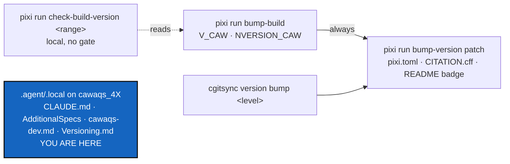

# BuildSemVerAgenticC — CaWaQS's two numbers bumped by pixi, and its Operating Space speaking C

*Created: 2026-11-22*

*Branch: 4X*

> **Owner's decisions, 2026-11-22**, carried over from
> [CGSCaWaQS4X](../archive/20261122_CGSCaWaQS4X_DevPlanTicket.md), which this ticket refines.
> - CaWaQS has two numbers. The build `MAJOR.XX` (`4.01`) is for developers.
>   The SemVer in `pixi.toml` (`4.1.0`) is the communication channel.
> - Every `bump-build` forces a `bump-version patch`.
> - The build rolls over `4.99 → 5.01`, and `bump-build --major` makes a
>   deliberate `4.xx → 5.0`.
> - Every user-facing copy (`CITATION.cff`, the README `Current_version`
>   badge) follows the SemVer.
> - The agentic content seeded from ComplexGitSync (Python) is adapted to
>   CaWaQS, an ANSI C code base, as was done for HTAS.
> - No C standard is fixed yet (D9 of CGSCaWaQS4X), and this ticket decides it.
> - The Operating Space is an AlphaSeries Digital Twin: one branch line, no
>   level branch, no blocking gate. Checks run locally through pixi.
> - cawaqs is a dependency of HTAS, never the reverse.
> - `pixi.toml` keeps three layers. The **default** environment is the C
>   product. Two opt-in features sit on top:
>   - `cgs`: cgitsync, which works without any agentic mount. Its own
>     private mounts are part of it: `.cgitsync/.memory` with
>     `.self-history`, and `.omniscience`;
>   - `agentic`: only the private `.agent/` mounts.
>
>   The tasks that rely on the private `.agent/.local/.dev` mount
>   (`bump-version`) go in `[feature.agentic]`, environment
>   `agentic = ["cgs", "agentic"]`. The self-history side belongs to `cgs`. A public script such as
>   `bump-build` must say which environment it runs in, and still work for
>   whoever has no agentic mount (decided here).

## Abstract — read this first

**The one-line version.** Add `bump-build`, `bump-version` and
`check-build-version` to cawaqs's `pixi.toml`, so that the build and the
SemVer move only through pixi and `cgitsync version`. Then rewrite the
seeded agentic files of `.agent/.local/` (branch `cawaqs_4X`) so that every
rule speaks C, `make` and the `.COMM` regression cases, not Python.

**What this document is.** The two sketches that CGSCaWaQS4X left for
refinement (its §3 steps 4 and 6), made into work (§2), with the decisions
still open (§3) and acceptance (§4).

**Why it exists.**
- Without these scripts, the build and the SemVer are typed by hand.
- `cgitsync version bump` cannot run, so the pair rule's orchestrator
  cannot bump at all.
- The Operating Space bootstrapped by CGSCaWaQS4X still carries
  ComplexGitSync's Python rules: pytest, ruff, pyproject, Pythonic names.

**Who it is for.** The owner, who answers §3, and the worker and
orchestrator who implement §2.

**What you need to do with it.** Pile 1, rank 2. Answer §3 before the
first edit.

---

## 1. What exists after CGSCaWaQS4X

- `pixi.toml` at the root (`version = "4.1.0"`), with the tasks `install`
  and `build` and a way to run `cgitsync` from the root, but no bump task.
- The build `4.01` in `src/Makefile` `V_CAW` and `src/param_caw.h`
  `NVERSION_CAW`.
  - `NVERSION_CAW` is a C float printed `%4.2f`.
  - `V_CAW` names the binary `cawaqs$(V_CAW)`.
  - The dead `make version` target calls a missing `update_version.sh`.
  - `main_cawaqs.c:8` says `VERSION ID : 3.x`.
- `CITATION.cff` (`version: '4.01'`) and the README badges still show the
  build.
- The Operating Space is bootstrapped. `.dev`, `.localSpec` and `.claude`
  sit on `cawaqs_4X`, seeded from `ComplexGitSync_CGS-ALPHA`, unadapted.
- ComplexGitSync's models (branch HT-BETA):
  - `scripts/bump_build.py`;
  - `scripts/check_build_version.py`;
  - `.dev/scripts/bump_version.py`.
- HTAS's models, branch `HydrologicalTwinAlphaSeries_HT-BETA`:
  - `.claude/CLAUDE.md`;
  - `.localSpec/{AdditionalSpecs,AgenticManifest,audit,digest}.md`;
  - `.dev/{htas-dev.md,Versioning.md,DevTickets/README.md}`.

## 2. The work

### 2.1 The two numbers (CGSCaWaQS4X §3 step 4)

1. **`scripts/bump_build.py`** (public), task `bump-build`:
   - It moves `MAJOR.XX` by one `XX` in `V_CAW` and `NVERSION_CAW`, both or
     neither, and refuses if they disagree.
   - After `.99` it rolls over to `(MAJOR+1).01`. `--major` makes
     `(MAJOR+1).0`.
   - Then it runs `pixi run bump-version patch`, and undoes the build move
     if that fails.
   - `--dry-run` writes nothing.
2. **`.agent/.local/.dev/scripts/bump_version.py`** (private), task
   `bump-version`, ported from ComplexGitSync's:
   - Targets: `pixi.toml` (read first), `CITATION.cff` `version` and
     `date-released`, and the README `Current_version` badge.
   - It writes every target or none, ends on `old -> new`, and never touches
     the build.
   - It stops with nothing changed when `.dev` is not mounted, and says so.
3. **`scripts/check_build_version.py`**, task `check-build-version`: it
   fails any commit in a range that moves `V_CAW`/`NVERSION_CAW` without
   moving `pixi.toml`'s version up by at least a patch. It runs locally,
   with no CI job.
4. **Tidy-up**:
   - the log header prints the SemVer and the build (D2);
   - `main_cawaqs.c:8` is fixed;
   - `make version` is replaced or removed (D3);
   - the first bump writes `4.1.0` into `CITATION.cff` and the badge.
5. **Tests**: shell or Python tests of the three scripts (dry run,
   rollover, `--major`, refusal on disagreement, the forced patch), run by a
   pixi task `test` (D4).

### 2.2 The Operating Space in C (CGSCaWaQS4X §3 step 6)

Each file is edited on `cawaqs_4X`, keeping ComplexGitSync's shape and
replacing every Python assumption:

- **`.claude/CLAUDE.md`, `AGENT.md`**:
  - the layout (root, `src/lib*`, `src/scripts`);
  - the `implement <ticket>` orders (AgentConduct §4.1);
  - the before-committing steps with C commands: `pixi run build` with
    no new warning, the regression cases, the format check, `bump-build`,
    `cgitsync status`, the commit message.
- **`.localSpec/AdditionalSpecs.md`**:
  - what CaWaQS is;
  - the layers (the root over the 17 libs, with the lib dependency order
    from `list_all.dat`);
  - which headers a file may include;
  - the public interface (the `.COMM` language: `input.y`, `lexical.l`, and
    the output files);
  - module shape (the file prefixes, a size ceiling in C lines: D5);
  - the C dialect (D1);
  - the rule that cawaqs never depends on HTAS.
- **`.localSpec/AgenticManifest.md`, `digest.md`, `audit.md`**:
  - the mounts of `cawaqs-dev-4X.cgs`;
  - the MUST/NEVER rules restated for C;
  - the findings of CGSCaWaQS4X §2: the build typed by hand, `make version`,
    `VERSION ID 3.x`, the destructive `make_Cawaqs.sh` used by CI, the
    commented-out format check, no `-std` or warnings, two regression cases.
- **`.dev/cawaqs-dev.md`**:
  - the commands;
  - bootstrapping a working checkout;
  - the checklist fill-ins;
  - the doc-impact map: README, `CITATION.cff`, the PDF documentation,
    Doxygen;
  - testing: the `gtest/testcases` cases and how one is added.

  No pytest and no ruff.
- **`.dev/Versioning.md`**: the two numbers, and the forced patch.
- **`.dev/DevTickets/README.md`**: branch `4X`, prefix `4X_`.
- **DevSpecs rules that are Python only**: `AdditionalSpecs.md` states the C
  rule that replaces each. The shared `DevSpec` is not edited from here.

## 3. Decisions for the owner — open

- **D1. Which C** (D9 of CGSCaWaQS4X, deferred here). Options:
  - C99 with `-Wall`, checked against the 17 libs;
  - strict C89, which means rewriting every `//` comment;
  - document the code as it is and fix nothing.
- **D2. The log header.** Options:
  - `CaWaQS 4.1.0 (build 4.01)`;
  - the SemVer only, with the build in the debug log.
- **D3. `make version`.** Options:
  - a target calling `pixi run bump-build`;
  - removed.
- **D4. Tests of the scripts.** Options:
  - pytest under `tests/`, Python like the scripts;
  - shell (bats).
- **D5. A size ceiling for C files.** `input.y` and several `.c` files are
  large. Options:
  - a ceiling with a baseline, as ComplexGitSync's `check_module_ceilings`;
  - none for now.
- **D6. The CI.** `.gitlab-ci.yml` still builds with the destructive
  `make_Cawaqs.sh`. Options:
  - move it to `./install.sh --https` and `pixi run build`;
  - leave it.

  The AlphaSeries rule forbids adding a blocking gate. It does not say
  whether the existing CI build stays.
- **D7. The PDF documentation number** (`CaWaQS_401_1_Documentation.pdf`,
  named after the build). Options:
  - named after the SemVer;
  - unchanged.

## 4. Acceptance

- `cgitsync version diagnose` shows cawaqs with `MANIFEST pixi.toml`,
  `VERSION 4.1.0`, `SCHEME semver`, `BUMP task`, `BUILD task`, verdict
  `ready`.
- `pixi run bump-build --dry-run` shows `4.01 -> 4.02` and `4.1.0 -> 4.1.1`
  and writes nothing. Without it, all of these move in one commit:
  - `V_CAW` and `NVERSION_CAW`;
  - `pixi.toml`;
  - `CITATION.cff`;
  - the README badge.

  `pixi run build` then gives `src/cawaqs4.02`.
- From `4.99`: `bump-build` gives `5.01`, `--major` gives `5.0`.
- `pixi run check-build-version <range>` fails on a build move without a
  SemVer move.
- No file under `.agent/.local/` on `cawaqs_4X` prescribes pytest (except
  for the bump scripts if D4 says so), ruff, pyproject or a Python naming
  rule.
- `cgitsync status` shows `errors=0`.
