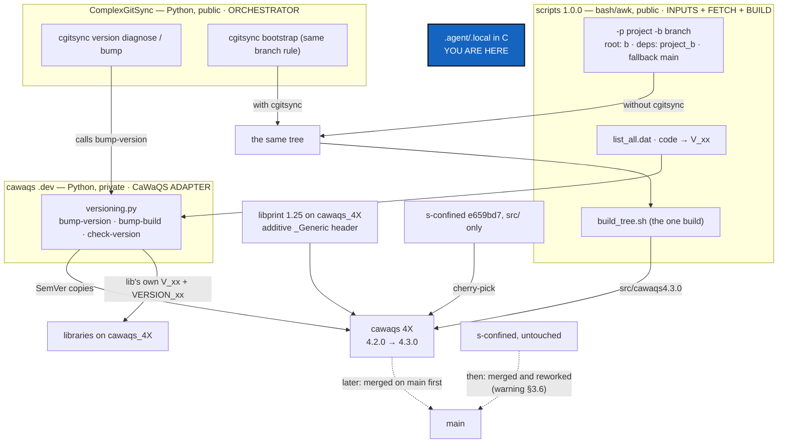

# BuildSemVerAgenticC — CaWaQS's one SemVer into the C code, its libraries' build numbers, a private versioning class, scripts 1.0.0 that knows the project, and an Operating Space speaking C

*Created: 2026-11-22*

*Branch: 4X*

*Revised: 2026-11-24, on the SemVer of `src/param_caw.h` on branch `s-confined`*

*Revised: 2026-11-24, `libprint` developed on `cawaqs_4X`, `main` left alone*

*Revised: 2026-11-24, the frontier between `scripts`, `.dev` and ComplexGitSync; `scripts` 1.0.0 with a project name, in cawaqs 4.3.0*

> **Owner's decisions, 2026-11-24, on `scripts`** (in conversation). They
> amend the blocks below.
> - **The only adaptation of `scripts` is its branch model.** Today it
>   knows one branch, applied everywhere. It gains a **project-name
>   variable**, so that it reproduces ComplexGitSync's strategy: the root
>   repository on branch `<b>`, and every dependency (the libraries and
>   `scripts`) on `<project>_<b>` (§3.5).
> - **`scripts` 1.0.0 breaks compatibility.** cawaqs 4.2.0 already breaks
>   it on the version, so `scripts` 1.0.0 is taken into **cawaqs 4.3.0**,
>   the second release of this ticket.
> - **CaWaQS still installs without `cgitsync`**: git, bash, gcc and make
>   are enough. `scripts` keeps the fetch and the build.
> - **ComplexGitSync is a development dependency of the Operating Space
>   only** (owner, 2026-11-25). Neither CaWaQS nor `scripts` depends on
>   it. The requests sent to it are generic features of ComplexGitSync,
>   with cawaqs only as where a need was observed, and never something
>   CaWaQS waits for.
> - **`pixi run install` belongs to the Operating Space** (owner,
>   2026-11-25), for both its rough form (`.config/cawaqs.cgs`) and its dev
>   form (`-s -dev-4X`). The cawaqs README promotes it first from now on.
>   The old manual install, without any agentic mount
>   (`make_Cawaqs_from_branches.sh`, `make_Cawaqs.sh`), stays available
>   for minimalist developers, second in the README. §3.5 keeps it working
>   with the same branches.
> - **ComplexGitSync is the reference for names.** The versioning commands
>   use its words: `bump-version`, `bump-build`, `check-version`,
>   `--dry-run`, and output ending `old -> new`.
> - *Withdrawn:* the shell versioning scripts in `src/scripts` (revision of
>   earlier the same day). Versioning is the Python class in `.dev` (§3.3),
>   and `scripts` writes no version.

> **Owner's decisions, 2026-11-24, on branches** (in conversation).
> - **All development is done on `cawaqs_4X`, `libprint` and `scripts`
>   included.** This ticket moves no branch `main`, in any repository. The
>   earlier plan to push `libprint` 1.25 to `main` and fast-forward
>   `cawaqs_4X` to it is withdrawn.
> - **`s-confined` stays as it is.** Its `libprint` `946195c` and its
>   `e659bd7` are not touched here. They are reworked when `s-confined` is
>   merged.
> - **The merge order is: `cawaqs_4X` onto `main` first, then
>   `s-confined`.** `s-confined` therefore meets an additive `libprint`
>   1.25 already on `main`.
> - **The message to the `s-confined` author is a warning**, written and
>   sent at the end of this ticket's implementation, not before (§3.6).

> **Owner's decisions, 2026-11-24** (in conversation). They replace the
> two-number model of 2026-11-22.
> - **One SemVer for CaWaQS**, as the `s-confined` commit `e659bd7` puts it
>   in C: `#define NVERSION_CAW "x.y.z"`, `V_CAW`, and every print in `%s`.
>   `pixi.toml` stays the reference.
> - **Only what versioning needs is taken from `s-confined`**: the `src/`
>   part of `e659bd7`. Nothing else comes in: not its README edits, not the
>   CONFINED/binary-source features, not `libaq` 0.75 or `libio` 0.26.
> - **`libprint` changes additively.** It keeps the build-number header used
>   across the ecosystem and adds the SemVer one beside it, under the same
>   name. `s-confined`'s `libprint` commit `946195c`, which changes the
>   signature, is not taken.
> - **The libraries keep their build numbers** (`MAJOR.XX`, e.g. libaq
>   0.75).
> - **Versioning is a developer feature, not a user one.** It lives in the
>   private Operating Space as `.agent/.local/.dev/scripts/versioning.py`,
>   not in a public repository. A user install cannot bump.

> **Owner's decisions, 2026-11-22**, carried over from
> [CGSCaWaQS4X](../archive/20261122_CGSCaWaQS4X_DevPlanTicket.md). Each one
> is marked with its status on 2026-11-24.
> - ~~CaWaQS has two numbers, a build `MAJOR.XX` and a SemVer.~~
>   **Superseded:** one SemVer.
> - ~~Every `bump-build` forces a `bump-version patch`.~~ ~~The build rolls
>   over `4.99 → 5.01`.~~ **Superseded:** CaWaQS has no build to bump.
>   `bump-build <lib>` bumps a library's build (§3.3).
> - Every user-facing copy (`CITATION.cff`, the README `Current_version`
>   badge) follows the SemVer. *Kept.*
> - The agentic content seeded from ComplexGitSync is adapted to C, as for
>   HTAS. *Kept.*
> - No C standard is fixed yet, and this ticket decides it (D1). *Kept.*
> - AlphaSeries Digital Twin: one branch line, no level branch, no
>   blocking gate. Checks run locally through pixi. *Kept.*
> - cawaqs is a dependency of HTAS, never the reverse. *Kept.*
> - `pixi.toml` has three layers: default (the C product), `cgs` and
>   `agentic`. The tasks that need the private `.dev` mount (`bump-version`)
>   go in `[feature.agentic]`. *Kept, and restored:* cawaqs 4.1.1 had put a
>   public `scripts/bump_version.py` in `[feature.dev]`. This ticket moves it
>   back into the private `.dev`.

## Abstract — read this first

**The one-line version.** Two releases, then a warning.
- **cawaqs 4.2.0** (§3.1 → §3.4):
  - `libprint` 1.25 gains a SemVer log header beside the build one, on
    `cawaqs_4X`;
  - cawaqs takes the `src/` part of `e659bd7`, so that `NVERSION_CAW` and
    `V_CAW` carry the SemVer of `pixi.toml`;
  - a private Python class in `.dev` bumps that SemVer and the libraries'
    builds;
  - the Operating Space is rewritten to speak C.
- **cawaqs 4.3.0** (§3.5): `scripts` 1.0.0 takes `-p <project> -b <branch>`.
  The root goes on `<branch>`, and `scripts` and the libraries go on
  `<project>_<branch>`, as ComplexGitSync does. The one build moves back
  into `scripts`.
- **Last** (§3.6): the warning to the `s-confined` author.

**What this document is.**
- §1: what exists on 4X and on `s-confined`;
- §2: what is taken from `s-confined`, and why `param_caw.h` alone is not
  enough;
- §3: the work, with the frontier between `scripts`, `.dev` and
  ComplexGitSync in §3.0;
- §4: the decisions still open;
- §5: acceptance.

**Why it exists.**
- Two version models are about to meet. 4X has the SemVer `4.1.3` in
  `pixi.toml` and the build `4.01` in C. `s-confined` has `"4.1.0"` in C.
  Until one model holds, every merge between them conflicts on the version.
- `libprint` is shared by the whole ecosystem. A signature change there
  would break every program that passes a build number to the log header.
- Bumping is a developer act. Today it sits in cawaqs's public `scripts/`.
- An install without `cgitsync` cannot reproduce the branches of a
  development workspace: `scripts` knows one branch, applied everywhere.
- The build loop is copied in `make_Cawaqs_fromCGS.sh`, and two copies of
  one build drift.
- The Operating Space still carries ComplexGitSync's Python rules.

**Who it is for.**
- The owner, who answers §4 and, at the end, sends the warning to the
  `s-confined` author.
- The worker and orchestrator, who implement §3.

**What you need to do with it.** Pile 1, rank 2. Answer §4, then implement
§3.1 → §3.4 (cawaqs 4.2.0), then §3.5 (cawaqs 4.3.0), and write the §3.6
warning last.



---

## 1. What exists on 2026-11-24

**On 4X** (cawaqs 4.1.3):
- `pixi.toml` `version = "4.1.3"`.
  - The public `scripts/bump_version.py` (from MOLONARI1D) runs as
    `pixi run -e dev bump-version` / `check-version`.
  - Its mirrors are `pixi.toml` and the README sentence "the SemVer in
    `pixi.toml` (`…`)". Nothing in `src/`, and neither `CITATION.cff` nor
    the badges.
  - Its suggested commit subject uses the directory name (line 179).
- The build `4.01`:
  - `src/Makefile` `V_CAW=4.01` names the binary;
  - `src/param_caw.h` has `NVERSION_CAW 4.01` (a float) and an unused
    `#define NVERSION`;
  - 111 prints use `%4.2f`;
  - `LP_log_file_header` takes a `double` (`libprint` 1.24 on `cawaqs_4X`
    = `main`).
- `CITATION.cff` `version: '4.01'`. The README badges say `4.01`.
  `pixi.toml:7-9` describes the build. `main_cawaqs.c:8` says
  `VERSION ID : 3.x`. `make version` calls a missing `update_version.sh`.
- Each library holds its build in its own `Makefile` (`V_AQ=0.74`, …) and
  `param_*.h` (`VERSION_AQ 0.74`, …).
  - cawaqs's `src/Makefile` and the other libraries' Makefiles repeat
    them. `V_LP` is written in 17 Makefiles, and `libwet/src/Makefile`
    already says 1.22 where the others say 1.24.
  - **The build does not read those copies.** `make_Cawaqs_fromCGS.sh`
    (`pixi run build`), `make_Cawaqs.sh` and `install_one_lib_2.sh` run
    `set_dependencies` / `write_dep_version.awk`. It reads each
    dependency's `V_xx` from that dependency's own `Makefile`
    (`get_version.sh`), and writes it into the `Makefile_tmp` that is
    compiled. A library's build therefore has **one source**: its own
    `Makefile` `V_xx` and `param_*.h` `VERSION_xx`.
- `cgitsync version diagnose` (8.11.1):
  - it reports the 18 libraries as *not versioned* (no `pixi.toml`);
  - it reports cawaqs as *task needed*: it reads only the top-level
    `[tasks]`, and `bump-version` sits in `[feature.dev.tasks]`.
- **`scripts` knows one branch** (`BNAME`, default `main`):
  - `make_Cawaqs_from_branches.sh -b <b> [path]` (cawaqs) checks out `<b>`
    in cawaqs, then in the `scripts` clone, then calls
    `clean_install_2.sh`. That script passes `-b <b>` to
    `install_one_lib_2.sh` for every library of `list_all.dat`.
  - The branch is read by **position** (`$4`, `$5` or `$6`, depending on
    how many arguments there are), not after the `-b`.
  - `install_a_lib_prose.sh`, `clean_install_crive.sh` and
    `build_onelib_gitlab_CI.sh` follow the same model. Only the last checks
    that the branch exists (`git ls-remote --heads`).
  - `get_version.sh` and `get_incl.sh` take the branch as a path
    (`lib<x>/branches/<b>/src`), a remnant of the svn layout.
  - `make_Cawaqs.sh` and `install_all_2.sh` have no branch: they use
    `main` everywhere.
  - So `-b 4X` puts every repository on `4X`, where a development
    workspace has cawaqs on `4X` and the 18 others on `cawaqs_4X`.
- `scripts/check_version.sh` has a bug. The `rive`, `seb`, `tube`, `mb`,
  `hyd` and `ap` branches are written `["$1" = …]`, with no space after
  `[`. The test fails as a command, so those codes all fall through to
  `V_AQ`.
- `make_Cawaqs_fromCGS.sh` carries its own copy of the build functions
  (`awk_apply`, `prepare_makefile`, `set_dependencies`, `build_lib`), taken
  from `scripts` with the git operations removed.
- The Operating Space is bootstrapped on `cawaqs_4X`, unadapted.

**On `s-confined`** (cawaqs 6 commits ahead of their common ancestor
`943eeac`, 7 behind 4X):

| Commit | What it carries | Taken here |
|---|---|---|
| `e199b39`, `39e0d9a` | Porosity/S switch and S modulation in CONFINED mode; needs `libaq` 0.75 | no |
| **`e659bd7`** | **SemVer in C.** In `src/`: `param_caw.h`, `Makefile` `V_CAW`/`V_LP`, 120 changed print lines in 17 `.c`/`.y`/`.l` files, all version-related except one "Done" → "Done." and four deleted Makefile comments. Outside `src/`: README badges and "3.x" wording | **`src/` only** |
| `b6e14e3`, `c1b44a9`, `9df6bbb` | Reversible S modulation, binary source inputs; needs `libaq` 0.75, `libio` 0.26 | no |
| `libprint` `946195c` | libprint 1.25: `LP_log_file_header`/`LP_file_header` take a `char *` instead of a `double` | **no** (§3.1 replaces it) |

**Who calls the log headers**, across every tree under `~/.cgs`:
- `main_cawaqs.c` (a string on `s-confined`);
- `libhyd/src/main_HYDRO.c` (`NVERSION_HYCU`);
- `libmesh/src/test_MSH.c` (`VERSION_MSH`);
- `libaq/src/test_AQ.c` (`VERSION_AQ`), which `libaq` 0.75 deletes.

The last three are standalone programs that pass a `double`. Programs of
the ecosystem that are not on this machine may call it too.
`LP_file_header` has no caller.

## 2. What is taken from `s-confined`, and why `param_caw.h` alone is not enough

**`param_caw.h` alone does not work.** `NVERSION_CAW "x.y.z"` would hand a
`char *`:
- to 111 `%4.2f` conversions, which is undefined behaviour. `LP_printf` and
  `LP_error` carry no `format` attribute, so gcc does not warn;
- to `LP_log_file_header(…, double, …)` in `libprint` 1.24, which does not
  compile.

The minimum is the `src/` part of `e659bd7`, together with a `libprint`
whose log header accepts a string.

**Tested on 2026-11-24**, in a scratch worktree:
1. `origin/4X`, then `git cherry-pick -n e659bd7`;
2. `libprint` 1.25;
3. `make_Cawaqs_fromCGS.sh gcc` with the pixi toolchain.

What it showed:
- Only the two version lines conflict, in `param_caw.h` and in the
  `Makefile` `V_CAW`. Resolved to `"4.1.3"` and `4.1.3`.
- The build passes and gives `src/cawaqs4.1.3`. None of its 27 warnings
  concerns the version.
- A scan of the 111 calls found every `NVERSION_CAW` argument matched by a
  `%s`.

**`V_CAW` must be unquoted.** With `V_CAW="4.1.0"`, make takes the quotes
into the target `cawaqs"4.1.0"`, a file that never exists. The binary is
then relinked on every build (`make -q` returns 1). `V_CAW=4.1.3` is up to
date after a build (`make -q` returns 0).

**The additive `libprint` was tested too** (gcc 13, `-Wall -Wextra`, and
`-std=gnu89`). Under one name, `LP_log_file_header`:
- the string `"4.1.3"` prints `# CaWaQS 4.1.3 -- Log file`;
- the doubles `0.75` and `0.47` print `# libaq 0.75 -- Log file` and
  `# HyCu 0.47 -- Log file`;
- an object compiled against the old prototype still links.

## 3. The work

### 3.0 The frontier: `scripts`, `.dev`, ComplexGitSync

| Layer | Language, visibility | Owns | Never does |
|---|---|---|---|
| **`scripts`** (`src/scripts`) | bash and awk, public, in the user install | **Inputs:** `list_all.dat`, the code → `V_xx` mapping. **Fetch:** clone and check out by the §3.5 branch rule. **Build:** `build_tree.sh`, the one build | Write a committed version |
| **cawaqs `.dev`** (`.agent/.local/.dev/scripts/versioning.py`) | Python, private, developer workspace only | **What is CaWaQS's own:** where the SemVer is copied, and how a library's build is bumped. Reads `scripts`' inputs and has no copy of them | Walk the tree, or decide which repositories to bump |
| **ComplexGitSync** | Python, public, generic; a development tool of the Operating Space only | **The developer's workspace:** `cgitsync bootstrap` / `branch` with the same branch rule, and `cgitsync version diagnose / bump`, which call each repository's `bump-version` | Know where CaWaQS copies its version, build CaWaQS, or be needed by CaWaQS or `scripts` |

The arrow goes one way: the Operating Space uses ComplexGitSync, and
ComplexGitSync knows nothing of CaWaQS. If a generic ComplexGitSync
feature later covers what `versioning.py` does for the libraries (a
version kept outside `pixi.toml`), the Operating Space may switch to it.
That is the Operating Space's choice, not a step of this ticket.
`scripts` stays whole either way, and an install with git and bash alone
must keep working.

### 3.1 `libprint` 1.25, additive, on `cawaqs_4X`

On `libprint`, on branch `cawaqs_4X` (today equal to `main`). **No `main`
is moved.** `s-confined`, which builds against its own `libprint`
`946195c`, stays as it is until it is merged.
- **`function_lprint.h`**: the two existing prototypes stay as they are.
  Add the string variants, and one dispatching macro per name:

  ```c
  void LP_log_file_header(FILE *, char *, double, char *, char *);
  void LP_log_file_header_semver(FILE *, char *, const char *, char *, char *);
  #define LP_log_file_header(fp, prog, v, date, cmd) _Generic((v), \
      char *: LP_log_file_header_semver, const char *: LP_log_file_header_semver, \
      default: LP_log_file_header)(fp, prog, v, date, cmd)
  ```

  `LP_file_header` gets the same treatment. A function-like macro does not
  expand its own name, so the `default:` branch reaches the real function.
- **`usual_functions.c`**: define the originals as
  `void (LP_log_file_header)(…)` and `void (LP_file_header)(…)`. The
  parentheses stop the macro from expanding. Add the two `_semver`
  functions, printing `%s`.
- **`param_lprint.h` and `src/Makefile`**: 1.24 → 1.25, with
  `pixi run bump-build libprint` once §3.3 exists, or by hand.
  - cawaqs's `V_LP=1.25` comes with `e659bd7`.
  - The dependents' copies do not need to move, because the build rewrites
    them (§1).
- Commit it on `libprint`'s `cawaqs_4X` only. Every program keeps
  compiling, so no source in the ecosystem has to change.
  - `main` reaches 1.25 later, when `cawaqs_4X` is merged on `main`. That
    merge comes **before** `s-confined`'s, so `s-confined` then meets the
    additive header and drops `946195c` (§3.6).
- `_Generic` is C11, and gcc accepts it in every mode, `-std=gnu89`
  included. This is noted for D1.

### 3.2 cawaqs: the SemVer in C (4X)

1. `git cherry-pick -n e659bd7`, then `git restore --staged --worktree
   README.md`. The README is not taken: `bump-version` (§3.3) moves its
   badges, and its "3.x" wording is a separate edit (D11). The commit
   message cites `s-confined` `e659bd7` as the source, by hash only: no
   explicit name, in the message or in a trailer.
2. Resolve the two conflicts:
   - `param_caw.h`: `#define NVERSION_CAW "<pixi.toml version>"`, with
     the commit's comment kept. `NVERSION` is dropped, as the commit
     does.
   - `src/Makefile`: `V_CAW=<version>`, **unquoted**. `V_LP=1.25` comes
     with the commit.
3. Tidy-up:
   - `main_cawaqs.c:8` → `VERSION ID : see pixi.toml`;
   - `make version` → D3;
   - `pixi.toml:7-9` is rewritten for one number;
   - the README row "Produces `src/cawaqs4.x`" → `src/cawaqs<SemVer>`.
4. The first bump after it: **minor**, to `4.2.0` (D15). The log header
   and the binary name change visibly. `4.2.0` also leaves `s-confined`'s
   "4.1.0" behind, so the two lines never give one number to different
   content.

### 3.3 `versioning.py`, a private class in `.dev`

- **Where**: `.agent/.local/.dev/scripts/versioning.py`, branch
  `cawaqs_4X`, with its tests beside it (D4). This is where ComplexGitSync
  keeps its own bump script.
  - cawaqs's `scripts/bump_version.py` and the `[feature.dev.tasks]`
    `bump-version`/`check-version` leave the public cawaqs repository.
  - The `[feature.dev]` environment keeps only what `install.sh` needs (the
    standalone `cgitsync`).
- **Its shape follows ComplexGitSync**: one class with
  `read`/`next`/`moved_by`, like `VersionScheme`, plus a `build` scheme for
  `MAJOR.XX`. If ComplexGitSync later takes that scheme, it can lift the
  class unchanged.
- **Its inputs come from `scripts`**: the library list (`list_all.dat`)
  and the code → `V_xx` mapping (`check_version.sh`, fixed in §3.5). It
  holds no copy of either.
- **How it is run**: a pixi feature `agentic` (`python`), and an
  environment `agentic = ["cgs", "agentic"]`, as decided on 2026-11-22.
  - Its tasks: `bump-version`, `bump-build`, `check-version`.
  - The tasks are defined only in that environment, so
    `pixi run bump-version minor` finds them by themselves.
  - On a user install the `.dev` mount is absent. The script is not there,
    the task stops with a clear "developer only" message, and nothing is
    written.
- **What it moves**, all files or none. A field found other than exactly
  once stops it with nothing written. `--dry-run` lists and writes
  nothing.
  - `bump-version <patch|minor|major>`, the CaWaQS SemVer:
    - `pixi.toml`;
    - `src/param_caw.h` `NVERSION_CAW`;
    - `src/Makefile` `V_CAW`;
    - `CITATION.cff` `version` and `date-released`;
    - the README `Current_version` badge and the "SemVer in `pixi.toml`"
      sentence;
    - the `Documentation` badge as D7 says.

    It ends on `old -> new`, as `cgitsync version bump` expects. Its
    suggested commit subject takes the name from `pixi.toml`, not from the
    directory.
  - `bump-build <lib> [--major]`, a library's build:
    - `MAJOR.XX` + 0.01 in the library's `src/Makefile` `V_xx` and
      `src/param_*.h` `VERSION_xx`, its one source (§1);
    - and cawaqs's `src/Makefile` copy, so that a plain `make` in `src/`
      still links;
    - `--major` gives `(MAJOR+1).00`.

    The other libraries' copies are left alone: the build rewrites them.
    No `pixi.toml` and no agentic file enters a shared library.
  - `check-version`:
    - every SemVer copy agrees with `pixi.toml`;
    - each library's `Makefile` `V_xx` and `param_*.h` `VERSION_xx` agree;
    - cawaqs's copies agree with them.

    It lists any other library's copy that lags, such as `libwet`'s
    `V_LP=1.22`, as information, not as a failure.
- **`cgitsync version bump`** cannot see a `[feature.*.tasks]` task today,
  so it cannot drive cawaqs. A request is filed for ComplexGitSync:
  [HT-BETA-20261124_VersionFeatureTasks](../dependency/CGS/HT-BETA-20261124_VersionFeatureTasks.md)
  (R1). Until it lands, run `pixi run bump-version` directly.
  - The same file proposes generic ComplexGitSync features: a documented
    branch-naming rule (R2), and a version kept outside `pixi.toml` (R3).
  - **None of them blocks this ticket**, and CaWaQS never waits for them.

### 3.4 The Operating Space in C (CGSCaWaQS4X §3 step 6)

Each file is edited on `cawaqs_4X`, keeping ComplexGitSync's shape and
replacing every Python assumption.

- **`.claude/CLAUDE.md`, `AGENT.md`**:
  - the layout (root, `src/lib*`, `src/scripts`);
  - the `implement <ticket>` orders (AgentConduct §4.1). The worker runs
    `pixi run bump-build <lib>` for a library it changed; the orchestrator
    runs `pixi run bump-version`;
  - the before-committing steps, with C commands: `pixi run build` with no
    new warning, the regression cases, the format check,
    `pixi run check-version`, `cgitsync status`, and the commit message
    `cawaqs-<SemVer>`.
- **`.localSpec/AdditionalSpecs.md`**:
  - what CaWaQS is;
  - the layers: the root over the 17 libraries on `cawaqs_4X`, in the
    `list_all.dat` order;
  - the §3.0 frontier, and the rule that CaWaQS installs without
    `cgitsync`;
  - which headers a file may include;
  - the `.COMM` interface (`input.y`, `lexical.l`) and the output files;
  - module shape: the file prefixes, and a size ceiling in C lines (D5);
  - the C dialect (D1);
  - the rule that cawaqs never depends on HTAS;
  - **the version rules**:
    - `NVERSION_CAW` is the SemVer string, printed with `%s`, never `%f`;
    - a library's `VERSION_xx` is its build, printed with `%4.2f`;
    - `LP_log_file_header` takes either.
- **`.localSpec/AgenticManifest.md`, `digest.md`, `audit.md`**:
  - the mounts;
  - the MUST/NEVER rules restated for C;
  - the findings: `make version`, `VERSION ID 3.x`, the destructive
    `make_Cawaqs.sh` used by CI, the commented-out format check, no `-std`
    or warnings, two regression cases.
- **`.dev/cawaqs-dev.md`**:
  - the commands;
  - bootstrapping;
  - the checklist fill-ins;
  - the doc-impact map (README, `CITATION.cff`, the PDF, Doxygen);
  - testing with `gtest/testcases`.

  No pytest and no ruff for the C code.
- **`.dev/Versioning.md`**:
  - one SemVer for CaWaQS and its copies;
  - a build per library, with one source, and its copy in cawaqs's
    `Makefile`;
  - `scripts`' own SemVer (D12);
  - how a branch that predates this (`s-confined`) merges: keep 4X's
    version, and bump by what the merge brings.
- **Python-only DevSpecs rules**: `AdditionalSpecs.md` states the C rule
  that replaces each.

**This closes cawaqs 4.2.0.**

### 3.5 `scripts` 1.0.0 with a project name, in cawaqs 4.3.0

**The rule, taken from ComplexGitSync** (`.config/cawaqs-dev-4X.cgs`,
cgitsync ≥ 8.11.1):
- the **root** repository is on the bare branch `<b>`;
- **every other repository that is not private**, the libraries and
  `scripts`, is on `<project>_<b>`;
- if `<project>_<b>` does not exist, the repository falls back to `main`,
  and the install says so for each repository.

`scripts` applies the same rule with the same names. It never reads a
`.cgs` file: the project name and the branch are its only inputs.

**On `scripts`, branch `cawaqs_4X`** (its `main` is not moved):
- **One shared parser**, `parse_project_branch.sh`, sourced by every
  installer. It reads `-p <project>` and `-b <branch>` as named options,
  in any position, and sets:
  - `ROOT_BRANCH=<b>`;
  - `DEP_BRANCH=<project>_<b>`, or what D13 says when `-p` is absent;
  - `FALLBACK_BRANCH=main`.
- **One checkout function**, `checkout_branch <dir> <branch> <fallback>`.
  It checks the branch exists with `git ls-remote --heads`, checks out the
  branch or the fallback, and prints which one.
- These scripts move to it, and stop reading the branch by position:
  - `clean_install_2.sh`;
  - `install_one_lib_2.sh`;
  - `install_a_lib_prose.sh`;
  - `clean_install_crive.sh`;
  - `build_onelib_gitlab_CI.sh`.
- `get_version.sh` and `get_incl.sh`: the `branches/<b>/` path goes as D14
  says.
- **`build_tree.sh <path_inst> <compilo>`**: the build loop taken back
  from `make_Cawaqs_fromCGS.sh` (`awk_apply`, `prepare_makefile`,
  `set_dependencies`, `build_lib`, over `list_all.dat`), with no git
  operation. This becomes the one build.
- **`check_version.sh`**: fix the `["$1" = …]` branches.
- **The version `1.0.0`**, kept where D12 says. Until now `scripts` had no
  SemVer: `V_SCRIPTS` was `git describe`.
- The README describes `-p`/`-b` and the rule above.

**On cawaqs 4X**:
- **`make_Cawaqs_from_branches.sh -p <project> -b <branch> [path]`**:
  - checks out `<branch>` in cawaqs;
  - clones `scripts` on `<project>_<branch>`, falling back to `main`;
  - passes `-p`/`-b` on to `clean_install_2.sh`;
  - then calls `build_tree.sh`.
- **`make_Cawaqs_fromCGS.sh`** shrinks to a call to `scripts/build_tree.sh`.
  It keeps its check that the workspace is assembled.
- **`make_Cawaqs.sh`** (CI, no branch) goes as D6 says.
- **README:** `pixi run install` stays first ("CGSInstall (recommended)").
  The second section, "Install without ComplexGitSync", is for minimalist
  developers:
  - its `make_Cawaqs_from_branches.sh` rows move to `-p <project> -b
    <branch>`, e.g. `./make_Cawaqs_from_branches.sh -p cawaqs -b 4X`;
  - it says the result has the same branches as `pixi run install`;
  - its `cawaqs3.x` wording follows D11.
- `pixi run bump-version minor` → **4.3.0** (D15). The release says it
  needs `scripts` ≥ 1.0.0.

### 3.6 The `s-confined` author — a warning, at the end

Nothing is changed on `s-confined` by this ticket. Its branches, `libprint`
`946195c` included, stay as they are and are reworked when it is merged.

**The message is written at the end of this ticket's implementation**, once
§3.1 → §3.5 are committed, so that it quotes the real commits and versions.
It replaces the draft of 2026-11-24. The worker drafts it in the final
report; the owner sends it. It is a **warning**, not a request for work
now. It tells them that:
- `cawaqs_4X` (cawaqs on `4X`, the libraries and `scripts` on `cawaqs_4X`)
  will be merged on `main` **first**, before `s-confined`;
- at that point `main` carries the additive `libprint` 1.25, under the same
  name as their 1.25. Their `946195c` must then be dropped, not merged:
  their string call to `LP_log_file_header` compiles unchanged against it;
- `V_CAW` must be unquoted (§2);
- 4X's version line wins at the merge: `NVERSION_CAW` takes 4X's SemVer
  (`4.3.0` or later), and their `"4.1.0"` is left behind;
- `e659bd7`'s `src/` part is already on 4X, so it falls out of their
  rebase. Its README part is handled as D11 says;
- `scripts` 1.0.0 reads the branch with `-p`/`-b`, not by position, so
  any call they make with the old arguments must change;
- `libap` needs nothing.

## 4. Decisions for the owner — open

- **D1. Which C.** Options:
  - C99 with `-Wall`, checked against the 17 libraries;
  - strict C89, which means rewriting every `//` comment;
  - document the code as it is.

  Note: the `libprint` macro uses C11 `_Generic`, which gcc accepts in
  every mode. With `-Wall`, adding
  `__attribute__((format(printf, 2, 3)))` to `LP_printf`/`LP_error` would
  make gcc check every print, and catch any future `%f`/`char *` mismatch.
- **D2. The log header.** *Answered:* the SemVer only, `# CaWaQS x.y.z --
  Log file`.
- **D3. `make version`.** Options:
  - a target that says "developer only: `pixi run bump-version`";
  - removed.
- **D4. Tests of `versioning.py`.** Options:
  - pytest beside it in `.dev/scripts/tests/`;
  - none beyond `--dry-run` in the acceptance.
- **D5. A size ceiling for C files.** Options:
  - a ceiling with a baseline;
  - none for now.
- **D6. The CI.** `.gitlab-ci.yml` builds with the destructive
  `make_Cawaqs.sh`. Options:
  - move it to `./make_Cawaqs_from_branches.sh -p cawaqs -b <b>` (§3.5),
    which needs no `cgitsync`;
  - move it to `./install.sh --https` and `pixi run build`;
  - leave it.
- **D7. The PDF documentation number.** `s-confined` points the README to
  `CaWaQS_4_1_0_1_Documentation.pdf`, which does not exist on 4X. Options:
  - name it after the SemVer, and let `bump-version` move the
    `Documentation` badge and link;
  - keep its own number.
- **D8.** *Answered:* only the `src/` part of `e659bd7`.
- **D9.** *Answered by the additive `libprint`:* the standalone programs of
  `libhyd`, `libmesh` and `libaq` are unaffected.
- **D10. A range check.** Options:
  - `check-version --range <a>..<b>` fails a commit that touches `src/`
    without moving `pixi.toml` (or a library's `src/` without moving its
    build), run locally;
  - dropped.
- **D11. `e659bd7`'s README wording** ("CaWaQS 3.x" → "CaWaQS",
  `cawaqs3.x` → `cawaqsX.Y.Z` in the old `make_Cawaqs*.sh` tables).
  Options:
  - take it by hand in this change;
  - leave it to the `s-confined` merge.
- **D12. Where `scripts` keeps 1.0.0.** Options:
  - `CITATION.cff` only;
  - a `VERSION` file that every script can print;
  - a `pixi.toml` with a `version`, so that `cgitsync version` sees it.
    That breaks the rule that no `pixi.toml` enters a shared repository.
- **D13. `-b` without `-p`.** Options:
  - the old behaviour, one branch everywhere;
  - refused: `-p` becomes mandatory with `-b`.
- **D14. The svn `branches/<b>/src` path** in `get_version.sh` and
  `get_incl.sh`. Options:
  - removed;
  - kept behind an option.
- **D15. The number for a break.** 4.2.0 and 4.3.0 are minor bumps, but in
  SemVer a change that breaks compatibility is a major one (5.0.0).
  Options:
  - keep the 4.x line, and state the break in the release notes;
  - cawaqs 5.0.0 for the first break (§3.2), and 5.1.0 or 6.0.0 for
    §3.5.

## 5. Acceptance

**cawaqs 4.2.0**
- **`libprint` 1.25 on `cawaqs_4X`.** A program passing a `double` and
  one passing a string to `LP_log_file_header` both compile with
  `-Wall -Wextra` and print the right header. `libhyd`'s `main_HYDRO.c`
  compiles unchanged.
- **No `main` has moved**, in any repository, and no `s-confined` branch
  has changed.
- `pixi run build` gives `src/cawaqs4.2.0`. Its log opens with
  `# CaWaQS 4.2.0 -- Log file`. A second build relinks nothing.
- `grep -rnE '%[0-9.]*f.*NVERSION_CAW' src/*.[cyl]` finds nothing.
- **`pixi run bump-version minor --dry-run`** (environment `agentic`)
  lists `4.2.0 -> 4.3.0` for:
  - `pixi.toml`;
  - `param_caw.h`;
  - `Makefile`;
  - `CITATION.cff`;
  - the README;

  and writes nothing.
- **`pixi run bump-build libaq --dry-run`** lists `0.74 -> 0.75` in
  libaq's `Makefile` and `param_AQ.h`, and in cawaqs's `V_AQ`, and writes
  nothing.
- `pixi run check-version` fails when a library's `Makefile` and
  `param_*.h` disagree, or when a SemVer copy is edited by hand. It lists
  `libwet`'s `V_LP` without failing.
- **A user install** (`pixi run install`, no `.dev`) has no `bump-*` task
  in its default environment, and the cawaqs repository no longer holds
  `scripts/bump_version.py`.
- `scripts` writes no committed version.
- No file under `.agent/.local/` prescribes a CaWaQS-level `bump-build`,
  ruff, pyproject or a Python naming rule for the C code.

**cawaqs 4.3.0**
- In a scratch directory, with no `cgitsync` and no pixi `cgs`
  environment:
  - `./make_Cawaqs_from_branches.sh -p cawaqs -b 4X <dir>` puts cawaqs on
    `4X`, and `scripts` and the 17 libraries on `cawaqs_4X`;
  - it builds `src/cawaqs4.3.0`.
- `-p cawaqs -b NOPE` puts every dependency on `main`, says so for each,
  and still builds.
- A workspace built by `cgitsync bootstrap` gives every repository the
  same branch as the run without `cgitsync`.
- `pixi run build` and the run without `cgitsync` both run
  `scripts/build_tree.sh`. `make_Cawaqs_fromCGS.sh` holds no build
  function of its own.
- `check_version.sh rive` prints `V_RIVE`, and `check_version.sh ap`
  prints `V_AP`.
- `scripts` reads `1.0.0` where D12 says. cawaqs reads `4.3.0`, or what
  D15 says.

**Both**
- `cgitsync status` shows `errors=0`.
- The final report holds the §3.6 warning to the `s-confined` author,
  quoting the commits and versions actually delivered, ready for the owner
  to send.
