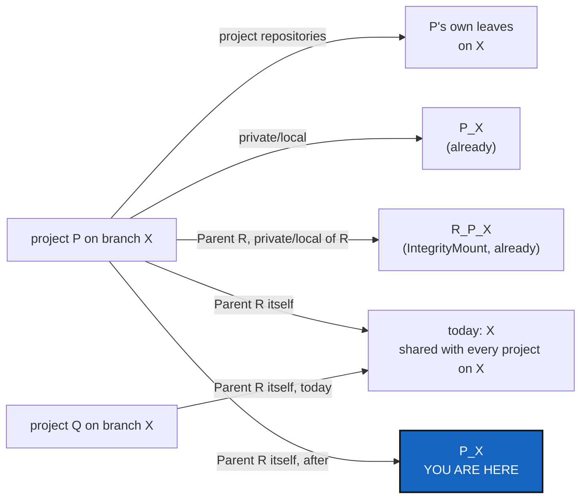

# ProjectBranch4Parent — a nested Parent is on `<project>_<branch>`, never on the project's bare branch

*Created: 2026-11-23*

*Branch: CGS-ALPHA*

> **From the owner's short ticket `project-brancg4parent`** (2026-11-23), as written: *"The name of the branch on which a
> parent repo isn't correct. It is currently branch but it should be <project-name>_branch otherwise it is impossible to
> combine parent within multiple projects. This defaults lives for multiple version in ComplexGitSync"*. The short ticket
> was closed when this plan was written (owner, 2026-11-23; TICKETLIFECYCLE §6), as `20261123_project-brancg4parent.md`
> in `archive/.closedUserTicket/`.

## Abstract — read this first

**The one-line version.** A repository that is a project of its own, mounted inside another project, takes the branch
`<project>_<branch>` of the project that mounts it. It no longer takes that project's bare `<branch>`, which every other
project mounting it would share.

**What this document is.** The plan for that change: what happens today, the cause, the change, the steps, the
decisions the owner owes, and how the work is accepted.

**Why it exists.** A nested Parent (HydrologicalTwinAlphaSeries under CaWaQS-Viz, ComplexGitSync under any project
that mounts it) is the one kind of repository that several projects share *and* commit to. Today each project checks
it out on its own branch name. Two projects with the same branch name (`main`, `dev`, `HT-BETA`) therefore write to the
same branch of the Parent, so one Parent cannot be combined into two projects. IntegrityMount fixed this for a Parent's
*private* repositories and BehindGate for ComplexGitSync in a level tree only. Nothing fixes it for the Parent itself
in an ordinary tree.

**What you will find.** §1 what happens, §2 the cause, §3 the change, §4 the steps, §5 the decisions for the owner,
§6 acceptance, §7 what this ticket leaves alone.

**Who it is for.** The worker and the orchestrator who implement it, and the owner, who answers §5.

**What you need to do with it.** §5 is answered (owner, 2026-11-23); §3 is written to those answers. Follow §4.

---

## 1. What happens today

Read-only checks, 2026-11-23, on ComplexGitSync 8.9.4.

| Tree | Repository | Its own `.cgs` | Project branch | Branch it targets | Should be |
|---|---|---|---|---|---|
| `examples/cawaqsviz.cgs` | HydrologicalTwinAlphaSeries (Parent, holds `htas.cgs`) | project `HydrologicalTwinAlphaSeries` | `cgitsync` | `cgitsync` | `CaWaQS-Viz_cgitsync` |
| `examples/cawaqsviz.cgs` | hydrological_twin (declared by both specs) | none | `cgitsync` | `cgitsync` | `CaWaQS-Viz_cgitsync` (Q1) |
| any `.cgs` that is not `yyyy-xxx`, mounting ComplexGitSync as a project repository | ComplexGitSync (Parent, holds `install.cgs`) | project `ComplexGitSync` | `X` | `X` | `<project>_X` |
| `yyyy-xxx.cgs` (BehindGate) | ComplexGitSync | project `ComplexGitSync` | `xxx` | `yyyy_xxx` | already right |

`tests/integration/test_behind_gate.py::test_a_tree_that_is_not_a_level_keeps_the_tool_on_the_project_branch` pins the
third row as correct behaviour. Under this ticket it is the defect, and the test is inverted (§4).

The ComplexGitSync repository already holds a branch `HT-BETA` (local and on `origin`), the project branch of
HydrologicalTwinAlphaSeries, with no prefix. That is the kind of branch this rule stops a second project from sharing.

## 2. Cause

- **The Parent is treated as a project repository of the tree, which it is not.** `git_branch.resolve_propagated_ref`
  has three answers: private/distant stays on its own branch, private/local takes `private_local_branch(project, X)`,
  and everything else follows `X` unchanged. A Parent is not private, so it falls into "everything else", the case
  meant for the project's own repositories.
- **The namespacing exists, but only for one name in one kind of tree.** `GitTreeBranches.guest` answers true only
  through `git_branch.behind_gate`, which requires `repo_name == "ComplexGitSync"` (`foreign_tool`) *and* a root that
  falls back to `CGS-ALPHA` (a level tree). Any other Parent, and ComplexGitSync in any other tree, is not a guest.
- **The tree already knows who a Parent is.** `MountGuard.owner` (`tree/mount_guard.py`) reads from the tree which
  entry holds a nested spec and which entries that spec declared. It is used today only to file a Parent's private
  repositories under `<Parent>_<Project>`. The same reading answers "is this repository a Parent?".
- **Every tree-wide branch command already asks one resolver.** `checkout`, `branch create`, `branch close`,
  `branch delete`, `merge`, `merge --into`, `merge --resolve`, `pull --private`, the dead-branch findings, the
  ancestors check and the install all go through `GitTreeBranches.target`. The fix is in one place, not in each command.

## 3. The change

As the owner answered §5. Every naming rule stays in `git_repo/git_branch.py`, the only implementation of the fallback
chain and the privacy rule. `tree/git_tree_branch.py` only asks it, and `tree/mount_guard.py` only says who is a Parent.

1. **Who is a Parent** (Q2). A repository that is not the root, is not effectively private, and holds a nested `.cgs`
   that discovery read and whose `project.name` is not the tree's. A nested `.cgs` naming the tree's own project is the
   same project split across repositories, and keeps `X`. `nested_config = "disabled"` keeps a repository a plain
   leaf. The predicate lives in `MountGuard` beside `owner`, so there is one reading of "the nested spec this entry
   holds".
2. **The branch it takes.** `private_local_branch(<tree project>, X)`: `<project>_X`, and `<project>` on `main` (Q3).
   The base is always the **tree's** project, never the Parent's own and never a chain of Parents: a Parent inside a
   Parent of `P` is on `P_X`, never `Q_P_X`. That is the no-doubling rule BehindGate Q1 needed.
3. **Which repositories follow it** (Q1). The Parent, and every project repository its nested `.cgs` declares. An entry
   both the root's spec and the Parent's declare (hydrological_twin in `cawaqsviz.cgs`) follows the Parent's
   declaration, since it is the Parent's project.
4. **BehindGate becomes one case of the rule** (Q4). `GitTreeBranches.guest` becomes "a Parent, or ComplexGitSync
   mounted as a project repository of another project" (`foreign_tool`), in every tree. `behind_gate` loses its
   level-tree condition, so the tool is on `<project>_X` whether its `install.cgs` is read or not.
   `resolve_propagated_ref`'s `guest` branch is unchanged: it already composes `<project>_X` with the `BEHIND_GATE`
   source. Generalise the predicates in place rather than adding a public symbol: `git_branch.py` is at its
   public-symbol ceiling (21).
5. **A Parent whose `<project>_X` does not exist yet follows the rule, and says so** (Q5). The clone chain stays the
   one `git_branch.py` already has: the target, the entry's `fallback_branch` (or `project.fallback_branch`), then
   `main`. No `X` link is added to it. That fallback is never silent:
   - the install report names each such Parent, the branch it waits for, the branch it landed on, and the command that
     creates its branch locally, with no push. This is C7's and BehindGate's pattern, and `client.py`'s report already
     reads `branches.guest(entry)`. The worker checks that `branch create`, then `checkout`, works when the root
     already holds `X`, or names the command that does;
   - `status` (and `--json`) reports a Parent already on `X` from before this rule as off its target, with the same
     command. It is never moved by itself: nothing is renamed, nothing is pushed, and work on `X` stays where it is;
   - a commit or push to a Parent waiting on its fallback is refused by name, or warned as `Preflight._waits_for_branch`
     does for a private repository, so nothing lands on the fallback unannounced.
6. **An explicit branch on the Parent's entry wins** (Q6). A `tag` still wins outright, and so does a `branch` or
   `default_branch` the root's `.cgs` types on the Parent's entry: the derived name replaces only the branch the Parent
   inherits from the project. Telling a typed `default_branch` from the one `apply_declared_defaults` fills in is the
   worker's to solve in `git_branch.py`.
7. **Names that are not project branches.** `ancestors` (`tree/operations/ancestors.py`) and `DEFAULT_BRANCH` in
   `restart.py` are also asked through `target`. For a private/local repository they already derive. Check that a
   Parent's `ancestors` derives the same way and say so in a test, or exempt it in `git_branch.py` with the reason.
8. **Specs.** `AdditionalSpecs.md`, *A `.cgs` asks, the `.gts` may refuse* (beside "A nested Parent's private
   repository has a branch of its own") and *The branches of a level tree*. The digest line on `<Parent>_<Project>`
   and the line on `behind_gate`. The user guide's *Branches in a `.cgs`* section, whose *A level tree waiting for its
   branch* paragraph says ComplexGitSync is namespaced only in a level tree. LinkAtCGS §7.1 points at BehindGate for
   these branches. Add this ticket beside it, by name.

No new command, option, client method or `.cgs` field.

## 4. Steps

1. **Tests first**, in a new `tests/integration/test_parent_branch.py`, built on `test_behind_gate.py`'s `_level_tree`
   fixtures (bare remotes, no network):
   - a root `demo` on `dev`; a Parent `lib` holding `lib.cgs` (project `lib`), which declares a leaf `libdoc`; a
     private writable `.localSpec`. Assert `lib` and `libdoc` target `demo_dev`, and `.localSpec` stays `demo_dev`. A
     private/local repository that `lib.cgs` declares stays `lib_demo_dev` (IntegrityMount).
   - a second root `other`, also on `dev`, mounting the same `lib` remote. Assert it targets `other_dev`, so the two
     trees never share a branch of `lib`.
   - a nested `.cgs` that names `demo` itself: that repository stays on `dev`. One with `nested_config = "disabled"`
     stays a plain leaf on `dev`.
   - a Parent inside a Parent: on `demo_dev`, not doubled.
   - `main`: the Parent targets `demo`.
   - an explicit `default_branch` on `lib`'s entry in the root's `.cgs`: `lib` targets it.
   - `lib`'s remote has `dev` and no `demo_dev`: `lib` lands on its `fallback_branch` (then `main`), never on `dev`; the
     install report and `status --json` name it with the branch it waits for and the creating command; a commit to it
     is refused or warned as §3.5 says. A State recorded with `lib` on `dev` before the rule: `status` reports it off
     target, and nothing moves.
   - `checkout`, `branch create`, `branch close` and `merge --into` over the tree, each moving `lib` on its derived
     name.
   - invert `test_a_tree_that_is_not_a_level_keeps_the_tool_on_the_project_branch` (Q4): ComplexGitSync in a plain
     tree targets `demo_CGS-ALPHA`. Its name says the behaviour it pins, so rename it too.
2. Change `mount_guard.py` (the predicate), `git_branch.py` (the rule, if Q4 or Q5 touch it) and
   `git_tree_branch.py` (`guest`), as §3 says.
3. `pixi run lint`, `pixi run test`, `pixi run bump-build`. Ceilings without a raise, or the raise asked of the owner
   (CLAUDE.md, step 2 of the `implement` orders). The orchestrator decides the level. This changes the branch a user's
   repository is on, so `minor` at least.
4. Specs, digest and user guide (§3.8), in the same change; `pixi run check-spectree`.
5. `cgitsync status` from this tree's root: `errors=0`. A fresh install of `examples/cawaqsviz.cgs` meets §6.

## 5. Decisions for the owner

**Answered (owner, 2026-11-23):** *"Recommended for every Qi except Q5 that must follow the rule no silent
behaviour"*. Nothing is left open. A ceiling raise, if the work needs one, is still asked before it is made.

| | Question | Answer |
|---|---|---|
| Q1 | Which repositories take `<project>_X` | The Parent and every project repository its nested `.cgs` declares; an entry both specs declare follows the Parent's |
| Q2 | How a Parent is recognised | A nested `.cgs` that discovery read, naming another project; `nested_config = "disabled"` stays a plain leaf |
| Q3 | The Parent's branch on `main` | `<project>`, as `private_local_branch` gives a private/local repository |
| Q4 | ComplexGitSync outside a level tree | `behind_gate` loses its level-tree condition: the tool is on `<project>_X` in every tree, read or not |
| Q5 | A Parent whose `<project>_X` does not exist yet | **Follow the rule, no silent behaviour**: the one clone chain (target, `fallback_branch`, `main`), no `X` link added, and every fallback reported by name with the creating command (§3.5) |
| Q6 | An explicit `branch` or `default_branch` on the Parent's entry | It wins; the derived name replaces only the inherited project branch |

Q5 was not the recommendation. The recommendation tried `X` before the fallback, which keeps the collision alive,
unannounced, wherever `X` exists. The owner's answer reads, as recorded here: the existing fallback chain, and no
fallback without a report. If that reading is wrong, the owner corrects this row before §4 starts.

## 6. Acceptance

- A fresh install of `examples/cawaqsviz.cgs` targets `CaWaQS-Viz_cgitsync` for HydrologicalTwinAlphaSeries and
  hydrological_twin. Until that branch exists, both land on their fallback chain, never on `cgitsync`, and the install
  report and `status` name each one with the command that creates its branch. CaWaQS-Viz's own repositories, its
  private/local repositories and its twin memory are on the branches they were on before.
- No Parent falls back, or sits off its target, without a line in the install report and in `status`.
- Two trees of different projects on the same branch name, mounting the same Parent, target two distinct branches of
  it. No tree-wide command run in one moves or writes the other's.
- `install.cgs` and `examples/cgitsync-alpha.cgs` install on the same branches as before. ComplexGitSync is the root
  there, and a root is never a Parent.
- A level tree (`yyyy-xxx.cgs`) installs as BehindGate delivered it.
- Nothing is renamed, nothing is pushed, and no `.gts` changes shape: a State stays schema 1, and only the branch
  names it records change.
- `pixi run lint`, `pixi run test` pass. `cgitsync status` from this tree's root shows `errors=0`.

## 7. Not this ticket

- `foreign_tool` in `tree/operations/version.py`: `version bump` never versions another project's tool. Whether that
  extends to every Parent is a separate question for TreeVersion's rule. This ticket changes only branches.
- The branch `HT-BETA` already on ComplexGitSync's remote, and any other bare branch a Parent holds from before. They
  are never renamed or deleted by ComplexGitSync (the hard prohibitions). Retiring them is the owner's call, through
  `branch close`.
- Who creates the Parent's `<project>_X` on its remote, and who protects it on the provider: gx4g (LinkAtCGS §3c).
- A collision-proof naming scheme (`_` inside a project name): deferred to industrialisation, as EnvConnect left it.
