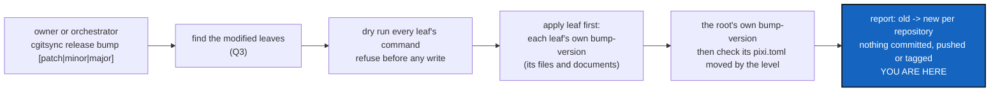

# ReleaseBump — one `cgitsync` command that bumps the tree root's SemVer and each modified leaf's

*Created: 2026-11-11*

*Branch: CGS-ALPHA*

> **From the owner, 2026-11-11:** *"write a DevPlanTicket for adding a cgitsync CMD bump-version by default patch but
> possibility to say minor or major. It controls the SemVer of the Tree root and uses the proper command for the
> modified leaves. This way projet administrated by cgitsync would be capable of updating each leaf version and all
> documents related. Let see what is possible without agent for doing it (the files update was until now performed by
> agent)"*

## Abstract — read this first

**The one-line version.** A new `cgitsync` command takes a level (`patch` by default, or `minor`, `major`). It runs each
modified leaf's own version command, leaf first, then the root's, and checks that the root's version moved by that
level. Anyone can then release a tree that `cgitsync` manages, with or without an agent.

**What this document is.** The plan for that command: what an agent does today on a release, which part of it is
mechanical and which is a judgement, the command, the contract a leaf must meet, the spec changes, the steps, the
decisions the owner owes, and how the work is accepted.

**Why it exists.** Today a release is `pixi run bump-version` in one repository, then `latexmk` in `docs/`, then a
commit message, all run by the orchestrator agent. In a tree of several versioned repositories (atCGS with
ComplexGitSync behind its gate, for example), nothing runs each repository's bump, and nothing checks that the root
moved. `cgitsync` already knows the tree, so it is the place to do it.

**What you will find.** §1 what an agent does today. §2 what can run without an agent. §3 the command. §4 the leaf
contract. §5 architecture constraints. §6 spec changes. §7 steps. §8 decisions for the owner. §9 acceptance. §10 what
this ticket does not do.

**Who it is for.** The worker and the orchestrator who implement it, and the owner, who answers §8.

**What you need to do with it.** Ask §8 before the first edit. Q1 decides the name, Q2 and Q3 most of §3. Land the short
ticket `alpha-examples` first: `bump_version.py` still points at a `.cgs` that does not exist (§5).

---

## 1. What an agent does today on a release

In this project, under `implement` (CLAUDE.md, the orders; `Versioning.md` in `.dev`):

| Step | Who today | Mechanical? |
|---|---|---|
| Choose `major`, `minor` or `patch` from the diff | orchestrator | **No.** A judgement (shared `Versioning.md` §2) |
| `pixi run bump-version <level>`: five targets, three in ComplexGitSync, two in `docs/` | orchestrator | Yes, already a script |
| Rebuild every PDF in `docs/` (`latexmk -pdf MASTER.tex c_*.tex`) | orchestrator | Yes, one command |
| Do the same in every other versioned repository of the tree | nobody | Yes, if each has a command |
| Check that the commit prefix carries the new version | `cgitsync commit` already does | Yes |
| Write the self-history record and the conformity score | orchestrator | No. It records agent work, and has nothing to record without an agent |
| `release freeze` (tag and ledger row) | owner, rarely (last tag `ComplexGitSync-8.5.0`, version now 8.8.0) | Yes, already a command |

## 2. What can run without an agent

Everything except the level, the record and the score. The level stays a reader's judgement, but **the owner typing
`minor` is that reader**: shared `Versioning.md` §2 requires a person to decide, not an agent. CI still never writes a
version. The command is never called from a workflow.

The two cases the command must cover:

- **This tree** (`examples/cgitsync-alpha.cgs`). The root ComplexGitSync has a `bump-version` task. `docs/` has none: its
  version macro is written by ComplexGitSync's script. The private mounts carry no version.
- **atCGS's tree** (`cgs-alpha.cgs`). The root atCGS has a `bump-version` task (`1.9.1-alpha`). The leaf ComplexGitSync
  has one too, but its script is in ComplexGitSync's own `.agent/.local/.dev`, which atCGS's tree does not mount. So
  that leaf cannot be bumped from there, and the command must say so before writing anything (Q7).

## 3. The command

Proposed as `cgitsync release bump [patch|minor|major] [--dry-run]` (name: Q1), `patch` when no level is given.

1. **Refused in a USER tree**, by `WorkingGitTree.require_dev`, before anything is read. The leaves' scripts are
   private, so a user tree cannot run them anyway (shared `Versioning.md` §6).
2. **Find the modified leaves** (Q3), among the `project`-scope repositories only. Private repositories carry no
   version.
3. **Find each one's command** (Q2). A modified leaf with no command is listed as `no command`, and is not an error
   unless it is the root (Q6).
4. **Dry run every command first** (`--dry-run`, §4). If one fails, nothing has been written yet: the command refuses
   and names the repository, the command and its output.
5. **Apply, leaf first, root last**, the order `merge` uses. Each command writes its own files and documents (Q5).
6. **Check the root**: `ProjectVersion.read` before and after. The new version must be the old one moved by exactly the
   level asked (Q4 says what that means for a pre-release).
7. **Report** `old -> new` per repository, then the next step: `cgitsync add`, then `cgitsync commit` with the
   `cgitsync-<new version>` prefix. Nothing is committed, pushed or tagged.

**A failure part-way.** Steps 4 and 6 catch most errors before any write, but a command can still fail during apply.
Then the report names, by `repo_id`, the leaves that completed, the one that failed and those never tried, as
`TreePartialFailure` does for a tree-wide `push`. Nothing is rolled back. The changes are uncommitted files, and the
report says how to discard them (`git -C <path> restore .`).

## 4. The contract a leaf meets

A leaf that wants to be bumped provides one command (by default, under Q2 (a), the pixi task `bump-version`) that:

- takes `major`, `minor` or `patch` as its first argument;
- takes `--dry-run`, writes nothing with it, and exits non-zero when the real run would fail;
- is atomic: all its targets or none (shared `Versioning.md` §6);
- prints `old -> new` on its last line;
- updates every document that embeds the version, PDFs included under Q5 (a).

ComplexGitSync's own `bump_version.py` already meets the first four points. It does not rebuild the PDFs. The contract
goes in the user guide, next to `release`, so another project can meet it.

## 5. Architecture constraints

- **One method, one command.** A `ComplexGitSyncClient` method carries the logic. `cli/` only collects arguments and
  prints. A row in Minimalism's map names the ring interface it lands on (`scripts/map_surface.py`).
- **No `subprocess` outside `git_runner.py`.** Running `pixi run` goes through `GitRunner`, as
  `Toolchain.tool_version("pixi", ...)` already does.
- **`ProjectVersion` stays the only reader** of a project's version, and it never interprets one. Comparing two
  versions by level is new: a small class of its own (for example `tree/semver.py`), not a method added to
  `ProjectVersion`.
- **No version in any hash.** The command writes nothing to the `.gts`, the ledger, the memory or the register.
- **No file paths of any project in `cgitsync`.** The tool calls a leaf's command. It never writes `pyproject.toml`,
  `.tex` or `README.md` itself, except under Q6 (b).
- **The ceilings.** `orchestre/client.py` is at its recorded size. The method belongs in an operation module under
  `tree/operations/`, with only a delegating method on the client. Any raise is asked of the owner.
- **A dead path to fix first.** `bump_version.py`'s `BOOTSTRAP_CGS_PATH` names `examples/complexgitsync4dev.cgs`, which
  does not exist. The short ticket `alpha-examples` fixes it.

## 6. Spec changes, in the same change

- `Versioning.md` (`.dev`): the new command beside `pixi run bump-version`, and who runs which. Under `implement` the
  orchestrator runs the new command. Run by hand, the owner runs it.
- `cgitsync-dev.md` step 4 and step 5 (step 5 only if Q5 (a) folds the PDF rebuild into the leaf's command), CLAUDE.md
  step 4 and order 4 of `implement`.
- `digest.md`: one line for the command (USER-tree refusal, leaf first, never commits, never runs in CI).
- `AdditionalSpecs.md`, *Responsibility boundaries*: the new operation module.
- User guide (`docs/Text/user_guide.tex`): the command and the leaf contract; API docs: the client method. Never
  `README.md`.
- Shared `DevSpec` `Versioning.md` stays as it is: the level is still a person's choice, and the script stays in the
  private mount.

## 7. Steps

1. Ask §8. Check that the short ticket `alpha-examples` has landed.
2. **Tests first** (`tests/integration/test_release_bump.py`). Bare remotes as `_tree` builds them: a root `demo` and a
   leaf `tool`, each with a `pixi.toml` version and a fake `bump-version` task (a small Python script that meets §4),
   plus a leaf `docsrepo` with none and a private writable `.localSpec`. Assert:
   - with no level, root and modified leaves move by `patch`; `minor` and `major` likewise;
   - only modified leaves run (Q3); `docsrepo` is reported `no command`; `.localSpec` is never looked at;
   - a leaf whose dry run fails: nothing is written anywhere, and the refusal names it;
   - a leaf that fails during apply: the report names completed, failed and never tried, and nothing is rolled back;
   - the root moved by another level than asked is refused, naming both versions;
   - a USER tree is refused before any command runs;
   - `--dry-run` writes nothing and prints every `old -> new`;
   - nothing is committed, pushed or tagged.
3. The level comparison class, the operation module, the client method, the CLI command, the Minimalism row.
4. If Q5 (a): `latexmk` added to ComplexGitSync's `bump_version.py` (in `.dev`), after the five targets are written.
5. `pixi run lint`, `pixi run test`, `pixi run bump-build`, the ceilings. The orchestrator decides the level: a new
   command is `minor`, at least.
6. Specs, digest and docs (§6); `pixi run check-spectree`.
7. Dogfood: the orchestrator releases this change with the new command instead of `pixi run bump-version`. Then
   `cgitsync status` from this tree's root shows `errors=0`.

## 8. Decisions for the owner

Open. Ask each with `AskUserQuestion` before the first edit.

- **Q1 — the name.** The owner wrote `bump-version`. The CLI grammar (`DevSpecs.md` §CLI Grammar) spells a verb on a
  noun as command then subcommand (`branch close`, not `close-branch`).
  (a) `cgitsync release bump [level]`, under the existing `release` (freeze, list, load).
  (b) `cgitsync version bump [level]`, a new command group.
  (c) `cgitsync bump-version [level]`, as written, as an exception the owner names.
  *Recommendation: (a).* A bump is the first half of a release, `release` is already in the Minimalist group, and no new
  top-level name is added.
- **Q2 — how a leaf's command is found.**
  (a) A convention: the leaf's `pixi.toml` declares a task `bump-version`, run as `pixi run bump-version <level>` in the
  leaf's directory.
  (b) A new optional `.cgs` key per repository, for example `version_command = "pixi run bump-version"`.
  (c) (a), with (b) as an override.
  *Recommendation: (a).* ComplexGitSync and atCGS already have that task, and every DevSpec project works through Pixi.
  (b) changes the `.cgs` grammar for a case that does not exist yet.
- **Q3 — which leaves count as modified.**
  (a) Those with uncommitted changes, or commits their upstream does not have: what the next commit and push will
  publish.
  (b) Those changed since the root's last release tag (`<project>-<version>`).
  (c) Every `project`-scope leaf that has a command, modified or not.
  *Recommendation: (a).* Releases are rarely frozen here (last tag 8.5.0, version now 8.8.0), so (b) would bump leaves
  for changes long since released. (c) bumps leaves that changed nothing.
- **Q4 — the level given to a leaf.**
  (a) The same level as the root, the one typed.
  (b) The level for the root, `patch` for every leaf.
  (c) The level for the root, and an option naming a level per leaf.
  *Recommendation: (a).* A bigger bump than needed keeps SemVer's promise. A smaller one breaks it, and (b) would
  under-state a leaf that gained a command. (c) can come later if the need appears.
- **Q5 — the documents, PDFs included.**
  (a) The leaf's own command rebuilds them. ComplexGitSync's `bump_version.py` gains the `latexmk` step.
  (b) A second leaf task (for example `docs`), which `cgitsync` runs after the bump.
  (c) Not in this command. The report reminds the user to rebuild.
  *Recommendation: (a).* `cgitsync` stays ignorant of LaTeX, and "all documents related" becomes the leaf's promise in
  §4. It needs `latexmk` wherever a release is cut, which is already the case.
- **Q6 — a root with no command.**
  (a) Refused, naming the task the root lacks.
  (b) `cgitsync` writes `[workspace].version` in the root's `pixi.toml` itself.
  *Recommendation: (a).* (b) makes `cgitsync` write a manifest it does not own, and silently skips every file that
  mirrors the version.
- **Q7 — a modified leaf whose command cannot run in this tree** (ComplexGitSync behind atCGS's gate, §2).
  (a) Refused before any write, naming the leaf and what is missing.
  (b) Skipped with a warning, the rest bumped.
  *Recommendation: (a).* Bumping atCGS while a modified ComplexGitSync keeps its old version gives a release that
  claims what one of its parts never said. The owner then bumps ComplexGitSync from its own tree first.
- **Q8 — pre-releases.** atCGS is on `1.9.1-alpha`, which has no `.N`. ComplexGitSync's script expects
  `-<stage>.<N>`.
  (a) Not in this ticket. `patch`, `minor` and `major` are passed through, and the level check (§3 step 6) compares the
  base `MAJOR.MINOR.PATCH` and ignores the suffix.
  (b) `--pre <stage>` and `--release` passed through as well, with a check for each.
  *Recommendation: (a).* The suffix rules differ between the two projects, so a check on them would encode one
  project's choice in the tool.

## 9. Acceptance

- In this tree, `cgitsync release bump` with no level moves ComplexGitSync from 8.x.y to 8.x.(y+1) in all five targets,
  reports `docs` as covered by its parent or `no command`, and touches no private repository.
- `minor` and `major` move the root by that level. The root's `pixi.toml` agrees with the report.
- A failing dry run writes nothing anywhere. A failure during apply is reported by `repo_id`, with nothing rolled back.
- A USER tree is refused before anything runs. No workflow calls the command.
- The command commits, pushes and tags nothing, and writes nothing to the `.gts`, the ledger, the memory or the
  register.
- `pixi run lint` and `pixi run test` pass; `check-spectree` passes; `cgitsync status` shows `errors=0`.
- The release of this ticket itself was cut with the new command (§7 step 7).

## 10. Not this ticket

- Choosing the level from a diff. It stays a person's judgement.
- Writing the self-history record or the score: still the orchestrator's, under `implement`.
- Chaining `commit`, `push` or `release freeze` after the bump.
- `bump-build`. It stays a worker's step on each change to `src/`, not a release step.
- Adopting the contract in atCGS: atCGS's own ticket, once this lands.
