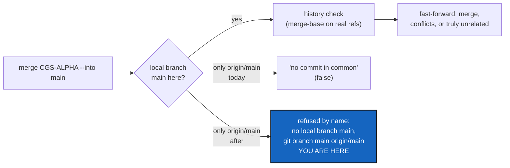

# MergeIntoLocalTarget — `merge --into` names a target with no local branch, instead of calling it unrelated

*Created: 2026-11-11*

*Branch: CGS-ALPHA*

> **From the owner, 2026-11-11:** *"write a DevPlanTicket in CGS-ALPHA for fixing the merge i should write origin/main ?
> if no main loaclly write an error message"*. It follows the owner's dry run
> `cgitsync merge --all CGS-ALPHA --into main --dry-run` in this workspace, which refused all five repositories as
> *"share no commit"* although every one shares history with its target. The owner's order settles Q1 (§5): refuse,
> with a message. The question is answered in §2: no, the user never types `origin/main`.

## Abstract — read this first

**The one-line version.** When the target of `merge --into` exists only on the remote, `cgitsync` today reports
*"no commit in common"*, which is false. After this ticket it refuses by name: the branch is not here, and this is the
command that creates it. A real unrelated history is still reported as one.

**What this document is.** The plan for that fix: what happened, the cause, the change, the steps, the decisions, and
how the work is accepted.

**Why it exists.** A refusal that names the wrong cause sends the user looking for a broken history that does not
exist. Here it blocked merging `CGS-ALPHA` into `main`, which is a fast-forward in the project repositories.

**What you will find.** §1 what happened. §2 the cause, and why `origin/main` is not the answer. §3 the change. §4 the
steps. §5 the decisions. §6 acceptance. §7 what this ticket leaves alone.

**Who it is for.** The worker and the orchestrator who implement it, and the owner, who answers §5.

**What you need to do with it.** Ask Q2 and Q3 before the first edit (Q1 is answered). Then follow §4.



---

## 1. What happened

In `~/.cgs/ComplexGitSync-20261111084907`, on `CGS-ALPHA`, the dry run planned:

| Repository | Plan | What Git says |
|---|---|---|
| ComplexGitSync | `main <- CGS-ALPHA`, *no commit in common* | merge-base with `origin/main` is 47d4100; `main` is 2 commits behind, a fast-forward |
| DocComplexGitSync | the same | merge-base 31cc371; `main` is 3 commits behind |
| `.dev`, `.localSpec`, `.claude` | `ComplexGitSync <- ComplexGitSync_CGS-ALPHA`, *no commit in common* | `.dev` has `origin/ComplexGitSync`, and no local `ComplexGitSync` |
| `.omniscience`, `.memory`, `.self-history` | *no such branch here, skipped* | correct: `ComplexGitSync_CGS-ALPHA` does not exist there |

None of the five refused repositories has a **local** branch of the target. Each has only the remote-tracking ref.

## 2. Cause, and why `origin/main` is not the answer

**The cause.** `MergeOperation.merge_into_status` (`tree/operations/merge.py`) asks `git_runner.branch_known(target)`,
which is true for a remote-only branch. It then calls `MemoryMergeOperation.tree_status(repo, git_runner, source,
target)`, whose last check (`tree/operations/memory_merge.py:149`) is:

```python
git_runner.merge_base(path, into or "HEAD", git_runner.resolve_merge_ref(path, source, remote=remote))
```

The source is resolved to `origin/CGS-ALPHA` when it is remote-only, but the target is passed bare. `git merge-base
main origin/CGS-ALPHA` fails with *"Not a valid object name main"*, `merge_base` returns `None`, and `None` is read as
*"no common ancestor"*. A plain `merge` (no `--into`) and `pull --private` are not affected, because their target is
the branch checked out, which is always local.

**Why typing `--into origin/main` is not the answer.** The argument is a **project** branch, from which every
repository derives its own (`merge_source_ref`): a private repository would look for `ComplexGitSync_origin/main`,
which does not exist. And `git checkout origin/main` leaves a project repository on a detached HEAD, so the merge
commit would land on no branch. The user always types `main`, and the tool makes sure `main` exists here first.

## 3. The change

1. **A new plan status, `no-local-target`**, decided in `merge_into_status` right after the existing `no-target`
   check: the target is known (`branch_known`) but not a local branch (`local_branch_exists`). It is a refusal. Like
   every other one in `merge_into_tree`, it is collected for every repository in scope before anything is checked out,
   so the tree stays exactly where it was.
2. **The message** names each repository, its path and the command that creates the branch from the remote, in one
   refusal (wording: Q2):

   ```
   merge --into main: refused, and nothing was changed. ComplexGitSync and 4 others have no local branch for the
   target, only the remote's. Create each one from the remote, then run this again:
     git branch main origin/main                                        (ComplexGitSync, .)
     git -C docs branch main origin/main                                (DocComplexGitSync)
     git -C .agent/.local/.dev branch ComplexGitSync origin/ComplexGitSync  (.dev)
     ...
   ```

   The command uses each repository's own remote name (`repo.remote_name`, default `origin`) and the target it
   derived, never the project branch typed.
3. **The dry run shows it**: `(no local branch here, only <remote>/<target> — would refuse)`, in the labels of
   `cli/expert.py` (the `merge --into` table), and the status joins the list that makes the dry run print `refused=true`.
4. **`tree_status` resolves its target too**, through `resolve_merge_ref`, as it already does the source. With step 1
   the target reaching it is always local, so this changes no answer today. It keeps the one function that decides
   "unrelated" from ever reading a missing ref as a missing history again, for any caller.
5. **A target typed with its remote's prefix** (`--into origin/main`) is refused by name, before any plan, when
   `<remote>/<rest>` is a remote-tracking ref in the root and `<rest>` is not a local branch: *"merge --into takes a
   project branch: type main, not origin/main"* (Q3).

No new command, option or client method, so no Minimalism row. The user guide's `merge --into` section and tutorial 7
§3 gain one line on the refusal.

## 4. Steps

1. **Tests first**, in `tests/integration/test_merge_into.py`, with the bare-remote trees it already builds: clone a
   tree whose remote has `main` and `feature`, with no local `main` (delete it after the clone, or clone with
   `--branch feature`). Assert:
   - `merge feature --into main --dry-run` shows `no local branch` for that repository, never `no commit in common`,
     and `refused=true`;
   - `merge feature --into main` raises one `GitSyncError` naming every such repository and its `git branch` command,
     and nothing is checked out or merged anywhere;
   - after the named `git branch` commands, the same merge runs and fast-forwards;
   - a private writable repository with only `origin/<project>` is refused the same way, naming its derived branch;
   - two branches that really share no commit, both local, are still refused as `unrelated`;
   - `--into origin/main` is refused by name with the Q3 wording;
   - a plain `merge feature`, on a checked-out target, is unchanged.
   A unit test in `tests/unit/test_memory_merge_operation.py`: `tree_status` with a remote-only target and a shared
   history answers `None`, not `"unrelated"`.
2. Change `merge.py`, `memory_merge.py` and `cli/expert.py` as §3 says.
3. `pixi run lint`, `pixi run test`, `pixi run bump-build`, the ceilings with no raise, or the raise asked of the owner.
   The orchestrator decides the level: a bug fix with no new interface is `patch`.
4. The user guide, tutorial 7, and the module docstrings; `pixi run check-spectree`.
5. `cgitsync status` from this tree's root: `errors=0`. Then, in this workspace, the owner's dry run
   `merge --all CGS-ALPHA --into main --dry-run` shows the five repositories as `no local branch`; after the five
   named `git branch` commands, it shows fast-forwards.

## 5. Decisions for the owner

- **Q1 — what to do when the target exists only on the remote. Answered: refuse with a message,** *"if no main
  loaclly write an error message"*. The two alternatives, not taken: resolve the target to `origin/main` silently
  (the checkout would then create `main` on its own, which `merge --into` refuses to do for a missing target), or
  create the local branch from the remote without asking.
- **Q2 — what the message tells the user to run.** Open.
  (a) The plain `git branch <target> <remote>/<target>` for each repository, as in §3.2.
  (b) A `cgitsync` command, if one creates a local branch from the remote across the tree. `branch create` today
  creates a branch at `HEAD`, so it would fork a new history under a name the remote already has. It does not fit.
  *Recommendation: (a).* It is exact, offline, moves nothing, and needs no new command.
- **Q3 — `--into origin/main`.** Open.
  (a) Refused by name, as §3.5.
  (b) Accepted, and read as `main`.
  *Recommendation: (a).* A branch name may contain `/` (`closed/memory-dev` exists here), so silently cutting a prefix
  could merge into the wrong branch. Naming the right word costs the user one retry.

## 6. Acceptance

- The owner's dry run in this workspace no longer says *no commit in common* for any repository that shares history
  with its target; it names each missing local branch and the command that creates it.
- After those commands, `merge CGS-ALPHA --into main --all` fast-forwards the project repositories and merges the
  private ones that have both branches, and skips the rest as it does today.
- A truly unrelated pair of branches is still refused as unrelated.
- Nothing is checked out, merged, created or fetched by a refused run.
- `pixi run lint` and `pixi run test` pass; `cgitsync status` shows `errors=0`.

## 7. Not this ticket

- Creating the missing local branch automatically (Q1, not taken).
- `ComplexGitSync_CGS-ALPHA` missing in `.omniscience`, `.memory` and `.self-history`: the skip is correct.
- Pushing after the merge: `cgitsync push`, on the owner's word.
