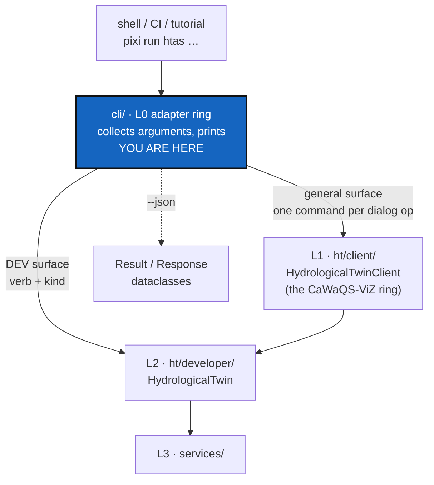

# HtasCli — `pixi run htas <command> <subcommand> --option`, built as cgitsync's CLI

*Created: 2026-11-19*

*Branch: HT-BETA*

## Abstract — read this first

**The one-line version.** Give HTAS a command-line tool, `htas`, run as
`pixi run htas <command> [<subcommand>] [--option …]`. It is built the way
`cgitsync`'s CLI is built: a thin adapter ring that only collects arguments
and prints. It exposes two surfaces: the **general** one, which is the
CaWaQS-ViZ ring (`HydrologicalTwinClient`, L1, one command per dialog
operation), and the **DEV** one (`HydrologicalTwin`, L2, the macro-verbs and
their `kind`s). The ticket also ships tutorials and brings every document
that describes the API in line with it.

**What this document is.** The request (§1), what exists today (§2), the
design (§3), the work in four milestones (§4), the decisions for the owner
(§5), and acceptance (§6).

**Why it exists.** Today HTAS can be driven only from Python: from
CaWaQS-ViZ's dialogs, or from a notebook. A CLI makes every operation
scriptable, testable from a shell, and usable without QGIS, and it gives
the public interface a surface whose stability SemVer can measure. The
CaWaQS-ViZ `ARCHITECTURE.md` already names L1 as "the surface a future HTTP
server will expose"; the CLI is the first such adapter.

**What you need to do with it.** Pile 1, rank 1. Ask §5 before the first
edit. The milestones land in order; each one ends green.

---

## 1. The request

The owner, 2026-11-19: *develop a CLI `pixi run htas CMD CMD2 option` like
cgitsync's, based on the CaWaQS-ViZ ring and on HTAS's DEV ring; write
tutorials and synchronise the documentation.*

## 2. What exists today

**The two rings.**

- **General, L1** (`ht/client/hydrological_twin_client.py`): construction
  (`build`, `configure`, `load`, `describe`, `is_ready`), detection
  (`detect_from_out_caw`, `detect_project_neighbors`), and ten dialog
  operations: `budget_barplot`, `hydrological_regime`,
  `spatial_map_watbal`, `spatial_map_aq`, `compare_sim_obs`,
  `statistical_criteria`, `mask_internal_values`, `mask_hyd_boundary`,
  `mask_aq_boundary`. Each delegates to an `operations_client.run_*` and
  returns a typed `*Result`. CaWaQS-ViZ calls exactly these ten.
- **DEV, L2** (`ht/developer/hydrological_twin_developer.py`): the
  macro-verbs `configure`, `load`, `describe`, `fetch`, `mask`, `assemble`,
  `transform`, `render`, `export`, each dispatching on a `kind`
  (`dispatch.py`). Today: `fetch` simulation_matrix, observations,
  sim_obs_bundle, spatial_map, catchment_cells, aquifer_outcropping_map,
  aq_balance_inputs; `mask` area_values, polygon_cells, boundary_hyd,
  boundary_hyd_flux, boundary_aq, boundary_aq_flux; `transform`
  temporal_aggregation, spatial_average, volumetric_rescale,
  temporal_aggregate, criteria, budget, hydrological_regime, runoff_ratio,
  aq_balance; `export` npy, geopackage; `assemble` compartment_bundle,
  boundary_aq_layers; `render` budget_barplot and others.

**What the CLI has to supply.** An operation needs a loaded twin: metadata
and `configure`/`load` arguments (compartments, years, geometry config,
observation directory). `detect_from_out_caw` and `detect_project_neighbors`
recover most of them from a CaWaQS `OUT_CAW` directory and a QGIS project.
Operation arguments are typed (periods, frequencies, units, output
directories), and two are structured: `mask_internal_values`'s `specs`, a
list of `(compartment, outtype, param, unit)`, and `spatial_map_aq`'s `mode`,
a dict. There is no persistence between calls (`ht/persistence.py` is gone,
`docs/TODO.md`), so each command builds its own twin.

**The model, ComplexGitSync** (`ComplexGitSync/src/ComplexGitSync/cli/`).
It is one package that the console script `cgitsync =
"ComplexGitSync.cli:main"` enters. It sits in the outer ring and only
collects arguments and prints: every command calls a client method, and
the mirror runs one way. It keeps one registry of commands
(`_PLANNED_COMMANDS`), formats help with examples (`help_format.py`),
suggests "did you mean" on a typo (`suggest.py`), maps exceptions to exit
codes (`exit_codes.py`) and renders `--json` (`json_render.py`). A test
fails when the user guide does not name a command
(`test_user_guide_documents_every_cli_command`). It has eight tutorials,
each opening with a twenty-line *Getting started*, and a README that lists
use cases with their tutorial and never lists commands.

**Constraints already in force.** The DevSpecs CLI Grammar: one subcommand
level, `<tool> <command> [<subcommand>] [<argument>…] [--option …]`; a
subcommand is a plain word; an option changes how, never which; a hyphen
never glues a command to its subcommand; a command has subcommands or
acts, never both. The QGIS-free rule. Pixi only, never `pip` in docs or CI.
SemVer: a new command is a MINOR bump, so this ticket releases `1.1.0`.

**A risk found while drafting.** CaWaQS-ViZ installs HTAS with `pip install
--user --upgrade external/HydrologicalTwinAlphaSeries` at the plugin's first
launch (`INSTALL.md`). SemVerPixi raised `requires-python` to `>=3.11`, so
that install now fails under a QGIS that ships an older Python. The CLI's
console script goes through the same install. See D6.

## 3. The design

**The adapter ring.** `src/HydrologicalTwinAlphaSeries/cli/`, a package, is
added as the outer ring, L0, above L1 and L2 in `AdditionalSpecs.md` §2. It
imports only `ht.client`, `ht.developer` and their public types. It holds
no computation and no default a lower layer does not already hold. Each
module is named for one command group, with its parser and handlers
together, as in `ComplexGitSync/cli/`. The console script
`htas = "HydrologicalTwinAlphaSeries.cli:main"` goes in `pyproject.toml`
`[project.scripts]`; the Pixi task `htas = "htas"` goes in `pixi.toml`, so
`pixi run htas …` passes its arguments through.

**The two surfaces** (spelling proposed; D1 settles the clash).

| Surface | Ring | Commands (proposal) |
|---|---|---|
| Twin | L1 | `htas detect run <OUT_CAW>`, `htas detect neighbors <QGIS project>`, `htas describe` |
| General | L1, the CaWaQS-ViZ ring | `htas budget barplot`, `htas regime show`, `htas map watbal`, `htas map aq`, `htas compare sim-obs`, `htas criteria compute`, `htas mask internal-values`, `htas mask hyd-boundary`, `htas mask aq-boundary` |
| DEV | L2 | one command per macro-verb, one subcommand per `kind`: `fetch simulation-matrix`, `transform temporal-aggregation`, `export geopackage`, … spelled per D1 |

**Rules the CLI keeps** (they go in `AdditionalSpecs.md` and `digest.md` in
the change that lands M1):

- **The mirror runs one way.** Every general command calls one
  `HydrologicalTwinClient` method, and every DEV command calls one
  `HydrologicalTwin` verb with one `kind`. A method may have no command; a
  command never has no method. A capability that does not exist in Python
  is never added in `cli/`.
- **One registry.** `cli.COMMANDS` lists every command and subcommand.
  Help, the typo suggestion, the documentation test and the tutorials test
  all read it.
- **Inputs.** The twin comes from one place (D2). Operation arguments are
  options named after the Python keyword (`--period START END`,
  `--frequency`, `--target-unit`, `--output-dir`). Structured arguments
  take a repeatable option (`--spec COMPARTMENT:OUTTYPE:PARAM:UNIT`) or a
  JSON file (`--mode-file`), per D4.
- **Output.** A short human report by default. `--json` prints the
  `*Result`/`*Response` dataclass as JSON, and the shape of that JSON is
  public interface. The paths a command wrote are always printed. An
  exception becomes one diagnostic line and a documented exit code (usage
  2, input or data 3, state 4, internal 1), per D5.
- **`htas --version`** prints the version and `__build__`.
- **Help.** `htas --help` lists the commands; `htas <command> --help` lists
  its subcommands with one example each. A command run without its
  subcommand refuses and lists them. A typo gets a "did you mean".

## 4. The work — four milestones

Each milestone is one `implement`: it ends with lint (no new error) and
tests green, `cgitsync status` at `errors=0`, the orchestrator's quote, and
its own commit message. The version moves MINOR once, at M2, the first
milestone a user can run an operation with, and PATCH after that.

1. **M1 — skeleton.** The `cli/` package and its modules, the console
   script, the Pixi task, the registry, help with examples, the typo
   suggestion, exit codes, `--json`, `--version`, and the twin commands
   (`detect run`, `detect neighbors`, `describe`), with the input chosen
   in D2. Tests: the parser builds; every registry entry has a handler;
   every command's `--help` exits 0; the grammar holds (no hyphen glues a
   command name to another, no command both acts and has subcommands).
   Specs: `AdditionalSpecs.md` §2 gets L0; §3 its import rule; `digest.md`
   the rules of §3 above.
2. **M2 — the general surface.** One command for each of the ten client
   operations, with options from the `run_*` signatures. Tests: each
   command against the CaWaQS test case (`CWAQS_FIXTURE_ROOT`, skipped
   when absent) writes the files its `*Result` names, and its `--json`
   parses; a test fails when a `HydrologicalTwinClient` operation has no
   command. Release `1.1.0`. Before the first command, fix `audit.md` #15:
   `build_client` must put `start_year` and `end_year` in the client's
   metadata, which every operation reads.
3. **M3 — the DEV surface.** One command per verb and one subcommand per
   `kind`, generated from the dispatch table instead of hand-copied, so a
   new `kind` gets its command in the same change (D3). Tests: every
   `kind` in `dispatch.py` has a subcommand; each runs on the fixture, or
   is marked as needing a prior step.
4. **M4 — tutorials and documentation.** It may land in pieces alongside
   M2 and M3, but it closes the ticket. **DocsOnTheFly D1 is (b)** (owner,
   2026-11-20): DocsOnTheFly owns the tutorial section, its index and
   tests, the Python tutorials, the README, `audit.md` #4 and step 7, all
   landed or planned there. M4 keeps only two items: the CLI tutorials,
   written inside DocsOnTheFly's `tutorials/`, and the user guide's CLI
   chapter with its registry test. The guide already has a *command line*
   section (DocsOnTheFly M1) that M4 grows into that chapter. The items
   below that DocsOnTheFly now owns are kept for the record.
   - `tutorials/`, at the repository root, with an index as in
     ComplexGitSync. Each tutorial opens with *Getting started*, about
     twenty lines of commands on the CaWaQS test case. Proposed set:
     1. first run: detect, describe, budget barplot;
     2. maps and the hydrological regime;
     3. comparing simulation and observations, and the statistical
        criteria;
     4. masks: internal values, the HYD boundary, the AQ boundary;
     5. the DEV surface: fetch, transform, render and export by `kind`;
     6. scripting: `--json`, the exit codes, CI.
   - **User guide.** A CLI chapter in `docs/hydrological_twin`
     (`Mainmatter/4_HT_UserGuide.tex` and `HTAS_user_guide.tex`) that
     names every command and subcommand, with its options. It is the
     command reference. A test fails when the guide does not name a
     registry entry, as ComplexGitSync's does. The PDF is rebuilt.
   - **API docs.** `docs/api_capabilities.md` and `docs/api_examples.md`
     give each capability its CLI spelling next to its Python one.
     `docs/canonical_monolith.md` gets the CLI as L0.
   - **README.** What `htas` is for, `pixi run htas --help`, and one row
     per use case with its tutorial. No command table. The stale
     `ht/persistence.py` and `accessors.py` lines go (`audit.md` #4).
   - **Specs.** `htas-dev.md` step 7 becomes "document a new command in
     the user guide, enforced by its test; a new use case gets a README
     row and a tutorial", and the same in `CLAUDE.md`. Add the Editing
     role's tutorial scope to `AGENT.md`.
   - **Tutorial test.** Each tutorial's *Getting started* block runs in CI
     on the fixture, or its commands are at least parsed against the
     registry (D7).

## 5. Decisions for the owner

- **D1. The two surfaces share `mask` and `render`, and the grammar has
  one subcommand level.** `htas mask internal-values` (L1) and the L2
  `mask` kinds (`polygon-cells`, …) cannot both sit under `htas mask`, and
  `htas dev mask polygon-cells` would be a second subcommand level. The
  options:
  - (a) A second console script, `htas-dev <verb> <kind>`, for L2. It is
    `pixi run htas-dev …`, and the grammar is unchanged.
  - (b) L2 at the top of `htas` and the L1 operations renamed so nothing
    clashes. For example, `htas mask internal-values` stays L1 and the L2
    kinds become `htas select polygon-cells`. This hides the ring.
  - (c) A local exception to the DevSpecs grammar: one extra level for
    `htas dev <verb> <kind>`, stated in `AdditionalSpecs.md`. DevSpec is
    shared and read-only, so the exception is HTAS's own.
- **D2. Where the twin comes from.**
  - (a) A hand-written project file, `htas.toml` (metadata, `configure`
    and `load`), passed as `--project`. It is the counterpart of a `.cgs`.
  - (b) Options on every command (`--out-caw`, `--geometry-config`,
    `--obs-dir`, `--years`), filled in by the detection helpers.
  - (c) Both: options override the file, and `htas detect run` writes the
    file.
- **D3. DEV subcommands from the dispatch table.** Generate them from
  `dispatch.py`'s kinds, which needs a registry in L2 that does not exist
  yet. Or list them by hand in `cli/`, with a test that compares the two.
- **D4. Structured arguments.** A repeatable, colon-separated option
  (`--spec AQ:…:…:m3/j`), a JSON file option (`--specs-file`), or both.
- **D5. Exit codes and `--json`.** Adopt ComplexGitSync's codes and
  render as they are, or HTAS's own set.
- **D6. Python 3.11 against QGIS.** CaWaQS-ViZ's `pip install` needs the
  QGIS Python to satisfy `requires-python >= 3.11`. Check the QGIS
  versions you support. Then keep 3.11, or lower the floor to 3.10, and
  then `tomllib` cannot be used in `src/`.
- **D7. Tutorials in CI.** Run every *Getting started* block on the
  fixture in CI (slower, true), or only parse its commands against the
  registry (fast, partial). *There is no CI since DocsOnTheFly M1 (owner,
  2026-11-20): read "in CI" as "in `pixi run test`", the local gate.*

### The owner's answers (2026-11-20, before M2)

- **Scope of this `implement`:** M2 only.
- **D1: (a)**, a second console script, `htas-dev <verb> <kind>`, for the DEV
  surface (M3). Not built in M2.
- **D2:** settled by M1 (`htas.toml`, options override it, `detect run`
  writes it). **D5:** settled by M1 (the three exit codes, `--json`).
- **D4: both.** `--spec COMPARTMENT:OUTTYPE:PARAM:UNIT` (repeatable) and
  `--specs-file` JSON; `--mode KEY=VALUE` (repeatable) and `--mode-file` JSON.
- **D6:** keep Python 3.11.
- **D7:** moot, there is no CI (DocsOnTheFly D4): a test in `pixi run test`.

### What M2 did (2026-11-20)

- `cli/operations.py`: one command per client operation (nine, not the ten
  this ticket counted), from one table of options. Spelled with plain-word
  subcommands, as the grammar test requires: `budget barplot`, `regime show`,
  `map watbal`, `map aq`, `compare simobs`, `criteria compute`,
  `mask internal`, `mask hyd`, `mask aq` (the proposal's `sim-obs`,
  `internal-values` and the like carried hyphens).
- `audit.md` #15 fixed: `build_client` puts `start_year` and `end_year` in
  the client's metadata.
- The mask commands read their polygon from `--polygon FILE` (a vector file,
  features merged) and the years from the project file. The map commands
  return a layer in memory: `--output GPKG` saves it; `compare simobs
  --mode csv` likewise with `--csv-file`.
- Tests: `tests/unit/test_cli_operations.py` (every operation has a command;
  the keywords each command passes; `--json`; the errors); and
  `tests/integration/test_cli_fixture.py`, `describe` then `budget barplot`
  on the CaWaQS test case, skipped without `CWAQS_FIXTURE_ROOT`.

M3 (the DEV surface) and M4 (CLI tutorials, the user guide's registry test)
remain.

## 6. Acceptance

- `pixi run htas --help`, `pixi run htas --version` (version and build),
  and `pixi run htas <command> --help` for every command, exit 0.
- Every `HydrologicalTwinClient` operation has a general command, and
  every L2 `kind` has a DEV subcommand. Tests fail otherwise.
- Every command and subcommand is named in the user guide. A test fails
  otherwise.
- On the CaWaQS test case, each general command writes the files its
  `*Result` names, and `--json` parses. Commands that need data are
  skipped without `CWAQS_FIXTURE_ROOT`.
- No `qgis`/`PyQt` import, and no computation, in `cli/`; `cli/` imports
  only `ht.client`, `ht.developer` and their public types.
- The tutorials exist, are indexed, and pass the D7 check. The README
  lists use cases and tutorials, and no commands.
- `pixi run lint` shows no new error; `pixi run test` passes; `cgitsync
  status` shows `errors=0`; `cgitsync version diagnose` shows `1.1.0` or
  later.
