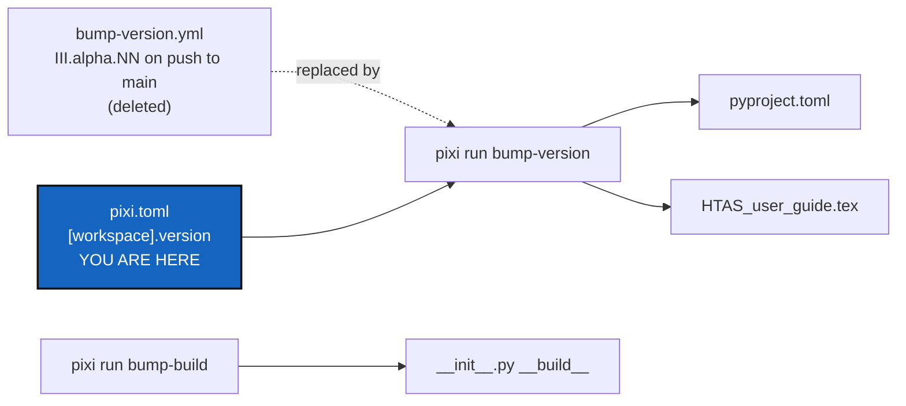

# SemVerPixi — SemVer in pixi.toml, bumped by the orchestrator, not by CI

*Created: 2026-11-19*

*Branch: HT-BETA*

## Abstract — read this first

**The one-line version.** Move HydrologicalTwinAlphaSeries from the
`III.alpha.NN` version bumped by a GitHub workflow to real SemVer, declared
in a root `pixi.toml` and bumped by `pixi run bump-version`, ported from
ComplexGitSync.

**What this document is.** The request (§1), what exists today (§2), the
work (§3), the decisions for the owner (§4) and acceptance (§5).

**Why it exists.** The owner's decision, 2026-11-19: versioning follows
ComplexGitSync's specs and is handled by the agentic process, not by the
current CI. Today CI writes a version on every push to `main`, nobody
decides the level, and the user guide's version has drifted
(`000.alpha.18` against `000.alpha.40`).

**What you need to do with it.** Pile 1, rank 1: the checklist in
`htas-dev.md` (steps 2, 4, 5, 8) waits on it.

---

## 1. The request

Adopt [Versioning.md](../../Versioning.md) (this project's fill-in) as
written: SemVer in `pixi.toml`, `bump-version` and `bump-build` as Pixi
tasks backed by scripts in `.agent/.local/.dev/scripts/`, CI read-only.

## 2. What exists today

- `pyproject.toml`: `[project].version = "000.alpha.40"`; Pixi configured in
  `[tool.pixi.workspace]`, `[tool.pixi.tasks]`, `[tool.pixi.dependencies]`,
  `[tool.pixi.pypi-dependencies]`; no `pixi.toml`.
- `.github/workflows/bump-version.yml`: on push to `main`, bumps `NN`
  (`99` rolls into `III`), commits `chore: bump version ...` and pushes.
- `src/HydrologicalTwinAlphaSeries/__init__.py`: `__version__` from
  `importlib.metadata`; no `__build__`.
- `docs/hydrological_twin/HTAS_user_guide.tex`: `\def\version{000.alpha.18}`,
  hand-synced.
- `tests/unit/test_version.py`: checks `__version__` against the package
  metadata and `pyproject.toml`'s `[project].version`.
- ComplexGitSync's model: `.dev/scripts/bump_version.py` on branch
  `ComplexGitSync_CGS-ALPHA` (five targets, all or none, `--pre`,
  `--release`, `--dry-run`, PDF rebuild).

## 3. The work

1. Move the Pixi configuration from `pyproject.toml` to a root `pixi.toml`
   with `[workspace].version`; keep `pyproject.toml` `[project]` for the
   hatchling build.
2. Port `bump_version.py` to `.agent/.local/.dev/scripts/`, with the three
   targets of Versioning.md; add `bump_build.py` if D3 says so; declare the
   `bump-version` and `bump-build` tasks.
3. Delete `.github/workflows/bump-version.yml`; check `ci.yml` writes
   nothing.
4. Set the first SemVer (D1) through the new script, not by hand.
5. Update `test_version.py`, and add a test that the user guide's
   `\version` equals `pixi.toml`'s.
6. Check `cgitsync version diagnose` reads the version, and that
   `cgitsync commit` accepts `HydrologicalTwinAlphaSeries-<version>`.
7. Update `Versioning.md`'s *Status* section and `htas-dev.md`'s
   *(SemVerPixi)* marks in the same change.

## 4. Decisions for the owner

- **D1. The first SemVer.** `0.40.0` (keeps the count), `0.1.0`, or a
  pre-release such as `0.40.0-alpha.1`.
- **D2. The last alpha.** No `III.alpha.NN` version was ever tagged (the
  only tag is `vCGS1`), and the `chore: bump version` commits stay as they
  are, since nothing is rewritten. Tag `000.alpha.40` before the switch, or
  leave it untagged.
- **D3. A build counter.** Add `__build__` and `bump-build` as in
  ComplexGitSync, or bump-version only.
- **D4. The user guide PDF.** Track the built PDF and have `bump-version`
  rebuild it, or track only the `.tex`.
- **D5. Where the script lives.** In the private `.dev` mount, as in
  ComplexGitSync (a public-only checkout cannot release), or in the public
  repository's `scripts/`.

## 5. Acceptance

- `pixi run bump-version patch --dry-run` prints `old -> new` and writes
  nothing; without `--dry-run` it writes every target or none.
- No workflow under `.github/workflows/` writes a version.
- `pixi run lint` and `pixi run test` pass; `cgitsync status` shows
  `errors=0`.
- `cgitsync version diagnose` reports the project as `semver`.
