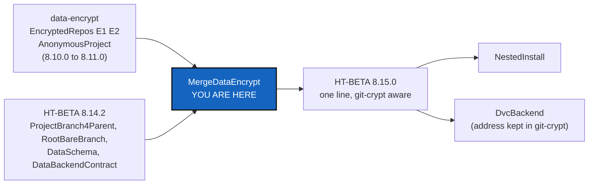

# MergeDataEncrypt — bring the git-crypt and anonymous-project work of `data-encrypt` into `HT-BETA`

*Created: 2026-11-27*

*Branch: HT-BETA*

> **Ticket review — 2026-11-27, on the owner's request:** *"shortTicket review and write DevPlanTickets in a proper
> order of execution. Merge paralell tasks in the same tickets. The goal is a CGS-HT-BETA ready for htbs. Also
> anticipate the merging of the CGS branch that deals with git-encrypt."* This ticket is that merge. It comes right after
> CheckoutBareTip, which makes the docs branch of the source line reliable, because DvcBackend reuses its git-crypt detection, because NestedInstall edits `orchestre/installer.py`,
> which this merge also changes, and because every day the two lines stay apart adds conflicts.
> **EncryptedMerge is folded in as step 6.** It arrives in `openTickets/` with the `.dev` merge (step 2). It is a
> small, independent change to `merge --resolve`, so it runs in parallel with steps 3–5 in this ticket rather than
> waiting for a review of its own.

## Abstract — read this first

**The one-line version.** `data-encrypt` (cgitsync 8.10.0, 8.10.1 and 8.11.0 on that line) holds EncryptedRepos E1
and E2 and AnonymousProject. `HT-BETA` (8.14.2) went on without them. This ticket merges `data-encrypt` into
`HT-BETA` in every repository of the tree, settles the version numbers that both lines used, and proves the
features that met for the first time in the merge (aliases and the new branch rules, the `CRYPT` column and the
branch-missing report, anonymous States and integrity schema 2) still agree.

**What this document is.** A merge plan with a trial run behind it: what conflicts, what merges cleanly but must
be checked, the steps in order, the acceptance and the owner's decisions.

**Why it exists.** HTBS mounts ComplexGitSync on `HT-BETA` (`.config/htbs-dev-beta.cgs`). DataServerAddress, now
part of DvcBackend, keeps a server's address in a git-crypt repository and refuses an address in clear. That design
works only if `HT-BETA` already knows git-crypt. The merge also changes the public interface: `validate` now
refuses an unknown key in the `project` table. So every `.cgs` HTBS, HTAS and CaWaQS use must be checked before HTBS
moves its pin.

**Who it is for.** The worker and orchestrator who run the merge, and the owner, who answers §6.

**What you need to do with it.** Answer §6, then follow §3 in order. Steps 3 to 6 can run in parallel once step 2
is done.

---

## 1. What a trial merge showed (2026-11-27)

The trial ran in a scratch clone: `git merge --no-commit --no-ff origin/data-encrypt` on `HT-BETA` at `99d6272`.
The merge base is `8247932` (8.9.4, LinkAtCGS). Nothing was written to the real tree.

**Repositories and branches.**

| Repository | Source branch | Target branch | Diff on the source side |
|---|---|---|---|
| `ComplexGitSync` (root) | `data-encrypt` | `HT-BETA` | 51 files, +1902 −41 |
| `DocComplexGitSync` (`docs/`) | `data-encrypt` (bare name, before RootBareBranch) | `ComplexGitSync_HT-BETA` | 9 files: user guide, preamble, PDFs |
| `.dev` | `ComplexGitSync_data-encrypt` | `ComplexGitSync_HT-BETA` | README row, two archived tickets with deep copies, two closed short tickets, EncryptedMerge |
| `.localSpec` | `ComplexGitSync_data-encrypt` | `ComplexGitSync_HT-BETA` | `AdditionalSpecs.md`: 6 module rows, the ring-2 list |
| `.claude` | `ComplexGitSync_data-encrypt` | `ComplexGitSync_HT-BETA` | none: the two tips are the same commit |
| `.cgitsync/.memory` | `ComplexGitSync_ComplexGitSync_data-encrypt` | `ComplexGitSync_ComplexGitSync_HT-BETA` | the memory rule applies (step 5) |

**Conflicts in the root: 8 files.**

| File | Nature | Resolution |
|---|---|---|
| `pixi.toml`, `pyproject.toml`, `pixi.lock`, `src/ComplexGitSync/__init__.py`, `README.md` title | Version: 8.11.0 against 8.14.2 | Take `HT-BETA`'s, then `bump-version` (D1) |
| `CHANGELOG.md` | Both lines add entries at the top | D1 |
| `scripts/ceiling_baseline.json` | Both lines moved the same rows: `orchestre/client.py` loc 1419 / 1422, `orchestre/installer.py` 745 / 716, `orchestre/reporting.py` 291 / 295, `tree/operations/branch.py` 610 / 612, `tree/registry.py` 464 / 470, and others | Re-measure after the merge. Every row that ends above both baselines is a raise for the owner (D5) |
| `src/ComplexGitSync/orchestre/reporting.py` | Imports: `DEFAULT_BRANCH` (HT-BETA) against `GitCrypt` (data-encrypt) | Keep both |

**Merged with no conflict, but they need a check (§2):** `orchestre/client.py`, `orchestre/installer.py`,
`tree/cgs_format.py`, `tree/operations/branch.py`, `tree/registry.py`, `tests/unit/test_operations.py`,
`tests/unit/test_registry_client.py`.

**Version numbers.** No `cgitsync-8.10.*`, `8.11.*` or later tag exists. But both lines used 8.10.0 and 8.11.x for
different work: ProjectBranch4Parent and RootBareBranch on `HT-BETA`, EncryptedRepos and AnonymousProject on
`data-encrypt`. A commit prefix therefore does not name one build.

## 2. What met for the first time in the merge

These pairs of features were never built against each other (five, after the data check moved to DvcBackend). Each needs a test, not only a clean merge.

1. **An alias against the new branch rules.** AnonymousProject puts the alias in place of the project name in the
   registry's root entry and in `private_local_branch`. ProjectBranch4Parent, RootBareBranch and BehindGate landed
   afterwards. They put every non-root project repository on `<tree project>_<branch>`: libraries, a nested Parent
   and what it declares, and ComplexGitSync mounted by another project. **Check:** in an anonymous tree, each of
   those branches is `<alias>_<branch>`. The command that the branch-missing block and `status` print names the
   alias too. The real name appears nowhere. If any of them reads the name from somewhere other than
   `GitTree.project_name`, that is the defect to fix.
2. **An anonymous State against integrity schema 2.** On `data-encrypt`, a `.gts` gains `project.anonymous` and
   `project.claim`, and an anonymous State drops `root_absolute_path`. On `HT-BETA`, DataSchema made a State that
   holds data declare integrity schema 2. **Check:** do the new project fields enter a State's hashed preimage? If
   they do, an anonymous State is a new `integrity_schema` (digest: a released schema is immutable), numbered after
   2, with 1 and 2 still verifiable. Either way, the golden vectors of a Git-only, non-anonymous State keep their
   names byte for byte.
3. **`status`: the `CRYPT` column against the branch-missing block.** `orchestre/reporting.py` and `status_crypt.py`
   on one side; the `missing_branches` attribute, the one-block report and the off-target lines on the other.
   **Check:** a tree with an encrypted repository that is also waiting on its branch shows both, and the `--json`
   output has both `crypt` and the branch-missing fields.
4. **The install path.** `data-encrypt` swapped `RegistryTranslator.from_cgs_document` for
   `AnonymousInstall(...).registry(...)` at both install sites. `HT-BETA` rewrote the end of the install (the
   waiting-repositories block). **Check:** `bootstrap` and `initialise` both build the tree through
   `AnonymousInstall`, and the Parent branch derivation of ProjectBranch4Parent runs on the tree that comes out.
5. **`validate` now refuses an unknown key in the `project` table** (`project_table_problems`). **Check:** every
   `.cgs` in `examples/`, `install.cgs`, `.config/`, and the specs of the projects that pin `HT-BETA` still
   validate. Those are HTBS `.config/htbs.cgs` and `htbs-dev-beta.cgs`, HTAS `.config/htas-dev-beta.cgs`, and
   CaWaQS `.config/cawaqs.cgs` and `cawaqs-dev-4X.cgs`. A key that one of them needs and the table refuses is a
   defect here, not in that project.
*Encryption against data* (a `.dvc` pointer or `.dvc/config` under a git-crypt path) is a data check, so it is
DvcBackend's, step S3 (ticket review 2026-11-27: data tickets hold data only).

## 3. Steps

1. **Prepare the branches** (no merge yet).
   - **Bring `DocComplexGitSync` level with the package first.** At the review of 2026-11-27, `docs/` says
     `\cgsversion{8.13.1}` (`preamble.tex`, `Setup/Shortcuts.tex`), while the package is 8.14.2.
     `tests/unit/test_bump_version.py::test_real_docs_tex_files_state_the_released_version` fails on `HT-BETA` as it
     stands. The commits of DataSchema (8.14.1, whose message says the user guide was updated) and
     DataBackendContract (8.14.2) have no counterpart in `DocComplexGitSync`. Find that work if it exists in another
     workspace, or rebuild the docs at 8.14.2. Either way, commit it as an 8.14.2 fix before the merge, so the merge
     starts from a green suite.
   - `DocComplexGitSync` already has `ComplexGitSync_data-encrypt` at the tip of `origin/data-encrypt`, pushed on
     2026-11-27 (CheckoutBareTip §1.3), so the one resolver finds the source on the name it derives. The bare
     `data-encrypt` is not renamed or deleted.
   - **Run every command with the `HT-BETA` tool.** With the root on `data-encrypt`, `pixi run cgitsync` is 8.11.0,
     which predates RootBareBranch and expects bare names (CheckoutBareTip §1). Look at the `data-encrypt` line
     with `git` only.
   - Run `cgitsync status` from the root. It must show `errors=0`, with every repository clean and level.
2. **Merge the tree.** Run `cgitsync merge data-encrypt`. Where it stops, run `merge --resolve data-encrypt`
   repository by repository.
   - Resolve the root's 8 conflicts as §1 says.
   - The `.dev` merge conflicts on `DevTickets/README.md`, because this review edited the *Data* row next to the
     *data-encrypt* row the source adds. Keep both rows, then apply step 4's README change.
   - `.claude` has nothing to merge.
3. **Prove §2.** Write one test per item, in `tests/integration/test_anonymous_project.py`,
   `test_encrypted_repos.py` and the golden suite, plus a `validate` run over every file item 5 lists. Fix what
   fails, in the module that owns the rule (`git_branch.py` for item 1, `gts_document.py` for item 2).
4. **Specs and docs.**
   - **Digest:** add the rules the `data-encrypt` work brought, each with its citation. A file in clear under a
     git-crypt path is refused by `commit`, `push` and `release freeze`, with no override. cgitsync never unlocks
     and never handles a key. An anonymous project's alias replaces its name wherever a shared repository is named
     or written. An unknown `project` key is refused.
   - **README branch table:** the `data-encrypt` row says the branch merged into `HT-BETA` in 8.15.0, and that it
     no longer takes tickets.
   - **User guide:** the *Encrypted repositories* and anonymous-project sections come from `DocComplexGitSync`.
     Rebuild the PDFs.
   - **Minimalism's map:** check that `anonymise` has its row (digest: no command without one).
5. **The memory and the records.** The tree-wide merge keeps `HT-BETA`'s memory whole and records
   `data-encrypt`'s as history (digest: a memory is never merged file by file). EncryptedRepos and
   AnonymousProject were archived on 2026-11-21. Their orchestrator's records are on the `data-encrypt` memory.
   **Check:** `pixi run check-tickets` lists both as `ok` after the merge. If it does not, they are reachable only
   from that memory's history, and the gate must be pointed there, never at a copy.
6. **EncryptedMerge E3, in parallel with 3–5.** Implement EncryptedMerge §2 as written: a conflicting path whose
   `filter` is git-crypt joins `binary_paths`, locked or unlocked, no merge tool opens, and the hand commands are
   named. Its acceptance is its own §3. When this ticket is archived, EncryptedMerge's file leaves `openTickets/`:
   its text is §1–§4 of the archived copy of this ticket, appended under *Part E3* by the worker.
7. **Release.** The orchestrator decides the level. A MINOR is expected, because the merge adds the `anonymise`
   command, the `CRYPT` column and a refusal. The whole tree is bumped from 8.14.2 to 8.15.0 with
   `cgitsync version bump minor`, and the PDFs are rebuilt. One commit message is used in every repository.

## 4. Acceptance

- `pixi run lint` and `pixi run test` pass on `HT-BETA` after the merge, with git-crypt installed, and with it
  absent (the encrypted tests skip).
- `pixi run check-ceilings` passes, after any raise D5 grants. `pixi run check-spectree` passes.
- §2's five checks are tests, and all pass.
- `cgitsync status` from the root shows `errors=0`. `pixi run check-tickets` names EncryptedRepos and
  AnonymousProject `ok`.
- `cgitsync validate` accepts every `.cgs` in §2 item 5.
- A fresh `bootstrap` of `.config/htbs-dev-beta.cgs` from a clean directory, on the merged `HT-BETA`, ends `READY`.
- `git log --oneline` shows one merge commit per repository, with the same message. Nothing is rebased, squashed
  or forced.

## 5. Out of scope

- Unlocking, keys, and any `git-crypt` call. EncryptedRepos §2 stands.
- A git-crypt merge driver (EncryptedMerge Q1, option 2): a new ticket if the owner wants it.
- Merging `HT-BETA` into `CGS-ALPHA` or `main`. That is a release decision of its own.

## 6. Decisions for the owner

- **D1. The version, and the CHANGELOG entries of the `data-encrypt` line.** Recommended: release the merge as
  8.15.0, and fold the three `data-encrypt` entries (8.10.0, 8.10.1, 8.11.0) into the 8.15.0 entry. Those numbers
  were never released on this line, and they name other work here. The alternative keeps the three headings,
  marked *(data-encrypt line, merged in 8.15.0)*.
- **D2. The unsafe keys and the encrypted test tree.** `.keys/unsafe-key-1`, `.keys/unsafe-key-2` and
  `.config/cgitsync-encrypt.cgs` sit at the root of the public repository, on a branch HTBS installs. Recommended:
  move them under `tests/fixtures/git-crypt/` with their README, so the root of a branch users install holds no key
  file, even a test one. The alternative keeps them where they are.
- **D3. EncryptedMerge Q1: refuse, or a merge driver?** Its own recommendation is to name the path and the way out.
- **D4. `data-encrypt` after the merge.** Recommended: `cgitsync branch close data-encrypt` once 8.15.0 is
  committed. Its tip stays on `ancestors`. The alternative is to leave it open for a later encryption ticket.
- **D5. Ceiling raises.** Asked one by one, with the measured numbers, after step 3.
