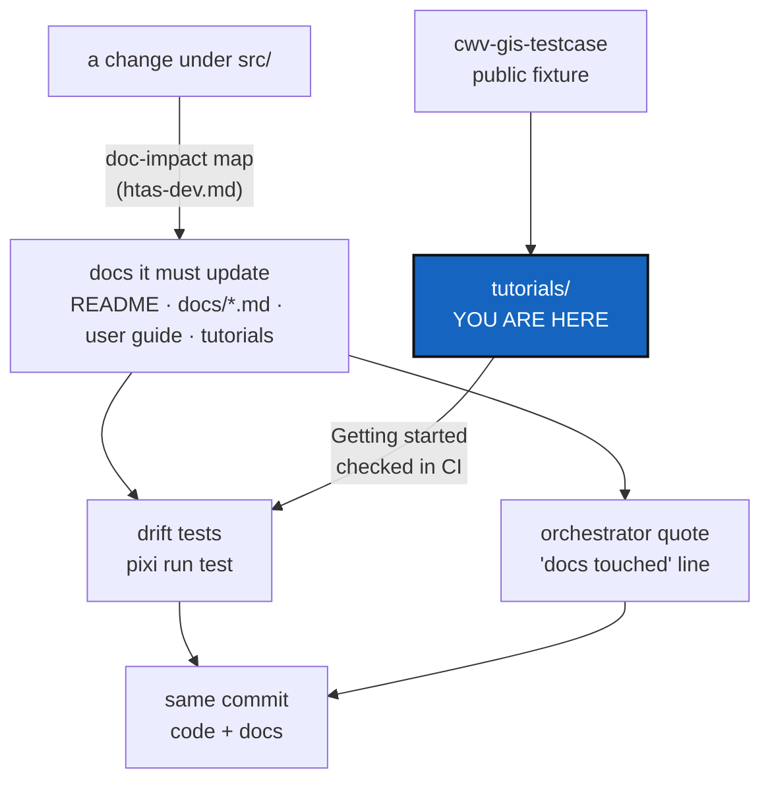

# DocsOnTheFly — every change updates its docs and README, and HTAS gets a tutorial section

*Created: 2026-11-19*

*Branch: HT-BETA*

## Abstract — read this first

**The one-line version.** Make the documentation keep up with the code
*in the change that moves it*, not in a later sweep. Each source area gets
the documents it must update, tests fail when a document has drifted, and
the orchestrator's quote checks it. Then add `tutorials/`, a worked tutorial
section at the repository root, built on the public CaWaQS test case.

**What this document is.** The request (§1), what exists today and how it
has drifted (§2), the design (§3), the work in three milestones (§4), the
decisions for the owner (§5), and acceptance (§6).

**Why it exists.** The README already describes files that are gone
(`ht/persistence.py`, `accessors.py`, `operations.py`), and still says that
no API stability is guaranteed, although HTAS has been on SemVer since 1.0.0.
Nothing caught either one. Step 7 of the checklist names two API documents
and nothing else. HTAS also has no tutorial: a new user meets either a
notebook in CaWaQS-ViZ or the API reference.

**What you need to do with it.** Pile 1, rank 2. Ask §5 before the first
edit. D1 decides what this ticket takes from HtasCli's M4; settle it first,
because it changes both tickets.

---

## 1. The request

The owner, 2026-11-19: *write a DevPlanTicket for updating docs and README
on the fly and develop a tutorial section.* It is filed, closed, as
`archive/.closedUserTicket/20261119_docs_on_the_fly.md`.

"On the fly" is read here as **in the same change, every time**. The
alternative reading, documents generated from the code, is option (b) of D2.

## 2. What exists today

**What the documents are.**

| Document | Audience | State |
|---|---|---|
| `README.md` | the user's front page | *Repository Structure* names `ht/persistence.py`, `accessors.py` and `operations.py`, which do not exist (`audit.md` #4). *Status* says "No long-term API stability", which contradicts SemVer 1.x. It has no `cli/` and no tutorial. Its *Developer Workflow* (submodule recipes) is aimed at developers, not users. |
| `docs/api_capabilities.md`, `docs/api_examples.md` | API users | Hand-written lists of methods and `kind`s. Nothing checks them against `HydrologicalTwinClient` or `dispatch.py`. HtasCli M1 added a CLI section. |
| `docs/canonical_monolith.md`, `domain_model.md`, `whitepaper.md`, `TODO.md` | developers, scientists | They predate DOCSTYLE (no abstract, no graph). CLAUDE.md says bring one up to date when a change rewrites it. |
| `docs/hydrological_twin/` | user guide (LaTeX, its own repository) | Its `\version` is written by `bump-version` and tested (`test_user_guide_version_matches`). Nothing else in it is checked. |
| `tests/README.md` | developers | Documents the public fixture `cwv-gis-testcase` (`gitlab.com/cawaqs/gtest/testcases`, sparse clone) and `CWAQS_FIXTURE_ROOT`. |

**What enforces documentation today.** `htas-dev.md` step 7: document a new
public method in the two API documents and in the user guide "when a user
sees it". There is one test, on the version. The orchestrator's quote has no
documentation line apart from step 7.

**What HtasCli already plans** (its M4): `tutorials/` with six CLI
tutorials, a CLI chapter in the user guide with a test that every command
is named in it, the README rewritten around use cases, `audit.md` #4, and
step 7 reworded. Without D1, the two tickets would each do this work.

**The model.** ComplexGitSync's `tutorials/`: an index (`README.md`) and
eight numbered tutorials. Each one opens with an abstract and a graph, then
*Getting started* (the commands alone, about twenty lines), then the
explanation. The root README lists use cases with their tutorial and never
lists commands. The user guide is the reference.

## 3. The design

**3.1 The doc-impact map.** A table in `htas-dev.md` (the checklist's
fill-in) that maps each source area to the documents a change there must
update in the same commit:

| A change to | Updates |
|---|---|
| `ht/client/` (a method, a `*Result`) | `docs/api_capabilities.md`, `docs/api_examples.md`, the user guide, the tutorial that uses it |
| `ht/developer/` (a verb, a `kind`) | the same two API documents, `docs/canonical_monolith.md` when a verb changes |
| `cli/` (a command, an option) | the user guide's CLI chapter, the tutorial that uses it |
| a package added, moved or removed | README *Repository Structure* and its diagram, `AdditionalSpecs.md` §2 |
| a new use case | a README row and a tutorial |
| `pixi.toml` tasks, the install | README *Getting Started*, the tutorials' *Getting started* blocks |

Step 7 becomes "update every document the doc-impact map names for this
change". `CLAUDE.md` and `digest.md` say the same in one line.

**3.2 Drift tests** (`tests/unit/test_docs_sync.py`), each one cheap and
needing no data:

- every `src/…` path and module name the README states exists;
- every public `HydrologicalTwinClient` method, and every L2 verb and
  `kind`, is named in `docs/api_capabilities.md`;
- the README holds no method or command table (a Markdown table whose first
  column is a list of method or command names);
- every file in `tutorials/` is in the index, and every index entry exists;
- every tutorial opens with an abstract, a graph and *Getting started*;
- every command in a *Getting started* block is checked as D4 says;
- relative links in `README.md`, `docs/*.md` and `tutorials/*.md` resolve.

**3.3 The quote.** The orchestrator's quote gets a *Docs touched* line: the
documents the map names for the diff, and whether each was updated. A
missing one is a blocking defect.

**3.4 The tutorial section.** `tutorials/` at the repository root, with an
index as ComplexGitSync's. Every tutorial runs on the public
`cwv-gis-testcase` (D3) and opens with *Getting started*. The tutorials
cover what a user can already do, through the Python API (D5). HtasCli adds
the CLI tutorials as each of its milestones lands. A proposed first set:

1. **First twin**: fetch the test case, detect, build the twin with
   `FileGeoProvider`, describe it.
2. **Water budget and the hydrological regime**: `budget_barplot`,
   `hydrological_regime`.
3. **Maps**: `spatial_map_watbal`, `spatial_map_aq`.
4. **Simulation against observations**: `compare_sim_obs`,
   `statistical_criteria`.
5. **Masks**: internal values, the HYD boundary, the AQ boundary, and the
   GeoPackage outputs.
6. **The developer surface**: `fetch`, `transform`, `render`, `export` by
   `kind`.

The README gets a *Use cases* table, with one row per use case and its
tutorial, and no command list.

## 4. The work — three milestones

Each milestone is one `implement`. Each ends with lint showing no new
error, tests green, `cgitsync status` at `errors=0`, the orchestrator's
quote and its own commit message. M1 and M2 change no file under `src/`, so
they bump no version unless D2 (b) adds a script under `src/`.

1. **M1 — the rule and the drift tests.** Add the doc-impact map, the new
   step 7, the line in `digest.md` and `CLAUDE.md`, and the *Docs touched*
   line in the orchestrator's brief (`AGENT.md`). Add the drift tests of
   §3.2 that need no tutorials. Fix the drift those tests find on day one:
   README *Repository Structure* and its diagram (`audit.md` #4, closed
   here), and the *Status* section (D6).
2. **M2 — the tutorial section.** Add `tutorials/README.md` (the index), the
   tutorial template, tutorial 1, the README *Use cases* table, the
   tutorial drift tests, and the *Getting started* check (D4). Add
   `tests/README.md`'s fixture recipe, shared by the tutorials and not
   repeated in each one.
3. **M3 — the remaining tutorials** (2 to 6), each one checked by the M2
   tests. When D7 says so, also bring each public `docs/*.md` the tutorials
   link to up to DOCSTYLE.

## 5. Decisions for the owner

- **D1. What this ticket takes from HtasCli's M4.**
  - (a) All of it. HtasCli ends at M3, and this ticket writes the CLI
    tutorials and the CLI chapter of the user guide as well.
  - (b) The rule, the tests, the tutorial section and the Python
    tutorials. HtasCli M4 shrinks to its CLI tutorials and the user guide's
    CLI chapter, written inside the section this ticket builds.
  - (c) None. This ticket stops at the rule and the tests (M1), and HtasCli
    M4 builds the tutorial section.
- **D2. How the documents keep up.**
  - (a) Hand-written documents, with drift tests that fail CI.
  - (b) Generated blocks between markers (the method and `kind` lists in
    `api_capabilities.md`, the README structure), rewritten by
    `pixi run sync-docs`. A test fails when a block is out of date.
  - (c) Both: generated blocks where a list is mechanical, drift tests for
    the rest.
- **D3. The tutorials' data.**
  - (a) The public `cwv-gis-testcase`, fetched by a sparse clone in each
    *Getting started*, as `tests/README.md` does.
  - (b) The same dataset, mounted by the developer install
    (`.config/htas-dev-beta.cgs`) and fetched by hand by an end user.
  - (c) A smaller synthetic case committed under `tutorials/data/`.
- **D4. How CI checks the tutorials.** HtasCli's D7 chose "parse against the
  registry" for CLI commands. For Python blocks:
  - (a) compile only (`compile()` of each block);
  - (b) run them on the fixture when `CWAQS_FIXTURE_ROOT` is set, and
    compile them when it is not;
  - (c) run them on the fixture always, with CI fetching it.
- **D5. Python first, or wait for the CLI.** Write tutorials 1 to 6 against
  the Python API now, and give each one its CLI spelling when HtasCli M2 and
  M3 land. Or write them for the CLI only, after HtasCli M2.
- **D6. The README's *Status* section.** "No long-term API stability" is
  false under SemVer 1.x. Rewrite it to say what SemVer promises from 1.0.0.
  Or keep the AlphaSeries wording and say that SemVer measures the public
  interface only.
- **D7. The public `docs/*.md`.** Bring `canonical_monolith.md`,
  `domain_model.md`, `api_capabilities.md` and `api_examples.md` up to
  DOCSTYLE in M3. Or keep CLAUDE.md's rule that a document is brought up to
  date only when a change rewrites it.
- **D8. The README's *Developer Workflow*.** Move it (the CaWaQS-ViZ
  submodule recipes) to a `docs/` page for developers and keep the README for
  users. Or leave it where it is.

## 6. Acceptance

- `htas-dev.md` holds the doc-impact map, and step 7 points to it.
  `digest.md` and `CLAUDE.md` state the rule in one line each. The
  orchestrator's brief has the *Docs touched* line.
- `tests/unit/test_docs_sync.py` exists and passes. It fails when a test
  deliberately breaks one of §3.2's checks (a README path, an undocumented
  `kind`, an unindexed tutorial).
- The README names no file that does not exist, holds no method or command
  table, and lists use cases with their tutorial. `audit.md` #4 is closed.
- `tutorials/` exists, with an index and the tutorials M2 and M3 deliver.
  Each opens with an abstract, a graph and *Getting started*, and passes the
  D4 check.
- HtasCli agrees with D1, and its M4 says what it still owns.
- `pixi run lint` shows no new error, `pixi run test` passes, and
  `cgitsync status` shows `errors=0`.
