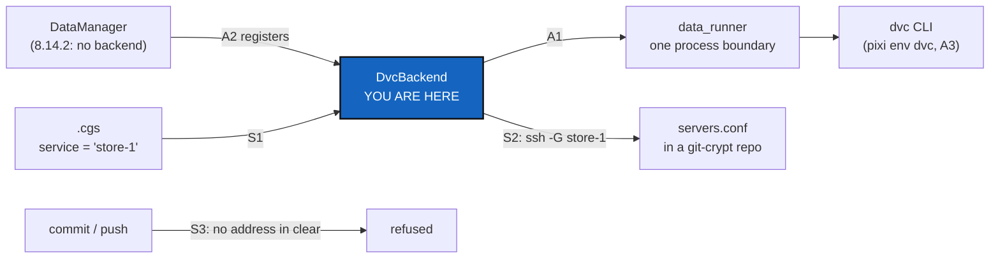

# DvcBackend — `dvc` is registered, runs through one process boundary, and reaches its server by an alias

*Created: 2026-11-27*

*Branch: HT-BETA*

> **Ticket review — 2026-11-27, on the owner's request** *"shortTicket review and write DevPlanTickets in a proper
> order of execution. Merge paralell tasks in the same tickets. The goal is a CGS-HT-BETA ready for htbs."* This
> ticket merges two pieces of work that can run side by side:
> - **Part A**, the part of DataBackendContract that 8.14.2 did not build. That is WP-B1 (the process boundary),
>   WP-B3 (`DvcBackend`) and WP-B5 (the optional `dvc` Pixi feature and its CI job), plus registering `dvc` with
>   `DataManager`. It also carries the first half of the short ticket
>   [dvc-backend-registration](../archive/.closedUserTicket/20261127_dvc-backend-registration.md). The other half
>   (running the phases in `push`, `pull`, `status` and `release freeze`) is DataRoundTrip.
> - **Part B**, DataServerAddress (filed 2026-11-25 as `data-repo_2-16`), whose file this ticket replaces. Its
>   analysis is kept word for word as §B1–§B6. Its decisions are renamed SD1–SD5, and its step 0 now points to
>   MergeDataEncrypt. Part B also carries the short ticket
>   [data-service-remote](../archive/.closedUserTicket/20261127_data-service-remote.md). That ticket asks that the
>   `.cgs` declare the data service, that the `.gts` State record it, and that the install check the remote is
>   reachable. Option C (§B2) answers the first two with the alias. Step S5 answers the third.
>
> It needs MergeDataEncrypt, because step S3 reuses `GitCrypt` and `EncryptionGuard`.

## Abstract — read this first

**The one-line version.** In 8.14.2 a repository can declare `data = { backend = "dvc" }`, and `DataManager`
answers `UNSUPPORTED`, because no backend is registered. This ticket registers `DvcBackend`, which runs DVC through
one process boundary, from an optional Pixi environment. It lets a repository name its DVC server by an SSH alias,
`service = "<alias>"`, whose address never appears in any file cgitsync writes.

**What this document is.** Two parts. Part A is the backend, written here. Part B is the server alias, carried
from DataServerAddress. The steps are in §3, the decisions in §5.

**Why it exists.** HTBS's first twin, `gitlab:htas1/ht-synthcase-1`, keeps its results under DVC on a VPS reached
over SSH. Today every DVC step is typed by hand around cgitsync, and the remote is written by hand in
`.dvc/config`. HTBS will have several such spaces, one per twin plus a gate space, each with its own remote.
Nothing in DataRoundTrip can run until a backend exists and knows where its remote is.

**Who it is for.** The worker and orchestrator, and the owner, who answers §5.

**What you need to do with it.** Answer §5. Then take steps A1, S1 and S3 in parallel, then A2 and S2, then A3, S4
and S5.

---

## 1. What 8.14.2 already holds

- `tree/data_manager.py`: `DataManager`, the `DataBackend` protocol (the nine phases of DataBackendContract §1), a
  registry by `data.backend` name that is empty, a dry run that calls only `inspect(offline=True)` and planning
  methods, `version()` asked once per manager, and `ArgvScrubber` on every result.
- `tree/data_command.py` (`DataCommand` as an enum, DataBackendContract D4), `tree/data_result.py` (the eight
  states, which never flatter).
- `git_repo/data_spec.py`: `DataSpec` with `backend = "dvc"` only. `git-lfs` is reserved; `service` and `paths` are
  refused as not implemented, `service` with the words *"waits for DataArchitecture §7 C2"*. No ticket has that
  section. Step S1 replaces the reference.
- A fake backend in the tests proves the dispatch is backend-neutral. The client holds the manager as the seam.
- No process is started, and no DVC module exists.

## 2. Part A — the backend

The design is DataBackendContract §1–§4 and is not restated. That ticket's D3 is the owner's answer of 2026-11-25:
`DataManager` never imports a backend. D6 is the owner's answer of 2026-09-16: `version()` is asked once, and is
`none` when DVC is missing. Both bind here.

**A1. The process boundary (WP-B1).** Where DVC's processes start is D1. Whatever the answer: argument arrays, an
explicit `cwd=repo.root`, a timeout and cancellation for transfers, failures that carry the repository and the
phase, a non-interactive environment, and no process from `cli/`, `cgs_format.py` or `git_tree.py`. The digest's
rule *"`git_runner.py` is the sole module allowed `import subprocess`"* either holds as it is (D1, options b and
c) or becomes a rule about two named modules (D1, option a). Then the digest, AdditionalSpecs and
`check_oo_conformance.py` change in the same commit.

**A2. `DvcBackend` and its registration (WP-B3).**
- `tree/dvc_backend.py` (or `tree/data/dvc_backend.py` if `tree/` passes its ceiling): the nine phases against the
  DVC CLI, each failure named. The DVC verbs behind them: `inspect` → `dvc status` (offline) and `dvc status -c`
  (online), `prepare_staging` → `dvc add`, `pre_git_commit` → `dvc commit`, `materialize` → `dvc pull`,
  `publish` → `dvc push`, `verify_release` → `dvc status -c` on the frozen revision.
- **Registration without an import in `DataManager`:** the client registers `"dvc"` by a name and a factory, so
  `tree/dvc_backend.py` is imported only when a repository declares `dvc`. A Git-only tree never imports it, and a
  test asserts it (DataBackendContract §7).
- `dvc` missing on the machine: one result per repository, `UNSUPPORTED`, naming the repository and the `dvc` Pixi
  environment. There is no traceback, no install attempt, and no probe when no repository declares data.
- The `DataManager` docstring and `DATA_BACKENDS` comment lose *"until the DvcBackend ticket registers one"*.

**A3. DVC as an optional Pixi feature (WP-B5).** DataBackendContract §4: `[feature.dvc.dependencies] dvc =
">=3.67,<4"`, an environment `dvc`, and the default environment without DVC. CI runs the default suite and,
separately, the DVC-marked tests in the `dvc` environment. The pin is checked against conda-forge on the day and
recorded (D2).

## 3. Steps, in order

S1–S4 are §B3's steps 1–4; S5 is new.

| Wave | Step | Needs |
|---|---|---|
| 1 | **A1** the process boundary; **S1** `DataService`, the alias in `DataSpec`; **S3** the refusal of an address in clear | MergeDataEncrypt (S3) |
| 2 | **A2** `DvcBackend` and its registration; **S2** `DvcBackend` binds the alias | A1; A2 for S2 |
| 3 | **A3** the `dvc` feature and the CI job; **S4** docs and the test tree; **S5** the install reports the remote | A2, S2 |

**S5. The install says whether each data remote answers** (short ticket `data-service-remote`). At the end of
`bootstrap` and `initialise`, each repository that declares `data` is asked `inspect(offline=False)` through
`DataManager`. The verdict joins the end-of-install report: `READY`, `REMOTE_UNAVAILABLE` naming the alias and the
`Include` line, or the locked-snippet hint. An unreachable remote does not stop the install (D3). The install still
ends `READY` for Git, and the line says what is missing for data. A restore on another machine therefore needs
only the snippet. The State already pins the alias (S1) and, through the repository's commit, `.dvc/config`'s
`ssh://<alias>/<path>`.

## 4. Acceptance

Part A:
- A Git-only tree never imports `dvc_backend`, never probes for `dvc`, and its outputs and States are unchanged
  byte for byte.
- In the `dvc` environment, a repository declaring `dvc` answers `inspect` from real DVC: a test makes a tiny DVC
  repository with a local filesystem remote.
- In the default environment, the same repository answers `UNSUPPORTED`, naming the repository and the `dvc`
  environment.
- Every process call is an argument array with `cwd=repo.root`; a test inspects the command built.
- `version()` is asked at most once per process, and is `none` with DVC missing.
- CI shows two jobs, default and `dvc`, both green.

Part B: §B4 below, unchanged, plus S5. An install with no snippet ends `READY` and names the alias as
`REMOTE_UNAVAILABLE`. With the snippet, it says the remote answers. Neither output holds the address.

Both: `pixi run lint`, `pixi run test`, `pixi run check-ceilings`, and `cgitsync status` with `errors=0`.

## 5. Decisions for the owner

**Part A.**

- **D1. Where does the data subprocess live?** DataBackendContract D1, still open. (a) `data_runner.py` beside
  `git_runner.py`, a second named `subprocess` importer. (b) The same policy inside `DvcBackend`. (c) Extend
  `git_runner.py` with a generic runner that Git and DVC both use. That ticket recommended (a). This review notes
  that (c) keeps the digest rule as it is, word for word, at the cost of `git_runner.py` growing by a policy that is
  not Git's.
- **D2. The DVC pin.** DataBackendContract D5: confirm `>=3.67,<4` on the day, and record the version the tests ran.
- **D3. An unreachable data remote at install: report it, or refuse the install?** Recommended: report it. A
  laptop on a train must still install the Git tree, and DataRoundTrip refuses the commands that would publish or
  freeze without the data.
- **D4. Where does `DvcBackend` live, if `tree/` is near its ceiling?** Recommended: `tree/dvc_backend.py` now, and
  a `tree/data/` package only when the module-shape rule asks for it.

**Part B.** SD1–SD5 in §B5 below. SD4 (branch and merge order) has a new answer to confirm: this review puts the
work on `HT-BETA`, after MergeDataEncrypt, which is the order SD4 recommended with `HT-BETA` in place of
`data-repo`.

---

# Part B — DataServerAddress (filed 2026-11-25), carried word for word

The text below is DataServerAddress's §1–§6, with its sections renumbered §B1–§B6, its decisions D1–D5 renamed
SD1–SD5, and its step 0 updated. Its original banner said: *from the owner's short ticket server-ip (2026-11-25):
`data-repo` develops the data class that couples DVC with a server and links it to the Git tree. The owner asks
whether the server's addresses (IPv4, IPv4 gateway, IPv6, IPv6 gateway, reverse DNS from the server provider) go
into the `.cgs` in clear, or into a register encrypted with the `data-encrypt` work. The owner prefers encrypted
addresses.*

## B1. Which of the five addresses a tree needs

A client connecting to the server needs **one** of them, never all five.

| Field from the provider | Does a client use it? | Store it? |
|---|---|---|
| IPv4 | Yes. It is the address DVC's SSH connects to. | Yes, encrypted (§B2) |
| IPv6 | Only when the client's network has IPv6. | Optional, encrypted, as a second `Host` |
| IPv4 gateway | **No.** It is the server's own route out, set on the server. | Never |
| IPv6 gateway | **No.** Same reason. | Never |
| Reverse DNS | It can stand in for the IP, but it does not hide it. Providers build it from the IP. An OVH-style name like `ns3012345.ip-51-68-12.eu` spells out three of the four bytes, and resolving it gives the whole IP. | Never |

Encrypting the IP while the reverse DNS name stays in clear protects
nothing. The rule therefore covers every address and every hostname that
reveals one, not only the IP.

**What encryption buys, and what it does not.** An IP address is not a
secret the way a key is. Every router between client and server sees it,
and the whole IPv4 space gets scanned constantly. Keeping it out of the
shared repositories still has a real use: nobody who reads the trees can
link the owner's projects to one machine. That is the same goal as
AnonymousProject on `data-encrypt`. But **the server's security is its SSH
configuration, not its address**: key-only login, no password and no root
login, a firewall and a ban on repeated failures. This ticket covers the
first goal and only names the second. §B6 lists the second as out of scope.

## B2. Where the address goes — the answer to the short ticket

| Option | What it means | Verdict |
|---|---|---|
| **A. In clear in the `.cgs`** | `service = { host = "51.68.12.34" }` | **Refused.** `.cgs` → `.gts` → State → memory copies it into append-only history, in shared repositories. |
| **B. An encrypted register that cgitsync reads** | A git-crypt repository holds `servers.toml`. cgitsync decrypts it to read the address. | **Refused.** cgitsync would have to read secrets, but EncryptedRepos settled that cgitsync never unlocks and never handles a key. A locked tree could not resolve anything. |
| **C. An alias in the `.cgs`, resolved by SSH, with the snippet kept in git-crypt** | The `.cgs` says `service = "store-1"`. The DVC remote is `ssh://store-1/<path>`. `~/.ssh/config` has `Include` of a `servers.conf` that lives under `data/**` in a private git-crypt repository of the tree. | **Recommended.** The owner gets the encrypted register they want, through `data-encrypt`. cgitsync and DVC only ever see the alias. SSH, which the owner already trusts with the key, is the only thing that reads the address. |

Option C gives the owner encrypted addresses, as the short ticket asks. The
encryption is git-crypt's, as built on `data-encrypt`. cgitsync adds no
cipher and no key handling of its own.

**Where the DVC remote is written.** DVC reads its remote from `.dvc/config`
(committed) and `.dvc/config.local` (never committed). With option C,
`.dvc/config` can be committed safely, because it holds `ssh://store-1/…`.
An IP literal in it is refused (§B3, step 3).

## B3. Steps

0. **Dependency on `data-encrypt`.** Satisfied by MergeDataEncrypt, which brings EncryptedRepos E1 and E2
   (the plaintext refusal under a `filter=git-crypt` path and the `CRYPT` column) into `HT-BETA` before this
   ticket starts. Step 3 reuses that detection.
1. **`DataService`: the class that couples DVC, the server and the tree.**
   - **Where:** `git_repo/data_spec.py`, ring 0, pure, no I/O. `DataSpec`
     gains `service: str | None`.
   - **Value:** the `service` key leaves `RESERVED_KEYS`. Its value is an
     **alias**: one SSH `Host` token matching `[A-Za-z0-9][A-Za-z0-9_-]*`.
     Dots, colons, `@` and digits-only labels are refused offline. That one
     rule rejects an IPv4 or IPv6 literal, a `user@host` and an FQDN such as
     a reverse DNS name, each with its own message.
   - **Round trip:** `to_cgs` writes it back, and the `.gts` `repo_state`
     carries the alias, never anything more.
   - **Optional `path`:** a path on the server (`service = { alias =
     "store-1", path = "/srv/dvc/forcing" }`) only if SD2 says the path
     belongs in the `.cgs`. Otherwise it stays in `.dvc/config`.
2. **`DvcBackend` binds the alias.**
   - **Check:** `inspect` checks that the DVC remote URL's host is the
     declared alias.
   - **Probe:** `inspect(offline=False)` asks `ssh -G <alias>`, through
     `git_runner.py`'s one subprocess boundary or the backend runner that
     DataBackendContract allows. It checks that the alias resolves to a
     `hostname` other than itself, which means a snippet is present. It
     **never keeps, prints or logs** the hostname it read: the output is
     parsed and dropped in the same call, and `DataManager._scrub` already
     scrubs backend lines.
   - **No snippet:** an unresolved alias is `REMOTE_UNAVAILABLE`, naming
     the alias and the `Include` line to add. It is never an error that
     shows an address.
   - **Locked tree:** a locked git-crypt snippet repository gives the same
     verdict, with the hint "unlock `<repo>`". That is the EncryptedRepos
     wording.
3. **Refuse an address in clear, with no override.** This is the same
   family as EncryptedRepos E1.
   - **`commit` and `push`** refuse a staged or outgoing `.cgs`, `.gts`,
     `.dvc/config` or `pixi.toml` that holds an IPv4 literal, an IPv6
     literal, or a hostname under a provider reverse-DNS pattern. D3 fixes
     the list of files.
   - **The message** names the repository, the file and the line number. It
     does not repeat the address.
   - **A file under a `filter=git-crypt` path is exempt**, because it is
     ciphertext once pushed. Its plaintext check is E1's job.
   - **Where:** the check is a preflight diagnostic in `tree/operations/`,
     and the pattern lives in one ring-0 helper, which the memory writer
     also uses (below).
   - **Memory:** the writer refuses to record an address in any field, as a
     last line of defence.
4. **Docs and the test tree.**
   - **User guide:** a section, *Naming a data server*, with the alias, the
     `Include` line and the git-crypt repository holding `servers.conf`.
   - **Test tree:** `examples/` gets a data entry with a `service` alias.
   - **CGSenc:** CGSenc-data gets a synthetic `data/servers.conf`
     (`HostName 192.0.2.10`, from the TEST-NET-1 documentation range, never
     a real address).
   - **Specs:** AdditionalSpecs (data section) and the digest get the rule
     "no server address in any file cgitsync writes".

## B4. Acceptance

- `data = { backend = "dvc", service = "store-1" }` parses, writes back
  unchanged, and reaches the `.gts` as `service = "store-1"`.
- `service` set to `"51.68.12.34"`, `"2001:db8::1"`, `"me@store-1"` or
  `"ns3012345.ip-51-68-12.eu"` is refused offline, each with its own reason.
- A `.cgs`, `.gts` or `.dvc/config` holding an IP literal is refused by
  `commit` and by `push` (for a commit made outside cgitsync). The same
  file under a git-crypt path in an unlocked tree passes.
- With no `Include`, `status` shows the data repository as
  `REMOTE_UNAVAILABLE` naming the alias. With the snippet present, it is
  available. Neither output holds `192.0.2.10`: a test greps stdout, stderr,
  the `.gts`, the State and the ledger for it.
- A Git-only tree is unchanged, byte for byte. `pixi run lint`,
  `pixi run test` and `pixi run check-ceilings` pass.

## B5. Decisions for the owner (SD1–SD5)

### SD1. Option C: an alias resolved by SSH, with the snippet in git-crypt?

Recommendation: **yes**. It is the only option that gives encrypted
addresses (as asked) and keeps cgitsync away from secrets (as EncryptedRepos
settled). The alternative that keeps encryption is option B. It makes
cgitsync read decrypted files and fail in every locked tree.

### SD2. Does the path on the server belong in the `.cgs`?

Recommendation: **no**. Keep `service` a bare alias, and leave the path in
`.dvc/config` (`ssh://store-1/srv/dvc/forcing`). A path like `/srv/dvc/…` is
less sensitive than an address. Still, it describes the server, and DVC
already owns the remote, as DataArchitecture §2 says.

*Ticket review 2026-11-27:* the short ticket `data-service-remote` asks that a State say where the bytes
are. With the path in `.dvc/config`, the State already pins it, through the repository's commit. A restore then
needs only the SSH snippet, which is the point of option C. The recommendation stands.

### SD3. Which files does step 3 scan, and which patterns count as an address?

Recommendation:
- **Files:** `.cgs`, `.gts`, `.dvc/config` and `pixi.toml`.
- **Patterns:** an IPv4 or IPv6 literal, and any hostname matching
  `ip-\d+-\d+-\d+`. The TEST-NET and `2001:db8::/32` documentation ranges
  are allowed, so docs and tests can show an example.

Scanning every tracked file would refuse legitimate data.

### SD4. Branch and merge order with `data-encrypt`?

Recommendation:
- **Branch:** `data-repo`, because the work is DataManager/DVC. *Ticket review 2026-11-27: no `data-repo` branch
  was ever pushed, and DataSchema and DataBackendContract landed on `HT-BETA`. So this review proposes `HT-BETA`.*
- **Order:** merge `data-encrypt` into `data-repo` first (*now MergeDataEncrypt, into `HT-BETA`*), so step 3 reuses
  E1's git-crypt detection instead of writing a second one.

The other way is to land steps 1 and 2 now, and step 3 after the merge.

### SD5. SSH only?

Recommendation: **yes, for now**. DVC also speaks S3, WebDAV and HTTP, but
the owner's server is reached over SSH, and only SSH has an alias mechanism
that keeps the address outside every file. Any other transport is refused
by name, as `git-lfs` is.

## B6. Out of scope

- Hardening the server itself (SSH keys only, firewall, bans). It matters
  more than hiding the address, and it is the owner's machine, not
  cgitsync's.
- Generating, holding or unlocking any key. Unlocking stays the consuming
  project's job (PATRIMOINE's `pixi run decrypt`).
- Credentials of any kind in any file cgitsync writes (DataArchitecture §5,
  unchanged).
- Provisioning the DVC remote on the server.
